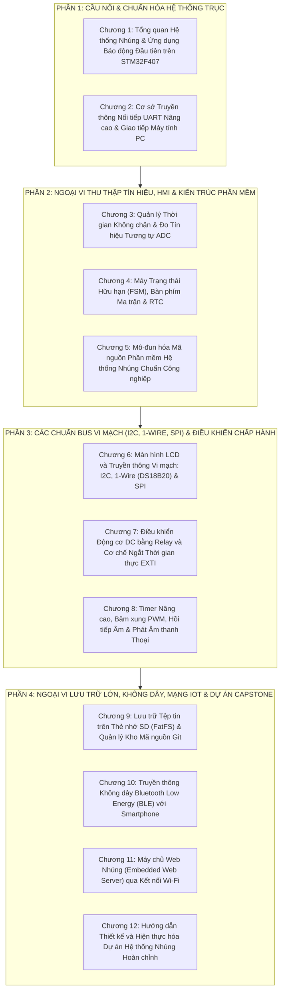

# ĐỀ CƯƠNG CHI TIẾT HỌC PHẦN: ĐIỀU KHIỂN THIẾT BỊ NGOẠI VI
### (MICROCONTROLLER PERIPHERAL INTERFACING & SYSTEM DESIGN)
**Chuyên ngành đào tạo:** Kỹ thuật Điện tử / Kỹ thuật Điện tử - Viễn thông / Kỹ thuật Cơ điện tử / Tự động hóa  
**Trình độ đào tạo:** Đại học chính quy  
**Vị trí học phần:** Học phần chuyên ngành cốt lõi, **học ngay sau học phần Vi điều khiển cơ bản (STM32F407 nền tảng - đã học đến phần UART cơ bản)**.  
**Phần cứng mục tiêu:** Vi điều khiển 32-bit ARM Cortex-M4 (**STM32F407VGT6 / STM32F407VET6** @ 168 MHz)  
**Tài liệu tham chiếu chuẩn:** *A Beginner's Guide to Designing Embedded System Applications on Arm Cortex-M Microcontrollers* (Arm Education Program, 12 Chapters)  
**Thời lượng:** 3 tín chỉ (45 giờ tiếp xúc trực tiếp = 15 buổi $\times$ 3 giờ/buổi theo mô hình Lớp học tích hợp Studio Lý thuyết - Thực hành)  

---

## I. MỤC TIÊU VÀ SỨ MỆNH CỦA HỌC PHẦN

### 1. Phân định ranh giới đào tạo (Curriculum Boundary)
- **Học phần Tiên quyết (Đã hoàn thành trước khi vào môn này):**
  - Sinh viên đã nắm được kiến trúc vi điều khiển STM32F407: Lõi ARM Cortex-M4, các khối nhớ Flash/SRAM, hệ thống cấp xung nhịp RCC cơ bản.
  - Đã làm chủ cổng vào/ra GPIO cơ bản (nhấp nháy LED, đọc nút bấm đơn).
  - Đã biết cấu hình Timer cơ bản để tạo trễ và đo thời gian.
  - Đã thực hành truyền thông nối tiếp UART cơ bản (truyền/nhận ký tự và chuỗi đơn giản với máy tính PC).
- **Học phần "Điều Khiển Thiết Bị Ngoại Vi" (Học phần hiện tại):**
  - **Mục tiêu tối thượng:** Đưa sinh viên bước vào **thế giới ngoại vi thực tế xung quanh** để tự tay phân tích, thiết kế mạch, lập trình điều khiển và đo kiểm tín hiệu nhằm **xây dựng một hệ thống nhúng hoàn chỉnh**.
  - **Phương pháp luận:** Đi từ **Cơ sở lý thuyết & Mạch điện tử nguyên lý (Schematic) $\rightarrow$ Phân tích thanh ghi & Cấu hình phần cứng STM32F407 $\rightarrow$ Thực hành vận dụng trên mã nguồn chuẩn mực $\rightarrow$ Đo kiểm bắt dạng sóng thực tế trên Logic Analyzer / Oscilloscope**.
  - **Dự án trục xuyên suốt:** Bám sát mô hình **Hệ thống Báo động & Giám sát Nhà Thông minh (Smart Home System)** qua 12 chương của tài liệu ARM Education, nâng cấp và tích hợp toàn diện trên STM32F407.

---

## II. CHUẨN ĐẦU RA HỌC PHẦN (COURSE LEARNING OUTCOMES - CLOs)

| Mã CLO | Mô tả Chuẩn đầu ra (Theo thang đo Bloom & Chuẩn CDIO/ABET) | Mức Bloom | Chuẩn CDIO |
| :--- | :--- | :---: | :---: |
| **CLO 1** | Phân tích được các chuẩn giao tiếp vi mạch và ngoại vi công nghiệp: **UART, $I^2C$, SPI, 1-Wire**; giải thích được cơ chế vật lý, giản đồ thời gian micro-giây và giao thức truyền nhận. | C4 (Phân tích) | 1.2, 1.3 |
| **CLO 2** | Tính toán và thiết kế được sơ đồ mạch nguyên lý (Schematic) ghép nối ngoại vi: Điện trở hạn dòng, mạch đệm transistor, cách ly quang Optocoupler, diode dập xung ngược cuộn cảm ($V = -L \frac{di}{dt}$), mạch lọc RC chống rung/lọc âm thanh, và điện trở kéo lên ($R_p$). | C4 (Phân tích) | 2.1, 3.1 |
| **CLO 3** | Lập trình thành thạo khối ADC đa kênh kết hợp kỹ thuật quản lý thời gian không chặn (Non-blocking Superloop) để thu thập dữ liệu từ cảm biến tương tự (Nhiệt độ LM35, Biến trở, Khí gas MQ-2, Quang trở LDR) và cảm biến kỹ thuật số 1-Wire (DS18B20). | C3 (Áp dụng) | 2.1, 3.2 |
| **CLO 4** | Ứng dụng mô hình Máy trạng thái hữu hạn (FSM) và khối thời gian thực RTC để xây dựng giao diện người - máy (HMI) tin cậy với bàn phím ma trận $4\times 4$ và màn hình ký tự/đồ họa (LCD 16x2, OLED SSD1306). | C4 (Phân tích) | 2.2, 3.2 |
| **CLO 5** | Làm chủ khối ngắt lồng nhau NVIC, ngắt ngoài EXTI và bộ định thời Timer/PWM để điều khiển cơ cấu chấp hành công suất: Cầu 2 Relay đảo chiều động cơ DC, điều chế độ sáng/màu sắc LED RGB, và phát âm thanh thoại cảnh báo từ Flash. | C4 (Phân tích) | 2.2, 3.3 |
| **CLO 6** | Tích hợp thành công các phân hệ ngoại vi nâng cao: Hệ thống lưu trữ tệp tin trên Thẻ nhớ SD (FatFS), truyền thông không dây Bluetooth Low Energy (BLE) với Smartphone, và Máy chủ Web nhúng (Embedded Web Server) qua Wi-Fi ESP8266. | C5 (Đánh giá) | 2.3, 3.2 |
| **CLO 7** | Thiết kế, chế tạo, đo kiểm và bảo vệ thành công một sản phẩm nhúng điều khiển ngoại vi tổng hợp hoàn chỉnh (Capstone Project) theo nhóm, lập hồ sơ kỹ thuật chuẩn mực. | C6 (Sáng tạo) | 4.3, 4.4, 4.5 |

---

## III. MA TRẬN 12 CHƯƠNG GIÁO TRÌNH CHUẨN HÓA TRÊN STM32F407

---

## IV. BẢNG TÓM TẮT NỘI DUNG 12 CHƯƠNG CHI TIẾT

| Chương | Tên Chương | Trọng tâm Cơ sở Lý thuyết & Phần cứng Điện tử | Trọng tâm Thực hành & Ngoại vi STM32F407 |
| :---: | :--- | :--- | :--- |
| **01** | **Tổng quan Hệ thống Nhúng & Ứng dụng Báo động Đầu tiên** | - Khái quát hệ thống nhúng điều khiển ngoại vi. - Kiến trúc Cortex-M4, Bus Matrix STM32F407 (AHB1/2, APB1/2). - Tầng ngõ ra Push-Pull/Open-Drain; Tính trở hạn dòng LED. | - Thiết lập dự án trục Smart Home System. - Đọc cảm biến gas (`PE2`), quá nhiệt (`PE3`), nút bấm (`PE4, PE5`). - Chốt báo động (`PD12`), khóa an toàn (`PD15`) (Code 1.1 $\div$ 1.5). |
| **02** | **Cơ sở Truyền thông Nối tiếp UART & Giao tiếp PC** | - Khung truyền UART, Baudrate thanh ghi `USART_BRR`. - Chuẩn điện áp TTL 3.3V vs RS-232 (MAX3232) vs RS-485 (SP3485). - Phân tách hàm mô-đun chức năng, quản lý bộ đệm mảng. | - Giao tiếp PC qua `USART2` (`PA2, PA3`) tại 115200 bps. - Gửi báo cáo trạng thái hệ thống, phân loại lệnh switch-case. - Tắt báo động từ xa, cập nhật mã PIN qua UART (Ex 2.1 $\div$ 2.5). |
| **03** | **Quản lý Thời gian Không chặn & Đo Tín hiệu Tương tự ADC** | - Nguyên lý SAR ADC 12-bit, $V_{REF+} = 3.3\text{V}$, sai số lượng tử hóa. - Định lý lấy mẫu Nyquist; Mạch lọc thông thấp RC chống răng cưa. - Nguyên lý Non-blocking Superloop loại bỏ delay chặn. | - Cấu hình `ADC1` đa kênh: Biến trở (`PA1`), LM35 (`PA2`), Gas (`PA3`). - Thuật toán lọc trung bình số (Moving Average). - Điều khiển còi Piezo Buzzer (`PD11`) theo ngưỡng (Ex 3.1 $\div$ 3.5). |
| **04** | **Máy Trạng thái Hữu hạn (FSM), Bàn phím Ma trận & RTC** | - Lý thuyết Máy trạng thái Mealy/Moore, State Diagram. - Nguyên lý quét hàng đọc cột ma trận phím $4\times 4$. - Khối RTC thời gian thực nội (LSE 32.768kHz) & IC DS3231. | - Đấu nối bàn phím ma trận (`PE7..PE10` Hàng, `PE11..PE14` Cột). - FSM phát hiện nhấn đúp phím Enter, giải mã mã PIN bảo mật. - Báo cáo sự kiện kèm mốc thời gian RTC lên PC (Ex 4.1 $\div$ 4.4). |
| **05** | **Mô-đun hóa Mã nguồn Phần mềm Nhúng Chuẩn Công nghiệp** | - Nguyên tắc công nghệ phần mềm nhúng: High Cohesion, Low Coupling. - Phân chia cấu trúc tệp `.h`/`.c`, Header Guards chống đa khai báo. - Quản lý an toàn phạm vi biến (`static`, `extern`). | - Tái cấu trúc mã nguồn toàn bộ hệ thống Smart Home thành các mô-đun: `inputs`, `outputs`, `alarm_system`, `pc_serial_com`, `matrix_keypad`, `rtc`. - Tối ưu hóa hàm `main.c` đạt chuẩn MISRA-C. |
| **06** | **Màn hình LCD & Truyền thông Vi mạch: I2C, 1-Wire & SPI** | - So sánh bus song song vs nối tiếp: UART vs I2C vs 1-Wire vs SPI. - Chuẩn $I^2C$: Cực máng hở, điện trở kéo lên $R_p$, ACK/NACK, thoát kẹt bus. - **Chuẩn 1-Wire:** Giản đồ thời gian $\mu s$, cảm biến DS18B20. - Chuẩn SPI: 4 chế độ cực tính `CPOL`/`CPHA`, Frame Buffer đồ họa. | - Điều khiển LCD 16x2 qua GPIO 4-bit (`PD0..PD5`) (Ex 6.1, 6.2). - Điều khiển LCD 16x2 qua `I2C1` (`PB6, PB7`) dùng PCF8574 (Ex 6.3). - **Đọc cảm biến nhiệt độ 1-Wire DS18B20 trên chân `PB12`**. - Điều khiển màn hình OLED SSD1306 qua `SPI1` (Ex 6.4, 6.5). |
| **07** | **Điều khiển Động cơ DC bằng Relay & Cơ chế Ngắt Thời gian thực** | - Khối NVIC Cortex-M4, cơ chế tự động lưu 8 thanh ghi vào Stack. - Ngắt ngoài EXTI (Bắt sườn lên/xuống), quy tắc biến `volatile`. - Mạch cầu 2 Relay đảo chiều động cơ DC, Opto cách ly và Flyback diode. | - Ghép nối cảm biến chuyển động PIR (`PC4`) kích hoạt `EXTI4`. - Lập trình chu trình mở/dừng/đóng cổng tự động qua 2 Relay (`PC8, PC9`). - Ngắt khẩn cấp bảo vệ quá dòng động cơ (`PC5`) (Ex 7.1 $\div$ 7.4). |
| **08** | **Timer Nâng cao, Băm xung PWM, Hồi tiếp Âm & Âm thanh** | - Khối Timer 16/32-bit (`PSC`, `ARR`, `CCR`), tính tần số $f_{PWM}$ và Duty ($D$). - Cơ sở lý thuyết điều khiển hồi tiếp âm (Negative Feedback Closed-loop). - Mạch lọc thông thấp RC tích phân xung PWM thành tín hiệu âm thanh thoại. | - Băm xung `TIM4` (`PD12, PD13, PD15`) đổi màu và độ sáng LED RGB. - Tự động điều chỉnh độ sáng đèn theo quang trở LDR (`PA4`). - Phát giọng nói cảnh báo từ Flash qua PWM `TIM1` (`PE9`) (Ex 8.1 $\div$ 8.6). |
| **09** | **Lưu trữ Tệp tin trên Thẻ nhớ SD (FatFS) & Quản lý Kho Git** | - Giao diện thẻ nhớ SD qua chuẩn SPI, cấu trúc sector vật lý. - Middleware hệ thống tập tin FatFS (File Allocation Table FAT32). - Quản lý phiên bản mã nguồn nhúng bằng Git (Commit, Branch, Merge). | - Ghép nối thẻ MicroSD qua `SPI2` (`PB12..PB15`). - Lập trình tạo và ghi nối tệp tin nhật ký `alarm_log.csv`. - Duyệt danh sách tệp tin và truyền nội dung lên PC (Ex 9.1 $\div$ 9.4). |
| **10** | **Truyền thông Không dây Bluetooth Low Energy với Smartphone** | - Kiến trúc giao thức vô tuyến BLE 2.4GHz: GAP (Central/Peripheral) và GATT (Server/Client, Services, Characteristics, UUID 128-bit). - Tối ưu hóa năng lượng tiêu thụ (Low Power) cho thiết bị chạy pin. | - Ghép nối module BLE (HC-08/HM-10) qua `USART3` (`PB10, PB11`). - Nhận lệnh từ ứng dụng Smartphone điều khiển đóng mở cổng. - Báo cáo thông số môi trường không dây lên điện thoại (Ex 10.1 $\div$ 10.4). |
| **11** | **Máy chủ Web Nhúng (Embedded Web Server) qua Wi-Fi** | - Chồng giao thức mạng TCP/IP cho hệ thống nhúng, cổng Socket Port 80. - Định dạng bản tin HTTP GET Request và HTTP 200 OK Response. - Tập lệnh điều khiển AT Commands của module Wi-Fi ESP8266. | - Ghép nối ESP8266 qua `USART6` (`PC6, PC7`) tại 115200 bps. - Tự động đăng nhập Wi-Fi, khởi tạo TCP Web Server lắng nghe cổng 80. - Phục vụ trang HTML Dashboard giám sát và điều khiển (Ex 11.1 $\div$ 11.4). |
| **12** | **Hướng dẫn Thiết kế & Hiện thực hóa Dự án Hệ thống Nhúng** | - Quy trình 10 bước thiết kế sản phẩm nhúng chuyên nghiệp. - Tính toán công suất nguồn cấp (Power Budget), mạch lọc gợn sóng. - Ma trận kiểm thử (Test Matrix) và quy chuẩn viết tài liệu kỹ thuật. | - Tích hợp toàn diện Hệ thống Nhà Thông minh Đa Năng trên STM32F407. - Đo kiểm dạng sóng thực tế trên Logic Analyzer / Oscilloscope. - Báo cáo, phản biện và nghiệm thu sản phẩm Capstone (Ex 12.1 $\div$ 12.10). |

---

## V. HỆ THỐNG ĐÁNH GIÁ KẾT HỢP LÝ THUYẾT VÀ THỰC HÀNH
1. **Đánh giá Thao tác Thực hành & Đo kiểm Lab tại lớp (30%):** Kiểm tra kỹ năng đấu nối mạch, nạp code, bắt sóng giải mã trên Logic Analyzer / Oscilloscope theo từng buổi.
2. **Kiểm tra Lý thuyết & Thiết kế Mạch Ngoại vi Giữa kỳ (20%):** Đề thi 60 phút: Tính toán mạch ghép nối, phân tích thanh ghi ngoại vi, giản đồ thời gian các chuẩn bus UART, I2C, SPI, 1-Wire.
3. **Đồ án Đỉnh cao Capstone theo Nhóm (20%):** Chế tạo sản phẩm nhúng hoàn chỉnh, sơ đồ nguyên lý chuẩn Altium/KiCad, mã nguồn mô-đun hóa, báo cáo kỹ thuật.
4. **Thi Thực hành Lập trình & Debug Cuối kỳ trên STM32F407 (30%):** Đề thi 90 phút tại phòng máy: Cấu hình và lập trình điều khiển một tổ hợp ngoại vi mới trực tiếp trước hội đồng giám khảo.
