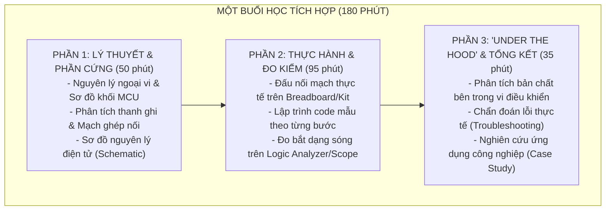
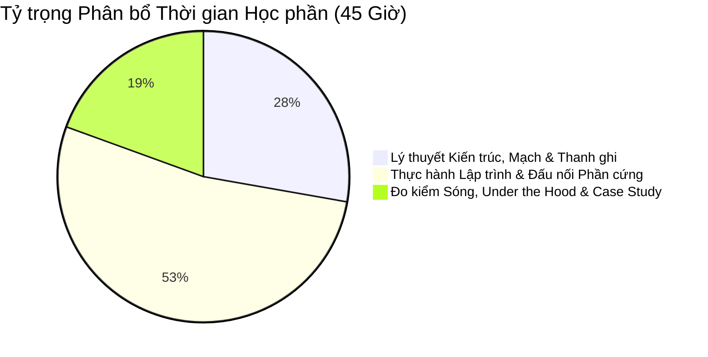

# PHÂN TÍCH LỘ TRÌNH VÀ PHÂN BỔ CHƯƠNG TRÌNH HỌC PHẦN (45 GIỜ)
## ĐIỀU KHIỂN THIẾT BỊ NGOẠI VI & GHÉP NỐI VI XỬ LÝ (STM32F4 / ARM CORTEX-M)
**Căn cứ tài liệu gốc:**  
1. *Beg.GuidetoDesigingEmbeddedSystems_ch1-6_textbook.pdf* (Chương 1 - 6)  
2. *Beg.GuidetoDesigingEmbeddedSystems_ch7-12_textbook.pdf* (Chương 7 - 12)  
*(Tác giả: Ariel Lutenberg, Pablo Gomez, Eric Pernia - Chương trình Giáo dục Toàn cầu ARM Education)*  
**Đối tượng:** Sinh viên Đại học ngành Kỹ thuật Điện tử / Kỹ thuật Điện tử - Viễn thông / Cơ điện tử  
**Tổng thời lượng:** 45 giờ học trực tiếp (15 buổi $\times$ 3 giờ/buổi)  

---

## I. ĐẶC ĐIỂM SƯ PHẠM CỐT LÕI CỦA BỘ GIÁO TRÌNH ARM VÀ ĐẶC THÙ NGÀNH ĐIỆN TỬ

### 1. Phương pháp luận "Learn-by-Doing" xuyên suốt qua 1 Dự án Trục (Core Spine Project)
Khác với các giáo trình truyền thống thường dạy các khối ngoại vi rời rạc (tuần 1 học LED, tuần 2 học UART, tuần 3 học ADC mà không có sự liên kết), bộ sách của ARM Education sử dụng **một dự án duy nhất xuyên suốt 12 chương: Hệ thống Giám sát & Báo động Nhà Thông minh (Smart Home System)**:
- Bắt đầu từ hệ thống đơn giản: Phát hiện rò rỉ khí gas / quá nhiệt bằng cảm biến số và báo động bằng LED/còi (Chương 1).
- Mở rộng dần qua từng tuần: Thêm giám sát PC qua UART (Ch.2) $\rightarrow$ Thêm cảm biến tương tự ADC (Ch.3) $\rightarrow$ Thêm bàn phím ma trận và thời gian thực RTC (Ch.4) $\rightarrow$ Chuẩn hóa mã nguồn theo kiến trúc mô-đun (Ch.5) $\rightarrow$ Thêm hiển thị LCD qua I2C và SPI (Ch.6) $\rightarrow$ Thêm điều khiển động cơ DC & ngắt EXTI (Ch.7) $\rightarrow$ Băm xung PWM & phát âm thanh (Ch.8) $\rightarrow$ Ghi nhật ký vào thẻ nhớ SD (Ch.9) $\rightarrow$ Kết nối không dây BLE tới Smartphone (Ch.10) $\rightarrow$ Máy chủ Web nhúng Wi-Fi (Ch.11) $\rightarrow$ Phương pháp thiết kế sản phẩm hoàn chỉnh (Ch.12).

### 2. Yêu cầu đặc thù đối với Sinh viên Ngành Kỹ thuật Điện tử
Sinh viên ngành Điện tử **không được đào tạo như lập trình viên phần mềm thuần túy (Software Developers)**. Đối với sinh viên Điện tử, mục tiêu không chỉ là gọi được hàm API thư viện mà phải làm chủ được 3 lớp:
1. **Lớp Phần cứng & Mạch ghép nối (Hardware & Circuitry):** Phải tính toán được điện trở hạn dòng, điện trở kéo lên Open-Drain, mạch đệm transistor, mạch cách ly quang Optocoupler chống nhiễu công nghiệp, diode dập xung ngược ($V = -L \frac{di}{dt}$), bảo vệ quá áp chân 5V-tolerant.
2. **Lớp Tín hiệu & Thời gian (Signal & Timing Integrity):** Phải hiểu rõ dạng sóng, xung nhịp Clock, các thời gian trễ Setup time, Hold time, méo cạnh xung do dung kháng ký sinh của đường truyền, phân tích được lỗi giao thức bằng Máy hiện sóng (Oscilloscope) và Bộ phân tích logic (Logic Analyzer).
3. **Lớp Bản chất Thanh ghi & Xung nhịp (Register & Clock Tree):** Nắm rõ vi mạch nào nằm trên bus nào (AHB1, AHB2, APB1, APB2), nguyên lý cấp clock từ khối RCC, cách thức thao tác thanh ghi mức bit (Bit-masking) trước khi trừu tượng hóa lên thư viện HAL.

---

## II. MÔ HÌNH PHÂN BỔ THỜI GIAN: LỚP HỌC TÍCH HỢP STUDIO (15 BUỔI $\times$ 3 GIỜ = 45 GIỜ)

Để đảm bảo sinh viên **kết hợp phân tích lý thuyết và thực hành một cách đầy đủ**, áp dụng cấu trúc phân bổ thời gian trong mỗi buổi học 3 giờ (180 phút) theo đúng hướng dẫn sư phạm quốc tế của ARM (Table 2 - Section *How This Book Can Be Used for Teaching in Engineering Schools*):

- **Trước giờ học (Chuẩn bị tại nhà - 1 đến 2 giờ):** Sinh viên đọc tài liệu Roadmap, chuẩn bị sơ đồ kết nối phần cứng theo tài liệu hướng dẫn.
- **Tại lớp học (180 phút):** Giảng viên giảng giải cốt lõi $\rightarrow$ Sinh viên thực hành kiểm chứng ngay trên kit $\rightarrow$ Giảng viên hướng dẫn dùng Logic Analyzer đo sóng $\rightarrow$ Đúc kết bài học.

---

## III. MA TRẬN PHÂN BỔ CHI TIẾT 15 BUỔI HỌC (45 GIỜ)

| Buổi | Tên chủ đề học tập | Phân tích Lý thuyết & Mạch Điện tử (50 phút) | Thực hành Lập trình & Đo kiểm Lab (95 phút) | "Under the Hood" & Case Study (35 phút) | Ánh xạ Chương sách ARM |
| :---: | :--- | :--- | :--- | :--- | :---: |
| **01** | **Tổng quan Hệ thống Nhúng & Khởi tạo Môi trường STM32F4** | - Cấu trúc hệ thống nhúng. - Lõi ARM Cortex-M4, bus AHB/APB, bộ nhớ. - Quy trình biên dịch và toolchain. | - Cài đặt IDE, nạp chương trình qua ST-Link. - Điều khiển LED trên kit nhấp nháy. - Thực hành Example 1.1, 1.2: Báo động Gas/Nhiệt độ. | - Giới thiệu họ vi xử lý Cortex-M và kit STM32 Nucleo. - Case study: Hệ thống khóa cửa thông minh (Smart Locks). | **Chương 1** |
| **02** | **Cổng GPIO & Kỹ thuật Ghép nối Mạch Ngoại vi Cơ bản** | - Cấu trúc ngõ ra Push-Pull, Open-Drain. - Ngõ vào Floating, Pull-up, Pull-down. - Tính toán điện trở hạn dòng LED, mạch đệm transistor, cách ly Opto PC817. | - Đấu nối nút nhấn, chống rung phím (Debounce hardware RC & software). - Điều khiển Relay đóng cắt tải đèn 220V. - Thực hành Example 1.3, 1.4, 1.5. | - Phân tích hiện tượng hồ quang khi đóng cắt tải cảm và vai trò diode dập xung. - Phân tích cấu trúc thanh ghi GPIO (MODER, ODR, IDR, BSRR). | **Chương 1 (Mở rộng chuyên sâu Điện tử)** |
| **03** | **Truyền thông Nối tiếp Dị bộ UART/USART & Giao tiếp PC** | - Khung truyền UART (Start, Data, Parity, Stop). - Tốc độ Baud, sai số clock. - Chuẩn điện áp TTL 3.3V/5V, RS-232, vi mạch MAX3232. | - Đấu nối Virtual COM qua USB-TTL. - Lập trình gửi nhận ký tự và chuỗi. - Thực hành Example 2.1, 2.2, 2.3: Giám sát trạng thái qua PC. | - Bản chất thanh ghi USART (SR, DR, BRR). - Phân tích sai lệch tần số thạch anh gây méo baudrate. - Case study: Industrial Transmitter. | **Chương 2** |
| **04** | **Quản lý Dữ liệu Mảng, Chuỗi Lệnh & Tùy biến Hệ thống qua UART** | - Quản lý bộ đệm ký tự trong bộ nhớ vi điều khiển. - Giao thức đóng gói bản tin (Framing protocol, Checksum, ký tự kết thúc `\r\n`). | - Thực hành Example 2.4, 2.5: Lưu trữ và đổi mật mã hệ thống qua giao diện PC. - Dùng phần mềm Terminal bắt khung truyền hex. | - Phân tích lỗi tràn bộ đệm (Buffer Overflow) trong C nhúng. - Phương pháp thiết kế giao diện lệnh điều khiển ASCII. | **Chương 2 (Tiếp theo)** |
| **05** | **Bộ Biến đổi Tương tự - Số (ADC) & Ghép nối Cảm biến Analog** | - Nguyên lý lấy mẫu ADC, độ phân giải 12-bit, điện áp $V_{REF}$. - Trở kháng ngõ vào và thời gian nạp tụ lấy mẫu ($T_{sample}$). - Ghép nối cảm biến nhiệt độ LM35, biến trở, LDR. | - Đo điện áp analog từ cảm biến nhiệt và quang trở. - Lập trình thuật toán lọc trung bình số (Moving Average). - Thực hành Example 3.1, 3.2, 3.3. | - Phân tích sai số lấy mẫu: Lượng tử hóa, trôi nhiệt áp tham chiếu. - Case study: Hệ thống chống đóng băng cây trồng (Frost Prevention). | **Chương 3** |
| **06** | **Tính toán Thông số Vật lý từ Tín hiệu ADC & Còi báo Đa âm** | - Hàm truyền đạt của cảm biến nhiệt độ và khí gas (MQ-2). - Mạch khuếch đại thuật toán (Op-Amp) tiền xử lý tín hiệu trước khi vào ADC. - Ghép nối còi Piezo Buzzer. | - Thực hành Example 3.4, 3.5: Đổi giá trị ADC thành độ C ($^\circ\text{C}$) và ppm khí gas. - Lập trình phát xung còi báo động nhiều cấp độ tần số. | - Phân tích thanh ghi ADC (CR1, CR2, SQR3, DR). - Kỹ thuật chống nhiễu analog trên bo mạch PCB (Ground plane, tụ lọc nguồn). | **Chương 3 (Tiếp theo)** |
| **07** | **Máy Trạng thái Hữu hạn (FSM) & Bàn phím Ma trận $4\times 4$** | - Khái niệm máy trạng thái Mealy và Moore. - Bảng chuyển trạng thái (State Table). - Sơ đồ nguyên lý quét hàng - đọc cột ma trận phím $4\times 4$. | - Đấu nối ma trận phím $4\times 4$ với STM32. - Lập trình thuật toán quét phím chống dính phím. - Thực hành Example 4.1, 4.2, 4.3: Nhập mã PIN an toàn. | - Biểu diễn đồ họa FSM trong phần mềm nhúng. - Triển khai FSM trong C sử dụng `switch-case` và con trỏ hàm. - Case study: Smart Door Locks. | **Chương 4** |
| **08** | **Đồng hồ Thời gian Thực (RTC) & Cấu trúc Mã nguồn Mô-đun hóa** | - Bộ dao động ngoài thạch anh LSE 32.768 kHz. - Khối thời gian thực RTC (Giờ, phút, giây, ngày, tháng, năm dạng BCD). - Nguyên lý mô-đun hóa (Separation of Concerns). | - Cấu hình RTC, hiển thị timestamp lên PC (Example 4.4). - Tái cấu trúc mã nguồn toàn bộ hệ thống Smart Home thành các file `.c`/`.h` riêng biệt (Chương 5). | - Cấu trúc phân lớp: Drivers $\rightarrow$ Hardware Abstraction $\rightarrow$ Application Logic. - Quản lý biến toàn cục an toàn trong C nhúng (`static`, `extern`). | **Chương 4 (RTC) & Chương 5 (Modularization)** |
| **09** | **Màn hình Ký tự LCD & Giao diện Ghép nối Song song qua GPIO** | - Cấu trúc bộ điều khiển LCD HD44780. - So sánh chế độ 8-bit và 4-bit. - Giản đồ thời gian các chân tín hiệu $RS, RW, EN, D_0 \div D_7$. | - Đấu nối màn hình LCD 16x2 chế độ 4-bit qua GPIO. - Lập trình gửi lệnh và hiển thị ký tự (Example 6.1, 6.2). - Hiển thị trạng thái nhiệt độ, gas và mã PIN. | - Phân tích thời gian trễ thực thi lệnh của vi mạch HD44780 ($T_{exec} \approx 37\mu s$). - Tác hại của việc dùng quá nhiều chân GPIO của MCU cho màn hình. | **Chương 6 (Phần 1: GPIO LCD)** |
| **10** | **Chuẩn Truyền thông $I^2C$ & Ghép nối IC Ngoại vi Chuyên dụng** | - Giao thức I2C: Khung truyền, 2 dây Open-Drain ($SDA, SCL$), điện trở Pull-up ($R_p$). - Địa chỉ 7-bit, bit ACK/NACK, hiện tượng Clock Stretching. - Vi mạch mở rộng cổng PCF8574. | - Đấu nối màn hình LCD qua module I2C PCF8574 (Example 6.3). - Dùng Logic Analyzer bắt tín hiệu SDA/SCL, giải mã từng byte. - Đọc dữ liệu từ IC thời gian thực RTC DS3231 qua I2C. | - So sánh điện trở kéo lên lý thuyết ($R_p$) phụ thuộc vào dung kháng đường dây ($C_b$). - Xử lý lỗi treo bus I2C (Bus lockup recovery sequence). | **Chương 6 (Phần 2: I2C)** |
| **11** | **Chuẩn Truyền thông Đồng bộ SPI & Màn hình Đồ họa Graphical LCD** | - Giao thức SPI: 4 dây (SCK, MOSI, MISO, CS). - 4 chế độ cực tính và pha xung nhịp (CPOL, CPHA). - So sánh toàn diện 3 giao thức: UART vs I2C vs SPI về tốc độ và khoảng cách. | - Đấu nối màn hình đồ họa Graphical LCD (ST7735 / Nokia 5110 / OLED SSD1306) qua SPI. - Lập trình vẽ hình ảnh đồ họa và biểu đồ cảm biến (Example 6.4, 6.5). | - Phân tích xung nhịp tối đa của SPI so với I2C ($>10\text{ MHz}$ vs $400\text{ kHz}$). - Case study: Ứng dụng màn hình LCD trong các dự án công nghiệp. | **Chương 6 (Phần 3: SPI)** |
| **12** | **Hệ thống Ngắt Ngoài EXTI, Cảm biến Chuyển động PIR & Điều khiển Động cơ DC** | - Khái niệm ngắt, bảng vector ngắt, khối điều khiển ngắt NVIC. - Cấu hình ngắt ngoài EXTI (Bắt sườn lên/xuống). - Điều khiển động cơ DC: Mạch cầu H (H-Bridge), relay, cách ly nguồn quang. | - Đấu nối cảm biến chuyển động PIR kích hoạt ngắt EXTI. - Lập trình điều khiển đóng mở cổng tự động bằng động cơ DC qua Relay (Example 7.1 $\div$ 7.4). | - Nguyên tắc viết ngắt ISR an toàn: Biến `volatile`, cấm delay dài trong ngắt. - Hiện tượng dội công tắc cơ khí và triệt tiêu ngắt giả. | **Chương 7** |
| **13** | **Điều chế Độ rộng Xung (PWM), Điều khiển Công suất & Phát Âm thanh** | - Nguyên lý PWM: Chu kỳ ($T$), tần số ($f$), hệ số công tác Duty cycle ($D$). - Cấu hình khối Timer và thanh ghi so sánh capture/compare (`CCR`). - Mạch lọc thông thấp RC biến đổi xung PWM thành tín hiệu âm thanh tương tự. | - Băm xung PWM điều khiển độ sáng và pha trộn màu LED RGB. - Điều khiển tốc độ động cơ DC và góc quay Servo (Example 8.1 $\div$ 8.5). - Phát đoạn âm thanh báo động mẫu từ mảng bộ nhớ Flash bằng PWM (Example 8.6). | - Lý thuyết điều khiển hồi tiếp âm (Negative Feedback Control). - Dùng máy hiện sóng quan sát dạng sóng xung PWM và sóng âm thanh sau lọc RC. - Case study: Đèn chiếu sáng thông minh Smart City Bike Lights. | **Chương 8** |
| **14** | **Lưu trữ Thẻ nhớ SD, Truyền thông Không dây BLE & Wi-Fi IoT** | - Giao diện thẻ nhớ SD (SPI mode), hệ thống tập tin FAT (FatFS). - Khái niệm truyền thông năng lượng thấp Bluetooth Low Energy (GATT, Services). - Giao tiếp module Wi-Fi (ESP8266) qua tập lệnh AT, giao thức HTTP. | - Ghi nhật ký báo động vào thẻ SD (Example 9.1). - Kết nối BLE với điện thoại để điều khiển đóng mở cổng (Example 10.1). - Khởi tạo Web Server nhúng hiển thị thông số cảm biến qua Wi-Fi (Example 11.1 $\div$ 11.4). | - Kiến trúc mạng truyền thông không dây cho IoT công nghiệp. - Quản lý năng lượng tiêu thụ (Sleep modes) trong thiết bị nhúng chạy pin. - Case study: Giám sát môi trường nhà xưởng trong nhà (Indoor Monitoring). | **Chương 9, 10, 11** |
| **15** | **Phương pháp Thiết kế Hệ thống Nhúng & Nghiệm thu Dự án Capstone** | - Quy trình thiết kế sản phẩm nhúng theo chuẩn công nghiệp: Khảo sát yêu cầu $\rightarrow$ Lập bảng phân bổ chân I/O $\rightarrow$ Vẽ Schematic $\rightarrow$ Layout PCB $\rightarrow$ Lập trình $\rightarrow$ Đo kiểm. - Tiêu chuẩn viết tài liệu kỹ thuật và hướng dẫn sử dụng. | - Sinh viên trình diễn sản phẩm hoàn chỉnh tích hợp toàn bộ các khối ngoại vi (Hệ thống Nhà Thông minh Đa Năng). - Báo cáo kỹ thuật, phản biện giải pháp thiết kế và giải thích các kết quả đo kiểm trên thiết bị đo. | - Tổng kết học phần: Định hướng các đề tài nghiên cứu chuyên sâu, vi mạch và hệ thống nhúng trong tương lai. - Đánh giá, chấm điểm Rubric đồ án môn học. | **Chương 12 & Tổng kết** |

---

## IV. PHÂN TÍCH CHI TIẾT TỶ TRỌNG THỜI LƯỢNG (LÝ THUYẾT - THỰC HÀNH - ĐO KIỂM)

Tổng thời lượng 45 giờ (2700 phút) được chia thành 3 cấu phần cốt lõi:

- **Lý thuyết phân tích chuyên sâu (Khoảng 28% ~ 12.5 giờ):** 
  - Đi sâu vào cấu trúc phần cứng vi điều khiển, sơ đồ nguyên lý mạch điện tử ghép nối và công thức tính toán linh kiện.
  - Phân tích bản chất các bit trong thanh ghi điều khiển ngoại vi và đường dẫn xung nhịp từ khối RCC.
- **Thực hành lập trình & đấu nối (Khoảng 53% ~ 23.75 giờ):** 
  - Sinh viên tự tay cắm dây, thiết kế mạch trên breadboard, viết mã nguồn C nhúng, debug từng bước trên kit STM32F4.
  - Tiếp cận từ ví dụ đơn giản đến phức tạp thông qua dự án trục Smart Home System.
- **Đo kiểm tín hiệu, "Under the Hood" & Chẩn đoán lỗi (Khoảng 19% ~ 8.75 giờ):** 
  - Đưa thiết bị đo kiểm chuyên dụng (Máy hiện sóng, Logic Analyzer) vào thành một kỹ năng bắt buộc để "nhìn thấy" dạng sóng tín hiệu thực tế.
  - Phân tích nguyên nhân gốc rễ (Root-cause analysis) của các sự cố phần cứng/phần mềm.

---

## V. DANH MỤC THIẾT BỊ VÀ LINH KIỆN THỰC HÀNH CẦN THIẾT (BILL OF MATERIALS - BOM)

Để đáp ứng đầy đủ lộ trình 45 giờ theo sách ARM Education, mỗi bàn thí nghiệm (nhóm 2 sinh viên) cần được trang bị:

### 1. Khối Vi điều khiển & Đo kiểm
- 01 Kit phát triển STM32F4 (Khuyên dùng: **ST Nucleo-F429ZI** theo sách gốc, hoặc tương thích hoàn toàn như **STM32F4-Discovery F407VGT6**, **STM32F401RE Nucleo**).
- 01 Mạch nạp & gỡ lỗi ST-Link v2 / On-board ST-Link kèm cáp USB.
- 01 Bộ phân tích logic USB 8 kênh 24MHz (Saleae Logic Analyzer clone hoặc tương đương) kèm phần mềm Logic / PulseView.
- 01 Đồng hồ vạn năng DMM (Đo thông mạch, đo điện áp, đo dòng điện).

### 2. Khối Cảm biến & Ngõ vào
- 01 Cảm biến nhiệt độ tương tự LM35 (hoặc NTC thermistor).
- 01 Cảm biến khí gas / khói (Module MQ-2 hoặc tương đương).
- 01 Quang trở LDR (đo cường độ ánh sáng).
- 01 Biến trở xoay $10\text{ k}\Omega$ (chia áp tạo điện áp tương tự tùy biến).
- 01 Ma trận bàn phím $4\times 4$ (Matrix Keypad).
- 01 Cảm biến chuyển động hồng ngoại thụ động (PIR Motion Sensor HC-SR501).
- 01 Cảm biến khoảng cách siêu âm HC-SR04.

### 3. Khối Chấp hành & Ngõ ra
- Hệ thống LED đơn (Đỏ, Xanh lá, Vàng) + 01 LED RGB 4 chân (Common Cathode/Anode).
- 01 Còi báo Piezo Buzzer (loại thụ động Passive Buzzer để phát được nhiều tần số nhạc qua PWM).
- 01 Module Relay 5V có cách ly quang Optocoupler (điều khiển tải AC/DC).
- 01 Động cơ một chiều mini DC Motor + 01 Module cầu H điều khiển động cơ L298N (hoặc TB6612).
- 01 Động cơ RC Servo SG90 (điều khiển góc quay qua xung PWM 50Hz).

### 4. Khối Hiển thị & Lưu trữ & Truyền thông
- 01 Màn hình ký tự Text LCD 16x2 (kèm Module I2C PCF8574 hàn sẵn hoặc cắm rời).
- 01 Màn hình đồ họa Graphical LCD (SPI OLED SSD1306 0.96 inch hoặc Nokia 5110 SPI hoặc TFT LCD ST7735 1.8 inch).
- 01 Module đọc thẻ nhớ MicroSD (giao tiếp SPI) kèm thẻ MicroSD dung lượng $2\text{GB} \div 16\text{GB}$ (định dạng FAT32).
- 01 Module IC thời gian thực RTC DS3231 hoặc DS1307 (I2C) kèm pin CR2032.
- 01 Mạch chuyển đổi USB-TTL (CP2102 hoặc CH340).
- 01 Module truyền thông không dây Bluetooth Low Energy BLE (HC-08 hoặc HM-10).
- 01 Module truyền thông Wi-Fi ESP8266 (ESP-01 hoặc ESP-12F) chạy firmware AT Commands tiêu chuẩn.
- Dây cắm đực-đực, đực-cái, breadboard thí nghiệm chất lượng cao.

---

## VI. BỘ TIÊU CHÍ ĐÁNH GIÁ KẾT HỢP LÝ THUYẾT VÀ THỰC HÀNH (EVALUATION RUBRIC)

Để bảo đảm sinh viên thực sự hiểu sâu và làm được, phương thức đánh giá kết hợp 4 thành phần:

1. **Đánh giá Quá trình Thực hành Lab tại lớp (30%):**
   - Đánh giá theo từng buổi: Đấu nối đúng sơ đồ mạch, nạp code chạy đúng yêu cầu ví dụ.
   - Kỹ năng đo kiểm: Bắt được dạng sóng trên Logic Analyzer/Oscilloscope và giải thích được các tham số tín hiệu cho giảng viên.
2. **Kiểm tra Lý thuyết & Phân tích Phần cứng giữa kỳ (20%):**
   - Đề thi tự luận/trắc nghiệm 60 phút: Tính toán mạch ghép nối (R hạn dòng, R kéo lên, diode dập xung), phân tích cấu trúc thanh ghi ngoại vi, tính toán xung nhịp RCC và chu kỳ timer/baudrate.
3. **Đồ án Capstone Tích hợp theo Nhóm (20%):**
   - Nhóm 2-3 sinh viên hoàn thiện sản phẩm hệ thống nhúng thông minh dựa trên dự án Smart Home (hoặc đề tài tương đương được duyệt).
   - Đánh giá sản phẩm chạy thực tế (40%), bản vẽ mạch nguyên lý chuẩn mực (20%), mã nguồn chuẩn mô-đun hóa (20%), báo cáo kỹ thuật & thuyết trình phản biện (20%).
4. **Thi Thực hành Cuối kỳ trên máy tính (30%):**
   - Thời gian 90 phút tại phòng lab: Cho một yêu cầu ghép nối và điều khiển một tổ hợp 2-3 thiết bị ngoại vi mới trên kit STM32F4.
   - Sinh viên tự tra cứu Datasheet/Reference Manual, cấu hình ngoại vi, viết code và debug chứng minh kết quả trực tiếp trước hội đồng giám khảo.
