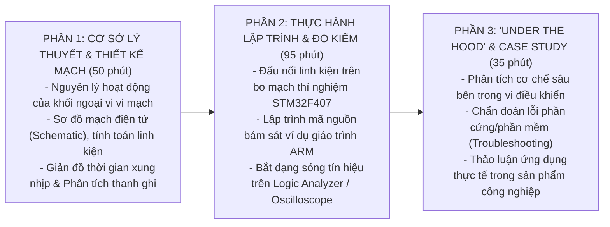

# PHÂN TÍCH LỘ TRÌNH VÀ PHÂN BỔ CHƯƠNG TRÌNH HỌC PHẦN (45 GIỜ)
## ĐIỀU KHIỂN THIẾT BỊ NGOẠI VI & GHÉP NỐI HỆ THỐNG NHÚNG (STM32F407)
**Căn cứ tài liệu gốc:**  
1. *Beg.GuidetoDesigingEmbeddedSystems_ch1-6_textbook.pdf* (Chương 1 - 6)  
2. *Beg.GuidetoDesigingEmbeddedSystems_ch7-12_textbook.pdf* (Chương 7 - 12)  
*(Tác giả: Ariel Lutenberg, Pablo Gomez, Eric Pernia - Chương trình Giáo dục Toàn cầu ARM Education)*  
**Đặc thù người học:** Sinh viên đã hoàn thành học phần nền tảng **Vi điều khiển STM32F407 (đã học đến UART cơ bản)**.  
**Mục tiêu học phần:** Trang bị cho sinh viên năng lực thực tế làm chủ toàn bộ thế giới ngoại vi xung quanh để tự tay xây dựng một hệ thống nhúng hoàn chỉnh trên kit STM32F407 (ghép nối UART nâng cao, $I^2C$, 1-Wire, SPI, màn hình LCD/OLED, động cơ, PWM, phát âm thanh, thẻ nhớ SD, BLE, Wi-Fi Web Server).  
**Thời lượng:** 45 giờ tiếp xúc trực tiếp (15 buổi $\times$ 3 giờ/buổi theo mô hình Lớp học tích hợp Studio Lý thuyết - Thực hành - Đo kiểm).  

---

## I. CẤU TRÚC MỘT BUỔI HỌC TÍCH HỢP STUDIO (180 PHÚT)

Để đảm bảo sinh viên **kết hợp phân tích lý thuyết, thiết kế mạch điện tử và thực hành đo kiểm một cách đầy đủ**:

---

## II. MA TRẬN 15 BUỔI HỌC CHI TIẾT (45 GIỜ) TRÊN STM32F407

| Buổi | Tên Chủ đề Giảng dạy | Nội dung Lý thuyết & Mạch Điện tử (50 phút) | Thực hành Lập trình & Đo kiểm dạng sóng (95 phút) | "Under the Hood" & Case Study (35 phút) | Ánh xạ Chương sách ARM |
| :---: | :--- | :--- | :--- | :--- | :---: |
| **01** | **Cầu nối Hệ thống & Khởi động Dự án Trục Smart Home** | - Ôn tập nhanh kiến trúc Cortex-M4 trên STM32F407 (168MHz, Bus Matrix AHB/APB, RCC). - Tầng ngõ ra Push-Pull/Open-Drain; Tính trở hạn dòng LED và bảo vệ quá áp. - Giới thiệu Dự án Trục Smart Home. | - Thiết lập môi trường STM32CubeIDE cho STM32F407. - Đấu nối cảm biến Gas (`PE2`), quá nhiệt (`PE3`), nút bấm (`PE4, PE5`), LED báo động (`PD12`). - Lập trình hoàn thiện Code 1.1 $\div$ 1.5. | - Phân tích bộ tăng tốc Flash ART Accelerator. - Case study: Hệ thống Khóa cửa thông minh (Smart Door Locks). | **Chương 1** |
| **02** | **Truyền thông UART Nâng cao & Giao tiếp Máy tính PC** | - Khung truyền UART chuẩn NRZ, Baudrate thanh ghi `USART_BRR` trên bus APB1 (42MHz). - Chuẩn điện áp TTL 3.3V vs RS-232 (MAX3232) vs RS-485 (SP3485). - Kỹ thuật phân tách hàm mô-đun và bộ đệm mảng. | - Kết nối PC qua `USART2` (`PA2, PA3`) tại 115200 bps. - Lập trình gửi báo cáo trạng thái hệ thống, phân loại lệnh switch-case. - Tắt báo động từ xa, đổi mật mã hệ thống (Ex 2.1 $\div$ 2.5). | - Phân tích 4 lỗi phần cứng UART (PE, FE, NE, ORE). - Case study: Bộ truyền phát công nghiệp (Industrial Transmitter). | **Chương 2** |
| **03** | **Quản lý Thời gian Không chặn & Thu thập Cảm biến ADC** | - Nguyên lý SAR ADC 12-bit, $V_{REF+} = 3.3\text{V}$, sai số lượng tử hóa. - Định lý lấy mẫu Nyquist; Mạch lọc thông thấp RC chống răng cưa. - Tư duy nhúng: Non-blocking timing thay thế hàm delay. | - Cấu hình `ADC1` đa kênh: Biến trở (`PA1`), LM35 (`PA2`), Gas (`PA3`). - Lập trình thuật toán lọc trung bình số (Moving Average). - Điều khiển còi Piezo Buzzer (`PD11`) theo ngưỡng (Ex 3.1 $\div$ 3.5). | - Phân tích sai số lấy mẫu do trôi nhiệt $V_{REF}$. - Case study: Hệ thống chống đóng băng cây trồng (Frost Prevention). | **Chương 3** |
| **04** | **Máy Trạng thái Hữu hạn (FSM), Bàn phím Ma trận & RTC** | - Lý thuyết Máy trạng thái Mealy/Moore, State Diagram. - Nguyên lý quét hàng đọc cột ma trận phím $4\times 4$. - Khối RTC thời gian thực nội (LSE 32.768kHz) & IC DS3231. | - Đấu nối ma trận phím (`PE7..PE10` Hàng, `PE11..PE14` Cột). - FSM phát hiện nhấn đúp phím Enter, giải mã mã PIN bảo mật. - Báo cáo sự kiện kèm mốc thời gian RTC lên PC (Ex 4.1 $\div$ 4.4). | - Ưu thế của FSM trong việc loại bỏ Spaghetti code. - Case study: Khóa điện tử phân quyền truy cập theo thời gian. | **Chương 4** |
| **05** | **Mô-đun hóa Mã nguồn Phần mềm Nhúng Chuẩn Công nghiệp** | - Nguyên lý công nghệ phần mềm nhúng: Phân tách trách nhiệm (Separation of Concerns). - Cấu trúc tệp `.h`/`.c`, Header Guards chống đa khai báo. - Quản lý an toàn phạm vi biến (`static`, `extern`). | - Tái cấu trúc mã nguồn toàn bộ hệ thống Smart Home thành các mô-đun: `inputs`, `outputs`, `alarm_system`, `pc_serial_com`, `matrix_keypad`, `rtc`. - Tối ưu hóa hàm `main.c` đạt chuẩn MISRA-C. | - Phân tích rủi ro của biến toàn cục không kiểm soát. - Kỹ thuật viết API driver tái sử dụng cao. | **Chương 5** |
| **06** | **Màn hình Ký tự LCD qua Bus Song song & Bus $I^2C$** | - Cấu trúc vi mạch điều khiển LCD HD44780 (8-bit vs 4-bit). - Giao thức $I^2C$: Khung truyền, Open-Drain, trở kéo $R_p$, địa chỉ 7-bit, ACK/NACK, Clock Stretching. - Vi mạch mở rộng 8-bit PCF8574. | - Điều khiển LCD 16x2 qua GPIO 4-bit (`PD0..PD5`) (Ex 6.1, 6.2). - Điều khiển LCD 16x2 qua `I2C1` (`PB6, PB7`) dùng PCF8574 (Ex 6.3). - Dùng Logic Analyzer bắt dạng sóng SDA/SCL giải mã từng byte. | - Tính toán điện trở kéo lên $R_p$ theo dung kháng đường dây. - Trình tự giải phóng kẹt bus I2C (Bus Clear Sequence). | **Chương 6 (Phần 1: GPIO & I2C)** |
| **07** | **Chuẩn Giao tiếp 1-Wire & Cảm biến Nhiệt độ Số DS18B20** | - Nguyên lý giao tiếp 1 dây (1-Wire): 1 dây dữ liệu $DQ$ + trở kéo $4.7\text{ k}\Omega$. - Giản đồ thời gian micro-giây: Reset pulse ($480\mu s$), Presence pulse, Write 0/1 slots, Read slot. - Cảm biến DS18B20: Mã ROM 64-bit, độ phân giải 12-bit. | - Ghép nối cảm biến DS18B20 trên chân `PB12` (Open-Drain). - Lập trình hàm trễ micro-giây bằng bộ đếm DWT của Cortex-M4. - Đọc nhiệt độ kỹ thuật số và hiển thị lên màn hình LCD I2C. | - So sánh cảm biến nhiệt độ Analog (LM35) vs Digital (DS18B20). - Bắt sóng xung Reset và Presence trên máy hiện sóng. | **Chương 6 (Phần 2: 1-Wire Chuyên sâu)** |
| **08** | **Chuẩn Giao tiếp Đồng bộ SPI & Màn hình Đồ họa OLED** | - Nguyên lý giao thức SPI: 4 dây ($SCK, MOSI, MISO, CS$), truyền song công toàn phần. - 4 chế độ cực tính và pha xung nhịp (`CPOL`, `CPHA`). - Màn hình đồ họa: Bộ đệm khung hình (Frame Buffer). | - Ghép nối màn hình OLED SSD1306 qua `SPI1` (`PA5, PA7, PB0, PB1`). - Lập trình vẽ đồ họa: Điểm ảnh, đường thẳng, chữ cái ASCII. - Vẽ biểu đồ diễn biến nhiệt độ thời gian thực (Ex 6.4, 6.5). | - So sánh toàn diện 4 chuẩn: Song song vs 1-Wire vs I2C vs SPI. - Tối ưu hóa tốc độ làm tươi màn hình Frame Rate. | **Chương 6 (Phần 3: SPI)** |
| **09** | **Điều khiển Động cơ DC qua Relay & Cơ chế Ngắt EXTI** | - Khối NVIC Cortex-M4: Bảng vector ngắt, lưu ngữ cảnh phần cứng, mức ưu tiên Preemption & Sub-priority. - Cấu hình ngắt ngoài EXTI (Bắt sườn lên/xuống), biến `volatile`. - Mạch cầu 2 Relay đảo chiều động cơ DC, Opto cách ly và Flyback diode. | - Ghép nối cảm biến chuyển động PIR (`PC4`) kích hoạt `EXTI4`. - Lập trình chu trình mở/dừng/đóng cổng tự động qua 2 Relay (`PC8, PC9`). - Ngắt khẩn cấp bảo vệ quá dòng động cơ (`PC5`) (Ex 7.1 $\div$ 7.4). | - Nguyên tắc vàng viết ISR an toàn: Không delay, xóa cờ ngắt. - Case study: Cửa trượt tự động (Automatic Sliding Doors). | **Chương 7** |
| **10** | **Khối Timer Nâng cao, Băm xung PWM & Hồi tiếp Âm** | - Khối Timer 16/32-bit (`PSC`, `ARR`, `CCR`), tính tần số $f_{PWM}$ và Duty ($D$). - Cơ sở lý thuyết điều khiển hồi tiếp âm (Negative Feedback Closed-loop). - Mạch đệm công suất điều khiển LED RGB và động cơ. | - Băm xung `TIM4` (`PD12, PD13, PD15`) đổi màu và độ sáng LED RGB. - Tự động điều chỉnh độ sáng đèn theo quang trở LDR (`PA4`) (Ex 8.1 $\div$ 8.5). - Đo dạng sóng PWM trên máy hiện sóng, phân tích Duty Cycle. | - Phân tích sai số xác lập trong vòng điều khiển hồi tiếp âm. - Case study: Đèn chiếu sáng thông minh Smart City Bike Lights. | **Chương 8 (Phần 1: PWM & Feedback)** |
| **11** | **Phát Âm thanh Thoại Cảnh báo Bằng Kỹ thuật PWM & Lọc RC** | - Nguyên lý phát âm thanh số bằng điều chế PWM tốc độ cao ($100\text{ kHz}$). - Mảng dữ liệu âm thanh số PCM 8-bit lấy mẫu $8\text{ kHz}$ trong Flash. - Mạch lọc thông thấp RC ($f_c \approx 1.6\text{ kHz}$) tích phân sóng PWM. | - Cấu hình `TIM1` (`PE9`) phát xung PWM mang âm thanh $100\text{ kHz}$. - Dùng `TIM6` tạo ngắt chu kỳ $125\mu s$ nạp mẫu âm thanh. - Kết nối mạch lọc RC và loa mini phát giọng nói cảnh báo (Ex 8.6). | - Dùng Oscilloscope quan sát dạng sóng trước và sau mạch lọc RC. - Kỹ thuật nén dữ liệu âm thanh trong hệ thống nhúng. | **Chương 8 (Phần 2: PWM Audio)** |
| **12** | **Lưu trữ Tệp tin trên Thẻ nhớ SD (FatFS) & Quản lý Kho Git** | - Giao diện thẻ nhớ SD qua chuẩn SPI, cấu trúc sector vật lý. - Middleware hệ thống tập tin FatFS (File Allocation Table FAT32). - Quản lý phiên bản mã nguồn nhúng bằng Git (Commit, Branch, Merge). | - Ghép nối thẻ MicroSD qua `SPI2` (`PB12..PB15`). - Lập trình tạo và ghi nối tệp tin nhật ký `alarm_log.csv`. - Duyệt danh sách tệp tin và truyền nội dung lên PC (Ex 9.1 $\div$ 9.4). | - Quản lý kho phần mềm phân tán trong dự án nhúng bằng Git. - Xử lý lỗi thẻ nhớ do rút đột ngột khi đang ghi file. | **Chương 9** |
| **13** | **Truyền thông Không dây Bluetooth Low Energy với Smartphone** | - Kiến trúc giao thức vô tuyến BLE 2.4GHz: GAP (Central/Peripheral) và GATT (Server/Client, Services, Characteristics, UUID 128-bit). - Tối ưu hóa năng lượng tiêu thụ (Low Power) cho thiết bị chạy pin. | - Ghép nối module BLE (HC-08/HM-10) qua `USART3` (`PB10, PB11`). - Nhận lệnh từ ứng dụng Smartphone điều khiển đóng mở cổng. - Báo cáo thông số môi trường không dây lên điện thoại (Ex 10.1 $\div$ 10.4). | - Thiết bị giao tiếp không dây công nghiệp (Wireless Bolt). - Quản lý chế độ ngủ tiết kiệm điện (Low-Power Sleep Modes). | **Chương 10** |
| **14** | **Máy chủ Web Nhúng (Embedded Web Server) qua Kết nối Wi-Fi** | - Chồng giao thức mạng TCP/IP cho hệ thống nhúng, cổng Socket Port 80. - Định dạng bản tin HTTP GET Request và HTTP 200 OK Response. - Tập lệnh điều khiển AT Commands của module Wi-Fi ESP8266. | - Ghép nối ESP8266 qua `USART6` (`PC6, PC7`) tại 115200 bps. - Tự động đăng nhập Wi-Fi, khởi tạo TCP Web Server lắng nghe cổng 80. - Phục vụ trang HTML Dashboard giám sát và điều khiển (Ex 11.1 $\div$ 11.4). | - Bắt tay 3 bước TCP (3-Way Handshake) và Socket API. - Case study: Giám sát môi trường nhà xưởng qua mạng IoT LAN. | **Chương 11** |
| **15** | **Tích hợp Hệ thống Nhúng Capstone Project & Nghiệm thu** | - Quy trình 10 bước thiết kế sản phẩm nhúng chuyên nghiệp. - Tính toán công suất nguồn cấp (Power Budget), mạch lọc gợn sóng. - Ma trận kiểm thử (Test Matrix) và quy chuẩn viết tài liệu kỹ thuật. | - Tích hợp toàn diện Hệ thống Nhà Thông minh Đa Năng trên STM32F407. - Đo kiểm dạng sóng thực tế trên Logic Analyzer / Oscilloscope. - Báo cáo, phản biện và nghiệm thu sản phẩm Capstone (Ex 12.1 $\div$ 12.10). | - Tổng kết học phần: Đánh giá Rubric đồ án môn học. - Định hướng các đề tài nghiên cứu chuyên sâu về RTOS và vi mạch. | **Chương 12 & Tổng kết** |
