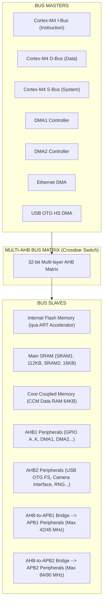

# CHƯƠNG 1: KIẾN TRÚC VI ĐIỀU KHIỂN ARM CORTEX-M4 VÀ HỆ THỐNG GHÉP NỐI NGOẠI VI (STM32F4)

---

## 1.1. MỤC TIÊU CỦA CHƯƠNG
Sau khi hoàn thành chương này, sinh viên có khả năng:
1. **Trình bày được kiến trúc phần cứng:** Giải thích được cấu trúc lõi ARM Cortex-M4, khối xử lý dấu phẩy động FPU, ma trận bus đa tầng (Multi-AHB Bus Matrix) và vai trò của các cầu nối bus (AHB-to-APB Bridges).
2. **Nắm vững bản đồ bộ nhớ (Memory Map):** Xác định được không gian địa chỉ vật lý của bộ nhớ Flash, SRAM và các dải địa chỉ ngoại vi trên các bus AHB1, AHB2, APB1, APB2.
3. **Phân tích cây xung nhịp (Clock Tree):** Hiểu rõ nguyên lý hoạt động của khối RCC (Reset and Clock Control), các nguồn dao động HSI, HSE, vòng khóa pha PLL và tính toán chính xác tần số xung nhịp cấp cho từng khối ngoại vi.
4. **Làm chủ công cụ phát triển:** Cài đặt và cấu hình thành thạo môi trường lập trình STM32CubeIDE / Keil MDK, công cụ sinh mã STM32CubeMX và mạch nạp/gỡ lỗi ST-Link v2.

---

## 1.2. TỔNG QUAN KIẾN TRÚC LÕI ARM CORTEX-M4
ARM Cortex-M4 là dòng vi xử lý 32-bit dựa trên kiến trúc ARMv7E-M của tập đoàn ARM Holdings, được thiết kế chuyên biệt cho các ứng dụng hệ thống nhúng đòi hỏi hiệu năng cao, chi phí thấp, tiêu thụ năng lượng thấp và xử lý thời gian thực chính xác.

### Các đặc tính kỹ thuật cốt lõi:
- **Kiến trúc tập lệnh (ISA):** Tập lệnh Thumb-2 kết hợp các lệnh 16-bit (tiết kiệm dung lượng bộ nhớ mã nguồn) và 32-bit (tối ưu tốc độ xử lý).
- **Đơn vị xử lý dấu phẩy động FPU (Floating Point Unit):** Tích hợp phần cứng tính toán dấu phẩy động độ chính xác đơn (Single-Precision) theo chuẩn IEEE 754, cho phép thực thi các phép toán nhân/chia số thực chỉ trong 1 chu kỳ máy (rất quan trọng trong các thuật toán điều khiển PID, lọc Kalman, biến đổi Fourier FFT).
- **Đơn vị xử lý tín hiệu số DSP:** Bổ sung các lệnh xử lý bão hòa (Saturating arithmetic), các lệnh nhân cộng tích lũy đơn chu kỳ (Single-cycle MAC).
- **Bộ điều khiển ngắt lồng nhau NVIC (Nested Vectored Interrupt Controller):** Tích hợp sâu vào lõi CPU, hỗ trợ ngắt độ trễ cực thấp (Low-latency interrupt processing, chỉ 12 chu kỳ clock từ khi xuất hiện ngắt đến khi thực thi lệnh đầu tiên trong ISR).

---

## 1.3. HỆ THỐNG MA TRẬN BUS VÀ ÁNH XẠ NGOẠI VI (STM32F4)

Trong các vi điều khiển truyền thống 8-bit hoặc 16-bit, CPU và ngoại vi thường chia sẻ chung một bus duy nhất, dẫn đến hiện tượng "nghẽn cổ chai" dữ liệu. Trên họ STM32F4, STMicroelectronics sử dụng kiến trúc **Multi-AHB Bus Matrix** 32-bit với kết nối chéo giữa các Master và Slave.



### Phân bổ ngoại vi trên các Bus chính:
1. **Bus AHB1 (Tốc độ cao nhất, bằng xung CPU $HCLK \le 168\text{ MHz}/180\text{ MHz}$):**
   - Các cổng xuất nhập đa dụng: `GPIOA`, `GPIOB`, `GPIOC`, `GPIOD`, `GPIOE`, `GPIOF`, `GPIOG`, `GPIOH`, `GPIOI`.
   - Các bộ điều khiển truy cập bộ nhớ trực tiếp: `DMA1`, `DMA2`.
   - Khối tính toán kiểm tra mã dư thừa tuần hoàn `CRC`.
   - Khối điều khiển phục hồi và xung nhịp `RCC`.
2. **Bus APB1 (Advanced Peripheral Bus 1 - Bus ngoại vi tốc độ trung bình, $PCLK1 \le 42\text{ MHz}/45\text{ MHz}$):**
   - Truyền thông nối tiếp: `USART2`, `USART3`, `UART4`, `UART5`.
   - Giao thức đồng bộ & vi mạch: `SPI2`, `SPI3`, `I2C1`, `I2C2`, `I2C3`.
   - Bộ định thời: `TIM2`, `TIM3`, `TIM4`, `TIM5`, `TIM6`, `TIM7`, `TIM12`, `TIM13`, `TIM14`.
   - Mạng truyền thông công nghiệp: `CAN1`, `CAN2`.
   - Khối chuyển đổi số - tương tự: `DAC`.
   - Khối đồng hồ thời gian thực: `RTC` và thanh ghi quản lý năng lượng `PWR`.
3. **Bus APB2 (Advanced Peripheral Bus 2 - Bus ngoại vi tốc độ cao, $PCLK2 \le 84\text{ MHz}/90\text{ MHz}$):**
   - Truyền thông tốc độ cao: `USART1`, `USART6`, `SPI1`, `SPI4`, `SPI5`, `SPI6`.
   - Bộ biến đổi tương tự - số: `ADC1`, `ADC2`, `ADC3`.
   - Bộ định thời nâng cao (Advanced Control Timers chuyên dụng điều khiển động cơ): `TIM1`, `TIM8`.
   - Bộ định thời đa dụng tốc độ cao: `TIM9`, `TIM10`, `TIM11`.
   - Khối cấu hình hệ thống và ngắt ngoài: `SYSCFG`, `EXTI`.

---

## 1.4. BẢN ĐỒ BỘ NHỚ (MEMORY MAPPING)

Toàn bộ không gian địa chỉ tuyến tính 4 Gigabytes ($2^{32}$ bytes, từ `0x0000 0000` đến `0xFFFF FFFF`) được phân chia thành 8 khối kích thước 512 Megabytes theo quy chuẩn kiến trúc ARM Cortex:

| Dải địa chỉ | Kích thước | Khối chức năng (Block) | Mục đích sử dụng |
| :--- | :---: | :--- | :--- |
| `0x0000 0000 - 0x1FFF FFFF` | 512 MB | Block 0: Code Area | Bộ nhớ Flash nạp chương trình (bắt đầu tại `0x0800 0000`), System Memory (chứa Bootloader của ST), OTP Area. |
| `0x2000 0000 - 0x3FFF FFFF` | 512 MB | Block 1: SRAM Area | Bộ nhớ SRAM nội (SRAM1, SRAM2 lưu trữ biến toàn cục, ngăn xếp Stack, bộ nhớ động Heap). |
| `0x4000 0000 - 0x5FFF FFFF` | 512 MB | Block 2: Peripherals | Toàn bộ các thanh ghi điều khiển thiết bị ngoại vi tích hợp trên chip. |
| `0x6000 0000 - 0x7FFF FFFF` | 512 MB | Block 3: External RAM | Giao tiếp bộ nhớ RAM ngoài (FSMC/FMC). |
| `0x8000 0000 - 0x9FFF FFFF` | 512 MB | Block 4: External Device | Ghép nối vi mạch ngoại vi ngoài qua bus FSMC. |
| `0xA000 0000 - 0xDFFF FFFF` | 1 GB | Block 5 & 6: Reserved | Dành riêng cho mở rộng phần cứng. |
| `0xE000 0000 - 0xFFFF FFFF` | 512 MB | Block 7: Cortex-M4 Core | Chứa các khối ngoại vi lõi của ARM: NVIC, SysTick Timer, SCB, MPU. |

> [!IMPORTANT]
> **Địa chỉ cơ sở (Base Address) của ngoại vi:**  
> - Ngoại vi bus APB1: Bắt đầu từ `0x4000 0000` (VD: `TIM2` tại `0x4000 0000`, `USART2` tại `0x4000 4400`, `I2C1` tại `0x4000 5400`).
> - Ngoại vi bus APB2: Bắt đầu từ `0x4001 0000` (VD: `TIM1` tại `0x4001 0000`, `USART1` tại `0x4001 1000`, `ADC1` tại `0x4001 2000`).
> - Ngoại vi bus AHB1: Bắt đầu từ `0x4002 0000` (VD: `GPIOA` tại `0x4002 0000`, `GPIOD` tại `0x4002 0C00`, `RCC` tại `0x4002 3800`).

---

## 1.5. CÂY XUNG NHỊP (CLOCK TREE) VÀ KHỐI QUẢN LÝ RCC

Để tiết kiệm năng lượng tối đa, sau khi vi điều khiển STM32F4 được reset, **toàn bộ xung nhịp cấp cho các khối ngoại vi đều bị ngắt mặc định** (ngoại trừ bộ nhớ Flash và SRAM).

### Các nguồn xung clock đầu vào:
1. **HSI (High-Speed Internal):** Dao động RC nội tần số 16 MHz (sai số khoảng $\pm 1\%$, không cần linh kiện bên ngoài nhưng kém ổn định theo nhiệt độ).
2. **HSE (High-Speed External):** Thạch anh dao động ngoài (thường là 8 MHz trên kit Discovery hoặc 25 MHz trên kit BlackPill/Nucleo), độ chính xác cao, cần thiết cho các ứng dụng truyền thông USB, CAN và Ethernet.
3. **LSI (Low-Speed Internal):** Dao động nội tần số 32 kHz dùng cho khối giám sát độc lập Independent Watchdog (IWDG).
4. **LSE (Low-Speed External):** Thạch anh ngoài 32.768 kHz chuyên dụng cho khối đồng hồ thời gian thực RTC.

### Vòng khóa pha PLL (Phase-Locked Loop):
Khối PLL cho phép nhân tần số từ nguồn dao động thạch anh đầu vào (HSI hoặc HSE) lên tần số tối đa của vi điều khiển (ví dụ 168 MHz trên STM32F407) theo công thức chuẩn:
$$f_{VCO} = f_{IN} \times \left( \frac{PLLN}{PLLM} \right)$$
$$f_{SYSCLK} = \frac{f_{VCO}}{PLLP}$$

Trong đó:
- $PLLM$: Hệ số chia đầu vào ($2 \le PLLM \le 63$).
- $PLLN$: Hệ số nhân ($50 \le PLLN \le 432$).
- $PLLP$: Hệ số chia chính cho xung hệ thống ($PLLP \in \{2, 4, 6, 8\}$).

### Nguyên tắc vàng khi lập trình ngoại vi trên STM32:
Trước khi thao tác đọc hoặc ghi vào bất kỳ thanh ghi nào của một khối ngoại vi, lập trình viên **bắt buộc phải kích hoạt bit cấp xung clock** của ngoại vi đó trong thanh ghi điều khiển `RCC`. Nếu quên bước này, việc ghi dữ liệu vào thanh ghi ngoại vi sẽ hoàn toàn vô hiệu hoặc gây ra lỗi nghiêm trọng (Bus Fault / Hard Fault).

---

## 1.6. MÃ NGUỒN MẪU: CẤU HÌNH CLOCK VÀ BẬT CLOCK NGOẠI VI

### Ví dụ 1: Truy xuất thanh ghi trực tiếp (Bare-Metal CMSIS)
```c
/**
 * @file   main_baremetal_clock.c
 * @brief  Cấu hình cấp xung clock cho Port D và kiểm tra thanh ghi
 */
#include "stm32f4xx.h"

int main(void) {
    // 1. Kích hoạt xung clock cấp cho ngoại vi GPIOD nằm trên bus AHB1
    // Thanh ghi: RCC_AHB1ENR (AHB1 Peripheral Clock Enable Register)
    RCC->AHB1ENR |= RCC_AHB1ENR_GPIODEN;
    
    // 2. Kích hoạt xung clock cấp cho Timer 2 nằm trên bus APB1
    RCC->APB1ENR |= RCC_APB1ENR_TIM2EN;
    
    // 3. Kích hoạt xung clock cấp cho USART1 nằm trên bus APB2
    RCC->APB2ENR |= RCC_APB2ENR_USART1EN;

    // Lúc này các thanh ghi của GPIOD, TIM2, USART1 mới có thể được đọc/ghi an toàn
    while (1) {
        // Vòng lặp chính
    }
}
```

### Ví dụ 2: Sử dụng thư viện chuẩn STM32 HAL (Hardware Abstraction Layer)
```c
/**
 * @file   main_hal_clock.c
 * @brief  Khởi tạo xung clock hệ thống và ngoại vi bằng thư viện HAL
 */
#include "main.h"

void SystemClock_Config(void);

int main(void) {
    // 1. Khởi tạo thư viện HAL và bộ định thời SysTick 1ms
    HAL_Init();

    // 2. Cấu hình xung nhịp toàn hệ thống lên 168MHz sử dụng thạch anh HSE 8MHz và PLL
    SystemClock_Config();

    // 3. Cấp xung clock cho các ngoại vi cần sử dụng thông qua các Macro định nghĩa sẵn
    __HAL_RCC_GPIOD_CLK_ENABLE();
    __HAL_RCC_TIM2_CLK_ENABLE();
    __HAL_RCC_USART1_CLK_ENABLE();

    while (1) {
        // Thực thi chương trình
    }
}
```

---

## 1.7. CÂU HỎI ÔN TẬP VÀ BÀI TẬP CHƯƠNG 1
1. **Câu 1:** Giải thích sự khác biệt giữa cấu trúc bus đơn truyền thống và ma trận bus Multi-AHB trên STM32F4. Ưu điểm nổi bật của kiến trúc này khi sử dụng với bộ điều khiển DMA là gì?
2. **Câu 2:** Giả sử vi điều khiển STM32F407 sử dụng thạch anh ngoài $HSE = 8\text{ MHz}$. Hãy tính toán các giá trị hệ số $PLLM$, $PLLN$, $PLLP$ để tạo ra xung nhịp hệ thống $SYSCLK = 168\text{ MHz}$.
3. **Câu 3:** Tại sao các cổng GPIO lại được đặt trên bus AHB1 trong khi giao tiếp UART, SPI lại được phân chia về bus APB1 và APB2?
4. **Câu 4:** Hiện tượng gì sẽ xảy ra nếu một hàm trong chương trình cố gắng ghi dữ liệu vào thanh ghi `GPIOD->MODER` khi chưa thực hiện dòng lệnh `RCC->AHB1ENR |= RCC_AHB1ENR_GPIODEN;`?
