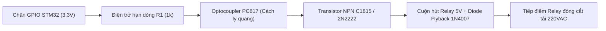
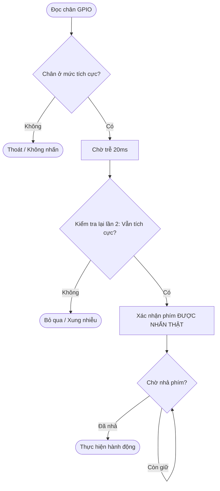

# CHƯƠNG 2: ĐIỀU KHIỂN CỔNG VÀO/RA ĐA DỤNG (GPIO) & THIẾT KẾ MẠCH GHÉP NỐI NGOẠI VI CƠ BẢN
*(Biên soạn dựa trên Chapter 1: Introduction to Embedded Systems - Arm Education Textbook kết hợp Chuẩn kỹ thuật phần cứng STM32F4)*

---

## 2.1. MỤC TIÊU CỦA CHƯƠNG
Sau khi học xong chương này, sinh viên ngành Kỹ thuật Điện tử có khả năng:
1. **Phân tích cấu trúc phần cứng ngõ I/O:** Hiểu rõ sơ đồ nguyên lý tầng ngõ vào/ra GPIO bên trong vi điều khiển STM32F4: Cấu hình ngõ ra Push-Pull vs Open-Drain; cấu hình ngõ vào Tri-state (Floating), Pull-up, Pull-down; bảo vệ ESD và giới hạn dòng điện tối đa trên mỗi chân ($I_{IO} \le 25\text{ mA}$).
2. **Tính toán và thiết kế mạch điện tử ghép nối:** 
   - Tính toán điện trở hạn dòng cho LED phát quang.
   - Thiết kế mạch đệm công tắc Transistor BJT/MOSFET và mạch cách ly quang Optocoupler (PC817) để điều khiển đóng cắt tải công suất (Relay 5V/12V, còi Buzzer).
   - Tính toán thông số mạch lọc phần cứng chống rung phím (RC Low-pass filter) và mạch diode dập xung ngược (Flyback Diode) bảo vệ vi mạch.
3. **Làm chủ kỹ thuật lập trình:** 
   - Lập trình cấu hình thanh ghi GPIO ở cấp độ Bare-metal (`MODER`, `OTYPER`, `OSPEEDR`, `PUPDR`, `IDR`, `ODR`, `BSRR`).
   - Lập trình ứng dụng trên STM32CubeIDE sử dụng thư viện STM32 HAL và đối sánh với thư viện Mbed C++ của ARM.
4. **Hiện thực hóa hệ thống logic nhúng:** Xây dựng hoàn chỉnh mạch logic điều khiển báo động thông minh (Smart Alarm System) tích hợp phát hiện khí gas, cảm biến nhiệt độ, chốt trạng thái và giải mã mật mã bảo mật (Examples 1.1 $\div$ 1.5 của ARM).

---

## 2.2. NGUYÊN LÝ PHẦN CỨNG TẦNG VÀO/RA GPIO TRÊN STM32F4

Mỗi chân I/O trên vi điều khiển STM32F4 là một khối mạch điện tử tích hợp phức hợp có khả năng lập trình để thích ứng với nhiều mức logic và giao thức khác nhau:

```mermaid
flowchart LR
    Pin([Chân Pin I/O Ngoại vi]) <--> ProtD["Diode bảo vệ VDD / VSS"]
    ProtD <--> OutDrv["TẦNG NGÕ RA (Output Driver)
    - P-MOS & N-MOS
    - Push-Pull / Open-Drain"]
    ProtD <--> InSchmitt["TẦNG NGÕ VÀO (Input Driver)
    - Điện trở kéo Pull-up / Pull-down
    - Bộ kích Schmitt Trigger"]
    OutDrv <-- ThanhGhiOut["Thanh ghi ODR / BSRR / Mạch AF"]
    InSchmitt --> ThanhGhiIn["Thanh ghi IDR / Ngắt EXTI"]
```

### 1. Phân tích các chế độ ngõ ra (Output Modes)
- **Output Push-Pull (Đẩy - Kéo):**
  - Mạch gồm 2 transistor MOSFET bổ phím (P-MOS nối nguồn $V_{DD}$, N-MOS nối mass $V_{SS}$).
  - Khi xuất mức logic '1': P-MOS dẫn, N-MOS ngắt $\rightarrow$ Chân I/O nối lên $V_{DD}$ (3.3V), dòng điện chạy từ chân MCU ra tải (Current Sourcing).
  - Khi xuất mức logic '0': P-MOS ngắt, N-MOS dẫn $\rightarrow$ Chân I/O nối xuống $V_{SS}$ (0V), dòng điện chạy từ tải vào chân MCU (Current Sinking).
  - *Ứng dụng:* Điều khiển LED, chân chọn chip SPI (CS/NSS), đường truyền xung nhịp SCK, các đường tín hiệu số tốc độ cao.
- **Output Open-Drain (Cực máng hở):**
  - P-MOS bị vô hiệu hóa hoàn toàn, chỉ còn N-MOS hoạt động.
  - Khi xuất mức logic '0': N-MOS dẫn $\rightarrow$ Kéo chân I/O xuống 0V.
  - Khi xuất mức logic '1': N-MOS ngắt $\rightarrow$ Chân I/O ở trạng thái trở kháng cao (High-Impedance / Hi-Z). Điện áp trên chân hoàn toàn phụ thuộc vào điện trở kéo lên bên ngoài (External Pull-up Resistor).
  - *Ứng dụng:* Đường truyền hai dây $I^2C$ ($SDA, SCL$), giao tiếp 1-Wire, ghép nối các vi mạch hoạt động ở các mức điện áp khác nhau (ví dụ STM32 3.3V giao tiếp với ngoại vi 5V nhờ chân 5V-tolerant).

### 2. Phân tích các chế độ ngõ vào (Input Modes)
- **Input Floating (Thả nổi / Tri-state):** Cả hai điện trở nội Pull-up và Pull-down đều bị ngắt. Điện áp trên chân phụ thuộc vào mạch bên ngoài. Nếu chân để hở, nhiễu điện từ môi trường sẽ làm mức logic dao động bất định giữa 0 và 1.
- **Input Pull-up:** Kích hoạt điện trở nội nối lên $V_{DD}$ (giá trị $R_{PU} \approx 30\text{ k}\Omega \div 50\text{ k}\Omega$). Thích hợp khi ghép nối nút nhấn nối mass (nhấn phím = mức 0).
- **Input Pull-down:** Kích hoạt điện trở nội nối xuống $V_{SS}$ ($R_{PD} \approx 30\text{ k}\Omega \div 50\text{ k}\Omega$). Thích hợp khi ghép nối nút nhấn nối nguồn (nhấn phím = mức 1).
- **Bộ kích Schmitt Trigger:** Mọi tín hiệu analog ngõ vào sau khi qua điện trở kéo đều đi qua cổng Schmitt Trigger để chuẩn hóa thành dạng sóng vuông sắc cạnh, có dải trễ (Hysteresis $\Delta V \approx 200\text{ mV}$) giúp triệt tiêu hiện tượng dao động logic khi tín hiệu biến thiên chậm ở vùng ngưỡng.

---

## 2.3. TÍNH TOÁN VÀ THIẾT KẾ MẠCH NGUYÊN LÝ GHÉP NỐI PHẦN CỨNG

### 1. Mạch điều khiển LED phát quang (Chỉ báo báo động - Alarm LED)
Khi vi điều khiển xuất mức '1' ($V_{OH} = 3.3\text{ V}$) để thắp sáng LED có điện áp rơi tiếp giáp $V_F$ và dòng định mức $I_F$:
$$R_{limit} = \frac{V_{OH} - V_F}{I_F}$$

*Ví dụ tính toán thực tế:*
- Sử dụng LED đơn màu đỏ: $V_F \approx 1.8\text{ V}$, dòng sáng rõ an toàn cho vi điều khiển chọn $I_F = 5\text{ mA} = 0.005\text{ A}$.
$$R_{limit} = \frac{3.3\text{ V} - 1.8\text{ V}}{0.005\text{ A}} = \frac{1.5}{0.005} = 300\text{ }\Omega$$
- Chọn giá trị điện trở thương mại chuẩn chuẩn E24: $R = 330\text{ }\Omega$ (công suất tiêu tán $P = I_F^2 \times R = (0.005)^2 \times 330 = 8.25\text{ mW}$, chọn điện trở vạch trở $1/4\text{ W}$).

### 2. Mạch đóng cắt tải công suất (Relay 5V / Còi báo động Buzzer) qua Transistor và Optocoupler
Dòng điện tối đa một chân GPIO của STM32 có thể cấp an toàn là $8\text{ mA}$ (tuyệt đối không vượt quá $25\text{ mA}$, và tổng dòng của toàn bộ chip không quá $120\text{ mA}$). Cuộn hút Relay 5V tiêu thụ dòng từ $70\text{ mA} \div 100\text{ mA}$, do đó **bắt buộc phải sử dụng mạch đệm công suất**:



> [!WARNING]
> **Hiện tượng sức điện động cảm ứng ngược:**  
> Khi ngắt dòng điện đột ngột qua cuộn dây cảm kháng của Relay, theo định luật Faraday sẽ sinh ra một điện áp cảm ứng ngược:
> $$V_{spike} = -L \frac{di}{dt}$$
> Điện áp này có thể lên tới hàng trăm Volt, đánh thủng Transistor ngay lập tức. Bắt buộc phải mắc một diode dập xung ngược (**Flyback Diode** như $1N4007$ hoặc Schottky $SS34$) mắc song song ngược cực tính với cuộn dây để xả năng lượng từ trường một cách an toàn.

### 3. Mạch nút nhấn ngõ vào và bài toán chống rung phím (Key Debounce)
Tiếp điểm cơ khí của nút nhấn khi đóng hoặc nhả không bao giờ tiếp xúc êm thuận mà bị nảy cơ học (Bouncing) trong khoảng thời gian từ $5\text{ ms} \div 20\text{ ms}$, tạo ra hàng chục xung logic giả khiến vi điều khiển đếm sai số lần nhấn.

#### A. Chống rung bằng phần cứng (Hardware Debounce - Mạch lọc RC)
- Mắc thêm tụ điện song song với tiếp điểm nút nhấn:
$$\tau = R \times C \ge 10\text{ ms}$$
- Chọn $R = 10\text{ k}\Omega$, suy ra $C = \frac{0.01\text{ s}}{10000\text{ }\Omega} = 1\mu\text{F}$. Tụ điện sẽ hấp thụ toàn bộ các gai xung nhọn do rung cơ khí tạo ra.

#### B. Chống rung bằng phần mềm (Software Debounce)
Lưu đồ thuật toán phát hiện trạng thái ổn định:


---

## 2.4. PHÂN TÍCH HỆ THỐNG THANH GHI ĐIỀU KHIỂN GPIO (STM32F4)

Mỗi Port GPIO (từ `GPIOA` đến `GPIOK`) có 10 thanh ghi 32-bit:

| Tên thanh ghi | Chức năng chi tiết | Mô tả cấu hình bit |
| :--- | :--- | :--- |
| `MODER` | Chế độ hoạt động của chân | 2 bit cho mỗi chân: `00`: Input; `01`: General Purpose Output; `10`: Alternate Function; `11`: Analog |
| `OTYPER` | Kiểu ngõ ra | 1 bit cho mỗi chân: `0`: Output Push-Pull; `1`: Output Open-Drain |
| `OSPEEDR` | Tốc độ đáp ứng ngõ ra | 2 bit cho mỗi chân: `00`: Low speed (2MHz); `01`: Medium (25MHz); `10`: Fast (50MHz); `11`: High speed (100MHz) |
| `PUPDR` | Cấu hình điện trở kéo | 2 bit cho mỗi chân: `00`: No pull; `01`: Pull-up; `10`: Pull-down; `11`: Reserved |
| `IDR` | Đọc dữ liệu ngõ vào (Input Data) | 16 bit thấp `[0..15]` phản ánh trạng thái logic hiện tại của các chân tương ứng (Chỉ đọc - Read Only) |
| `ODR` | Ghi dữ liệu ngõ ra (Output Data) | 16 bit thấp `[0..15]` ghi giá trị logic xuất ra chân (Đọc/Ghi - Read/Write) |
| `BSRR` | Thiết lập / Xóa bit nguyên tử (Bit Set/Reset) | 16 bit thấp `[0..15]`: Ghi '1' để Set chân lên mức cao; 16 bit cao `[16..31]`: Ghi '1' để Reset chân xuống mức thấp |

> [!TIP]
> **Tại sao nên dùng thanh ghi `BSRR` thay vì `ODR`?**  
> Việc thay đổi một bit trên thanh ghi `ODR` đòi hỏi chu trình đọc - sửa - ghi (Read-Modify-Write, ví dụ `GPIOD->ODR |= (1<<12)`), thao tác này mất ít nhất 3 chu kỳ lệnh và có thể bị ngắt (Interrupt) xen vào giữa làm hỏng dữ liệu. Trong khi đó, ghi vào `BSRR` là một thao tác **nguyên tử (Atomic operation)** thực thi chỉ trong đúng 1 chu kỳ clock, an toàn tuyệt đối ngay cả khi có ngắt.

---

## 2.5. PHÂN TÍCH VÀ HIỆN THỰC HÓA CÁC VÍ DỤ CỐT LÕI (EXAMPLES 1.1 $\div$ 1.5)

### Bảng phân bổ chân phần cứng theo hệ thống Smart Home (Kit ST Nucleo-F429ZI / F401RE):
- **Ngõ ra:**
  - LED Báo động chính (`alarmLed`): Chân `PB0` (LED1 xanh lá trên kit Nucleo) hoặc `PD12` (trên Discovery).
  - LED Báo nhập sai mã (`incorrectCodeLed`): Chân `PB14` (LED3 đỏ).
  - LED Báo hệ thống bị khóa (`systemBlockedLed`): Chân `PB7` (LED2 xanh dương).
- **Ngõ vào:**
  - Cảm biến phát hiện khí gas (`gasDetector`): Chân `PG14` (Arduino D2 header), ngõ vào có điện trở kéo xuống Pull-down.
  - Cảm biến quá nhiệt (`overTempDetector`): Chân `PE13` (Arduino D3 header), kéo xuống Pull-down.
  - Nút nhấn giải mã số 1 (`aButton`): Chân `PF15` (Arduino D4 header).
  - Nút nhấn giải mã số 2 (`bButton`): Chân `PE11` (Arduino D5 header).

---

### VÍ DỤ 1.1: BÁO ĐỘNG KHI PHÁT HIỆN RÒ RỈ KHÍ GAS (Example 1.1)
- **Mô tả hành vi:** Giám sát liên tục tín hiệu từ cảm biến khí gas. Nếu phát hiện khí gas (`gasDetector == 1`), bật đèn LED báo động (`alarmLed = 1`). Nếu không có gas, tắt đèn báo động.

#### 1. Triển khai theo phong cách Mbed C++ (Giáo trình ARM - Listing 1.1)
```cpp
#include "mbed.h"
#include "arm_book_lib.h"

int main()
{
    // Khởi tạo đối tượng DigitalIn trên chân D2 với trở kéo xuống
    DigitalIn gasDetector(D2);
    // Khởi tạo đối tượng DigitalOut điều khiển LED1
    DigitalOut alarmLed(LED1);

    gasDetector.mode(PullDown);
    alarmLed = OFF;

    while (true) {
        if (gasDetector == ON) {
            alarmLed = ON;
        } else {
            alarmLed = OFF;
        }
    }
}
```

#### 2. Triển khai theo chuẩn công nghiệp C (STM32 HAL Library)
```c
#include "main.h"

int main(void)
{
    HAL_Init();
    SystemClock_Config();

    // 1. Kích hoạt xung nhịp cho GPIOG (chứa chân D2 - PG14) và GPIOB (chứa LED1 - PB0)
    __HAL_RCC_GPIOG_CLK_ENABLE();
    __HAL_RCC_GPIOB_CLK_ENABLE();

    GPIO_InitTypeDef GPIO_InitStruct = {0};

    // 2. Cấu hình chân ngõ ra cho LED báo động (PB0)
    GPIO_InitStruct.Pin = GPIO_PIN_0;
    GPIO_InitStruct.Mode = GPIO_MODE_OUTPUT_PP;
    GPIO_InitStruct.Pull = GPIO_NOPULL;
    GPIO_InitStruct.Speed = GPIO_SPEED_FREQ_LOW;
    HAL_GPIO_Init(GPIOB, &GPIO_InitStruct);

    // 3. Cấu hình chân ngõ vào cho Cảm biến Gas (PG14) có trở kéo xuống Pull-down
    GPIO_InitStruct.Pin = GPIO_PIN_14;
    GPIO_InitStruct.Mode = GPIO_MODE_INPUT;
    GPIO_InitStruct.Pull = GPIO_PULLDOWN;
    HAL_GPIO_Init(GPIOG, &GPIO_InitStruct);

    // Tắt LED ban đầu
    HAL_GPIO_WritePin(GPIOB, GPIO_PIN_0, GPIO_PIN_RESET);

    // Vòng lặp điều khiển chính (Superloop)
    while (1)
    {
        if (HAL_GPIO_ReadPin(GPIOG, GPIO_PIN_14) == GPIO_PIN_SET)
        {
            HAL_GPIO_WritePin(GPIOB, GPIO_PIN_0, GPIO_PIN_SET);   // Bật còi/đèn báo
        }
        else
        {
            HAL_GPIO_WritePin(GPIOB, GPIO_PIN_0, GPIO_PIN_RESET); // Tắt còi/đèn báo
        }
    }
}
```

#### 3. Triển khai cấp thanh ghi trực tiếp (Bare-Metal CMSIS)
```c
#include "stm32f4xx.h"

int main(void)
{
    // 1. Cấp xung clock cho Port B và Port G trên bus AHB1
    RCC->AHB1ENR |= (RCC_AHB1ENR_GPIOBEN | RCC_AHB1ENR_GPIOGEN);

    // 2. Cấu hình PB0 là Output Push-Pull (MODER[1:0] = 01)
    GPIOB->MODER &= ~(3U << (0 * 2));
    GPIOB->MODER |=  (1U << (0 * 2));

    // 3. Cấu hình PG14 là Input (MODER[29:28] = 00) có Pull-down (PUPDR[29:28] = 10)
    GPIOG->MODER &= ~(3U << (14 * 2));
    GPIOG->PUPDR &= ~(3U << (14 * 2));
    GPIOG->PUPDR |=  (2U << (14 * 2)); // 10: Pull-down

    while (1)
    {
        // Đọc bit 14 trong thanh ghi IDR của GPIOG
        if (GPIOG->IDR & (1U << 14))
        {
            GPIOB->BSRR = (1U << 0);       // Set PB0 lên mức cao
        }
        else
        {
            GPIOB->BSRR = (1U << (0 + 16)); // Reset PB0 xuống mức thấp
        }
    }
}
```

---

### VÍ DỤ 1.2: BÁO ĐỘNG KHI CÓ KHÍ GAS HOẶC QUÁ NHIỆT (Example 1.2)
- **Mô tả hành vi:** Bổ sung cảm biến quá nhiệt độ (`overTempDetector`). Báo động sẽ kích hoạt nếu có Gas **HOẶC** Quá nhiệt (Toán tử logic OR `||`).
```c
// Lôgic điều khiển cốt lõi:
if ((HAL_GPIO_ReadPin(GPIOG, GPIO_PIN_14) == GPIO_PIN_SET) ||
    (HAL_GPIO_ReadPin(GPIOE, GPIO_PIN_13) == GPIO_PIN_SET))
{
    HAL_GPIO_WritePin(GPIOB, GPIO_PIN_0, GPIO_PIN_SET);
}
else
{
    HAL_GPIO_WritePin(GPIOB, GPIO_PIN_0, GPIO_PIN_RESET);
}
```

---

### VÍ DỤ 1.3: CHỐT TRẠNG THÁI BÁO ĐỘNG (LATCHING ALARM STATE) (Example 1.3)
- **Vấn đề kỹ thuật:** Trong thực tế, khi khí gas rò rỉ làm chuông reo rồi gió thổi tan khí gas, nếu không có cơ chế chốt, chuông sẽ lập tức tắt khiến gia chủ không biết vừa xảy ra sự cố nguy hiểm.
- **Giải pháp:** Sử dụng một biến trạng thái logic `alarmState`. Khi xảy ra sự cố, `alarmState` chuyển lên 1 và **tự giữ nguyên** ngay cả khi cảm biến đã trở về bình thường.
```c
uint8_t alarmState = 0; // Biến trạng thái chốt

while (1)
{
    // Nếu có sự cố gas hoặc nhiệt, chốt báo động được kích hoạt
    if (HAL_GPIO_ReadPin(GPIOG, GPIO_PIN_14) || HAL_GPIO_ReadPin(GPIOE, GPIO_PIN_13))
    {
        alarmState = 1;
    }

    // Xuất tín hiệu ra ngoại vi dựa trên biến trạng thái chốt
    if (alarmState == 1)
    {
        HAL_GPIO_WritePin(GPIOB, GPIO_PIN_0, GPIO_PIN_SET);
    }
}
```

---

### VÍ DỤ 1.4: TẮT BÁO ĐỘNG BẢO MẬT BẰNG TỔ HỢP PHÍM (Example 1.4)
- **Mô tả hành vi:** Để tắt báo động đã chốt, người dùng phải nhấn đồng thời 2 nút nhấn bí mật (`aButton` trên chân PF15 và `bButton` trên chân PE11). Nếu nhấn sai tổ hợp, báo động không tắt và đèn báo sai mã `incorrectCodeLed` (PB14) sẽ sáng lên.
```c
uint8_t alarmState = 0;

while (1)
{
    // Kích hoạt báo động
    if (HAL_GPIO_ReadPin(GPIOG, GPIO_PIN_14) || HAL_GPIO_ReadPin(GPIOE, GPIO_PIN_13))
    {
        alarmState = 1;
    }

    if (alarmState == 1)
    {
        HAL_GPIO_WritePin(GPIOB, GPIO_PIN_0, GPIO_PIN_SET); // Bật còi báo động

        // Kiểm tra người dùng nhập tổ hợp giải mã
        uint8_t a = HAL_GPIO_ReadPin(GPIOF, GPIO_PIN_15);
        uint8_t b = HAL_GPIO_ReadPin(GPIOE, GPIO_PIN_11);

        // Quy ước mã đúng: Nhấn cả A và B cùng lúc (a == 1 && b == 1)
        if (a && b)
        {
            alarmState = 0; // Tắt chốt báo động
            HAL_GPIO_WritePin(GPIOB, GPIO_PIN_0, GPIO_PIN_RESET);
            HAL_GPIO_WritePin(GPIOB, GPIO_PIN_14, GPIO_PIN_RESET); // Tắt đèn báo sai mã
        }
        else if (a || b) // Nhấn chỉ A hoặc chỉ B -> Sai mã
        {
            HAL_GPIO_WritePin(GPIOB, GPIO_PIN_14, GPIO_PIN_SET); // Bật đèn cảnh báo nhập sai
        }
    }
}
```

---

### VÍ DỤ 1.5: ĐẾM SỐ LẦN NHẬP SAI VÀ KHÓA HỆ THỐNG AN TOÀN (Example 1.5)
- **Mô tả hành vi:** Bổ sung thuật toán phòng thủ tấn công vét cạn (Brute-force attack). Nếu người lạ nhập sai mã quá 5 lần, hệ thống sẽ chuyển sang trạng thái khóa cứng (`systemBlockedLed` sáng trên PB7), còi hú liên tục và vô hiệu hóa các nút bấm mở khóa.
```c
uint8_t alarmState = 0;
uint8_t numberOfIncorrectCodes = 0;
uint8_t systemBlocked = 0;

while (1)
{
    if (systemBlocked)
    {
        // Khi bị khóa: Giữ còi báo và bật LED báo khóa hệ thống vĩnh viễn
        HAL_GPIO_WritePin(GPIOB, GPIO_PIN_0, GPIO_PIN_SET);
        HAL_GPIO_WritePin(GPIOB, GPIO_PIN_7, GPIO_PIN_SET);
        continue; // Bỏ qua toàn bộ xử lý mở khóa bên dưới
    }

    if (HAL_GPIO_ReadPin(GPIOG, GPIO_PIN_14) || HAL_GPIO_ReadPin(GPIOE, GPIO_PIN_13))
    {
        alarmState = 1;
    }

    if (alarmState == 1)
    {
        HAL_GPIO_WritePin(GPIOB, GPIO_PIN_0, GPIO_PIN_SET);

        uint8_t a = HAL_GPIO_ReadPin(GPIOF, GPIO_PIN_15);
        uint8_t b = HAL_GPIO_ReadPin(GPIOE, GPIO_PIN_11);

        if (a && b) // Đúng mã
        {
            alarmState = 0;
            numberOfIncorrectCodes = 0; // Reset số lần đếm sai
            HAL_GPIO_WritePin(GPIOB, GPIO_PIN_0, GPIO_PIN_RESET);
            HAL_GPIO_WritePin(GPIOB, GPIO_PIN_14, GPIO_PIN_RESET);
        }
        else if (a || b) // Nhập sai mã
        {
            HAL_Delay(200); // Chống dội phím cơ bản
            numberOfIncorrectCodes++;
            HAL_GPIO_WritePin(GPIOB, GPIO_PIN_14, GPIO_PIN_SET);

            if (numberOfIncorrectCodes >= 5)
            {
                systemBlocked = 1; // Kích hoạt cờ khóa hệ thống
            }
        }
    }
}
```

---

## 2.6. CÁC LỖI KỸ THUẬT PHẦN CỨNG THƯỜNG GẶP & CÁCH GỠ LỖI (TROUBLESHOOTING)

| Hiện tượng lỗi thực tế | Nguyên nhân gốc rễ (Root Cause) | Giải pháp xử lý chuẩn kỹ thuật |
| :--- | :--- | :--- |
| Nút nhấn thả tay ra nhưng vi điều khiển vẫn nhận mức logic 1 chập chờn | Chân GPIO đang ở chế độ **Input Floating**, không có điện trở phân cực làm chân bị nhiễm sóng điện từ môi trường | Cấu hình bit trong thanh ghi `PUPDR` thành **Pull-down** hoặc gắn điện trở xả $10\text{ k}\Omega$ ngoài xuống GND |
| Nhấn nút 1 lần nhưng biến đếm `numberOfIncorrectCodes` nhảy vọt lên 5-10 lần | Do hiện tượng rung tiếp điểm cơ khí (Contact Bouncing) tạo ra chuỗi xung nảy $10\text{ ms}$ | Thêm tụ lọc gốm $100\text{nF} \div 1\mu\text{F}$ song song với nút nhấn hoặc viết hàm trễ `HAL_Delay(20)` xác nhận phím |
| Vi điều khiển bị Reset ngẫu nhiên mỗi khi Relay đóng cắt đèn | Tia lửa điện hồ quang tại tiếp điểm Relay gây sụt áp nguồn và phát xạ nhiễu EMI truyền ngược về chân MCU qua đường cấp nguồn | Tách riêng đường nguồn nuôi Relay (5V/12V rời), sử dụng Optocoupler PC817 cách ly tuyệt đối mass vi điều khiển và mass cuộn dây Relay |
| Ghi giá trị vào `ODR` nhưng điện áp trên chân vẫn là 0V | Quên chưa cấp xung nhịp cho Port GPIO tương ứng trong thanh ghi `RCC_AHB1ENR` | Gọi macro `__HAL_RCC_GPIOx_CLK_ENABLE()` hoặc dòng lệnh `RCC->AHB1ENR |= RCC_AHB1ENR_GPIOxEN;` ở đầu chương trình |

---

## 2.7. CÂU HỎI ÔN TẬP VÀ BÀI TẬP THIẾT KẾ

### A. Câu hỏi Lý thuyết & Mạch Điện tử
1. **Câu 1:** Vẽ sơ đồ tương đương của tầng ngõ ra GPIO ở chế độ **Output Push-Pull** và **Output Open-Drain**. Tại sao bus $I^2C$ lại bắt buộc phải dùng chế độ Open-Drain kết hợp với điện trở kéo lên Pull-up?
2. **Câu 2:** Hãy tính toán giá trị điện trở phân cực $R_B$ cho Transistor NPN C1815 ($\beta = 100$) để đóng cắt một cuộn dây Relay $5\text{ V}$ có điện trở cuộn dây $R_{coil} = 70\text{ }\Omega$. Biết ngõ ra GPIO của STM32 xuất mức cao $3.3\text{ V}$.
3. **Câu 3:** Trình bày tác hại của hiện tượng dội phím (Contact Bouncing). Nếu không dùng tụ lọc phần cứng, hãy vẽ lưu đồ thuật toán chống rung phím bằng phần mềm sử dụng bộ định thời (Non-blocking timer).

### B. Bài tập Lập trình Ứng dụng
1. **Bài tập 1:** Nâng cấp hệ thống báo động trong Ví dụ 1.5: Thay vì khóa hệ thống vĩnh viễn khi nhập sai 5 lần, hãy lập trình để hệ thống tự động khóa trong vòng **30 giây** (LED đỏ nhấp nháy liên tục tần số 2Hz). Sau 30 giây, hệ thống cho phép người dùng nhập lại mã.
2. **Bài tập 2:** Viết chương trình điều khiển hệ thống đèn giao thông ngã tư (2 cụm đèn Đỏ - Vàng - Xanh) sử dụng phương pháp máy trạng thái (FSM) và truy xuất thanh ghi trực tiếp (Bare-metal CMSIS) với thanh ghi `BSRR`.
