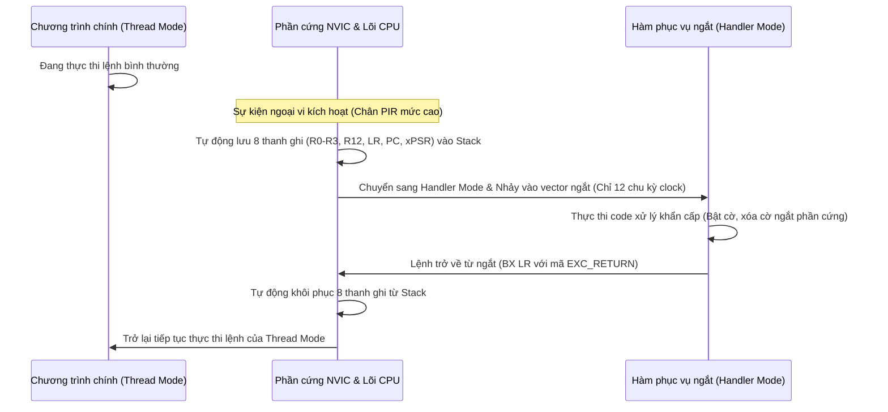
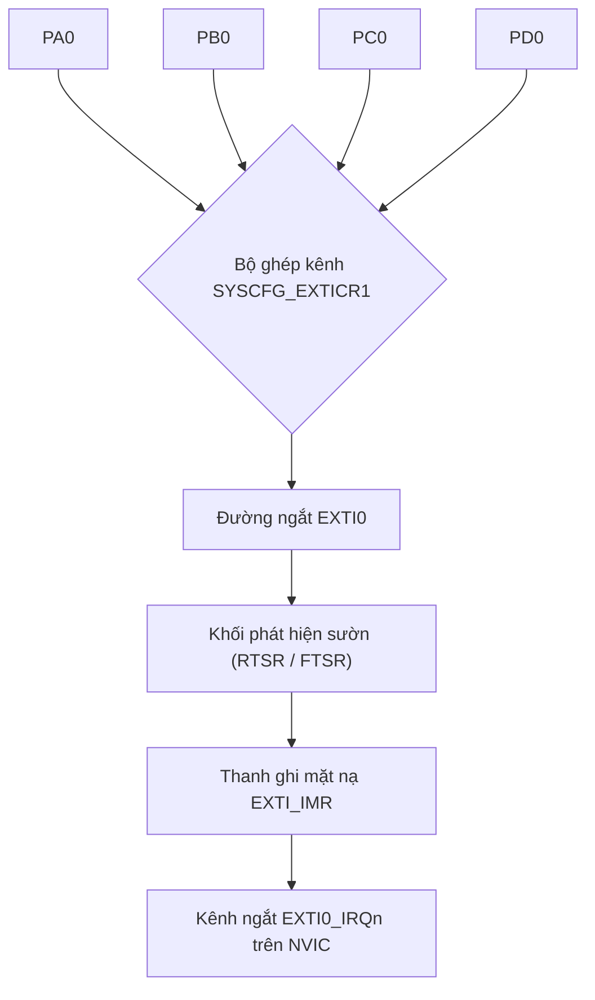
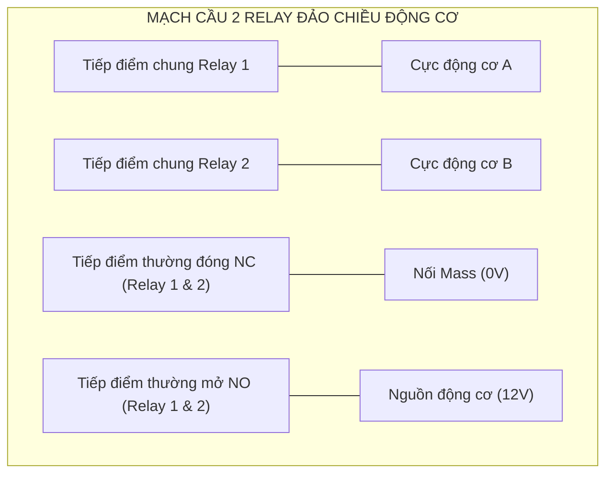

# CHƯƠNG 3: HỆ THỐNG QUẢN LÝ NGẮT (NVIC), NGẮT NGOÀI (EXTI) & ĐIỀU KHIỂN ĐỘNG CƠ DC
*(Biên soạn dựa trên Chapter 7: DC Motor Driving using Relays and Interrupts - Arm Education Textbook kết hợp Chuẩn kỹ thuật phần cứng STM32F4)*

---

## 3.1. MỤC TIÊU CỦA CHƯƠNG
Sau khi hoàn thành chương này, sinh viên ngành Kỹ thuật Điện tử có khả năng:
1. **Làm chủ cơ chế ngắt thời gian thực:** Hiểu rõ bản chất hoạt động của khối điều khiển ngắt lồng nhau NVIC (Nested Vectored Interrupt Controller), bảng vector ngắt (Interrupt Vector Table), cơ chế chuyển đổi ngữ cảnh (Context Switching) và tính toán độ trễ ngắt (Interrupt Latency).
2. **Cấu hình khối ngắt ngoài EXTI (Extended Interrupts Controller):**
   - Ánh xạ các chân GPIO vào 16 đường ngắt ngoài `EXTI0` $\div$ `EXTI15` thông qua thanh ghi cấu hình hệ thống `SYSCFG_EXTICR`.
   - Cấu hình phát hiện ngắt theo sườn lên (Rising Edge), sườn xuống (Falling Edge) hoặc cả hai sườn.
   - Phân cấp mức ưu tiên ngắt: Nhóm ưu tiên (Priority Grouping), độ ưu tiên chiếm quyền (Preemption Priority) và độ ưu tiên phụ (Sub-Priority).
3. **Thiết kế mạch điều khiển động cơ DC & Cảm biến chuyển động PIR:**
   - Ghép nối cảm biến chuyển động hồng ngoại thụ động (PIR Motion Sensor HC-SR501) kích hoạt ngắt vi điều khiển.
   - Thiết kế mạch điều khiển đảo chiều động cơ DC sử dụng 2 Relay hoặc mạch cầu H (H-Bridge) có bảo vệ quá dòng và diode dập xung ngược.
4. **Quy chuẩn lập trình hàm phục vụ ngắt (ISR) chuẩn mực:**
   - Sử dụng đúng từ khóa `volatile` để chống lỗi tối ưu hóa của trình biên dịch.
   - Xóa cờ ngắt đúng quy trình phần cứng, viết ISR ngắn gọn theo kiến trúc cờ hiệu (Flag polling / Event-driven architecture).
   - Hiện thực hóa hệ thống đóng mở cổng tự động thông minh (Examples 7.1 $\div$ 7.4 của ARM).

---

## 3.2. CƠ CHẾ HOẠT ĐỘNG CỦA BỘ ĐIỀU KHIỂN NGẮT LÕI NVIC (ARM CORTEX-M4)

Khác với kiến trúc vi điều khiển cổ điển phải dùng phần mềm để thăm dò (Polling) liên tục làm tiêu hao tài nguyên CPU, lõi ARM Cortex-M4 tích hợp phần cứng quản lý ngắt NVIC cực kỳ mạnh mẽ:



### 1. Cơ chế Stacking phần cứng (Tự động lưu ngữ cảnh)
Khi ngắt xảy ra, phần cứng vi điều khiển Cortex-M4 tự động đẩy 8 thanh ghi quan trọng vào ngăn xếp (Stack) mà không cần lập trình viên phải viết lệnh Assembly:
$$\text{Stack Frame: } \{ R0, R1, R2, R3, R12, LR, PC, xPSR \}$$
Nhờ cơ chế này, độ trễ từ lúc chân phần cứng nhận tín hiệu đến khi bắt đầu thực thi dòng lệnh đầu tiên trong ISR chỉ mất đúng **12 chu kỳ xung nhịp** (độ trễ thấp nhất trong các dòng vi điều khiển 32-bit).

### 2. Phân chia mức độ ưu tiên ngắt (Priority Grouping)
STM32F4 cung cấp 16 mức ưu tiên ngắt (sử dụng 4-bit trọng số cao). Được phân chia thành 2 cấp độ:
- **Preemption Priority (Ưu tiên chiếm quyền):** Một ngắt có Preemption Priority cao hơn (giá trị số nhỏ hơn) CÓ THỂ cắt ngang một ngắt đang thực thi có mức ưu tiên thấp hơn (hiện tượng ngắt lồng nhau - Nested Interrupts).
- **Sub-Priority (Ưu tiên phụ):** Nếu hai ngắt có cùng Preemption Priority xảy ra đồng thời, ngắt nào có Sub-Priority nhỏ hơn sẽ được CPU phục vụ trước. Tuy nhiên, Sub-Priority **không thể** cắt ngang nhau.

---

## 3.3. KHỐI NGẮT NGOÀI EXTI VÀ BỘ CHỌN ĐƯỜNG DÂY `SYSCFG`

Vi điều khiển STM32F4 có hàng trăm chân I/O, nhưng chỉ có **16 đường ngắt ngoài (EXTI0 $\div$ EXTI15)** tương ứng với số thứ tự của chân:
- Chân `PA0, PB0, PC0, PD0...` đều nối chung vào đường `EXTI0`.
- Chân `PA1, PB1, PC1, PD1...` đều nối chung vào đường `EXTI1`.
- ...
- Chân `PA15, PB15, PC15...` đều nối chung vào đường `EXTI15`.



> [!CRITICAL]
> **Quy tắc bất biến:** Tại một thời điểm, chỉ có **duy nhất 1 Port** được phép kích hoạt ngắt trên một đường dây EXTI. Ví dụ, nếu đã cấu hình `PA0` làm ngắt thì không thể sử dụng đồng thời `PD0` làm ngắt!

---

## 3.4. THIẾT KẾ MẠCH ĐIỆN TỬ ĐIỀU KHIỂN ĐỘNG CƠ DC VÀ CẢM BIẾN PIR

### 1. Cảm biến chuyển động PIR (Passive Infrared Sensor)
- Module HC-SR501 phát hiện sự thay đổi bức xạ hồng ngoại từ cơ thể người di chuyển.
- Ngõ ra dạng số (Digital Output): Khi phát hiện chuyển động, chân tín hiệu chuyển từ mức $0\text{V} \rightarrow 3.3\text{V}$ (Sườn lên - Rising Edge).
- Ghép nối trực tiếp vào chân GPIO (ví dụ `PG14` / `D2`) và cấu hình ngắt ngoài bắt sườn lên.

### 2. Mạch đảo chiều động cơ DC sử dụng 2 Relay (Mô phỏng cổng tự động)
Để cổng có thể đóng và mở, động cơ DC cần quay theo hai chiều thuận/nghịch:



- **Trạng thái Dừng (Stop):** Cả 2 Relay đều tắt $\rightarrow$ Cả 2 cực động cơ nối mass $\rightarrow$ Hãm động năng (Braking).
- **Trạng thái Mở cổng (Forward):** Bật Relay 1, Tắt Relay 2 $\rightarrow$ Cực A nối 12V, cực B nối 0V $\rightarrow$ Động cơ quay thuận.
- **Trạng thái Đóng cổng (Reverse):** Tắt Relay 1, Bật Relay 2 $\rightarrow$ Cực A nối 0V, cực B nối 12V $\rightarrow$ Động cơ quay nghịch.

---

## 3.5. HIỆN THỰC HÓA CÁC VÍ DỤ CỐT LÕI (EXAMPLES 7.1 $\div$ 7.4)

### VÍ DỤ 7.1: BẮT SỰ KIỆN CHUYỂN ĐỘNG BẰNG NGẮT NGOÀI (Example 7.1)
- Khi có người đi qua cảm biến PIR, ngắt ngoài được kích hoạt ngay lập tức để bật hệ thống đèn chiếu sáng và báo hiệu.

#### 1. Triển khai theo chuẩn Mbed C++ (Giáo trình ARM - Listing 7.1)
```cpp
#include "mbed.h"
#include "arm_book_lib.h"

// Khởi tạo đối tượng ngắt ngoài trên chân D2
InterruptIn pirSensor(D2);
DigitalOut lightLed(LED1);

// Hàm phục vụ ngắt (ISR)
void motionDetectedCallback()
{
    lightLed = ON;
}

int main()
{
    lightLed = OFF;
    pirSensor.mode(PullDown);
    // Gắn hàm callback thực thi khi có sườn lên (Rising Edge)
    pirSensor.rise(&motionDetectedCallback);

    while (true) {
        // CPU có thể nghỉ hoặc làm nhiệm vụ khác mà không cần thăm dò chân D2
        sleep();
    }
}
```

#### 2. Triển khai theo chuẩn C Công nghiệp (STM32 HAL Library)
```c
#include "main.h"

// Biến cờ hiệu ngắt - BẮT BUỘC có từ khóa volatile
volatile uint8_t motionDetectedFlag = 0;

void System_Init_GPIO_Interrupt(void)
{
    __HAL_RCC_GPIOG_CLK_ENABLE();
    __HAL_RCC_GPIOB_CLK_ENABLE();

    GPIO_InitTypeDef GPIO_InitStruct = {0};

    // 1. Cấu hình PB0 là ngõ ra điều khiển đèn
    GPIO_InitStruct.Pin = GPIO_PIN_0;
    GPIO_InitStruct.Mode = GPIO_MODE_OUTPUT_PP;
    GPIO_InitStruct.Pull = GPIO_NOPULL;
    HAL_GPIO_Init(GPIOB, &GPIO_InitStruct);

    // 2. Cấu hình PG14 là Ngắt ngoài bắt sườn lên
    GPIO_InitStruct.Pin = GPIO_PIN_14;
    GPIO_InitStruct.Mode = GPIO_MODE_IT_RISING;
    GPIO_InitStruct.Pull = GPIO_PULLDOWN;
    HAL_GPIO_Init(GPIOG, &GPIO_InitStruct);

    // 3. Cấu hình NVIC: Cho phép ngắt đường EXTI15_10_IRQn với mức ưu tiên 2
    HAL_NVIC_SetPriority(EXTI15_10_IRQn, 2, 0);
    HAL_NVIC_EnableIRQ(EXTI15_10_IRQn);
}

// Hàm Callback ngắt ngoài chuẩn của STM32 HAL (tự động xóa cờ ngắt)
void HAL_GPIO_EXTI_Callback(uint16_t GPIO_Pin)
{
    if (GPIO_Pin == GPIO_PIN_14)
    {
        motionDetectedFlag = 1; // Chỉ bật cờ hiệu trong ngắt, xử lý sau ở main
    }
}

int main(void)
{
    HAL_Init();
    System_Init_GPIO_Interrupt();

    while (1)
    {
        if (motionDetectedFlag)
        {
            motionDetectedFlag = 0;
            HAL_GPIO_WritePin(GPIOB, GPIO_PIN_0, GPIO_PIN_SET);
            HAL_Delay(3000); // Giữ đèn sáng 3 giây
            HAL_GPIO_WritePin(GPIOB, GPIO_PIN_0, GPIO_PIN_RESET);
        }
    }
}
```

#### 3. Triển khai cấp thanh ghi trực tiếp (Bare-Metal CMSIS)
```c
#include "stm32f4xx.h"

volatile uint8_t motionFlag = 0;

void EXTI15_10_IRQHandler(void)
{
    // Kiểm tra cờ ngắt của đường EXTI14 trong thanh ghi PR (Pending Register)
    if (EXTI->PR & (1U << 14))
    {
        // XÓA CỜ NGẮT BẰNG CÁCH GHI '1' VÀO BIT ĐÓ (Quy chuẩn thanh ghi ST)
        EXTI->PR = (1U << 14);

        motionFlag = 1;
    }
}

void EXTI14_BareMetal_Init(void)
{
    // 1. Cấp clock cho GPIOG và khối SYSCFG
    RCC->AHB1ENR |= RCC_AHB1ENR_GPIOGEN;
    RCC->APB2ENR |= RCC_APB2ENR_SYSCFGEN;

    // 2. Cấu hình PG14 là Input Pull-down
    GPIOG->MODER &= ~(3U << (14 * 2));
    GPIOG->PUPDR &= ~(3U << (14 * 2));
    GPIOG->PUPDR |=  (2U << (14 * 2));

    // 3. Ghép nối PG14 vào đường EXTI14 qua thanh ghi SYSCFG_EXTICR4
    SYSCFG->EXTICR[3] &= ~(0xFU << 8);
    SYSCFG->EXTICR[3] |=  (0x6U << 8); // 0110: Port G

    // 4. Kích hoạt mặt nạ ngắt và bắt sườn lên
    EXTI->IMR  |= (1U << 14); // Không che ngắt đường 14
    EXTI->RTSR |= (1U << 14); // Bắt sườn lên (Rising Trigger)
    EXTI->FTSR &= ~(1U << 14); // Không bắt sườn xuống

    // 5. Cấu hình trên khối NVIC
    NVIC_SetPriority(EXTI15_10_IRQn, 2);
    NVIC_EnableIRQ(EXTI15_10_IRQn);
}
```

---

### VÍ DỤ 7.2: ĐIỀU KHIỂN ĐÓNG MỞ CỔNG TỰ ĐỘNG BẰNG ĐỘNG CƠ DC (Example 7.2)
- Khi phát hiện chuyển động qua ngắt PIR $\rightarrow$ Mở cổng (Bật Relay quay thuận trong 5 giây).
- Dừng cổng trong 3 giây.
- Đóng cổng (Bật Relay quay nghịch trong 5 giây) $\rightarrow$ Dừng hoàn toàn.
```c
void Open_Gate(void)
{
    HAL_GPIO_WritePin(RELAY1_PORT, RELAY1_PIN, GPIO_PIN_SET);
    HAL_GPIO_WritePin(RELAY2_PORT, RELAY2_PIN, GPIO_PIN_RESET);
}

void Close_Gate(void)
{
    HAL_GPIO_WritePin(RELAY1_PORT, RELAY1_PIN, GPIO_PIN_RESET);
    HAL_GPIO_WritePin(RELAY2_PORT, RELAY2_PIN, GPIO_PIN_SET);
}

void Stop_Gate(void)
{
    HAL_GPIO_WritePin(RELAY1_PORT, RELAY1_PIN, GPIO_PIN_RESET);
    HAL_GPIO_WritePin(RELAY2_PORT, RELAY2_PIN, GPIO_PIN_RESET);
}

void Process_Gate_Sequence(void)
{
    Open_Gate();
    HAL_Delay(5000); // Mở trong 5 giây
    Stop_Gate();
    HAL_Delay(3000); // Chờ 3 giây cho xe qua
    Close_Gate();
    HAL_Delay(5000); // Đóng trong 5 giây
    Stop_Gate();
}
```

---

## 3.6. QUY TẮC VÀNG KHI VIẾT HÀM PHỤC VỤ NGẮT (ISR)
1. **ISR phải thực thi cực nhanh:** Tuyệt đối không bao giờ gọi các hàm `delay`, không truyền dữ liệu dài qua UART hoặc chờ phím trong hàm ngắt.
2. **Từ khóa `volatile`:** Mọi biến toàn cục được chia sẻ giữa hàm ngắt và chương trình chính bắt buộc phải khai báo có tiền tố `volatile`. Nếu không, trình biên dịch sẽ tối ưu hóa bằng cách đọc biến từ thanh ghi CPU thay vì đọc lại từ bộ nhớ SRAM, khiến chương trình chính không nhận ra biến đã thay đổi.
3. **Luôn xóa cờ ngắt:** Trước khi thoát khỏi ISR, phải xóa cờ ngắt tương ứng trong thanh ghi `EXTI_PR`. Nếu quên xóa cờ, vi điều khiển sẽ bị kẹt vĩnh viễn trong hàm ngắt ngay sau khi vừa thoát ra.

---

## 3.7. CÂU HỎI VÀ BÀI TẬP THIẾT KẾ
1. **Câu hỏi:** Giải thích hiện tượng Context Switching và cơ chế phần cứng của lõi ARM Cortex-M4 khi lưu và phục hồi 8 thanh ghi vào Stack.
2. **Thiết kế mạch:** Thiết kế mạch cảm biến dòng điện trở Shunt kết hợp mạch so sánh Op-Amp để bảo vệ quá dòng cho động cơ DC: Khi dòng điện qua động cơ vượt quá $2\text{ A}$, ngõ ra Op-Amp nhảy lên mức cao kích hoạt ngắt EXTI lập tức dừng động cơ để chống kẹt cửa.
3. **Lập trình:** Viết chương trình đọc tín hiệu Encoder 2 kênh A và B của động cơ sử dụng ngắt ngoài EXTI để đo góc quay và xác định chiều quay của trục động cơ.
