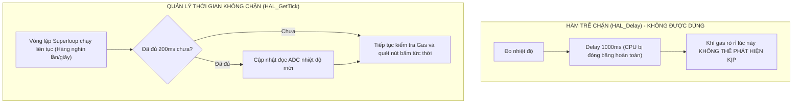

# CHƯƠNG 3: QUẢN LÝ THỜI GIAN VÀ ĐO LƯỜNG TÍN HIỆU TƯƠNG TỰ (ADC) TRÊN STM32F407
*(Biên soạn dựa trên Chapter 3: Time Management and Analog Signals - Arm Education Textbook, hiệu chỉnh chuyên sâu cho STM32F407)*

---

## 3.1. MỤC TIÊU CỦA CHƯƠNG
- **Bối cảnh kiến thức:** Sinh viên đã biết khái niệm cơ bản về tín hiệu analog và digital; chương này tập trung vào làm chủ cấu trúc bộ chuyển đổi SAR ADC 12-bit trên STM32F407, kỹ thuật chuyển đổi điện áp thành thông số vật lý và **nguyên lý quản lý thời gian không chặn (Non-blocking timing)** trong hệ thống nhúng thời gian thực.
- **Mục tiêu chi tiết:**
  1. Cấu hình khối `ADC1` trên STM32F407 để lấy mẫu đa kênh: Biến trở đặt ngưỡng (`PA1`), Cảm biến nhiệt độ LM35 (`PA2`) và Cảm biến khí gas MQ-2 (`PA3`).
  2. Hiểu và loại bỏ hoàn toàn các hàm trễ chặn (`delay_ms()`, `HAL_Delay()`) trong vòng lặp chính, thay thế bằng kỹ thuật kiểm tra mốc thời gian hệ thống (`HAL_GetTick()`) để tăng tính đáp ứng tức thời (Responsiveness).
  3. Hiện thực hóa các ví dụ từ Example 3.1 đến 3.5 trên STM32F407: Chỉ báo cảm biến kích hoạt báo động, thiết lập ngưỡng quá nhiệt linh hoạt bằng biến trở xoay, tính toán độ C thực tế và điều khiển còi báo Piezo Buzzer (`PD11`).
  4. Phân tích nguyên lý SAR ADC, độ phân giải 12-bit ($4096$ mức), điện áp tham chiếu $V_{REF+} = 3.3\text{V}$ và nghiên cứu Case Study chống đóng băng cây trồng.

---

## 3.2. PHÂN BỔ PHẦN CỨNG ADC VÀ THỜI GIAN TRÊN STM32F407

| Tên biến trong sách ARM | Thiết bị ngoại vi kết nối | Chân Pin STM32F407 | Khối ngoại vi & Kênh ADC |
| :--- | :--- | :---: | :--- |
| `potentiometer` | Biến trở đặt ngưỡng nhiệt độ ($10\text{ k}\Omega$) | `PA1` | `ADC1_IN1` (Kênh Analog 1) |
| `lm35Sensor` | Cảm biến nhiệt độ tương tự LM35 ($10\text{ mV}/^\circ\text{C}$) | `PA2` | `ADC1_IN2` (Kênh Analog 2) |
| `gasSensor` | Cảm biến khí gas tương tự MQ-2 | `PA3` | `ADC1_IN3` (Kênh Analog 3) |
| `buzzer` | Còi báo động Piezo Buzzer | `PD11` | GPIO Output Push-Pull |

### Tính toán chuyển đổi ADC 12-bit trên STM32F407:
- Với $V_{REF+} = 3.3\text{ V}$, giá trị số nguyên $0 \div 4095$:
  $$V_{in} = \frac{\text{ADC\_Val}}{4095} \times 3.3\text{ V}$$
- Với cảm biến LM35 ($10\text{ mV}/^\circ\text{C} = 0.01\text{ V}/^\circ\text{C}$):
  $$T(^\circ\text{C}) = \frac{V_{in}}{0.01} = \frac{\text{ADC\_Val} \times 3.3 \times 100}{4095} \approx \text{ADC\_Val} \times 0.080586$$

---

## 3.3. KỸ THUẬT QUẢN LÝ THỜI GIAN KHÔNG CHẶN (EXAMPLE 3.2 CỐT LÕI)

Trong Example 3.2, giáo trình ARM chỉ ra sai lầm phổ biến nhất của người mới học là dùng hàm trễ (delay) dài để chờ đo cảm biến, khiến hệ thống bỏ sót nút bấm hoặc sự cố nguy hiểm.



---

## 3.4. HIỆN THỰC HÓA CÁC VÍ DỤ TỪ EXAMPLE 3.1 ĐẾN 3.5 TRÊN STM32F407

### VÍ DỤ 3.3 & 3.4: ĐẶT NGƯỠNG NHIỆT ĐỘ BẰNG BIẾN TRỞ & TÍNH ĐỘ C THỰC TẾ
- Người dùng xoay biến trở để cài đặt ngưỡng nhiệt độ $T_{threshold}$ từ $20^\circ\text{C}$ đến $60^\circ\text{C}$.
- STM32F407 đọc cảm biến LM35, quy đổi ra độ C. Nếu nhiệt độ đo được vượt ngưỡng $\rightarrow$ Kích hoạt còi báo động `PD11` và LED báo động `PD12`.

```c
#include "main.h"

ADC_HandleTypeDef hadc1;

uint16_t Read_ADC(uint32_t channel)
{
    ADC_ChannelConfTypeDef sConfig = {0};
    sConfig.Channel = channel;
    sConfig.Rank = 1;
    sConfig.SamplingTime = ADC_SAMPLETIME_84CYCLES;
    HAL_ADC_ConfigChannel(&hadc1, &sConfig);

    HAL_ADC_Start(&hadc1);
    HAL_ADC_PollForConversion(&hadc1, 10);
    uint16_t val = HAL_ADC_GetValue(&hadc1);
    HAL_ADC_Stop(&hadc1);
    return val;
}

float getTemperatureC(uint16_t adcRaw)
{
    return ((float)adcRaw * 3.3f * 100.0f) / 4095.0f;
}

int main(void)
{
    HAL_Init();
    SystemClock_Config();
    MX_GPIO_Init();
    MX_ADC1_Init();

    uint32_t lastReadTick = 0;
    float currentTemp = 0.0f;
    float tempThreshold = 30.0f;

    while (1)
    {
        uint32_t now = HAL_GetTick();

        // 1. Quản lý thời gian không chặn: Đọc ADC chu kỳ 200ms
        if (now - lastReadTick >= 200)
        {
            lastReadTick = now;

            uint16_t potRaw  = Read_ADC(ADC_CHANNEL_1); // PA1
            uint16_t tempRaw = Read_ADC(ADC_CHANNEL_2); // PA2

            // Ngưỡng nhiệt độ từ 20 đến 60 độ C tương ứng vị trí xoay biến trở
            tempThreshold = 20.0f + (((float)potRaw / 4095.0f) * 40.0f);
            currentTemp   = getTemperatureC(tempRaw);
        }

        // 2. So sánh ngưỡng và điều khiển ngoại vi
        if (currentTemp > tempThreshold)
        {
            HAL_GPIO_WritePin(GPIOD, GPIO_PIN_12, GPIO_PIN_SET); // Bật LED báo động
            HAL_GPIO_WritePin(GPIOD, GPIO_PIN_11, GPIO_PIN_SET); // Bật còi Buzzer
        }
        else
        {
            HAL_GPIO_WritePin(GPIOD, GPIO_PIN_12, GPIO_PIN_RESET);
            HAL_GPIO_WritePin(GPIOD, GPIO_PIN_11, GPIO_PIN_RESET);
        }
    }
}
```

---

## 3.5. "UNDER THE HOOD" & CASE STUDY (THEO SÁCH ARM)
- **Under the Hood (3.3.1):** 
  - Khối SAR ADC (Successive Approximation Register): Giải thuật tìm kiếm nhị phân 12 bước.
  - Phân tích sai số lượng tử hóa ($\pm \frac{1}{2}\text{ LSB}$), độ méo hài tổng THD và ảnh hưởng của điện áp tham chiếu không ổn định khi không có tụ lọc gốm bypass $100\text{nF}$ tại chân $V_{DDA} / V_{SSA}$.
- **Case Study (3.4.1):** Hệ thống Chống Đóng Băng Cây Trồng (Vineyard Frost Prevention): Sử dụng mạng cảm biến nhiệt độ phân tán đo nhiệt độ không khí tại các vườn nho; khi nhiệt độ giảm xuống sát $0^\circ\text{C}$, vi điều khiển tự động bật quạt đối lưu không khí lớn và hệ thống sưởi nhiệt để bảo vệ mùa màng.
