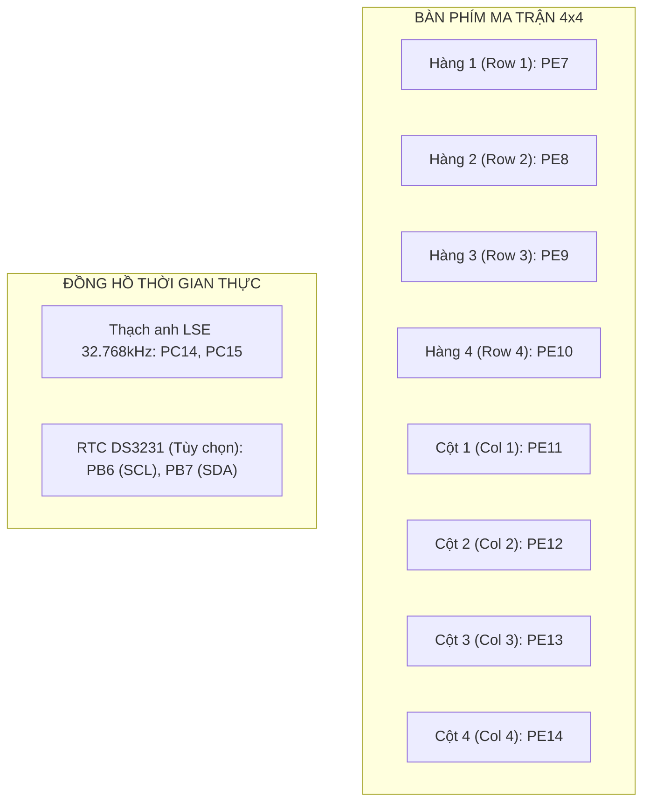
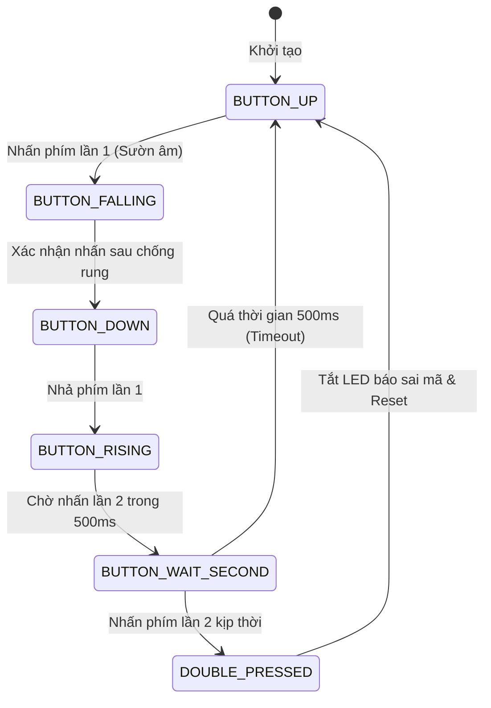

# CHƯƠNG 4: MÁY TRẠNG THÁI HỮU HẠN (FSM), BÀN PHÍM MA TRẬN & ĐỒNG HỒ THỜI GIAN THỰC (RTC) TRÊN STM32F407
*(Biên soạn dựa trên Chapter 4: Finite-State Machines and the Real-Time Clock - Arm Education Textbook, hiệu chỉnh chuyên sâu cho STM32F407)*

---

## 4.1. MỤC TIÊU CỦA CHƯƠNG
- **Bối cảnh kiến thức:** Sinh viên đã biết lập trình logic điều kiện tuần tự; chương này trang bị tư duy thiết kế phần mềm nhúng chuyên nghiệp thông qua **Máy trạng thái hữu hạn (FSM - Finite-State Machine)** để giải quyết các bài toán giao diện phức tạp và đồng bộ thời gian thực.
- **Mục tiêu chi tiết:**
  1. Hiểu và áp dụng mô hình toán học FSM (Mô hình Mealy và Moore, Bảng chuyển trạng thái, Biểu đồ chuyển trạng thái State Diagram).
  2. Ghép nối và lập trình giải mã bàn phím ma trận $4\times 4$ trên STM32F407 (Quét hàng đọc cột, chống dính phím).
  3. Cấu hình khối đồng hồ thời gian thực RTC trên STM32F407 (sử dụng thạch anh ngoài tốc độ thấp LSE $32.768\text{ kHz}$) để lưu trữ giờ, phút, giây, ngày, tháng, năm dạng nhị phân thập phân (BCD).
  4. Hiện thực hóa các ví dụ từ Example 4.1 đến 4.4 trên STM32F407: Xử lý sự kiện nhấn đúp phím (Double-press FSM), nhập mã số PIN bảo mật qua bàn phím ma trận và ghi nhận mốc thời gian sự kiện báo động (Date/Time Timestamp) gửi lên PC.

---

## 4.2. PHÂN BỔ PHẦN CỨNG BÀN PHÍM VÀ RTC TRÊN STM32F407



### Nguyên lý quét bàn phím ma trận $4\times 4$:
- 4 chân Hàng (`PE7..PE10`): Cấu hình ngõ ra Output (hoặc Open-Drain kéo thấp lần lượt từng hàng).
- 4 chân Cột (`PE11..PE14`): Cấu hình ngõ vào Input có trở kéo lên **Pull-up**.
- Thuật toán quét: Kéo Hàng 1 xuống mức 0, đọc trạng thái 4 cột. Nếu Cột nào bằng 0 $\rightarrow$ Phím tại giao điểm Hàng 1 và Cột đó đang được nhấn! Lặp lại lần lượt cho Hàng 2, 3, 4.

---

## 4.3. HIỆN THỰC HÓA CÁC VÍ DỤ TỪ EXAMPLE 4.1 ĐẾN 4.4 TRÊN STM32F407

### VÍ DỤ 4.1: XỬ LÝ NHẤN ĐÚP PHÍM BẰNG MÁY TRẠNG THÁI FSM (Listing 4.1)
- **Yêu cầu:** Đèn báo sai mã `incorrectCodeLed` (`PD14`) đang sáng. Người dùng chỉ có thể tắt đèn này nếu **nhấn đúp (Double-press)** nút Enter trong khoảng thời gian quy định ($500\text{ ms}$). Nếu nhấn 1 lần rồi thả quá lâu $\rightarrow$ Trở về trạng thái ban đầu.



---

### VÍ DỤ 4.3: GIẢI MÃ NHẬP MÃ SỐ PIN BẰNG MA TRẬN PHÍM (Listing 4.3)
- Sử dụng bàn phím ma trận để nhập mã bảo mật 4 chữ số (ví dụ: `1-8-0-5`).
- Mỗi lần nhấn phím số, FSM chuyển sang trạng thái chờ ký tự tiếp theo. Nếu đúng đủ 4 số $\rightarrow$ Tắt báo động. Nếu sai bất kỳ số nào $\rightarrow$ Bật đèn báo sai mã `PD14`.

```c
typedef enum {
    STATE_IDLE,
    STATE_DIGIT_1,
    STATE_DIGIT_2,
    STATE_DIGIT_3,
    STATE_VERIFIED,
    STATE_WRONG_CODE
} Security_FSM_State_t;

Security_FSM_State_t currentFsmState = STATE_IDLE;
const char correctPIN[4] = {'1', '8', '0', '5'};

void Process_Keypad_FSM(char pressedKey)
{
    if (pressedKey == '\0') return; // Không có phím nhấn

    switch (currentFsmState)
    {
        case STATE_IDLE:
            if (pressedKey == correctPIN[0]) currentFsmState = STATE_DIGIT_1;
            else currentFsmState = STATE_WRONG_CODE;
            break;

        case STATE_DIGIT_1:
            if (pressedKey == correctPIN[1]) currentFsmState = STATE_DIGIT_2;
            else currentFsmState = STATE_WRONG_CODE;
            break;

        case STATE_DIGIT_2:
            if (pressedKey == correctPIN[2]) currentFsmState = STATE_DIGIT_3;
            else currentFsmState = STATE_WRONG_CODE;
            break;

        case STATE_DIGIT_3:
            if (pressedKey == correctPIN[3])
            {
                currentFsmState = STATE_VERIFIED;
                HAL_GPIO_WritePin(GPIOD, GPIO_PIN_12, GPIO_PIN_RESET); // Tắt báo động
                HAL_GPIO_WritePin(GPIOD, GPIO_PIN_14, GPIO_PIN_RESET); // Tắt đèn sai mã
            }
            else currentFsmState = STATE_WRONG_CODE;
            break;

        case STATE_WRONG_CODE:
            HAL_GPIO_WritePin(GPIOD, GPIO_PIN_14, GPIO_PIN_SET); // Bật LED báo sai mã
            currentFsmState = STATE_IDLE; // Reset về ban đầu
            break;

        default:
            currentFsmState = STATE_IDLE;
            break;
    }
}
```

---

### VÍ DỤ 4.4: BÁO CÁO THỜI GIAN SỰ KIỆN LÊN MÁY TÍNH QUA RTC (Listing 4.4)
- Khi có sự cố báo động khí gas hoặc quá nhiệt xảy ra, STM32F407 đọc thanh ghi RTC nội và gửi chuỗi báo cáo kèm mốc thời gian thực chuẩn ISO lên máy tính qua UART:
```
[2026-11-15 22:30:15] ALARM TRIGGERED: Gas leak detected!
```

```c
RTC_HandleTypeDef hrtc;

void Report_Alarm_With_Timestamp(char *eventDescription)
{
    RTC_TimeTypeDef sTime = {0};
    RTC_DateTypeDef sDate = {0};

    // Đọc thời gian và ngày tháng từ RTC nội
    HAL_RTC_GetTime(&hrtc, &sTime, RTC_FORMAT_BIN);
    HAL_RTC_GetDate(&hrtc, &sDate, RTC_FORMAT_BIN);

    char msg[128];
    snprintf(msg, sizeof(msg), "[20%02d-%02d-%02d %02d:%02d:%02d] ALARM: %s\r\n",
             sDate.Year, sDate.Month, sDate.Date,
             sTime.Hours, sTime.Minutes, sTime.Seconds,
             eventDescription);

    UART_SendString(msg);
}
```

---

## 4.4. "UNDER THE HOOD" & CASE STUDY (THEO SÁCH ARM)
- **Under the Hood (4.3.1):** 
  - So sánh mô hình máy trạng thái Mealy (ngõ ra phụ thuộc cả trạng thái hiện tại và ngõ vào) và Moore (ngõ ra chỉ phụ thuộc vào trạng thái hiện tại).
  - Ưu thế vượt trội của FSM trong việc loại bỏ hoàn toàn các cấu trúc lệnh `if-else` lồng nhau phức tạp (Spaghetti Code), giúp mã nguồn dễ đọc, dễ kiểm thử và không bao giờ rơi vào trạng thái bế tắc (Deadlock).
- **Case Study (4.4.1):** Hệ thống Khóa Điện tử Thông minh (Smart Door Locks): Triển khai toàn diện FSM kết hợp RTC để quản lý mã mở khóa theo khung giờ (Time-based Access Control), tự động ghi nhật ký thời gian ra vào của từng thành viên.
