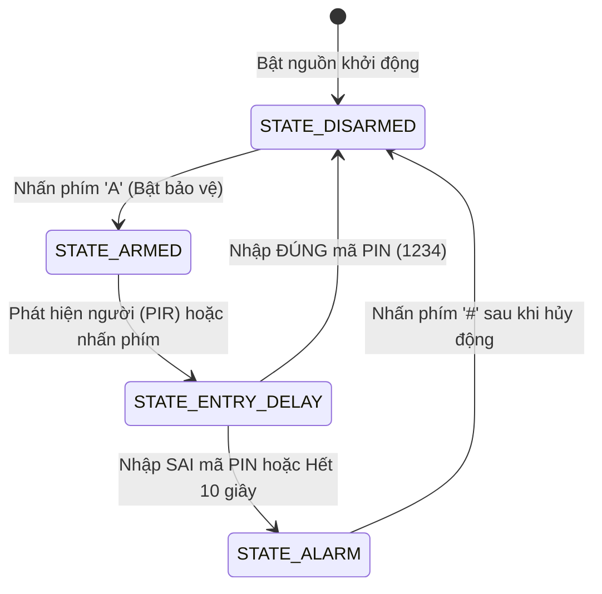

# CHƯƠNG 4: MÁY TRẠNG THÁI HỮU HẠN (FSM), BÀN PHÍM MA TRẬN VÀ ĐỒNG HỒ THỜI GIAN THỰC (RTC) TRÊN STM32F407
*(Biên soạn dựa trên Chapter 4: Finite State Machines, Real-Time Clocks & Keypads - Arm Education Textbook, hiệu chỉnh chuyên sâu cho STM32F407)*

---

## 4.1. MỤC TIÊU CỦA CHƯƠNG
- **Bối cảnh kiến thức:** Sinh viên đã thành thạo kỹ thuật quản lý thời gian không chặn ở Chương 3; chương này nâng tầm tư duy kiến trúc phần mềm bằng phương pháp luận **Máy trạng thái hữu hạn (Finite State Machine - FSM)** để loại bỏ triệt để mã nguồn rối rắm (Spaghetti Code), làm chủ thuật toán **Quét bàn phím ma trận $4\times 4$**, cơ chế chống rung phím và khai thác khối **Đồng hồ thời gian thực RTC (Real-Time Clock)** tích hợp trên STM32F407.
- **Mục tiêu chi tiết:**
  1. **Lý thuyết Máy Trạng Thái Hữu Hạn:** Phân biệt mô hình Moore và Mealy, biểu diễn luồng vận hành bằng Sơ đồ chuyển đổi trạng thái (State Transition Diagram), hiện thực hóa bằng cấu trúc C chuẩn (`enum` và `switch-case`).
  2. **Thiết Kế & Quét Bàn Phím Ma Trận $4\times 4$:** Nắm vững nguyên lý tiết kiệm chân (16 phím chỉ tốn 8 chân GPIO), thuật toán quét tuần tự từng hàng, cơ chế chống rung phím số (Software Debounce) không chặn, và kỹ thuật triệt tiêu hiện tượng bóng ma phím (Key Ghosting).
  3. **Khối Đồng Hồ Thời Gian Thực RTC Nội & Ngoại:** Hiểu rõ bản chất thạch anh LSE $32.768\text{ kHz}$ ($2^{15}\text{ Hz}$), định dạng dữ liệu nhị phân - thập phân BCD (Binary-Coded Decimal), chân cấp nguồn pin dự phòng `VBAT`, và ghép nối IC RTC công nghiệp DS3231 qua $I^2C$.
  4. **Lập Trình Hệ Thống An Ninh (Examples 4.1 $\div$ 4.4):**
     - Hiện thực hóa máy trạng thái bảo mật Smart Home (`DISARMED`, `ARMING`, `ARMED`, `ENTRY_DELAY`, `ALARM`).
     - Giải mã mã PIN 4 chữ số kèm phát hiện nhấn đúp phím Enter (`#`).
     - Xuất nhật ký sự kiện có gắn tem thời gian thực RTC (Timestamp: Giờ:Phút:Giây) lên cổng nối tiếp PC.

---

## 4.2. CƠ SỞ LÝ THUYẾT CHUYÊN SÂU

### 4.2.1. Phương Pháp Luận Thiết Kế Máy Trạng Thái Hữu Hạn (FSM)
Trong các hệ thống nhúng điều khiển thiết bị, nếu lập trình theo lối mòn dùng biến cờ hiệu (`flag1`, `flag2`) kết hợp các câu lệnh `if-else` lồng nhau, mã nguồn sẽ nhanh chóng trở thành "mạng nhện" (Spaghetti Code) không thể kiểm thử và bảo trì được.  
**Máy trạng thái hữu hạn (FSM)** là mô hình toán học trừu tượng bao gồm một tập hữu hạn các trạng thái ($S$), các sự kiện kích hoạt ngõ vào ($\Sigma$) và các hàm chuyển đổi trạng thái ($\delta$):



#### So sánh hai mô hình FSM chuẩn:
1. **Máy Moore (Moore Machine):** Ngõ ra của hệ thống chỉ phụ thuộc duy nhất vào trạng thái hiện thời của máy:
   $$\text{Output}(t) = \lambda(S(t))$$
   *Ưu điểm:* Ổn định cao, ngõ ra đồng bộ hoàn toàn với xung nhịp, không bị ảnh hưởng bởi xung nhiễu ngõ vào.
2. **Máy Mealy (Mealy Machine):** Ngõ ra của hệ thống phụ thuộc vào cả trạng thái hiện thời và tín hiệu ngõ vào:
   $$\text{Output}(t) = \lambda(S(t), \text{Input}(t))$$
   *Ưu điểm:* Thường cần ít trạng thái hơn máy Moore, phản ứng tức thời với ngõ vào mà không cần chờ chuyển trạng thái kế tiếp.

---

### 4.2.2. Cơ Sở Lý Thuyết Quét Bàn Phím Ma Trận $4\times 4$
Để đọc 16 phím bấm độc lập, nếu nối từng phím vào một chân GPIO sẽ làm lãng phí tới 16 chân của vi điều khiển. Bàn phím ma trận bố trí 16 công tắc tại giao điểm của **4 Hàng (Rows)** và **4 Cột (Columns)**, giảm số chân điều khiển xuống chỉ còn **8 chân GPIO**:

```
                 COL0 (PE11)   COL1 (PE12)   COL2 (PE13)   COL3 (PE14)
                      |             |             |             |
ROW0 (PE7)  ----------[ 1 ]---------[ 2 ]---------[ 3 ]---------[ A ]---
                      |             |             |             |
ROW1 (PE8)  ----------[ 4 ]---------[ 5 ]---------[ 6 ]---------[ B ]---
                      |             |             |             |
ROW2 (PE9)  ----------[ 7 ]---------[ 8 ]---------[ 9 ]---------[ C ]---
                      |             |             |             |
ROW3 (PE10) ----------[ * ]---------[ 0 ]---------[ # ]---------[ D ]---
```

#### 1. Thuật toán quét tuần tự từng hàng (Row-by-Row Strobe):
- **Cấu hình chân:**
  - 4 chân Hàng (`ROW0..3`): Cấu hình là **Output Push-Pull** (hoặc Open-Drain).
  - 4 chân Cột (`COL0..3`): Cấu hình là **Input kèm điện trở kéo lên nội (Pull-up)**.
- **Trình tự thực thi:**
  1. Ban đầu, kéo cả 4 hàng lên mức cao $3.3\text{V}$ (Logic 1). Vì có trở kéo lên, cả 4 cột đều ở mức cao $3.3\text{V}$.
  2. Kéo riêng Hàng 0 (`ROW0`) xuống mức thấp $0\text{V}$, giữ 3 hàng còn lại ở mức cao 1.
  3. Đọc trạng thái 4 cột:
     - Nếu không phím nào ở Hàng 0 được bấm: Cả 4 cột đều là 1.
     - Nếu phím '2' (giao điểm giữa Hàng 0 và Cột 1) được nhấn: Chân Cột 1 bị nối ngắn mạch xuống mức 0 của Hàng 0 $\implies$ Chân `COL1` đọc được mức **0**!
  4. Lần lượt lặp lại chu trình cho Hàng 1, Hàng 2 và Hàng 3 để quét toàn bộ 16 phím.

#### 2. Hiện tượng bóng ma phím (Key Ghosting) và Mạch bảo vệ Diode:
Khi người dùng vô tình bấm đồng thời 3 phím tạo thành 3 đỉnh của một hình chữ nhật trên ma trận (ví dụ phím '1', '2' và '4'):
- Dòng điện từ Hàng 1 chạy ngược qua phím '4', xuyên qua phím '1' và phím '2' làm chân Cột 0 bị kéo xuống mức 0 ngay cả khi phím '5' (đỉnh thứ 4) **hoàn toàn không được bấm**! Đây là hiện tượng **Phím Ma (Ghost Key)**.
- **Giải pháp phần cứng:** Mắc nối tiếp một diode tiếp điểm (1N4148) tại mỗi phím bấm để chặn dòng điện chạy ngược, triệt tiêu hoàn toàn hiện tượng Ghosting.

---

### 4.2.3. Khối Đồng Hồ Thời Gian Thực RTC (Real-Time Clock)

#### 1. Tại sao thạch anh RTC luôn có tần số $32.768\text{ kHz}$?
Tần số thạch anh dao động thấp LSE (Low-Speed External) được chọn chính xác là:
$$f_{LSE} = 32{,}768\text{ Hz} = 2^{15}\text{ Hz}$$
- Vi điều khiển tích hợp một chuỗi gồm 15 bộ lật T-Flip-Flop chia đôi tần số nhị phân:
  $$\frac{32{,}768}{2^{15}} = \frac{32{,}768}{32{,}768} = 1.0000\text{ Hz} \text{ (Chu kỳ đúng } 1.0\text{ giây)}$$
- Xung nhịp $1\text{Hz}$ này được đưa vào bộ đếm thời gian thực để tăng giây, phút, giờ mà không hề phát sinh bất kỳ sai số làm tròn số học nào!

#### 2. Định dạng dữ liệu nhị phân - thập phân BCD (Binary-Coded Decimal):
Khối RTC phần cứng của STM32F4 lưu trữ giờ, phút, giây dưới dạng BCD để thuận tiện cho việc xuất trực tiếp ra màn hình hiển thị:
- Ví dụ số $59$ giây:
  - Byte BCD: `0x59` ($0101\ 1001_2$) gồm 4-bit cao biểu diễn số hàng chục ($5$) và 4-bit thấp biểu diễn số hàng đơn vị ($9$).
  - Công thức chuyển đổi:
    $$\text{Decimal} = (\text{BCD} \gg 4) \times 10 + (\text{BCD} \& 0x0F)$$
    $$\text{BCD} = ((\text{Decimal} / 10) \ll 4) \mid (\text{Decimal} \% 10)$$

#### 3. Chân cấp nguồn pin dự phòng `VBAT`:
STM32F407 có một chân nguồn chuyên dụng `VBAT` (nối với pin cúc áo Lithium CR2032 3V):
- Khi nguồn cấp chính $V_{DD}$ bị ngắt: Mạch chuyển mạch nguồn tự động (Power Switch) bên trong chip tự động ngắt khối CPU và nối khối RTC + thanh ghi Backup SRAM sang sử dụng năng lượng từ chân `VBAT`.
- Dòng tiêu thụ ở chế độ `VBAT` chỉ khoảng **$1\mu\text{A}$**, cho phép một viên pin đồng xu duy trì đồng hồ chạy liên tục trong hơn **10 năm**!

---

## 4.3. SƠ ĐỒ NGUYÊN LÝ & SƠ ĐỒ ĐẤU NỐI CHÂN CHI TIẾT

### 4.3.1. Sơ đồ mạch nguyên lý điện tử (Schematics)

```
=============================================================================================
1. MẠCH BÀN PHÍM MA TRẬN 4x4 KẾT NỐI VÀO PORT E
=============================================================================================
STM32F407                                                    Bàn Phím Ma Trận 4x4
+------------------+                                        +---------------------+
|  PE7  (GPIO_Out) |----------------------------------------| ROW 0 (Hàng 1, 2, 3, A)
|  PE8  (GPIO_Out) |----------------------------------------| ROW 1 (Hàng 4, 5, 6, B)
|  PE9  (GPIO_Out) |----------------------------------------| ROW 2 (Hàng 7, 8, 9, C)
|  PE10 (GPIO_Out) |----------------------------------------| ROW 3 (Hàng *, 0, #, D)
|                  |                                        |
|  PE11 (GPIO_In)  |<---------------------------------------| COL 0 (Cột 1, 4, 7, *)
|  PE12 (GPIO_In)  |<---------------------------------------| COL 1 (Cột 2, 5, 8, 0)
|  PE13 (GPIO_In)  |<---------------------------------------| COL 2 (Cột 3, 6, 9, #)
|  PE14 (GPIO_In)  |<---------------------------------------| COL 3 (Cột A, B, C, D)
+------------------+ (Các chân COL bật điện trở kéo lên Pull-up nội 40k)


=============================================================================================
2. MẠCH THẠCH ANH NGOẠI LSE 32.768kHz VÀ NGUỒN PIN DỰ PHÒNG VBAT
=============================================================================================
STM32F407
+------------------+               Thạch Anh 32.768kHz
| PC14/OSC32_IN    |------+---------[ Y1 ]---------+
|                  |      |                        |
|                  |    ===== C_L1               ===== C_L2
|                  |    10pF|                    10pF|
|                  |      |                        |
| PC15/OSC32_OUT   |------+------------------------+
|                  |      |
|                  |     GND
|                  |                                  Pin Đồng Xu CR2032 3V
|             VBAT |----------------------------------[ + ] (Duy trì giờ khi mất điện)
|                  |                                  [ - ]
|              GND |------------------------------------+
+------------------+                                    |
                                                       GND
```

---

### 4.3.2. Bảng Phân Bổ Chân Toàn Diện Trên STM32F407 (Master Pinout Table)

| Tên Chân STM32 | Tên Tín Hiệu | Chức Năng Phần Cứng / Cấu Hình CubeMX | Kết Nối Ngoại Vi | Mức Điện Áp An Toàn |
| :---: | :---: | :---: | :--- | :--- |
| `PE7` | `KEY_ROW0` | GPIO_Output Push-Pull, High Speed | Chân Row 0 bàn phím ma trận (Phím 1, 2, 3, A) | Mức logic $3.3\text{V}$ |
| `PE8` | `KEY_ROW1` | GPIO_Output Push-Pull, High Speed | Chân Row 1 bàn phím ma trận (Phím 4, 5, 6, B) | Mức logic $3.3\text{V}$ |
| `PE9` | `KEY_ROW2` | GPIO_Output Push-Pull, High Speed | Chân Row 2 bàn phím ma trận (Phím 7, 8, 9, C) | Mức logic $3.3\text{V}$ |
| `PE10`| `KEY_ROW3` | GPIO_Output Push-Pull, High Speed | Chân Row 3 bàn phím ma trận (Phím *, 0, #, D) | Mức logic $3.3\text{V}$ |
| `PE11`| `KEY_COL0` | GPIO_Input, Bật **Pull-up** nội | Chân Col 0 bàn phím ma trận (Cột 1, 4, 7, *) | Mức logic $3.3\text{V}$ |
| `PE12`| `KEY_COL1` | GPIO_Input, Bật **Pull-up** nội | Chân Col 1 bàn phím ma trận (Cột 2, 5, 8, 0) | Mức logic $3.3\text{V}$ |
| `PE13`| `KEY_COL2` | GPIO_Input, Bật **Pull-up** nội | Chân Col 2 bàn phím ma trận (Cột 3, 6, 9, #) | Mức logic $3.3\text{V}$ |
| `PE14`| `KEY_COL3` | GPIO_Input, Bật **Pull-up** nội | Chân Col 3 bàn phím ma trận (Cột A, B, C, D) | Mức logic $3.3\text{V}$ |
| `PC14`| `OSC32_IN` | RCC_OSC32_IN | Cực 1 thạch anh hình trụ LSE $32.768\text{ kHz}$ | Kèm tụ tải $10\text{pF}$ xuống mass |
| `PC15`| `OSC32_OUT`| RCC_OSC32_OUT | Cực 2 thạch anh hình trụ LSE $32.768\text{ kHz}$ | Kèm tụ tải $10\text{pF}$ xuống mass |
| `VBAT`| `VBAT_PIN` | Power Supply | Cực dương pin đồng hồ Lithium CR2032 ($3\text{V}$) | Tuyệt đối không nối quá $3.6\text{V}$ |
| `PD12`| `LED_GREEN`| GPIO_Output Push-Pull | Đèn báo trạng thái an toàn `DISARMED` | Mức logic $3.3\text{V}$ qua trở $330\Omega$ |
| `PD14`| `LED_RED` | GPIO_Output Push-Pull | Đèn báo trạng thái báo động `ALARM` | Mức logic $3.3\text{V}$ qua trở $330\Omega$ |

---

## 4.4. HIỆN THỰC HÓA CHI TIẾT CÁC VÍ DỤ TỪ EXAMPLE 4.1 ĐẾN 4.4 TRÊN STM32F407

### 4.4.1. Mã Nguồn Quét Bàn Phím Ma Trận & Chống Rung Không Chặn
```c
#include "main.h"
#include <stdio.h>
#include <string.h>
#include <stdbool.h>

extern RTC_HandleTypeDef hrtc;
extern UART_HandleTypeDef huart2;

const char KEYPAD_MAP[4][4] = {
    {'1', '2', '3', 'A'},
    {'4', '5', '6', 'B'},
    {'7', '8', '9', 'C'},
    {'*', '0', '#', 'D'}
};

/* Quét phím ma trận trả về ký tự được nhấn (hoặc 0 nếu không có) */
char Keypad_ScanNonBlocking(void)
{
    const uint16_t rowPins[4] = {GPIO_PIN_7, GPIO_PIN_8, GPIO_PIN_9, GPIO_PIN_10};
    const uint16_t colPins[4] = {GPIO_PIN_11, GPIO_PIN_12, GPIO_PIN_13, GPIO_PIN_14};

    static uint32_t lastDebounceTime = 0;
    static char lastStableKey = 0;

    for (int r = 0; r < 4; r++)
    {
        /* Kéo tất cả các hàng lên 1, kéo riêng hàng r xuống 0 */
        HAL_GPIO_WritePin(GPIOE, GPIO_PIN_7 | GPIO_PIN_8 | GPIO_PIN_9 | GPIO_PIN_10, GPIO_PIN_SET);
        HAL_GPIO_WritePin(GPIOE, rowPins[r], GPIO_PIN_RESET);

        /* Độ trễ nhỏ vài chu kỳ cho sườn tín hiệu ổn định */
        for (volatile int d = 0; d < 30; d++);

        for (int c = 0; c < 4; c++)
        {
            if (HAL_GPIO_ReadPin(GPIOE, colPins[c]) == GPIO_PIN_RESET)
            {
                char detectedKey = KEYPAD_MAP[r][c];
                /* Chống rung phím 25ms */
                if (HAL_GetTick() - lastDebounceTime > 25)
                {
                    lastDebounceTime = HAL_GetTick();
                    /* Chờ nhả phím */
                    while (HAL_GPIO_ReadPin(GPIOE, colPins[c]) == GPIO_PIN_RESET);
                    return detectedKey;
                }
            }
        }
    }
    return 0;
}
```

---

### 4.4.2. Hiện Thực Hóa Máy Trạng Thái FSM An Ninh Smart Home (Examples 4.1 $\div$ 4.4)
```c
typedef enum {
    STATE_DISARMED,     /* Hệ thống an toàn */
    STATE_ARMED,        /* Đã kích hoạt bảo vệ */
    STATE_ENTRY_DELAY,  /* Đang đếm lùi thời gian cho phép nhập mã PIN */
    STATE_ALARM         /* Đang hú còi báo động khẩn cấp */
} SystemState_t;

static SystemState_t systemState = STATE_DISARMED;
static char enteredPIN[5] = {0};
static uint8_t pinIdx = 0;
static const char MASTER_PIN[] = "1234";
static uint32_t entryDelayStartTime = 0;

/* In tem thời gian thực tế từ khối RTC */
void RTC_PrintTimestamp(void)
{
    RTC_TimeTypeDef sTime = {0};
    RTC_DateTypeDef sDate = {0};
    HAL_RTC_GetTime(&hrtc, &sTime, RTC_FORMAT_BIN);
    HAL_RTC_GetDate(&hrtc, &sDate, RTC_FORMAT_BIN);
    printf("[%02d:%02d:%02d] ", sTime.Hours, sTime.Minutes, sTime.Seconds);
}

void SecuritySystem_FSM_Process(void)
{
    char key = Keypad_ScanNonBlocking();

    switch (systemState)
    {
        case STATE_DISARMED:
            HAL_GPIO_WritePin(GPIOD, GPIO_PIN_12, GPIO_PIN_SET);   /* LED xanh SÁNG */
            HAL_GPIO_WritePin(GPIOD, GPIO_PIN_14, GPIO_PIN_RESET); /* LED đỏ TẮT */

            /* Nhấn phím 'A' để bật chế độ bảo vệ */
            if (key == 'A')
            {
                systemState = STATE_ARMED;
                RTC_PrintTimestamp();
                printf("HE THONG DA BAT CHE DO PHONG VE (ARMED)!\r\n");
            }
            break;

        case STATE_ARMED:
            HAL_GPIO_WritePin(GPIOD, GPIO_PIN_12, GPIO_PIN_RESET);
            HAL_GPIO_WritePin(GPIOD, GPIO_PIN_14, GPIO_PIN_SET);   /* LED đỏ SÁNG */

            /* Khi người bước vào hoặc nhấn phím bất kỳ -> Cho 10s nhập mã */
            if (key != 0)
            {
                systemState = STATE_ENTRY_DELAY;
                entryDelayStartTime = HAL_GetTick();
                pinIdx = 0;
                memset(enteredPIN, 0, sizeof(enteredPIN));
                enteredPIN[pinIdx++] = key;
                RTC_PrintTimestamp();
                printf("PHAT HIEN THAM NHAP! Con 10 giay de nhap PIN: *\r\n");
            }
            break;

        case STATE_ENTRY_DELAY:
            /* Nhấp nháy LED đỏ dồn dập */
            if ((HAL_GetTick() / 250) % 2 == 0)
                HAL_GPIO_WritePin(GPIOD, GPIO_PIN_14, GPIO_PIN_SET);
            else
                HAL_GPIO_WritePin(GPIOD, GPIO_PIN_14, GPIO_PIN_RESET);

            if (key >= '0' && key <= '9')
            {
                enteredPIN[pinIdx++] = key;
                printf("*");
                if (pinIdx == 4)
                {
                    enteredPIN[4] = '\0';
                    printf("\r\n");
                    if (strcmp(enteredPIN, MASTER_PIN) == 0)
                    {
                        systemState = STATE_DISARMED;
                        RTC_PrintTimestamp();
                        printf("DUNG MA PIN! GIAI TRU THANH CONG (DISARMED).\r\n");
                    }
                    else
                    {
                        systemState = STATE_ALARM;
                        RTC_PrintTimestamp();
                        printf("SAI MA PIN! KICH HOAT COI BAO DONG!\r\n");
                    }
                }
            }

            /* Hết 10 giây mà chưa mở khóa -> Báo động */
            if (HAL_GetTick() - entryDelayStartTime >= 10000)
            {
                systemState = STATE_ALARM;
                RTC_PrintTimestamp();
                printf("\r\nHET THOI GIAN! BAO DONG NGUY HIEM!\r\n");
            }
            break;

        case STATE_ALARM:
            HAL_GPIO_WritePin(GPIOD, GPIO_PIN_14, GPIO_PIN_SET);
            HAL_GPIO_WritePin(GPIOD, GPIO_PIN_11, GPIO_PIN_SET); /* Bật còi hú */

            /* Nhấn phím '#' để hủy báo động khi nhập đúng */
            if (key == '#')
            {
                HAL_GPIO_WritePin(GPIOD, GPIO_PIN_11, GPIO_PIN_RESET);
                systemState = STATE_DISARMED;
                RTC_PrintTimestamp();
                printf("DA TAT BAO DONG KHAN CAP.\r\n");
            }
            break;
    }
}
```

---

## 4.5. "UNDER THE HOOD" & CASE STUDY (THEO GIÁO TRÌNH ARM)

### 4.5.1. Under the Hood (4.3.1): Bù Trừ Sai Số Nhiệt Độ Cho Thạch Anh RTC
- Thạch anh cắt lát hình nĩa âm thoa (Tuning-fork crystal) $32.768\text{ kHz}$ có hệ số nhiệt độ theo đường cong Parabol:
  $$\frac{\Delta f}{f_0} = -k \times (T - T_0)^2$$
  với $T_0 \approx 25^\circ\text{C}$ và $k \approx 0.035\text{ ppm}/(^\circ\text{C})^2$.
- Khi nhiệt độ môi trường thay đổi từ $25^\circ\text{C}$ sang $50^\circ\text{C}$, độ trôi tần số có thể khiến đồng hồ chạy sai hàng chục giây mỗi tháng.
- **Giải pháp công nghiệp:** Sử dụng IC thời gian thực tích hợp bộ bù nhiệt kỹ thuật số **DS3231 (TCXO - Temperature Compensated Crystal Oscillator)** qua bus $I^2C$, độ chính xác đạt $\pm 2\text{ ppm}$ (sai số chưa đầy $1\text{ phút/năm}$).

### 4.5.2. Case Study (4.4.1): Khóa Cửa Điện Tử Phân Quyền Theo Thời Gian Thực (Time-Based Smart Lock)
- **Bối cảnh ứng dụng:** Trong các khách sạn thông minh và văn phòng chia sẻ, khách thuê phòng chỉ được phép sử dụng mã PIN trong khoảng thời gian đã đặt trước (Ví dụ từ $14:00$ ngày hôm nay đến $12:00$ trưa ngày mai).
- **Giải pháp nhúng trên ARM:**
  - Vi điều khiển đọc liên tục tem thời gian từ khối RTC nội.
  - Khi người dùng nhập mã PIN trên bàn phím ma trận, máy trạng thái FSM kiểm tra đồng thời:
    1. Mã PIN có khớp với cơ sở dữ liệu mã số hay không.
    2. Thời gian hiện tại từ RTC có nằm trong khung giờ hợp lệ hay không.
  - Sau $12:00$, mã PIN tự động hết hạn, relay ngắt chốt và từ chối mở cửa, đồng thời ghi lại toàn bộ nhật ký quẹt thẻ/bấm mã vào thẻ nhớ SD.

---

## 4.6. CÂU HỎI ÔN TẬP VÀ BÀI TẬP THIẾT KẾ CHƯƠNG 4

1. **Câu hỏi 1 (Mô hình FSM):** *Vẽ sơ đồ chuyển đổi trạng thái (State Diagram) của máy trạng thái kiểm soát cửa quay tự động (Turnstile) gồm 2 trạng thái: `Locked` (Khóa) và `Unlocked` (Mở khóa) với 2 ngõ vào: Nhét tiền xu (`Coin`) và Đẩy cửa (`Push`). Phân tích xem máy này thuộc dạng Moore hay Mealy.*
2. **Câu hỏi 2 (Hiện tượng Ghosting):** *Hãy giải thích cơ chế hình thành hiện tượng "Phím ma" (Ghosting) khi nhấn đồng thời 3 phím trên bàn phím ma trận $4\times 4$. Vẽ sơ đồ minh họa đường đi của dòng điện gây ra hiện tượng này.*
3. **Câu hỏi 3 (Khối RTC):** *Tại sao khối RTC lại sử dụng bộ đếm theo định dạng BCD thay vì lưu số nguyên nhị phân thông thường? Trình bày công thức chuyển đổi một byte BCD sang số thập phân trong ngôn ngữ C.*
4. **Bài tập thiết kế hệ thống:** *Thiết kế một két sắt điện tử thông minh: Sử dụng STM32F407, bàn phím ma trận $4\times 4$, màn hình LCD 16x2 $I^2C$, khối RTC nội, điều khiển cuộn hút nam châm điện Solenoid mở chốt két qua Relay. Khóa két sẽ tự động khóa cứng trong 15 phút nếu người dùng nhập sai mật mã quá 3 lần liên tiếp.*
