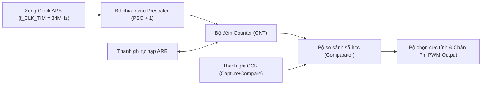
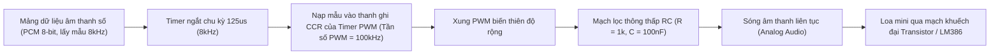

# CHƯƠNG 4: BỘ ĐỊNH THỜI (TIMER/COUNTER), ĐIỀU CHẾ ĐỘ RỘNG XUNG (PWM) & PHÁT ÂM THANH
*(Biên soạn dựa trên Chapter 8: Advanced Time Management, PWM, Feedback Control & Audio - Arm Education Textbook kết hợp Chuẩn kỹ thuật phần cứng STM32F4)*

---

## 4.1. MỤC TIÊU CỦA CHƯƠNG
Sau khi hoàn thành chương này, sinh viên ngành Kỹ thuật Điện tử có khả năng:
1. **Làm chủ cấu trúc khối Timer trên ARM Cortex-M4:** Hiểu rõ cơ chế đếm của các bộ định thời 16-bit và 32-bit trên STM32F4: Bộ chia trước Prescaler (`PSC`), Thanh ghi tự nạp lại Auto-Reload Register (`ARR`), Bộ đếm Counter (`CNT`), và các chế độ đếm lên (Up-counting), đếm xuống (Down-counting), đếm tâm (Center-aligned).
2. **Nắm vững nguyên lý điều chế độ rộng xung (PWM - Pulse Width Modulation):**
   - Tính toán chu kỳ xung ($T$), tần số ($f_{PWM}$) và hệ số công tác Duty cycle ($D$).
   - Sử dụng thanh ghi so sánh Capture/Compare (`CCR`) để tạo dạng sóng PWM phần cứng chính xác không chiếm dụng CPU.
3. **Thiết kế mạch công suất & Mạch lọc tín hiệu tương tự:**
   - Thiết kế mạch đệm công suất điều khiển LED RGB và động cơ DC qua mạch cầu H.
   - Thiết kế mạch lọc thông thấp RC (Low-Pass Filter) tích phân sóng vuông PWM thành điện áp một chiều tương tự hoặc tín hiệu âm thanh analog để kéo loa/tai nghe.
4. **Hiện thực hóa các ứng dụng thực tế theo giáo trình ARM:**
   - Điều khiển đổi màu và độ sáng LED RGB trang trí nội thất (Examples 8.1 $\div$ 8.4).
   - Điều khiển hồi tiếp tự động thay đổi độ sáng đèn theo quang trở LDR (Example 8.5).
   - Tái tạo và phát thông điệp âm thanh cảnh báo (Audio Speech Playback) từ mảng mẫu PCM lưu trong bộ nhớ Flash thông qua kỹ thuật PWM (Example 8.6).

---

## 4.2. NGUYÊN LÝ BỘ ĐỊNH THỜI VÀ BĂM XUNG PWM PHẦN CỨNG

### 1. Cấu trúc khối Timer cơ bản trên STM32F4
Khối Timer tạo ra xung nhịp chính xác dựa trên xung clock cấp từ bus APB ($f_{CLK\_TIM}$):



### 2. Các công thức tính toán thiết kế quan trọng
- **Tần số đếm của bộ đếm CNT:**
  $$f_{CNT} = \frac{f_{CLK\_TIM}}{PSC + 1}$$
- **Thời gian tràn bộ đếm (Chu kỳ xung PWM):**
  $$T_{PWM} = \frac{ARR + 1}{f_{CNT}} = \frac{(PSC + 1) \times (ARR + 1)}{f_{CLK\_TIM}}$$
- **Tần số xung PWM phát ra:**
  $$f_{PWM} = \frac{1}{T_{PWM}} = \frac{f_{CLK\_TIM}}{(PSC + 1) \times (ARR + 1)}$$
- **Hệ số công tác (Duty Cycle - Tỷ lệ phần trăm thời gian mức cao):**
  $$D = \frac{CCR}{ARR + 1} \times 100\%$$
- **Điện áp trung bình tương đương tạo ra trên tải:**
  $$V_{avg} = D \times V_{DD} = \frac{CCR}{ARR + 1} \times 3.3\text{ V}$$

---

## 4.3. NGUYÊN LÝ PHÁT ÂM THANH BẰNG KỸ THUẬT PWM VÀ MẠCH LỌC THÔNG THẤP RC
*(Phân tích chuyên sâu về mặt Điện tử - Tín hiệu)*

Vi điều khiển số không có màng loa hay bộ khuếch đại tương tự công suất lớn, nhưng có thể tạo ra âm thanh rõ ràng bằng phương pháp **điều chế PWM tốc độ cao**:



- Tần số sóng mang PWM được chọn rất cao ($f_{carrier} \ge 100\text{ kHz}$), vượt xa ngưỡng nghe của tai người ($20\text{ Hz} \div 20\text{ kHz}$).
- Tín hiệu âm thanh chuẩn thoại có tần số lấy mẫu $8\text{ kHz}$ (chu kỳ lấy mẫu $T_s = 125\mu\text{s}$).
- Mỗi mẫu âm thanh 8-bit (giá trị $0 \div 255$) được nạp vào thanh ghi `CCR` để thay đổi độ rộng xung PWM tương ứng.
- **Mạch lọc thông thấp RC** mắc ở ngõ ra sẽ san phẳng thành phần sóng mang cao tần $100\text{ kHz}$, chỉ giữ lại thành phần điện áp trung bình biến thiên âm tần mượt mà đi vào loa.
  Tần số cắt của bộ lọc RC:
  $$f_c = \frac{1}{2\pi R C} = \frac{1}{2 \times 3.1416 \times 1000\text{ }\Omega \times 100 \times 10^{-9}\text{ F}} \approx 1.59\text{ kHz}$$

---

## 4.4. HIỆN THỰC HÓA CÁC VÍ DỤ CỐT LÕI (EXAMPLES 8.1 $\div$ 8.6)

### VÍ DỤ 8.2 & 8.4: ĐIỀU CHẾ PWM VÀ TRỘN MÀU ĐÈN LED RGB TRANG TRÍ (Examples 8.2 & 8.4)
- LED RGB tích hợp 3 diode (Đỏ - Red, Xanh lá - Green, Xanh dương - Blue) chung cực âm (Common Cathode). Bằng cách băm xung PWM độc lập trên 3 kênh, ta có thể pha trộn được hơn $16.7$ triệu màu sắc khác nhau ($256 \times 256 \times 256$).

#### 1. Triển khai theo chuẩn Mbed C++ (Giáo trình ARM - Listing 8.2/8.4)
```cpp
#include "mbed.h"
#include "arm_book_lib.h"

// Khởi tạo các kênh PWM phần cứng
PwmOut ledRed(D9);
PwmOut ledGreen(D10);
PwmOut ledBlue(D11);

void setRgbColor(float redRatio, float greenRatio, float blueRatio)
{
    ledRed.write(redRatio);     // Hệ số công tác từ 0.0 đến 1.0
    ledGreen.write(greenRatio);
    ledBlue.write(blueRatio);
}

int main()
{
    // Thiết lập chu kỳ xung PWM là 1ms (Tần số 1kHz)
    ledRed.period(0.001);
    ledGreen.period(0.001);
    ledBlue.period(0.001);

    while (true) {
        // Màu Vàng (Đỏ + Xanh lá)
        setRgbColor(1.0, 1.0, 0.0);
        thread_sleep_for(1000);

        // Màu Tím (Đỏ + Xanh dương)
        setRgbColor(1.0, 0.0, 1.0);
        thread_sleep_for(1000);

        // Màu Xanh lơ Cyan (Xanh lá + Xanh dương)
        setRgbColor(0.0, 1.0, 1.0);
        thread_sleep_for(1000);
    }
}
```

#### 2. Triển khai theo chuẩn C Công nghiệp (STM32 HAL Library)
```c
#include "main.h"

TIM_HandleTypeDef htim4; // Sử dụng Timer 4 (PB6 - CH1, PB7 - CH2, PB8 - CH3)

void Set_RGB_Duty(uint16_t red, uint16_t green, uint16_t blue)
{
    // Cập nhật thanh ghi CCR tương ứng (ARR nạp sẵn là 999 -> dải 0 đến 1000)
    __HAL_TIM_SET_COMPARE(&htim4, TIM_CHANNEL_1, red);   // Kênh Đỏ
    __HAL_TIM_SET_COMPARE(&htim4, TIM_CHANNEL_2, green); // Kênh Xanh lá
    __HAL_TIM_SET_COMPARE(&htim4, TIM_CHANNEL_3, blue);  // Kênh Xanh dương
}

int main(void)
{
    HAL_Init();
    SystemClock_Config();
    MX_TIM4_Init();

    // Bắt đầu phát xung PWM trên cả 3 kênh
    HAL_TIM_PWM_Start(&htim4, TIM_CHANNEL_1);
    HAL_TIM_PWM_Start(&htim4, TIM_CHANNEL_2);
    HAL_TIM_PWM_Start(&htim4, TIM_CHANNEL_3);

    while (1)
    {
        // Hiệu ứng tăng dần độ sáng màu Đỏ
        for (int i = 0; i <= 1000; i += 10)
        {
            Set_RGB_Duty(i, 0, 0);
            HAL_Delay(10);
        }
        for (int i = 1000; i >= 0; i -= 10)
        {
            Set_RGB_Duty(i, 0, 0);
            HAL_Delay(10);
        }
    }
}
```

---

### VÍ DỤ 8.5: HỆ THỐNG ĐIỀU KHIỂN HỒI TIẾP ÂM ĐỘ SÁNG ĐÈN (Example 8.5)
- **Tư duy lý thuyết điều khiển (Feedback Control):**
  - Đọc cường độ ánh sáng môi trường từ quang trở LDR ($V_{LDR}$).
  - Khi phòng tối ($V_{LDR}$ giảm) $\rightarrow$ Tự động tăng hệ số công tác PWM để đèn sáng hơn bù sáng.
  - Khi phòng sáng $\rightarrow$ Tự động giảm PWM để tiết kiệm năng lượng.
```c
void Automatic_Lighting_Control(void)
{
    uint16_t lightSensorVal = Read_ADC_Channel(ADC_CHANNEL_0); // 0 - 4095

    // Nghịch đảo: Càng tối (sensor nhỏ) thì PWM càng lớn
    uint16_t pwmDuty = 4095 - lightSensorVal;

    // Quy đổi về dải 0 - 1000 của Timer
    uint32_t compareVal = (pwmDuty * 1000) / 4095;

    __HAL_TIM_SET_COMPARE(&htim4, TIM_CHANNEL_1, compareVal);
}
```

---

### VÍ DỤ 8.6: PHÁT ĐOẠN ÂM THANH THOẠI BÁO ĐỘNG TỪ BỘ NHỚ FLASH (Example 8.6)
- Đoạn âm thanh thông báo `"Warning! Gas leak detected!"` được thu âm và nén thành mảng mẩu 8-bit PCM không dấu ($0 \div 255$):
```c
// Mảng lưu mẫu âm thanh trong bộ nhớ Flash (từ khóa const)
const uint8_t audioSampleData[] = {
    128, 132, 138, 145, 150, 154, 153, 149, 142, 134, 126, 118, 112, 108, 106, 110, ...
};
const uint32_t totalSamples = sizeof(audioSampleData);

volatile uint32_t currentSampleIndex = 0;

// Ngắt Timer định thời chu kỳ lấy mẫu 8kHz (T = 125us)
void TIM6_DAC_IRQHandler(void)
{
    if (TIM6->SR & TIM_SR_UIF)
    {
        TIM6->SR = ~TIM_SR_UIF; // Xóa cờ ngắt

        if (currentSampleIndex < totalSamples)
        {
            // Cập nhật giá trị mẫu âm thanh vào độ rộng xung PWM của Timer 1
            TIM1->CCR1 = audioSampleData[currentSampleIndex++];
        }
        else
        {
            currentSampleIndex = 0; // Lặp lại hoặc dừng phát
        }
    }
}
```

---

## 4.5. BÀI TẬP VÀ CÂU HỎI THIẾT KẾ
1. **Tính toán:** Vi điều khiển chạy với xung nhịp $f_{CLK} = 168\text{ MHz}$, khối Timer 1 nằm trên bus APB2 có xung nhịp $168\text{ MHz}$. Cần tạo xung PWM có tần số chính xác $f_{PWM} = 20\text{ kHz}$ (tần số siêu âm để động cơ không bị rít) với độ phân giải $1000$ mức độ rộng xung. Hãy tính các giá trị cần nạp vào thanh ghi `PSC` và `ARR`.
2. **Thiết kế mạch:** Vẽ sơ đồ mạch nguyên lý điều khiển tốc độ và đảo chiều động cơ DC bằng vi mạch cầu H L298N: Sử dụng 2 kênh PWM của Timer để băm xung cho 2 chân $IN1$ và $IN2$. Tính toán công suất tiêu tán của cầu H khi dòng động cơ là $1.5\text{ A}$.
3. **Mô phỏng & Đo kiểm:** Trình bày phương pháp sử dụng máy hiện sóng (Oscilloscope) để đo hệ số công tác Duty Cycle của xung PWM và phân tích sóng hài âm thanh sau mạch lọc RC.
