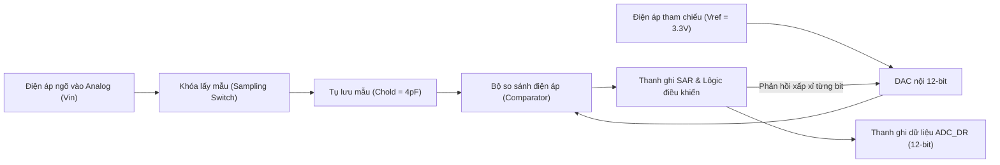

# CHƯƠNG 5: BỘ BIẾN ĐỔI TƯƠNG TỰ - SỐ (ADC) VÀ SỐ - TƯƠNG TỰ (DAC)
*(Biên soạn dựa trên Chapter 3: Time Management and Analog Signals - Arm Education Textbook kết hợp Chuẩn kỹ thuật phần cứng STM32F4)*

---

## 5.1. MỤC TIÊU CỦA CHƯƠNG
Sau khi hoàn thành chương này, sinh viên ngành Kỹ thuật Điện tử có khả năng:
1. **Làm chủ nguyên lý chuyển đổi tương tự - số:** Hiểu rõ cấu trúc bộ biến đổi ADC xấp xỉ liên tiếp (Successive Approximation Register - SAR), định lý lấy mẫu Nyquist-Shannon ($f_s \ge 2 f_{max}$), điện áp tham chiếu $V_{REF+}$, độ phân giải 12-bit ($2^{12} = 4096$ mức) và sai số lượng tử hóa ($Q = \frac{V_{REF}}{2^N}$).
2. **Thiết kế mạch điều hòa tín hiệu cảm biến (Signal Conditioning):**
   - Thiết kế mạch phân áp và mạch lọc thông thấp RC chống răng cưa (Anti-Aliasing Filter).
   - Ghép nối cảm biến nhiệt độ tương tự LM35 ($10\text{ mV}/^\circ\text{C}$), cảm biến quang trở (LDR) và cảm biến khí gas MQ-2.
   - Tính toán phối hợp trở kháng nguồn tín hiệu ngõ vào ($R_{AIN} \le 50\text{ k}\Omega$) phù hợp với thời gian nạp tụ lấy mẫu của STM32F4.
3. **Làm chủ kỹ thuật lập trình ADC & Quản lý thời gian:**
   - Triển khai kỹ thuật quản lý thời gian không chặn (Non-blocking timing) để hệ thống phản hồi tức thời với các sự kiện.
   - Lập trình bộ biến đổi ADC đa kênh ở các chế độ: Đơn kênh (Single), Quét liên tục (Scan Continuous) và kích hoạt tự động bằng Timer (TRGO Trigger).
   - Lập trình thuật toán lọc số khử nhiễu (Moving Average Filter).
4. **Hiện thực hóa khối phát tín hiệu DAC:** Cấu hình bộ chuyển đổi DAC 12-bit để phát điện áp tương tự và tạo dạng sóng sin/tam giác theo bảng tra (Look-Up Table).

---

## 5.2. NGUYÊN LÝ LẤY MẪU VÀ BỘ ADC XẤP XỈ LIÊN TIẾP (SAR ADC)

### 1. Cấu trúc bộ biến đổi SAR ADC trên STM32F4
Bộ ADC trên dòng STM32F4 là loại SAR 12-bit có tốc độ chuyển đổi cực nhanh (lên tới $2.4\text{ MSPS}$ ở chế độ đơn và $7.2\text{ MSPS}$ ở chế độ ghép kênh Interleaved).



- **Giai đoạn lấy mẫu (Sampling Phase):** Khóa chuyển mạch đóng lại trong một khoảng thời gian $T_{sample}$ (tùy chỉnh từ $3 \div 480$ chu kỳ xung nhịp ADC) để nạp đầy điện tích vào tụ lưu mẫu nội $C_{hold}$.
- **Giai đoạn biến đổi (Conversion Phase):** SAR Logic thực hiện thuật toán tìm kiếm nhị phân (Binary Search) qua 12 bước từ bit cao nhất $MSB$ (Bit 11) đến bit thấp nhất $LSB$ (Bit 0):
  - Bước 1: Giả định $MSB = 1$ ($V_{DAC} = \frac{V_{REF}}{2}$). Bộ so sánh kiểm tra $V_{in} > V_{DAC}$ hay không. Nếu lớn hơn thì giữ bit 1, ngược lại xóa về 0.
  - Lặp lại liên tục cho 12 bit $\rightarrow$ Tổng thời gian biến đổi:
  $$T_{conv} = T_{sample} + 12\text{ chu kỳ ADC}$$

### 2. Công thức chuyển đổi giá trị số sang điện áp thực tế
Giá trị số nguyên 12-bit lưu trong thanh ghi `ADC_DR` nằm trong dải $0 \div 4095$:
$$V_{in} = \frac{\text{ADC\_Value}}{4095} \times V_{REF+}$$

Với $V_{REF+} = 3.3\text{ V}$, độ phân giải điện áp của 1 mức lượng tử ($LSB$ voltage step):
$$1\text{ LSB} = \frac{3.3\text{ V}}{4095} \approx 0.8058\text{ mV}$$

---

## 5.3. THIẾT KẾ MẠCH ĐIỀU HÒA TÍN HIỆU CẢM BIẾN

### 1. Ghép nối cảm biến nhiệt độ LM35
Cảm biến nhiệt độ LM35 xuất ra điện áp tương tự tỷ lệ tuyến tính hoàn hảo với nhiệt độ:
$$V_{out}(T) = 10\text{ mV}/^\circ\text{C} \times T(^\circ\text{C})$$
- Tại $0^\circ\text{C}$: $V_{out} = 0\text{ mV}$.
- Tại $25^\circ\text{C}$: $V_{out} = 250\text{ mV} = 0.25\text{ V}$.
- Tại $100^\circ\text{C}$: $V_{out} = 1000\text{ mV} = 1.0\text{ V}$.

Công thức phần mềm quy đổi giá trị ADC ra nhiệt độ thực tế:
$$T(^\circ\text{C}) = \frac{V_{in}\text{ (mV)}}{10\text{ mV}/^\circ\text{C}} = \frac{\text{ADC\_Value} \times \frac{3300\text{ mV}}{4095}}{10} = \text{ADC\_Value} \times 0.080586$$

### 2. Mạch đo quang trở LDR và Biến trở tạo ngưỡng
- Mắc quang trở LDR nối tiếp với một điện trở chuẩn $R_1 = 10\text{ k}\Omega$ tạo thành mạch cầu chia áp:
$$V_{ADC} = V_{DD} \times \frac{R_{LDR}}{R_1 + R_{LDR}}$$
- Khi trời sáng: $R_{LDR}$ giảm nhỏ ($\approx 1\text{ k}\Omega$) $\rightarrow V_{ADC}$ giảm thấp.
- Khi trời tối: $R_{LDR}$ tăng lớn ($\approx 50\text{ k}\Omega \div 100\text{ k}\Omega$) $\rightarrow V_{ADC}$ tăng cao gần bằng $3.3\text{V}$.

---

## 5.4. KỸ THUẬT QUẢN LÝ THỜI GIAN KHÔNG CHẶN (NON-BLOCKING TIMING)
*(Phân tích theo tư duy thiết kế của Giáo trình ARM - Listing 3.2)*

Trong hệ thống nhúng thời gian thực, **tuyệt đối không được sử dụng các hàm trễ chặn (Blocking delay như `delay_ms()` hoặc `HAL_Delay()`)** trong vòng lặp chính. Khi vi điều khiển đang bị "kẹt" trong vòng lặp delay 1000ms để chờ đo nhiệt độ, nó sẽ hoàn toàn bị "mù" trước các sự cố rò rỉ khí gas hoặc phím bấm khẩn cấp!

### Mô hình quản lý thời gian bằng bộ đếm mili-giây (SysTick / Non-blocking loop):
```c
uint32_t lastReadTime = 0;
#define SENSOR_READ_INTERVAL 200 // Đọc cảm biến mỗi 200ms

while (1)
{
    uint32_t currentTime = HAL_GetTick(); // Đọc bộ đếm thời gian hệ thống

    // Chỉ thực thi đo cảm biến khi đã hết chu kỳ 200ms
    if (currentTime - lastReadTime >= SENSOR_READ_INTERVAL)
    {
        lastReadTime = currentTime;
        Read_Analog_Sensors(); // Đọc ADC
    }

    // Các tác vụ khác (Quét phím, cảnh báo còi) vẫn được thực thi liên tục 100% thời gian
    Check_Emergency_Gas();
    Update_Alarm_Siren();
}
```

---

## 5.5. HIỆN THỰC HÓA CÁC VÍ DỤ CỐT LÕI (EXAMPLES 3.1 $\div$ 3.5)

### VÍ DỤ 3.3 & 3.4: KÍCH HOẠT BÁO ĐỘNG BẰNG BIẾN TRỞ & QUY ĐỔI NHIỆT ĐỘ THỰC TẾ
- Người dùng điều chỉnh một biến trở analog xoay để đặt ngưỡng nhiệt độ cảnh báo ($T_{threshold}$ từ $20^\circ\text{C} \div 60^\circ\text{C}$).
- Vi điều khiển đọc cảm biến LM35, quy đổi ra độ C. Nếu nhiệt độ đo được vượt ngưỡng đặt của biến trở, kích hoạt còi báo động đa âm tần.

#### 1. Triển khai theo chuẩn Mbed C++ (Giáo trình ARM - Listing 3.3/3.4)
```cpp
#include "mbed.h"
#include "arm_book_lib.h"

AnalogIn potentiometer(A0);       // Đọc chân analog A0
AnalogIn lm35Sensor(A1);          // Đọc cảm biến nhiệt độ chân A1
DigitalOut alarmLed(LED1);
PwmOut buzzer(D4);

float getTemperatureC(float analogValue)
{
    // Chuyển đổi điện áp đọc được thành độ C
    return analogValue * 3.3 * 100.0;
}

int main()
{
    while (true) {
        float potVal = potentiometer.read(); // Giá trị chuẩn hóa 0.0 đến 1.0
        float tempVal = lm35Sensor.read();
        
        float tempThreshold = 20.0 + (potVal * 40.0); // Ngưỡng từ 20 đến 60 độ C
        float currentTemp = getTemperatureC(tempVal);

        if (currentTemp > tempThreshold) {
            alarmLed = ON;
        } else {
            alarmLed = OFF;
        }
        thread_sleep_for(100);
    }
}
```

#### 2. Triển khai theo chuẩn C Công nghiệp (STM32 HAL Library)
```c
#include "main.h"

ADC_HandleTypeDef hadc1;

uint16_t Read_ADC_Channel(uint32_t channel)
{
    ADC_ChannelConfTypeDef sConfig = {0};
    sConfig.Channel = channel;
    sConfig.Rank = 1;
    sConfig.SamplingTime = ADC_SAMPLETIME_84CYCLES;
    HAL_ADC_ConfigChannel(&hadc1, &sConfig);

    HAL_ADC_Start(&hadc1);
    HAL_ADC_PollForConversion(&hadc1, 10);
    uint16_t val = HAL_ADC_GetValue(&hadc1);
    HAL_ADC_Stop(&hadc1);

    return val;
}

void Process_Sensors(void)
{
    uint16_t rawPot = Read_ADC_Channel(ADC_CHANNEL_0); // PA0 (A0)
    uint16_t rawLM35 = Read_ADC_Channel(ADC_CHANNEL_1); // PA1 (A1)

    // Tính toán điện áp và nhiệt độ thực tế
    float vLM35 = (rawLM35 * 3.3f) / 4095.0f;
    float currentTemp = vLM35 * 100.0f; // LM35: 10mV/độ C -> nhân 100

    float potRatio = rawPot / 4095.0f;
    float tempThreshold = 20.0f + (potRatio * 40.0f); // 20 - 60 độ C

    if (currentTemp > tempThreshold)
    {
        HAL_GPIO_WritePin(GPIOB, GPIO_PIN_0, GPIO_PIN_SET); // Bật báo động
    }
    else
    {
        HAL_GPIO_WritePin(GPIOB, GPIO_PIN_0, GPIO_PIN_RESET);
    }
}
```

#### 3. Thuật toán Lọc số Trung bình (Moving Average Filter) chống nhiễu ADC
Tín hiệu analog luôn bị ảnh hưởng bởi nhiễu nguồn và nhiễu từ trường. Áp dụng bộ lọc trung bình trượt 16 mẫu:
```c
#define FILTER_WINDOW_SIZE 16

uint16_t Filtered_ADC_Read(uint32_t channel)
{
    uint32_t sum = 0;
    for (int i = 0; i < FILTER_WINDOW_SIZE; i++)
    {
        sum += Read_ADC_Channel(channel);
    }
    return (uint16_t)(sum / FILTER_WINDOW_SIZE);
}
```

---

## 5.6. BÀI TẬP VÀ CÂU HỎI ÔN TẬP CHƯƠNG 5
1. **Câu hỏi:** Giả sử xung nhịp cấp cho khối ADC trên STM32F4 là $f_{ADC} = 21\text{ MHz}$. Nếu cấu hình thời gian lấy mẫu là $T_{sample} = 84\text{ chu kỳ}$, hãy tính tổng thời gian để hoàn thành 1 lần chuyển đổi ($T_{conv}$) và tính tốc độ lấy mẫu cực đại (tính bằng số mẫu/giây - SPS).
2. **Thiết kế mạch:** Thiết kế mạch chia áp để đưa tín hiệu cảm biến điện áp công nghiệp từ $0\text{ V} \div 10\text{ V}$ về dải an toàn $0\text{ V} \div 3.3\text{ V}$ của chân ADC STM32F4. Tính toán giá trị 2 điện trở $R_1, R_2$ sao cho trở kháng tương đương Thevenin nhỏ hơn $10\text{ k}\Omega$.
3. **Lập trình:** Viết chương trình cấu hình khối DAC 12-bit trên kênh 1 (chân PA4) để phát ra một tín hiệu điện áp dạng răng cưa biến thiên từ $0.5\text{ V}$ đến $2.5\text{ V}$ với tần số $100\text{ Hz}$.
