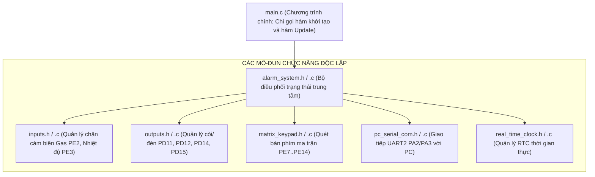

# CHƯƠNG 5: MÔ-ĐUN HÓA MÃ NGUỒN PHẦN MỀM HỆ THỐNG NHÚNG TRÊN STM32F407
*(Biên soạn dựa trên Chapter 5: Modularization Applied to Embedded Systems Programming - Arm Education Textbook, hiệu chỉnh chuyên sâu cho STM32F407)*

---

## 5.1. MỤC TIÊU CỦA CHƯƠNG
- **Bối cảnh kiến thức:** Sinh viên thường có thói quen viết dồn toàn bộ mã nguồn vào một file duy nhất `main.c`. Khi hệ thống nhúng mở rộng nhiều khối ngoại vi (ADC, UART, RTC, Bàn phím), file `main.c` dài hàng nghìn dòng sẽ trở nên không thể bảo trì, dễ sinh lỗi xung đột biến toàn cục.
- **Mục tiêu chi tiết:**
  1. Nắm vững các nguyên lý vàng của công nghệ phần mềm nhúng: **Mô-đun hóa (Modularization)**, **Phân tách trách nhiệm (Separation of Concerns)**, **Độ kết dính cao (High Cohesion)** và **Độ liên kết lỏng (Low Coupling)**.
  2. Tái cấu trúc (Refactoring) toàn bộ hệ thống Smart Home đã xây dựng từ Chương 1 đến Chương 4 thành các phân hệ mô-đun chức năng độc lập.
  3. Làm chủ kỹ thuật phân chia file trong C/C++ cho STM32CubeIDE: Quản lý file tiêu đề (`.h`) và file thực thi (`.c`), bảo vệ chống đa khai báo (Header Guards), phạm vi biến `static` và biến toàn cục chia sẻ `extern`.
  4. Thiết kế các hàm giao tiếp chuẩn hóa (API Functions: `Init()`, `Update()`, `Read()`, `Write()`) cho từng khối ngoại vi.

---

## 5.2. NGUYÊN TẮC PHÂN TÁCH VÀ CẤU TRÚC THƯ MỤC MÃ NGUỒN

Hệ thống Smart Home trên STM32F407 được tái cấu trúc thành 6 mô-đun độc lập đặt trong thư mục `Core/Src` và `Core/Inc`:



---

## 5.3. CHI TIẾT TÁI CẤU TRÚC CÁC MÔ-ĐUN MÃ NGUỒN

### 1. Phân hệ Ngõ vào Cảm biến: `inputs.h` và `inputs.c`
- **Nhiệm vụ:** Đóng gói toàn bộ việc đọc chân phần cứng cảm biến và nút bấm, không để lộ cấu hình chân ra bên ngoài.

`inputs.h`:
```c
#ifndef INPUTS_H
#define INPUTS_H

#include <stdbool.h>

void Inputs_Init(void);
bool Inputs_ReadGasDetector(void);
bool Inputs_ReadOverTempDetector(void);

#endif // INPUTS_H
```

`inputs.c`:
```c
#include "inputs.h"
#include "main.h"

void Inputs_Init(void)
{
    // Cấu hình PE2 (Gas) và PE3 (OverTemp)
    __HAL_RCC_GPIOE_CLK_ENABLE();
    GPIO_InitTypeDef GPIO_InitStruct = {0};
    GPIO_InitStruct.Pin = GPIO_PIN_2 | GPIO_PIN_3;
    GPIO_InitStruct.Mode = GPIO_MODE_INPUT;
    GPIO_InitStruct.Pull = GPIO_PULLDOWN;
    HAL_GPIO_Init(GPIOE, &GPIO_InitStruct);
}

bool Inputs_ReadGasDetector(void)
{
    return (HAL_GPIO_ReadPin(GPIOE, GPIO_PIN_2) == GPIO_PIN_SET);
}

bool Inputs_ReadOverTempDetector(void)
{
    return (HAL_GPIO_ReadPin(GPIOE, GPIO_PIN_3) == GPIO_PIN_SET);
}
```

---

### 2. Phân hệ Ngõ ra Chỉ báo: `outputs.h` và `outputs.c`
- **Nhiệm vụ:** Đóng gói toàn bộ việc bật/tắt đèn LED và còi hú.

`outputs.h`:
```c
#ifndef OUTPUTS_H
#define OUTPUTS_H

#include <stdbool.h>

void Outputs_Init(void);
void Outputs_SetAlarmLed(bool state);
void Outputs_SetIncorrectCodeLed(bool state);
void Outputs_SetSystemBlockedLed(bool state);
void Outputs_SetBuzzer(bool state);

#endif // OUTPUTS_H
```

---

### 3. Chương trình chính `main.c` sau khi được mô-đun hóa hoàn hảo:
Nhờ mô-đun hóa, hàm `main.c` trở nên cực kỳ trong sáng, ngắn gọn và đạt chuẩn công nghiệp:

```c
#include "main.h"
#include "inputs.h"
#include "outputs.h"
#include "alarm_system.h"
#include "pc_serial_com.h"
#include "matrix_keypad.h"

int main(void)
{
    HAL_Init();
    SystemClock_Config();

    // 1. Khởi tạo tất cả các phân hệ ngoại vi
    Inputs_Init();
    Outputs_Init();
    AlarmSystem_Init();
    PCSerialCom_Init();
    MatrixKeypad_Init();

    // 2. Vòng lặp điều phối chính (Superloop): Không chứa lệnh delay chặn
    while (1)
    {
        AlarmSystem_Update();
        PCSerialCom_Update();
        MatrixKeypad_Update();
    }
}
```

---

## 5.4. BÀI HỌC KINH NGHIỆM KỸ THUẬT VỀ PHẠM VI BIẾN (VARIABLE SCOPING)
1. **Từ khóa `static` cho hàm và biến nội bộ:** Mọi biến hoặc hàm chỉ sử dụng nội bộ bên trong file `.c` **bắt buộc phải có từ khóa `static`**. Điều này giúp ẩn giấu dữ liệu (Data Hiding), tránh việc các file khác vô tình sửa đổi làm sai lệch trạng thái hệ thống.
2. **Hạn chế tối đa từ khóa `extern`:** Thay vì dùng `extern int alarmState;` ở nhiều file khác nhau, hãy viết hàm đóng gói truy xuất an toàn:
   ```c
   bool AlarmSystem_IsAlarmActive(void);
   void AlarmSystem_ClearAlarm(void);
   ```
