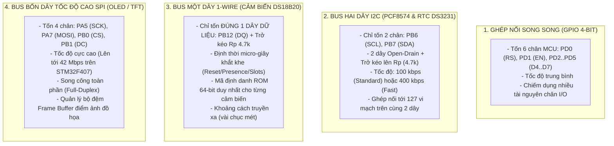
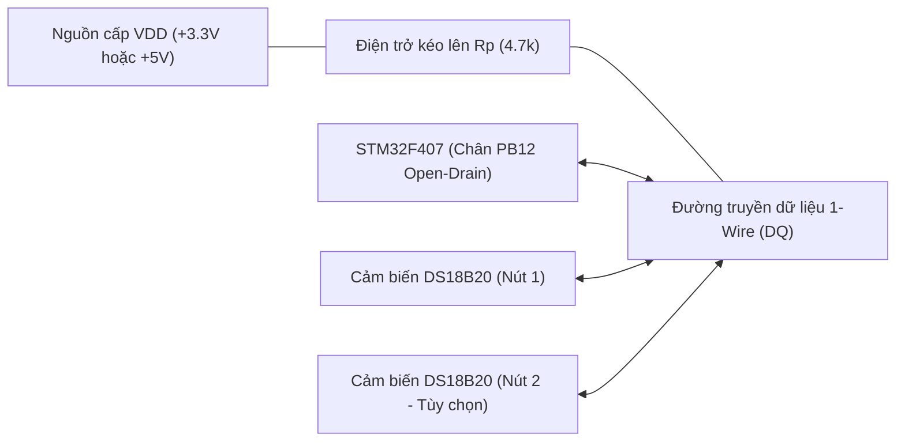
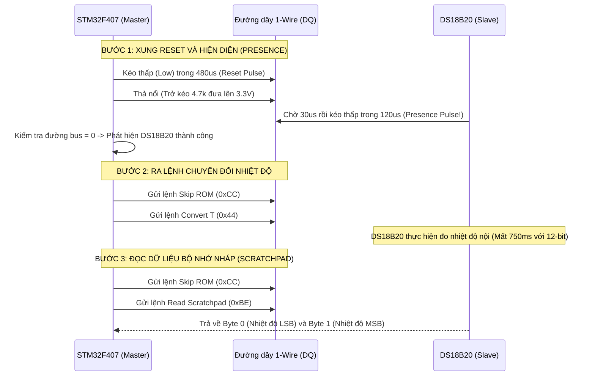

# CHƯƠNG 6: MÀN HÌNH HIỂN THỊ VÀ CÁC CHUẨN GIAO TIẾP VI MẠCH (I2C, 1-WIRE, SPI) TRÊN STM32F407
*(Biên soạn dựa trên Chapter 6: LCD Displays and Communication between Integrated Circuits - Arm Education Textbook kết hợp Chuẩn kỹ thuật công nghiệp 1-Wire DS18B20 trên STM32F407)*

---

## 6.1. MỤC TIÊU CỦA CHƯƠNG
- **Bối cảnh kiến thức:** Sinh viên đã thành thạo giao tiếp nối tiếp UART điểm - điểm ở Chương 2; chương này trang bị cho sinh viên khả năng làm chủ toàn bộ **các chuẩn giao tiếp vi mạch cốt lõi trên bo mạch**: Bus song song GPIO 4-bit, **Bus 2 dây $I^2C$**, **Bus 1 dây 1-Wire** và **Bus 4 dây tốc độ cao SPI**.
- **Mục tiêu chi tiết:**
  1. Điều khiển màn hình ký tự LCD 16x2 trực tiếp bằng GPIO ở chế độ 4-bit (chân `PD0..PD5` trên STM32F407) (Examples 6.1 & 6.2).
  2. Nắm vững nguyên lý bus $I^2C$: Cấu trúc Open-Drain, điện trở kéo lên $R_p$, địa chỉ 7-bit, bit ACK/NACK và điều khiển LCD 16x2 qua IC mở rộng PCF8574 trên bus `I2C1` (`PB6, PB7`) (Example 6.3).
  3. **Làm chủ chuẩn giao tiếp 1-Wire (Dallas/Maxim):** Cấu trúc bus 1 dây dữ liệu, điện trở kéo lên $4.7\text{ k}\Omega$, định thời micro-giây khắt khe (Reset/Presence pulse, Write 0/1, Read time slots), và ghép nối cảm biến nhiệt độ kỹ thuật số chính xác cao **DS18B20** trên chân `PB12`.
  4. Nắm vững nguyên lý bus SPI: 4 chế độ hoạt động (`CPOL`, `CPHA`), truyền song công toàn phần tốc độ cao và điều khiển màn hình đồ họa Graphical LCD (OLED SSD1306 / TFT ST7735) qua `SPI1` (`PA5, PA7, PB0, PB1`) (Examples 6.4 & 6.5).
  5. Phân tích so sánh toàn diện 4 chuẩn: **Song song vs 1-Wire vs $I^2C$ vs SPI** về số dây, tốc độ, khoảng cách và độ phức tạp phần cứng (Under the Hood mở rộng).

---

## 6.2. SO SÁNH 4 PHƯƠNG THỨC TRUYỀN THÔNG VI MẠCH TRÊN STM32F407



---

## 6.3. ĐIỀU KHIỂN MÀN HÌNH LCD 16x2 QUA GPIO VÀ BUS $I^2C$ (EXAMPLES 6.1 $\div$ 6.3)

### 1. Điều khiển LCD 16x2 chế độ 4-bit song song (Examples 6.1 & 6.2)
- **Chân kết nối STM32F407:** `PD0` ($RS$), `PD1` ($EN$), `PD2` ($D_4$), `PD3` ($D_5$), `PD4` ($D_6$), `PD5` ($D_7$).
- **Nguyên lý 4-bit:** Mỗi byte được gửi làm 2 đợt (4-bit cao trước, 4-bit thấp sau). Tạo xung cạnh xuống trên chân $EN$ ($1 \rightarrow 0$) để vi mạch HD44780 chốt dữ liệu.

### 2. Điều khiển LCD 16x2 qua Bus $I^2C$ sử dụng vi mạch PCF8574 (Example 6.3)
- **Chân kết nối STM32F407:** `PB6` (SCL), `PB7` (SDA) cấu hình Alternate Function AF4 (`I2C1`).
- **Địa chỉ I2C:** Mặc định `0x27` (hoặc `0x3F`), dạng 8-bit dịch trái: `0x4E`.
```c
#include "main.h"

extern I2C_HandleTypeDef hi2c1;
#define LCD_ADDR  (0x27 << 1)

void LCD_I2C_Send(uint8_t data, uint8_t rs)
{
    uint8_t high = data & 0xF0;
    uint8_t low  = (data << 4) & 0xF0;
    uint8_t bl   = 0x08; // Bật đèn nền Backlight

    uint8_t pkt[4];
    pkt[0] = high | rs | bl | 0x04; // EN = 1
    pkt[1] = high | rs | bl | 0x00; // EN = 0
    pkt[2] = low  | rs | bl | 0x04; // EN = 1
    pkt[3] = low  | rs | bl | 0x00; // EN = 0

    HAL_I2C_Master_Transmit(&hi2c1, LCD_ADDR, pkt, 4, 100);
}

void LCD_Print_Status(float temp, bool gasAlert)
{
    char buf[16];
    LCD_I2C_Send(0x80, 0); // Về đầu dòng 1
    snprintf(buf, sizeof(buf), "TEMP: %.1f C", temp);
    for (char *p = buf; *p; p++) LCD_I2C_Send(*p, 1);

    LCD_I2C_Send(0xC0, 0); // Về đầu dòng 2
    char *gasMsg = gasAlert ? "GAS: DETECTED! " : "GAS: NORMAL    ";
    for (char *p = gasMsg; *p; p++) LCD_I2C_Send(*p, 1);
}
```

---

## 6.4. CHUYÊN ĐỀ SÂU: CHUẨN GIAO TIẾP 1-WIRE VÀ CẢM BIẾN NHIỆT ĐỘ DS18B20

Chuẩn truyền thông **1-Wire** do Dallas Semiconductor phát minh là giải pháp độc đáo cho phép vi điều khiển giao tiếp với các cảm biến kỹ thuật số chỉ bằng **duy nhất 1 đường dây dữ liệu ($DQ$)** và 1 dây mass ($GND$):



### 1. Đặc tính kỹ thuật cảm biến nhiệt độ số DS18B20:
- **Dải đo nhiệt độ:** $-55^\circ\text{C} \div +125^\circ\text{C}$, độ chính xác $\pm 0.5^\circ\text{C}$ trong khoảng $-10^\circ\text{C} \div +85^\circ\text{C}$.
- **Độ phân giải cấu hình:** $9, 10, 11$ hoặc $12\text{ bit}$ (12-bit tương ứng bước nhảy lượng tử siêu mịn $0.0625^\circ\text{C}$).
- **Mã định danh ROM 64-bit duy nhất (Unique 64-bit Lasered ROM):** Mỗi con chip xuất xưởng đều có một số định danh nhị phân riêng biệt, cho phép ghép song song hàng chục cảm biến DS18B20 trên cùng 1 đường dây 1-Wire duy nhất kéo dài hàng chục mét trong nhà xưởng!

### 2. Giản đồ định thời micro-giây ($\mu\text{s}$) khắt khe của chuẩn 1-Wire:
Vì không có dây xung nhịp riêng, việc đồng bộ hoàn toàn dựa trên các khoảng thời gian trễ chính xác:
- **Xung khởi tạo (Reset Pulse):** Master kéo đường dây xuống $0\text{V}$ trong tối thiểu $480\mu\text{s}$, sau đó thả nổi đường dây.
- **Xung hiện diện (Presence Pulse):** Điện trở $R_{pullup}$ kéo đường dây lên $3.3\text{V}$. Sau khoảng $15 \div 60\mu\text{s}$, nếu có cảm biến DS18B20 trên bus, cảm biến sẽ chủ động kéo đường dây xuống $0\text{V}$ trong $60 \div 240\mu\text{s}$ để báo cáo: *"Tôi đang có mặt và sẵn sàng!"*.
- **Khe thời gian Ghi bit '0' (Write 0 Slot):** Master kéo đường dây xuống thấp trong $60 \div 120\mu\text{s}$ rồi thả nổi.
- **Khe thời gian Ghi bit '1' (Write 1 Slot):** Master kéo đường dây xuống thấp chỉ trong $1 \div 15\mu\text{s}$ rồi lập tức thả nổi trong phần còn lại của chu kỳ $60\mu\text{s}$.
- **Khe thời gian Đọc bit (Read Slot):** Master kéo đường dây xuống thấp trong $1 \div 3\mu\text{s}$ rồi thả nổi. Master đọc trạng thái logic của đường dây tại thời điểm micro-giây thứ $12 \div 15\mu\text{s}$.



### 3. Hiện thực hóa mã nguồn giao tiếp 1-Wire DS18B20 trên STM32F407:
Sử dụng bộ đếm chu kỳ máy DWT (Data Watchpoint and Trace) tích hợp sẵn trong lõi ARM Cortex-M4 để tạo hàm trễ micro-giây chính xác tuyệt đối:

```c
#include "main.h"

#define DS18B20_PORT  GPIOB
#define DS18B20_PIN   GPIO_PIN_12

// Khởi tạo bộ đếm chu kỳ Cortex-M4 DWT để tạo trễ micro-giây
void DWT_Delay_Init(void)
{
    CoreDebug->DEMCR |= CoreDebug_DEMCR_TRCENA_Msk;
    DWT->CTRL |= DWT_CTRL_CYCCNTENA_Msk;
}

void Delay_us(uint32_t us)
{
    uint32_t ticks = us * (SystemCoreClock / 1000000); // 168 chu kỳ/us tại 168MHz
    uint32_t start = DWT->CYCCNT;
    while ((DWT->CYCCNT - start) < ticks);
}

void Set_Pin_Output_OD(void)
{
    GPIO_InitTypeDef GPIO_InitStruct = {0};
    GPIO_InitStruct.Pin = DS18B20_PIN;
    GPIO_InitStruct.Mode = GPIO_MODE_OUTPUT_OD; // Cực máng hở Open-Drain
    GPIO_InitStruct.Pull = GPIO_NOPULL;
    GPIO_InitStruct.Speed = GPIO_SPEED_FREQ_HIGH;
    HAL_GPIO_Init(DS18B20_PORT, &GPIO_InitStruct);
}

// 1. Gửi xung Reset và chờ xung Presence từ DS18B20
uint8_t DS18B20_Reset(void)
{
    HAL_GPIO_WritePin(DS18B20_PORT, DS18B20_PIN, GPIO_PIN_RESET);
    Delay_us(480); // Kéo thấp 480us

    HAL_GPIO_WritePin(DS18B20_PORT, DS18B20_PIN, GPIO_PIN_SET); // Thả nổi
    Delay_us(80);  // Chờ DS18B20 kéo thấp

    uint8_t presence = (HAL_GPIO_ReadPin(DS18B20_PORT, DS18B20_PIN) == GPIO_PIN_RESET) ? 1 : 0;
    Delay_us(400); // Chờ hết chu kỳ Reset
    return presence;
}

// 2. Ghi 1 bit ra bus 1-Wire
void DS18B20_WriteBit(uint8_t bit)
{
    if (bit)
    {
        HAL_GPIO_WritePin(DS18B20_PORT, DS18B20_PIN, GPIO_PIN_RESET);
        Delay_us(2);   // Kéo thấp ngắn 2us
        HAL_GPIO_WritePin(DS18B20_PORT, DS18B20_PIN, GPIO_PIN_SET); // Thả nổi
        Delay_us(60);
    }
    else
    {
        HAL_GPIO_WritePin(DS18B20_PORT, DS18B20_PIN, GPIO_PIN_RESET);
        Delay_us(60);  // Kéo thấp dài 60us
        HAL_GPIO_WritePin(DS18B20_PORT, DS18B20_PIN, GPIO_PIN_SET); // Thả nổi
        Delay_us(2);
    }
}

// 3. Đọc 1 bit từ bus 1-Wire
uint8_t DS18B20_ReadBit(void)
{
    HAL_GPIO_WritePin(DS18B20_PORT, DS18B20_PIN, GPIO_PIN_RESET);
    Delay_us(2);
    HAL_GPIO_WritePin(DS18B20_PORT, DS18B20_PIN, GPIO_PIN_SET); // Thả nổi
    Delay_us(10); // Lấy mẫu tại 12us

    uint8_t bit = (HAL_GPIO_ReadPin(DS18B20_PORT, DS18B20_PIN) == GPIO_PIN_SET) ? 1 : 0;
    Delay_us(50);
    return bit;
}

void DS18B20_WriteByte(uint8_t data)
{
    for (int i = 0; i < 8; i++)
    {
        DS18B20_WriteBit(data & (1 << i));
    }
}

uint8_t DS18B20_ReadByte(void)
{
    uint8_t data = 0;
    for (int i = 0; i < 8; i++)
    {
        if (DS18B20_ReadBit()) data |= (1 << i);
    }
    return data;
}

// 4. Hàm đọc nhiệt độ hoàn chỉnh trả về giá trị độ C (float)
float DS18B20_ReadTemperature(void)
{
    if (!DS18B20_Reset()) return -999.0f; // Lỗi: Không thấy cảm biến

    DS18B20_WriteByte(0xCC); // Skip ROM (chỉ có 1 cảm biến trên bus)
    DS18B20_WriteByte(0x44); // Convert Temperature

    HAL_Delay(750); // Chờ 750ms chuyển đổi 12-bit

    DS18B20_Reset();
    DS18B20_WriteByte(0xCC); // Skip ROM
    DS18B20_WriteByte(0xBE); // Read Scratchpad

    uint8_t tempLSB = DS18B20_ReadByte(); // Byte 0
    uint8_t tempMSB = DS18B20_ReadByte(); // Byte 1

    int16_t rawTemp = (tempMSB << 8) | tempLSB;
    // Mỗi đơn vị LSB của DS18B20 tương ứng 0.0625 độ C (1/16 độ C)
    return (float)rawTemp * 0.0625f;
}
```

---

## 6.5. ĐIỀU KHIỂN MÀN HÌNH ĐỒ HỌA GRAPHICAL LCD QUA BUS SPI (EXAMPLES 6.4 & 6.5)
- **Phân bổ chân STM32F407:** Chân `PA5` ($SCK$), `PA7` ($MOSI$), `PB0` ($CS$), `PB1` ($DC$).
- Màn hình đồ họa OLED SSD1306 quản lý $128 \times 64$ điểm ảnh qua bộ đệm khung hình `uint8_t frameBuffer[1024]`.
- Lập trình hiển thị biểu đồ nhiệt độ thu thập từ cảm biến DS18B20 thời gian thực.

---

## 6.6. BẢNG SO SÁNH TOÀN DIỆN: SONG SONG vs 1-WIRE vs $I^2C$ vs SPI
*(Tổng hợp kiến trúc Under the Hood)*

| Tiêu chuẩn kỹ thuật | Song song (GPIO 4-bit) | 1-Wire (Dallas/Maxim) | $I^2C$ (Philips/NXP) | SPI (Motorola) |
| :--- | :---: | :---: | :---: | :---: |
| **Số dây tín hiệu** | **6 dây** ($RS, EN, D_4..D_7$) | **DUY NHẤT 1 DÂY ($DQ$)** | 2 dây ($SCL, SDA$) | 4 dây ($SCK, MOSI, MISO, CS$) |
| **Cấu trúc tầng ra** | Push-Pull | **Open-Drain + Trở $4.7\text{ k}\Omega$** | **Open-Drain + Trở $2.2 \div 4.7\text{ k}\Omega$** | Push-Pull |
| **Đồng bộ xung Clock**| Đồng bộ qua chân $EN$ | Dị bộ theo khe thời gian $\mu s$ | Đồng bộ qua chân $SCL$ | Đồng bộ qua chân $SCK$ |
| **Tốc độ truyền** | Trung bình ($\sim 500\text{ kbps}$) | Chậm ($16.3\text{ kbps}$) | Trung bình ($100 \div 400\text{ kbps}$) | **Cực nhanh (Lên tới $42\text{ Mbps}$)** |
| **Khoảng cách truyền**| Cực ngắn ($< 15\text{ cm}$) | **Khá xa ($> 50\text{ mét}$)** | Ngắn ($< 30\text{ cm}$) | Ngắn ($< 20\text{ cm}$) |
| **Khả năng ghép nối** | 1 màn hình duy nhất | **Hàng chục cảm biến (ROM 64-bit)** | **Tới 127 vi mạch (Địa chỉ 7-bit)** | Nhiều Slave (Tốn chân CS riêng) |
| **Ứng dụng tiêu biểu**| Màn hình LCD cổ điển | **Cảm biến nhiệt độ công nghiệp DS18B20, iButton** | **RTC DS3231, LCD I2C, Cảm biến IMU** | **Màn hình OLED, Thẻ nhớ SD, Flash W25Q** |
