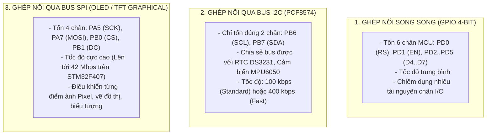

# CHƯƠNG 6: MÀN HÌNH HIỂN THỊ LCD VÀ TRUYỀN THÔNG VI MẠCH QUA BUS I2C VÀ SPI TRÊN STM32F407
*(Biên soạn dựa trên Chapter 6: LCD Displays and Communication between Integrated Circuits - Arm Education Textbook, hiệu chỉnh chuyên sâu cho STM32F407)*

---

## 6.1. MỤC TIÊU CỦA CHƯƠNG
- **Bối cảnh kiến thức:** Sinh viên đã nắm vững nguyên lý truyền thông nối tiếp UART điểm - điểm ở Chương 2; chương này giúp sinh viên so sánh trực quan và làm chủ hai chuẩn truyền thông vi mạch phổ biến nhất trên bo mạch: **Bus hai dây $I^2C$** và **Bus bốn dây tốc độ cao SPI** thông qua bài toán điều khiển màn hình hiển thị.
- **Mục tiêu chi tiết:**
  1. Điều khiển màn hình ký tự LCD 16x2 trực tiếp bằng GPIO ở chế độ 4-bit (chân `PD0..PD5` trên STM32F407) (Examples 6.1 & 6.2).
  2. Nắm vững nguyên lý bus $I^2C$: Cấu trúc Open-Drain, điện trở kéo lên $R_p$, địa chỉ 7-bit, bit ACK/NACK và điều khiển LCD 16x2 qua IC mở rộng PCF8574 trên bus `I2C1` (`PB6, PB7`) (Example 6.3).
  3. Nắm vững nguyên lý bus SPI: 4 chế độ hoạt động (`CPOL`, `CPHA`), truyền song công toàn phần tốc độ cao và điều khiển màn hình đồ họa Graphical LCD (OLED SSD1306 / TFT ST7735) qua `SPI1` (`PA5, PA7, PB0, PB1`) (Examples 6.4 & 6.5).
  4. Phân tích so sánh toàn diện 3 chuẩn: **UART vs $I^2C$ vs SPI** về số chân, tốc độ, khoảng cách và độ phức tạp phần cứng (Section 6.3 - Under the Hood của ARM).

---

## 6.2. SO SÁNH 3 PHƯƠNG THỨC GHÉP NỐI MÀN HÌNH TRÊN STM32F407



---

## 6.3. HIỆN THỰC HÓA CHI TIẾT CÁC VÍ DỤ TỪ EXAMPLE 6.1 ĐẾN 6.5 TRÊN STM32F407

### VÍ DỤ 6.1 & 6.2: ĐIỀU KHIỂN LCD 16x2 CHẾ ĐỘ 4-BIT QUA GPIO
- **Phân bổ chân:** `PD0` ($RS$), `PD1` ($EN$), `PD2` ($D_4$), `PD3` ($D_5$), `PD4` ($D_6$), `PD5` ($D_7$).
- **Nguyên lý 4-bit:** Mỗi byte lệnh hoặc ký tự 8-bit được tách thành 2 nửa (Nibble cao gửi trước, Nibble thấp gửi sau), kèm theo xung kích cạnh xuống của chân $EN$.
- Hiển thị lên LCD: Dòng 1 hiển thị nhiệt độ đo được; Dòng 2 hiển thị trạng thái còi báo động.

---

### VÍ DỤ 6.3: ĐIỀU KHIỂN LCD 16x2 QUA BUS $I^2C$ (IC PCF8574)
- **Phân bổ chân STM32F407:**
  - Chân `PB6`: $SCL$ (Alternate Function AF4 - `I2C1`).
  - Chân `PB7`: $SDA$ (Alternate Function AF4 - `I2C1`).
  - Điện trở kéo lên ngoài: $R_p = 4.7\text{ k}\Omega$ nối lên $3.3\text{V}$ (hoặc module PCF8574 đã tích hợp sẵn).
- **Địa chỉ I2C:** Mặc định `0x27` (hoặc `0x3F`), dạng 8-bit dịch trái: `0x4E`.
```c
// Gửi ký tự ra màn hình qua I2C HAL
void LCD_I2C_Print_Temperature(float temp)
{
    char lineBuffer[16];
    snprintf(lineBuffer, sizeof(lineBuffer), "TEMP: %.1f C", temp);
    LCD_SetCursor(0, 0); // Dòng 1
    LCD_Print(lineBuffer);
}
```

---

### VÍ DỤ 6.4 & 6.5: ĐIỀU KHIỂN MÀN HÌNH ĐỒ HỌA GRAPHICAL LCD QUA BUS SPI
- **Phân bổ chân STM32F407:**
  - Chân `PA5`: $SCK$ (SPI1 Clock).
  - Chân `PA7`: $MOSI$ (SPI1 Data Master Out).
  - Chân `PB0`: $CS$ (Chip Select, GPIO Output).
  - Chân `PB1`: $DC$ (Data/Command Control, GPIO Output).
- **Bộ đệm khung hình (Frame Buffer):** Màn hình đồ họa $128 \times 64$ điểm ảnh được quản lý trong mảng RAM `uint8_t frameBuffer[1024];`.
```c
// Vẽ đường thẳng hoặc biểu đồ cảm biến
void OLED_Draw_Temperature_Graph(float tempHistory[], int count)
{
    OLED_ClearScreen();
    for (int x = 0; x < count - 1; x++)
    {
        // Vẽ đồ thị biến thiên nhiệt độ thời gian thực
        OLED_DrawLine(x, (int)tempHistory[x], x + 1, (int)tempHistory[x + 1]);
    }
    OLED_UpdateScreen(); // Đẩy toàn bộ 1024 byte qua SPI1
}
```

---

## 6.4. "UNDER THE HOOD": SO SÁNH TOÀN DIỆN UART vs $I^2C$ vs SPI
*(Theo tài liệu Section 6.3.1 của ARM Education)*

| Tiêu chí so sánh | UART / USART | $I^2C$ (Two-Wire) | SPI (Serial Peripheral) |
| :--- | :---: | :---: | :---: |
| **Số dây tín hiệu** | 2 dây (TX, RX) | **2 dây** (SCL, SDA) | 4 dây (SCK, MOSI, MISO, CS) |
| **Đồng bộ xung clock** | Dị bộ (Không dây clock) | Đồng bộ (Có dây SCL) | Đồng bộ (Có dây SCK) |
| **Mạch ngõ ra** | Push-Pull | **Open-Drain (Cực máng hở)** | Push-Pull |
| **Tốc độ truyền dữ liệu** | $9.6\text{ kbps} \div 115.2\text{ kbps}$ | $100\text{ kbps} \div 400\text{ kbps}$ | **$10\text{ Mbps} \div 42\text{ Mbps}$ (Cực nhanh)** |
| **Mô hình ghép nối** | 1 Master - 1 Slave | **Đa điểm (Multi-drop, tới 127 thiết bị)** | 1 Master - Nhiều Slave (qua chân CS riêng) |
| **Khoảng cách truyền** | Trung bình (TTL 1m, RS-485 1200m) | Ngắn ($< 30\text{ cm}$ trên cùng PCB) | Ngắn ($< 20\text{ cm}$ trên cùng PCB) |
| **Ứng dụng tối ưu** | Giao tiếp PC, Module SIM, GPS | **Cảm biến, RTC, IC mở rộng, EEPROM** | **Màn hình đồ họa, Thẻ nhớ SD, Flash tốc độ cao** |
