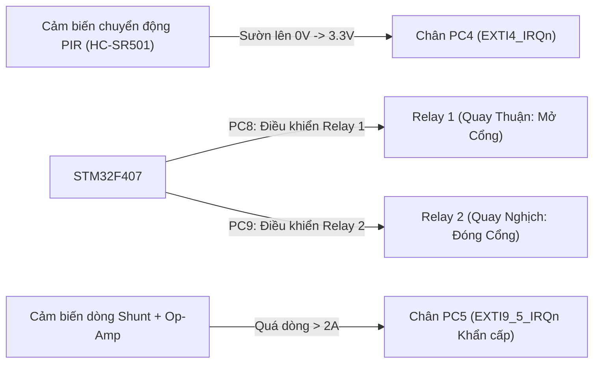

# CHƯƠNG 7: ĐIỀU KHIỂN ĐỘNG CƠ DC BẰNG RELAY VÀ CƠ CHẾ NGẮT THỜI GIAN THỰC TRÊN STM32F407
*(Biên soạn dựa trên Chapter 7: DC Motor Driving using Relays and Interrupts - Arm Education Textbook, hiệu chỉnh chuyên sâu cho STM32F407)*

---

## 7.1. MỤC TIÊU CỦA CHƯƠNG
- **Bối cảnh kiến thức:** Sinh viên đã biết cách điều khiển đóng cắt tải cơ bản ở Chương 1; chương này nâng lên điều khiển tải cảm kháng công suất lớn (Động cơ DC đảo chiều) và làm chủ **Cơ chế ngắt ngoài EXTI kết hợp bộ điều khiển ngắt lồng nhau NVIC** trên vi điều khiển STM32F407.
- **Mục tiêu chi tiết:**
  1. Nắm vững cơ chế xử lý ngắt phần cứng của lõi ARM Cortex-M4: Bảng vector ngắt (Vector Table), tự động lưu ngữ cảnh (Hardware Context Stacking), độ trễ ngắt cực thấp (12 chu kỳ clock) và phân cấp ưu tiên ngắt (Preemption & Sub-Priority).
  2. Ghép nối cảm biến chuyển động hồng ngoại thụ động PIR (HC-SR501 trên chân `PC4`) kích hoạt ngắt ngoài `EXTI4`.
  3. Thiết kế mạch cầu 2 Relay đảo chiều quay động cơ DC (chân điều khiển `PC8` và `PC9`), phân tích nguyên lý diode dập xung ngược Flyback Diode và mạch cách ly quang Optocoupler.
  4. Hiện thực hóa các ví dụ từ Example 7.1 đến 7.4 trên STM32F407: Phát hiện chuyển động bằng ngắt, đóng mở cổng tự động, bảo vệ quá dòng động cơ bằng ngắt và quản lý chu trình chuyển động cổng không chặn (Non-blocking timing).

---

## 7.2. PHÂN BỔ PHẦN CỨNG ĐIỀU KHIỂN ĐỘNG CƠ VÀ NGẮT TRÊN STM32F407



---

## 7.3. HIỆN THỰC HÓA CHI TIẾT CÁC VÍ DỤ TỪ EXAMPLE 7.1 ĐẾN 7.4 TRÊN STM32F407

### VÍ DỤ 7.1: BẮT NGẮT CHUYỂN ĐỘNG TỪ CẢM BIẾN PIR (Listing 7.1)
- Cấu hình chân `PC4` ở chế độ ngắt ngoài `GPIO_MODE_IT_RISING`, kích hoạt kênh `EXTI4_IRQn` trên khối NVIC.

```c
#include "main.h"

// Biến cờ hiệu - Bắt buộc khai báo volatile
volatile uint8_t motionDetectedFlag = 0;

void System_Init_PIR_Interrupt(void)
{
    __HAL_RCC_GPIOC_CLK_ENABLE();
    GPIO_InitTypeDef GPIO_InitStruct = {0};

    // Cấu hình PC4 là ngõ vào ngắt bắt sườn lên
    GPIO_InitStruct.Pin = GPIO_PIN_4;
    GPIO_InitStruct.Mode = GPIO_MODE_IT_RISING;
    GPIO_InitStruct.Pull = GPIO_PULLDOWN;
    HAL_GPIO_Init(GPIOC, &GPIO_InitStruct);

    // Cấu hình NVIC: Ưu tiên ngắt mức 2
    HAL_NVIC_SetPriority(EXTI4_IRQn, 2, 0);
    HAL_NVIC_EnableIRQ(EXTI4_IRQn);
}

// Hàm phục vụ ngắt ngoài của STM32 HAL
void HAL_GPIO_EXTI_Callback(uint16_t GPIO_Pin)
{
    if (GPIO_Pin == GPIO_PIN_4)
    {
        motionDetectedFlag = 1; // Chỉ bật cờ hiệu trong ISR
    }
}
```

---

### VÍ DỤ 7.2: CHU TRÌNH ĐIỀU KHIỂN CỔNG ĐỘNG CƠ DC BẰNG 2 RELAY (Listing 7.2)
- Khi có chuyển động kích hoạt:
  1. Mở cổng (Bật Relay 1, Tắt Relay 2) trong 5 giây.
  2. Dừng cổng (Tắt cả 2 Relay) trong 3 giây cho xe qua.
  3. Đóng cổng (Tắt Relay 1, Bật Relay 2) trong 5 giây.
  4. Dừng hoàn toàn.

```c
void Motor_OpenGate(void)
{
    HAL_GPIO_WritePin(GPIOC, GPIO_PIN_8, GPIO_PIN_SET);
    HAL_GPIO_WritePin(GPIOC, GPIO_PIN_9, GPIO_PIN_RESET);
}

void Motor_CloseGate(void)
{
    HAL_GPIO_WritePin(GPIOC, GPIO_PIN_8, GPIO_PIN_RESET);
    HAL_GPIO_WritePin(GPIOC, GPIO_PIN_9, GPIO_PIN_SET);
}

void Motor_StopGate(void)
{
    HAL_GPIO_WritePin(GPIOC, GPIO_PIN_8, GPIO_PIN_RESET);
    HAL_GPIO_WritePin(GPIOC, GPIO_PIN_9, GPIO_PIN_RESET);
}
```

---

### VÍ DỤ 7.3 & 7.4: BẢO VỆ QUÁ DÒNG VÀ ĐIỀU KHIỂN CỔNG THEO MÁY TRẠNG THÁI KHÔNG CHẶN (Listings 7.3 & 7.4)
- Nếu động cơ bị kẹt (ví dụ kẹt người/vật cản khi đang đóng cổng), dòng điện tăng vọt $\rightarrow$ Kích hoạt ngắt khẩn cấp trên chân `PC5` lập tức dừng động cơ ngay trong hàm ngắt!
- Chu trình thời gian mở/dừng/đóng được quản lý bằng FSM kết hợp bộ đếm `HAL_GetTick()`, không dùng lệnh `delay` chặn:

```c
typedef enum {
    GATE_CLOSED,
    GATE_OPENING,
    GATE_HOLDING,
    GATE_CLOSING,
    GATE_EMERGENCY_STOP
} GateState_t;

GateState_t gateState = GATE_CLOSED;
uint32_t gateTimerStart = 0;

void Gate_Update(void)
{
    uint32_t now = HAL_GetTick();

    switch (gateState)
    {
        case GATE_CLOSED:
            if (motionDetectedFlag)
            {
                motionDetectedFlag = 0;
                Motor_OpenGate();
                gateTimerStart = now;
                gateState = GATE_OPENING;
            }
            break;

        case GATE_OPENING:
            if (now - gateTimerStart >= 5000) // Đã mở xong 5 giây
            {
                Motor_StopGate();
                gateTimerStart = now;
                gateState = GATE_HOLDING;
            }
            break;

        case GATE_HOLDING:
            if (now - gateTimerStart >= 3000) // Chờ 3 giây
            {
                Motor_CloseGate();
                gateTimerStart = now;
                gateState = GATE_CLOSING;
            }
            break;

        case GATE_CLOSING:
            if (now - gateTimerStart >= 5000) // Đã đóng xong 5 giây
            {
                Motor_StopGate();
                gateState = GATE_CLOSED;
            }
            break;

        case GATE_EMERGENCY_STOP:
            Motor_StopGate();
            // Còi hú cảnh báo kẹt cửa
            break;
    }
}
```

---

## 7.4. "UNDER THE HOOD" & CASE STUDY (THEO SÁCH ARM)
- **Under the Hood (7.3.1):** 
  - Cơ chế phân xử ưu tiên ngắt của NVIC trên Cortex-M4: Preemption Priority cho phép ngắt khẩn cấp (như ngắt bảo vệ quá dòng động cơ) có thể cắt ngang lập tức ngắt PIR đang thực thi.
  - Phân tích rủi ro tái nhập hàm (Function Re-entrancy) và kỹ thuật bảo vệ vùng tương hỗ (Critical Sections) bằng cách tạm khóa ngắt bằng chỉ thị `__disable_irq()` và `__enable_irq()`.
- **Case Study (7.4.1):** Hệ thống Cửa Trượt Tự Động Siêu Thị (Automatic Sliding Doors): Ứng dụng ngắt kép (PIR + Cảm biến quang an toàn chùm tia hồng ngoại Safety Beam) chống kẹp hành khách.
