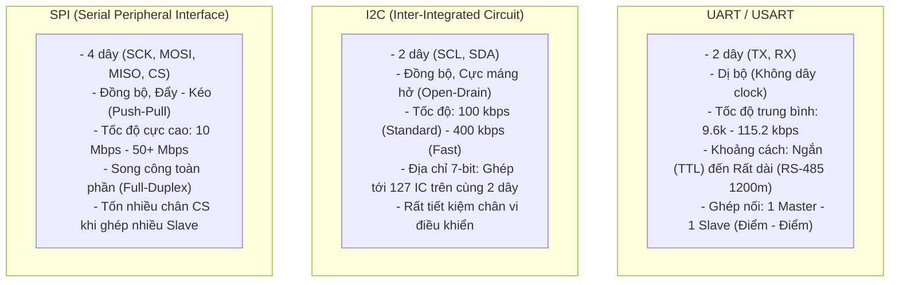
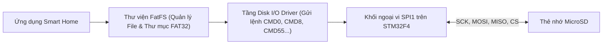

# CHƯƠNG 7: GIAO THỨC TRUYỀN THÔNG NỐI TIẾP ĐỒNG BỘ SPI, MÀN HÌNH ĐỒ HỌA & LƯU TRỮ THẺ NHỚ SD
*(Biên soạn dựa trên Chapter 6: SPI Display & Chapter 9: SD Cards - Arm Education Textbook kết hợp Chuẩn kỹ thuật phần cứng STM32F4)*

---

## 7.1. MỤC TIÊU CỦA CHƯƠNG
Sau khi hoàn thành chương này, sinh viên ngành Kỹ thuật Điện tử có khả năng:
1. **Làm chủ nguyên lý giao thức SPI (Serial Peripheral Interface):** Hiểu rõ cấu trúc bus 4 dây đồng bộ tốc độ cao ($SCK, MOSI, MISO, \overline{CS}$), cơ chế truyền nhận dữ liệu đồng thời bằng cặp thanh ghi dịch dịch chuyển vòng (Circular Shift Registers) và 4 chế độ hoạt động (SPI Modes $0, 1, 2, 3$) dựa trên cực tính xung nhịp `CPOL` và pha xung nhịp `CPHA`.
2. **So sánh toàn diện các chuẩn truyền thông nối tiếp trên bo mạch:** Phân tích ưu nhược điểm, thông lượng dữ liệu (Throughput) và phạm vi ứng dụng giữa **UART**, **$I^2C$** và **SPI** (Section 6.3 - Under the Hood của ARM).
3. **Thiết kế mạch và lập trình điều khiển màn hình đồ họa:**
   - Ghép nối màn hình đồ họa SPI (OLED SSD1306 / TFT LCD ST7735).
   - Lập trình bộ đệm khung hình (Frame Buffer), vẽ các phần tử đồ họa cơ bản (Điểm ảnh, đường thẳng, hình chữ nhật, vòng tròn) và hiển thị biểu đồ diễn biến nhiệt độ thời gian thực (Examples 6.4 $\div$ 6.5 của ARM).
4. **Làm chủ hệ thống lưu trữ tệp tin trên Thẻ nhớ SD (SD Card & FatFS):**
   - Ghép nối thẻ MicroSD qua giao diện SPI, phân tích cấu trúc sector vật lý.
   - Ứng dụng thư viện quản lý hệ thống tập tin FatFS (FAT16/FAT32) để tạo tệp tin nhật ký `.csv`, ghi nhận thời gian và sự kiện báo động (Examples 9.1 $\div$ 9.4 của ARM).

---

## 7.2. NGUYÊN LÝ HOẠT ĐỘNG CỦA GIAO THỨC SPI

### 1. Kiến trúc bus 4 dây và cơ chế trao đổi dữ liệu
Giao thức SPI do Motorola phát triển là chuẩn truyền thông đồng bộ song công toàn phần (Full-Duplex). Quá trình truyền dữ liệu diễn ra đồng thời giữa hai thanh ghi dịch 8-bit (hoặc 16-bit):

```mermaid
flowchart LR
    subgraph Master["MASTER (STM32F4)"]
        M_Shift["Thanh ghi dịch 8-bit Master"]
        M_Clock["Bộ tạo xung nhịp Baud Rate Generator"]
    end

    subgraph Slave["SLAVE (Ngoại vi: Màn hình / Thẻ nhớ / Flash)"]
        S_Shift["Thanh ghi dịch 8-bit Slave"]
    end

    M_Clock -->|Xung nhịp đồng bộ SCK| S_Shift
    M_Shift -->|Dữ liệu Master Out - Slave In (MOSI)| S_Shift
    S_Shift -->|Dữ liệu Master In - Slave Out (MISO)| M_Shift
    Master -->|Chân chọn chip Chip Select (/CS hoặc /NSS)| Slave
```

- Cứ mỗi chu kỳ xung nhịp phát ra trên đường $SCK$:
  - Master đẩy 1 bit cao nhất từ thanh ghi dịch của mình ra đường $MOSI$, đồng thời nuốt 1 bit từ đường $MISO$ vào thanh ghi dịch.
  - Slave đẩy 1 bit ra đường $MISO$ và nuốt 1 bit từ đường $MOSI$.
- Sau đúng 8 chu kỳ xung nhịp, **hai thanh ghi dịch đã hoán đổi hoàn toàn dữ liệu cho nhau**. Do đó, trong SPI, hành động "Ghi" và "Đọc" luôn diễn ra đồng thời: Muốn đọc một byte từ Slave, Master bắt buộc phải phát đi một byte giả (Dummy byte, thường là `0xFF`).

### 2. Bốn chế độ hoạt động của SPI (SPI Modes)
Được cấu hình bởi 2 bit trong thanh ghi `SPI_CR1`:
- **`CPOL` (Clock Polarity - Cực tính xung nhịp khi đường truyền nghỉ):**
  - `CPOL = 0`: Đường $SCK$ ở mức THẤP ($0\text{V}$) khi nghỉ.
  - `CPOL = 1`: Đường $SCK$ ở mức CAO ($3.3\text{V}$) khi nghỉ.
- **`CPHA` (Clock Phase - Pha xung nhịp lấy mẫu):**
  - `CPHA = 0`: Dữ liệu được lấy mẫu tại sườn xung nhịp đầu tiên (First clock edge) và thay đổi tại sườn thứ hai.
  - `CPHA = 1`: Dữ liệu được lấy mẫu tại sườn xung nhịp thứ hai (Second clock edge) và thay đổi tại sườn đầu tiên.

| Chế độ SPI | `CPOL` | `CPHA` | Trạng thái nghỉ của $SCK$ | Sườn lấy mẫu dữ liệu | Thiết bị tiêu biểu sử dụng |
| :---: | :---: | :---: | :---: | :---: | :--- |
| **Mode 0** | 0 | 0 | Mức Thấp ('0') | Sườn Lên (Rising Edge) | Thẻ nhớ SD, Bộ nhớ Flash W25Qxx, Màn hình OLED SSD1306 |
| **Mode 1** | 0 | 1 | Mức Thấp ('0') | Sườn Xuống (Falling Edge) | Một số IC DAC / ADC công nghiệp |
| **Mode 2** | 1 | 0 | Mức Cao ('1') | Sườn Xuống (Falling Edge) | Cảm biến gia tốc, con quay hồi chuyển |
| **Mode 3** | 1 | 1 | Mức Cao ('1') | Sườn Lên (Rising Edge) | Màn hình TFT LCD ST7735, Thẻ nhớ SD |

---

## 7.3. SO SÁNH TOÀN DIỆN: UART vs $I^2C$ vs SPI
*(Theo tài liệu Under the Hood của ARM Education - Section 6.3.1)*



---

## 7.4. ĐIỀU KHIỂN MÀN HÌNH ĐỒ HỌA GRAPHICAL LCD (EXAMPLES 6.4 & 6.5)

Khác với màn hình ký tự LCD 16x2 chỉ hiển thị được các chữ cái định sẵn trong bảng mã ASCII, màn hình đồ họa quản lý từng điểm ảnh (Pixel) độc lập.
- Ví dụ: Màn hình OLED SSD1306 $128 \times 64$ điểm ảnh hoặc TFT LCD ST7735 $160 \times 128$ màu.
- Khái niệm **Bộ đệm khung hình (Frame Buffer):** Màn hình $128 \times 64$ đơn sắc cần $\frac{128 \times 64}{8} = 1024\text{ bytes} = 1\text{ KB}$ bộ nhớ RAM nội của vi điều khiển. Mọi thao tác vẽ đường thẳng, ký tự, vòng tròn đều được tính toán trên mảng RAM này trước, sau đó đẩy toàn bộ 1024 byte xuống màn hình qua bus SPI tốc độ cao.

#### Triển khai hàm vẽ điểm ảnh và truyền SPI chuẩn HAL:
```c
#include "main.h"

extern SPI_HandleTypeDef hspi1;

#define OLED_CS_LOW()   HAL_GPIO_WritePin(GPIOB, GPIO_PIN_6, GPIO_PIN_RESET)
#define OLED_CS_HIGH()  HAL_GPIO_WritePin(GPIOB, GPIO_PIN_6, GPIO_PIN_SET)
#define OLED_DC_CMD()   HAL_GPIO_WritePin(GPIOB, GPIO_PIN_4, GPIO_PIN_RESET) // D/C = 0: Lệnh
#define OLED_DC_DATA()  HAL_GPIO_WritePin(GPIOB, GPIO_PIN_4, GPIO_PIN_SET)   // D/C = 1: Dữ liệu

uint8_t FrameBuffer[1024]; // 128 x 64 pixels / 8 bits

void OLED_WriteCommand(uint8_t cmd)
{
    OLED_DC_CMD();
    OLED_CS_LOW();
    HAL_SPI_Transmit(&hspi1, &cmd, 1, 10);
    OLED_CS_HIGH();
}

void OLED_UpdateScreen(void)
{
    for (uint8_t page = 0; page < 8; page++)
    {
        OLED_WriteCommand(0xB0 + page); // Đặt địa chỉ Page (0 đến 7)
        OLED_WriteCommand(0x00);        // Đặt cột thấp
        OLED_WriteCommand(0x10);        // Đặt cột cao

        OLED_DC_DATA();
        OLED_CS_LOW();
        // Đẩy 128 byte của một hàng điểm ảnh ra màn hình qua SPI
        HAL_SPI_Transmit(&hspi1, &FrameBuffer[page * 128], 128, 100);
        OLED_CS_HIGH();
    }
}

void OLED_DrawPixel(int x, int y, uint8_t color)
{
    if (x >= 0 && x < 128 && y >= 0 && y < 64)
    {
        if (color) FrameBuffer[x + (y / 8) * 128] |=  (1 << (y % 8)); // Bật điểm ảnh
        else       FrameBuffer[x + (y / 8) * 128] &= ~(1 << (y % 8)); // Tắt điểm ảnh
    }
}
```

---

## 7.5. LƯU TRỮ NHẬT KÝ SỰ KIỆN LÊN THẺ NHỚ SD QUA THƯ VIỆN FATFS (EXAMPLES 9.1 $\div$ 9.4)

Trong các ứng dụng công nghiệp và trạm quan trắc thông minh, việc lưu trữ lịch sử báo động là bắt buộc. Thẻ nhớ MicroSD sử dụng chuẩn truyền thông SPI giúp lưu trữ hàng Gigabyte dữ liệu với chi phí cực thấp.



### Triển khai ghi tệp tin nhật ký `.csv` trên STM32:
```c
#include "fatfs.h"

FATFS fs;         // Cấu trúc quản lý hệ thống tệp
FIL file;         // Con trỏ tệp tin
UINT bytesWritten;

void Log_Event_To_SDCard(char *timestamp, char *eventType, float temp)
{
    // 1. Gắn kết ổ đĩa (Mount drive)
    if (f_mount(&fs, "", 1) == FR_OK)
    {
        // 2. Mở hoặc tạo mới tệp tin "alarm_log.csv" ở chế độ ghi tiếp vào cuối file (FA_OPEN_APPEND)
        if (f_open(&file, "alarm_log.csv", FA_OPEN_APPEND | FA_WRITE) == FR_OK)
        {
            char logBuffer[128];
            // Định dạng dòng nhật ký dạng bảng CSV: Thời gian, Sự kiện, Nhiệt độ
            snprintf(logBuffer, sizeof(logBuffer), "%s,%s,%.2f\r\n", timestamp, eventType, temp);

            // 3. Ghi dữ liệu vào thẻ nhớ
            f_write(&file, logBuffer, strlen(logBuffer), &bytesWritten);

            // 4. Đồng bộ dữ liệu xuống phần cứng và đóng tệp an toàn
            f_close(&file);
        }
        // 5. Tháo ổ đĩa
        f_mount(NULL, "", 0);
    }
}
```

---

## 7.6. BÀI TẬP VÀ CÂU HỎI THIẾT KẾ
1. **Câu hỏi:** Phân tích sự khác biệt giữa hai chế độ `CPHA = 0` và `CPHA = 1` trong giao thức SPI. Vẽ giản đồ xung nhịp minh họa sườn lấy mẫu dữ liệu của cả hai chế độ khi `CPOL = 0`.
2. **Thiết kế phần cứng:** Thiết kế mạch ghép nối một vi điều khiển STM32F4 (Master) với đồng thời 3 thiết bị ngoại vi SPI (Slave 1: Bộ nhớ Flash W25Q64, Slave 2: Màn hình TFT LCD, Slave 3: Thẻ nhớ MicroSD). Phân tích cách bố trí các chân $SCK, MOSI, MISO$ và các chân chọn chip riêng biệt ($CS_1, CS_2, CS_3$).
3. **Lập trình tối ưu:** Tại sao khi đẩy dữ liệu Frame Buffer kích thước lớn (ví dụ màn hình màu TFT $160 \times 128 \times 2\text{ bytes} = 40.960\text{ bytes}$) ra màn hình SPI, người ta bắt buộc phải sử dụng **bộ điều khiển DMA (Direct Memory Access)** thay vì dùng CPU truyền từng byte?
