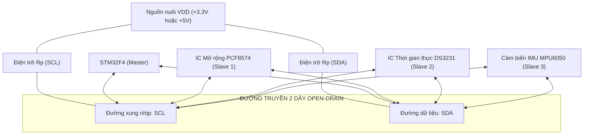

# CHƯƠNG 8: GIAO THỨC TRUYỀN THÔNG HAI DÂY I2C & GHÉP NỐI CÁC IC NGOẠI VI CHUYÊN DỤNG
*(Biên soạn dựa trên Chapter 4: RTC & Chapter 6: I2C LCD - Arm Education Textbook kết hợp Chuẩn kỹ thuật phần cứng STM32F4)*

---

## 8.1. MỤC TIÊU CỦA CHƯƠNG
Sau khi hoàn thành chương này, sinh viên ngành Kỹ thuật Điện tử có khả năng:
1. **Làm chủ nguyên lý giao thức $I^2C$ (Inter-Integrated Circuit):** Hiểu rõ cấu trúc bus hai dây cực máng hở (Open-Drain) gồm $SDA$ (Serial Data) và $SCL$ (Serial Clock), điều kiện START, STOP, địa chỉ thiết bị 7-bit/10-bit, cơ chế phản hồi ACK/NACK và hiện tượng kéo dài xung nhịp (Clock Stretching).
2. **Thiết kế phần cứng và tính toán điện trở kéo lên (Pull-up Resistors):**
   - Tính toán dải giá trị điện trở kéo lên ($R_{p(min)} \le R_p \le R_{p(max)}$) phụ thuộc vào tốc độ truyền (Standard-mode 100kbps, Fast-mode 400kbps), mức điện áp cấp và dung kháng ký sinh của đường dây ($C_b$).
   - Phân tích nguyên nhân và giải pháp phần cứng/phần mềm xử lý hiện tượng treo bus I2C (Bus Lockup).
3. **Lập trình ghép nối các IC ngoại vi I2C tiêu biểu:**
   - Điều khiển màn hình ký tự LCD 16x2 qua vi mạch mở rộng 8-bit PCF8574 (Example 6.3 của ARM).
   - Ghép nối vi mạch đồng hồ thời gian thực RTC (DS3231 / DS1307) qua I2C để đọc/ghi lịch thời gian dạng mã nhị phân thập phân BCD (Example 4.4 của ARM).
   - Ghép nối cảm biến chuyển động đo góc nghiêng IMU 6 trục MPU6050.
4. **Khai thác công cụ đo kiểm tín hiệu:** Sử dụng bộ phân tích logic (Logic Analyzer) để bắt dạng sóng trên hai đường $SDA$ và $SCL$, giải mã khung truyền từng byte (Địa chỉ Slave, bit Read/Write, bit ACK, Data).

---

## 8.2. NGUYÊN LÝ VẬT LÝ VÀ GIAO THỨC TRUYỀN THÔNG $I^2C$

### 1. Cấu trúc vật lý của Bus $I^2C$
Bus $I^2C$ được phát minh bởi hãng Philips Semiconductor (nay là NXP), chỉ sử dụng đúng 2 dây dẫn để kết nối hàng chục IC với nhau trên cùng một bo mạch:



- **Đặc tính cực máng hở (Open-Drain):** Cả Master và các Slave đều không bao giờ được phép chủ động xuất mức điện áp cao ($V_{DD}$) ra đường dây. Các chân chỉ có thể kéo đường dây xuống mass ($0\text{V}$) hoặc thả nổi (Hi-Z). Khi tất cả thiết bị đều thả nổi, hai điện trở kéo lên ($R_p$) sẽ kéo đường dây lên mức điện áp $V_{DD}$. Cơ chế này tạo ra mạch logic **AND đấu dây (Wired-AND)**, loại bỏ hoàn toàn nguy cơ ngắn mạch (Short circuit) khi nhiều thiết bị cùng truyền tín hiệu một lúc.

### 2. Định dạng khung truyền dữ liệu $I^2C$

```
SDA:  ──┐      ┌───┬───┬───┬───┬───┬───┬───┬───┬───┐      ┌───
        └───...┤A6 │A5 │A4 │A3 │A2 │A1 │A0 │R/W│ACK│...───┘   
SCL:  ──┐   ┌──┴─┐ ┌─┐ ┌─┐ ┌─┐ ┌─┐ ┌─┐ ┌─┐ ┌─┐ ┌─┐ ┌─┐    ┌───
        └───┘ 1  └─┘2└─┘3└─┘4└─┘5└─┘6└─┘7└─┘8└─┘9└─┘ └───...┘   
       START       7-Bit Slave Address       Bit   ACK       STOP
```

- **Điều kiện START (Bắt đầu):** Khi đường $SCL$ đang ở mức CAO, đường $SDA$ chuyển từ CAO xuống THẤP.
- **Điều kiện STOP (Kết thúc):** Khi đường $SCL$ đang ở mức CAO, đường $SDA$ chuyển từ THẤP lên CAO.
- **Tính hợp lệ của dữ liệu (Data Validity):** Dữ liệu trên đường $SDA$ **bắt buộc phải giữ ổn định trong suốt khoảng thời gian $SCL$ ở mức CAO**. Dữ liệu trên $SDA$ chỉ được phép thay đổi khi $SCL$ đang ở mức THẤP.
- **Byte địa chỉ:** Gồm 7 bit địa chỉ của thiết bị Slave + 1 bit xác định hướng truyền:
  - $\text{Bit } 8 = 0$: Master GHI dữ liệu vào Slave (Write).
  - $\text{Bit } 8 = 1$: Master ĐỌC dữ liệu từ Slave (Read).
- **Bit xác nhận (ACK / NACK):** Sau mỗi 8 bit truyền, thiết bị nhận phải kéo đường $SDA$ xuống mức THẤP trong chu kỳ xung nhịp $SCL$ thứ 9 để xác nhận đã nhận thành công byte đó (**ACK = 0**). Nếu đường $SDA$ vẫn ở mức CAO, nghĩa là không có thiết bị phản hồi hoặc báo kết thúc đọc (**NACK = 1**).

---

## 8.3. TÍNH TOÁN ĐIỆN TRỞ KÉO LÊN $R_p$ PHẦN CỨNG

Điện trở kéo lên $R_p$ đóng vai trò quyết định đến độ toàn vẹn tín hiệu trên bus $I^2C$:
- Nếu $R_p$ quá lớn: Thời gian nạp điện cho dung kháng ký sinh của đường dây ($C_b$) kéo dài, làm sườn lên (Rise time $t_r$) của xung bị tù, vi mạch không nhận diện được mức logic ở tốc độ cao.
- Nếu $R_p$ quá nhỏ: Dòng điện chạy qua transistor ngõ ra khi kéo xuống mass quá lớn, gây sụt áp vượt quá ngưỡng $V_{OL(max)} = 0.4\text{ V}$ và làm quá nhiệt chân vi điều khiển.

### Công thức tính toán chuẩn của Hiệp hội $I^2C$ (NXP Specification):
1. **Giá trị nhỏ nhất của điện trở kéo lên ($R_{p(min)}$):**
   $$R_{p(min)} = \frac{V_{DD} - V_{OL(max)}}{I_{OL}} = \frac{3.3\text{ V} - 0.4\text{ V}}{3\text{ mA}} = \frac{2.9\text{ V}}{0.003\text{ A}} \approx 967\text{ }\Omega$$
2. **Giá trị lớn nhất của điện trở kéo lên ($R_{p(max)}$):**
   Phụ thuộc vào thời gian sườn lên cực đại cho phép ($t_r$) và dung dung ký sinh đường dây ($C_b$ thường từ $50\text{pF} \div 200\text{pF}$):
   $$t_r = 0.8473 \times R_p \times C_b \implies R_{p(max)} = \frac{t_{r(max)}}{0.8473 \times C_b}$$
   - Ở chế độ Standard-mode ($100\text{ kbps}$), quy chuẩn $t_{r(max)} = 1000\text{ ns}$: Với $C_b = 100\text{ pF} \rightarrow R_{p(max)} \approx 11.8\text{ k}\Omega$.
   - Ở chế độ Fast-mode ($400\text{ kbps}$), quy chuẩn $t_{r(max)} = 300\text{ ns}$: Với $C_b = 100\text{ pF} \rightarrow R_{p(max)} \approx 3.5\text{ k}\Omega$.

> [!TIP]
> **Giá trị khuyên dùng trong thực tế phòng Lab:** Chọn $R_p = 2.2\text{ k}\Omega \div 4.7\text{ k}\Omega$ là giá trị tối ưu hoạt động ổn định cho cả hai tốc độ 100kbps và 400kbps với chiều dài cáp dưới 30cm.

---

## 8.4. ĐIỀU KHIỂN MÀN HÌNH LCD 16x2 QUA IC MỞ RỘNG PCF8574 (EXAMPLE 6.3)

Để hiển thị thông tin lên màn hình LCD 16x2 ở chế độ song song 4-bit thông thường (như mục 6.2 của sách), vi điều khiển phải tốn ít nhất 6 chân GPIO ($RS, EN, D_4, D_5, D_6, D_7$). Khi sử dụng vi mạch mở rộng $I^2C$ **PCF8574**, toàn bộ màn hình LCD chỉ cần duy nhất **2 chân $I^2C$ ($SDA, SCL$)**:

```mermaid
flowchart LR
    STM32["STM32F4 (Master)"] -->|I2C: SDA / SCL| PCF["IC Mở rộng PCF8574
    (Địa chỉ: 0x27 hoặc 0x3F)"]
    PCF -->|P0..P7 (8-bit song song)| LCD["Màn hình LCD 16x2 HD44780
    (RS, RW, EN, Backlight, D4..D7)"]
```

### Ánh xạ 8 bit của PCF8574 sang các chân LCD:
- Bit 0 (`P0`): Chân $RS$ (0: Gửi Lệnh, 1: Gửi Ký tự Dữ liệu).
- Bit 1 (`P1`): Chân $RW$ (Luôn nối 0 để Ghi).
- Bit 2 (`P2`): Chân Chốt $EN$ (Tạo xung cạnh xuống $1 \rightarrow 0$ để chốt dữ liệu).
- Bit 3 (`P3`): Điều khiển Đèn nền Backlight (1: Bật, 0: Tắt).
- Bit 4..7 (`P4..P7`): 4 bit dữ liệu cao $D_4 \div D_7$ của màn hình LCD.

#### Triển khai C chuẩn STM32 HAL điều khiển LCD I2C:
```c
#include "main.h"

extern I2C_HandleTypeDef hi2c1;
#define LCD_SLAVE_ADDR  (0x27 << 1) // Địa chỉ I2C của PCF8574 (0x4E)

void LCD_I2C_Write_Byte(uint8_t data)
{
    HAL_I2C_Master_Transmit(&hi2c1, LCD_SLAVE_ADDR, &data, 1, 100);
}

void LCD_Send_Internal(uint8_t data, uint8_t rs)
{
    uint8_t highNibble = data & 0xF0;
    uint8_t lowNibble  = (data << 4) & 0xF0;
    uint8_t backlight  = 0x08; // Bit 3: Bật đèn nền

    uint8_t packet[4];
    // 4-bit cao kèm xung EN: Bật EN rồi tắt EN
    packet[0] = highNibble | rs | backlight | 0x04; // EN = 1
    packet[1] = highNibble | rs | backlight | 0x00; // EN = 0

    // 4-bit thấp kèm xung EN
    packet[2] = lowNibble  | rs | backlight | 0x04; // EN = 1
    packet[3] = lowNibble  | rs | backlight | 0x00; // EN = 0

    HAL_I2C_Master_Transmit(&hi2c1, LCD_SLAVE_ADDR, packet, 4, 100);
}

void LCD_Send_Cmd(uint8_t cmd)    { LCD_Send_Internal(cmd, 0x00); }
void LCD_Send_Data(uint8_t data)  { LCD_Send_Internal(data, 0x01); }

void LCD_Init(void)
{
    HAL_Delay(50);
    LCD_Send_Cmd(0x02); // Khởi tạo chế độ 4-bit
    LCD_Send_Cmd(0x28); // 2 dòng, font 5x8
    LCD_Send_Cmd(0x0C); // Bật hiển thị, tắt con trỏ nhấp nháy
    LCD_Send_Cmd(0x06); // Tự động tăng con trỏ
    LCD_Send_Cmd(0x01); // Xóa toàn bộ màn hình
    HAL_Delay(5);
}

void LCD_Print(char *str)
{
    while (*str) LCD_Send_Data(*str++);
}
```

---

## 8.5. GHÉP NỐI IC ĐỒNG HỒ THỜI GIAN THỰC RTC DS3231 (EXAMPLE 4.4)
- **Đặc điểm vi mạch DS3231:** Tích hợp bộ dao động bù nhiệt TCXO độ chính xác cao (sai số dưới $\pm 2\text{ phút/năm}$), giao tiếp qua $I^2C$ tại địa chỉ cố định `0x68` (dạng 8-bit dịch trái: `0xD0`).
- **Định dạng dữ liệu BCD (Binary Coded Decimal):** Dữ liệu giờ, phút, giây trong thanh ghi của DS3231 được lưu dưới dạng BCD (ví dụ 45 giây được lưu thành `0x45`). Muốn hiển thị ra màn hình hoặc truyền qua UART, ta phải giải mã sang số thập phân:
$$\text{Decimal} = (\text{BCD} \gg 4) \times 10 + (\text{BCD} \& 0x0F)$$
$$\text{BCD} = ((\text{Decimal} / 10) \ll 4) | (\text{Decimal} \% 10)$$

#### Hàm đọc thời gian thực từ DS3231 qua I2C:
```c
typedef struct {
    uint8_t seconds;
    uint8_t minutes;
    uint8_t hours;
    uint8_t day;
    uint8_t date;
    uint8_t month;
    uint8_t year;
} RTC_Time_t;

void DS3231_ReadTime(RTC_Time_t *rtc)
{
    uint8_t regAddr = 0x00; // Thanh ghi bắt đầu lưu giây
    uint8_t buffer[7];

    // Gửi địa chỉ thanh ghi bắt đầu đọc
    HAL_I2C_Master_Transmit(&hi2c1, (0x68 << 1), &regAddr, 1, 100);

    // Đọc liên tục 7 byte (Giây, Phút, Giờ, Thứ, Ngày, Tháng, Năm)
    HAL_I2C_Master_Receive(&hi2c1, (0x68 << 1), buffer, 7, 100);

    // Chuyển đổi từ mã BCD sang số thập phân
    rtc->seconds = ((buffer[0] >> 4) * 10) + (buffer[0] & 0x0F);
    rtc->minutes = ((buffer[1] >> 4) * 10) + (buffer[1] & 0x0F);
    rtc->hours   = (((buffer[2] & 0x3F) >> 4) * 10) + (buffer[2] & 0x0F);
    rtc->date    = ((buffer[4] >> 4) * 10) + (buffer[4] & 0x0F);
    rtc->month   = ((buffer[5] >> 4) * 10) + (buffer[5] & 0x0F);
    rtc->year    = ((buffer[6] >> 4) * 10) + (buffer[6] & 0x0F);
}
```

---

## 8.6. GIẢI PHÁP XỬ LÝ LỖI TREO BUS I2C (BUS LOCKUP RECOVERY)
Một trong những lỗi kinh điển nhất của giao tiếp $I^2C$ trong môi trường công nghiệp là **kẹt bus**: Khi Master đang đọc dở một byte dữ liệu và bất ngờ bị Reset (hoặc bị ngắt làm mất xung clock), thiết bị Slave vẫn đang giữ đường $SDA$ ở mức THẤP để chuẩn bị gửi tiếp. Lúc này Master khởi động lại thấy đường $SDA = 0$ và nghĩ rằng bus đang bận (Bus Busy), dẫn đến toàn bộ hệ thống bị treo vĩnh viễn!

### Quy trình phần mềm giải cứu kẹt bus (I2C Bus Clear Sequence):
1. Chuyển chân $SCL$ sang chế độ GPIO Output thủ công.
2. Phát thủ công **9 xung nhịp xung Clock $SCL$** (mỗi chu kỳ kéo lên 1 rồi kéo xuống 0). Thiết bị Slave khi nhận đủ 9 xung sẽ hoàn tất việc xuất byte dở dang và giải phóng đường $SDA$ về mức CAO.
3. Master phát tiếp một điều kiện **STOP** hợp lệ ($SDA$ từ 0 lên 1 khi $SCL = 1$).
4. Cấu hình lại chân $SCL$ và $SDA$ về chế độ ngoại vi $I^2C$ và khởi động lại khối phần cứng $I^2C$.

---

## 8.7. BÀI TẬP VÀ CÂU HỎI THIẾT KẾ
1. **Câu hỏi:** Giải thích sự khác biệt giữa ACK và NACK trong giao thức $I^2C$. Tại sao trong lần đọc byte cuối cùng của khung nhận, Master lại phải phát NACK trước khi phát điều kiện STOP?
2. **Đo kiểm tín hiệu:** Hãy vẽ giản đồ dạng sóng chi tiết (mối quan hệ giữa $SCL$ và $SDA$) khi Master gửi lệnh ghi giá trị `0x55` vào thanh ghi địa chỉ `0x00` của IC RTC DS3231 (Địa chỉ Slave `0x68`).
3. **Lập trình ứng dụng:** Viết chương trình tích hợp: Đọc thời gian thực từ DS3231 và hiển thị lên màn hình LCD 16x2 qua I2C theo định dạng chuẩn: `Dòng 1: TIME: 14:30:25` và `Dòng 2: DATE: 15/11/2026`.
