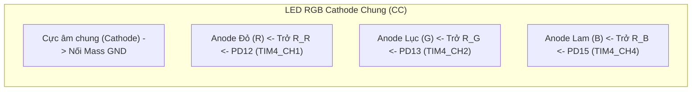

# CHƯƠNG 8: QUẢN LÝ THỜI GIAN NÂNG CAO, BĂM XUNG PWM, ĐIỀU KHIỂN HỒI TIẾP ÂM & PHÁT ÂM THANH THOẠI TRÊN STM32F407
*(Biên soạn dựa trên Chapter 8: Advanced Time Management, PWM, Feedback Control & Audio - Arm Education Textbook, hiệu chỉnh chuyên sâu cho STM32F407)*

---

## 8.1. MỤC TIÊU CỦA CHƯƠNG
- **Bối cảnh kiến thức:** Sinh viên đã làm quen với việc đo đạc tín hiệu tương tự (ADC) ở Chương 3 và cơ chế ngắt thời gian thực ở Chương 7. Chương này trang bị kiến thức chuyên sâu về **Khối Timer phần cứng nâng cao của vi điều khiển STM32F407**, làm chủ kỹ thuật **Điều chế độ rộng xung (Pulse Width Modulation - PWM)**, ứng dụng vào điều khiển công suất tải không tiêu hao nhiệt, thiết kế **Hệ thống điều khiển kín có hồi tiếp âm (Negative Feedback Closed-Loop Control)** tự động thích ứng với môi trường, và hiện thực hóa kỹ thuật **Phát âm thanh thoại trực tiếp từ bộ nhớ Flash** bằng sóng mang PWM tốc độ cao kết hợp bộ lọc tích phân tương tự.
- **Mục tiêu chi tiết:**
  1. **Lý thuyết Khối Timer & PWM:** Nắm vững cấu trúc khối Timer trên STM32F407 (Advanced Control Timer `TIM1`/`TIM8`, General-Purpose Timer `TIM2` $\div$ `TIM5`), vai trò của thanh ghi bộ đếm `CNT`, bộ chia tần số `PSC`, thanh ghi tự nạp lại `ARR` và thanh ghi so sánh/bắt giữ `CCR`.
  2. **Tính toán & Thiết kế Mạch Ngoại vi:**
     - Thiết kế mạch đệm công suất và tính toán điện trở hạn dòng độc lập cho đèn LED RGB 3 kênh màu (`PD12`, `PD13`, `PD15` qua `TIM4`).
     - Thiết kế mạch cầu phân áp quang trở LDR với điện trở chuẩn kết nối vào chân `PA4` (`ADC1_IN4`) kèm tụ lọc nhiễu cao tần.
     - Thiết kế mạch lọc thông thấp RC tích phân (Low-Pass Filter) và tụ chặn một chiều (DC Blocking Capacitor) để giải điều chế sóng mang PWM $100\text{ kHz}$ thành tín hiệu âm thanh thoại analog phát ra loa mini.
  3. **Lý thuyết Điều khiển Tự động:** Phân tích nguyên lý vòng điều khiển kín có phản hồi âm, sơ đồ khối hệ thống (Set-point, Error, Controller, Actuator, Plant, Sensor), bộ điều khiển tỷ lệ P (Proportional Control), phân tích sai số xác lập (Steady-state error) và cơ chế chống bão hòa (Anti-windup).
  4. **Lập trình Ứng dụng Thực tế (Examples 8.1 $\div$ 8.6):**
     - Băm xung PWM điều khiển màu sắc và độ sáng đèn trang trí Smart Home.
     - Vòng lặp điều khiển tự động bù sáng đèn phòng khách theo cường độ ánh sáng môi trường.
     - Trình phục vụ ngắt định thời `TIM6` kết hợp `TIM1` phát câu thoại cảnh báo hỏa hoạn: *"Warning! Fire detected!"* từ mảng âm thanh PCM 8-bit lưu trong bộ nhớ Flash.
  5. **Đo kiểm & Phân tích Dạng sóng:** Sử dụng máy hiện sóng (Oscilloscope) đo kiểm tần số, Duty cycle của xung PWM và phân tích dạng sóng trước/sau mạch lọc RC.

---

## 8.2. CƠ SỞ LÝ THUYẾT CHUYÊN SÂU

### 8.2.1. Kiến trúc Khối Timer Phần cứng trên STM32F407
Vi điều khiển STM32F407 tích hợp tới 14 bộ Timer phần cứng độc lập. Trong đó:
- **Timer nâng cao (Advanced-control Timers - `TIM1`, `TIM8`):** Nằm trên bus APB2 (84MHz, xung nhịp Timer nhân đôi lên **168MHz**), bộ đếm 16-bit up/down/center-aligned, hỗ trợ tạo thời gian chết (Dead-time insertion), ngắt phanh khẩn cấp (Break input), chuyên dùng cho biến tần điều khiển động cơ và điều chế âm thanh tốc độ cao.
- **Timer đa dụng (General-purpose Timers - `TIM2` $\div$ `TIM5`):** `TIM2` và `TIM5` có bộ đếm 32-bit; `TIM3` và `TIM4` có bộ đếm 16-bit. Nằm trên bus APB1 (42MHz, xung nhịp Timer nhân đôi lên **84MHz**).

```
                      +---------------------------------------+
                      |       Xung nhịp Bus (PCLK1 / PCLK2)    |
                      +---------------------------------------+
                                          |
                                          v  (x2 nếu Prescaler APB != 1)
                      +---------------------------------------+
                      |         Timer Clock (f_TIM)           |
                      |    (TIM4: 84MHz  |  TIM1: 168MHz)     |
                      +---------------------------------------+
                                          |
                                          v
                      +---------------------------------------+
                      |     Bộ chia tần trước (PSC: 16-bit)   |
                      |       f_CK_CNT = f_TIM / (PSC + 1)    |
                      +---------------------------------------+
                                          |
                                          v
      +-----------------------------------------------------------------------+
      |                 Thanh ghi Bộ đếm (CNT Register)                       |
      |   Đếm tăng dần (Upcounter) từ 0 cho đến khi bằng giá trị thanh ghi ARR|
      +-----------------------------------------------------------------------+
            |                                                           |
            | So sánh liên tục                                          | Khi CNT == ARR
            v                                                           v
+--------------------------+                                +-----------------------+
|  Thanh ghi So sánh CCRx  |                                | Bộ nạp lại Auto-Reload|
| (Capture/Compare Reg x)  |                                |     (ARR Register)    |
+--------------------------+                                +-----------------------+
            |                                                           |
            | Kênh so sánh Output Compare                               | Xóa CNT về 0
            v                                                           | Sinh sự kiện Update
+-------------------------------------------------------------+         v
| Tín hiệu PWM Ngõ ra (Chuyển trạng thái 1 -> 0 hoặc 0 -> 1) | <--------+
+-------------------------------------------------------------+
```

#### Công thức toán học tính tần số và chu kỳ PWM:
1. **Tần số xung nhịp bộ đếm ($f_{CNT}$):**
   $$f_{CNT} = \frac{f_{TIM\_CLK}}{\text{PSC} + 1}$$
2. **Tần số ngõ ra của xung PWM ($f_{PWM}$):**
   $$f_{PWM} = \frac{f_{CNT}}{\text{ARR} + 1} = \frac{f_{TIM\_CLK}}{(\text{PSC} + 1) \times (\text{ARR} + 1)}$$
3. **Chu kỳ của xung PWM ($T_{PWM}$):**
   $$T_{PWM} = \frac{1}{f_{PWM}} = \frac{(\text{PSC} + 1) \times (\text{ARR} + 1)}{f_{TIM\_CLK}}$$
4. **Hệ số công tác (Duty Cycle $D\%$):**
   Ở chế độ **PWM Mode 1** (Ngõ ra tích cực mức cao khi $\text{CNT} < \text{CCR}$ và tích cực mức thấp khi $\text{CNT} \ge \text{CCR}$):
   $$D = \frac{t_{ON}}{T_{PWM}} \times 100\% = \frac{\text{CCR}}{\text{ARR} + 1} \times 100\%$$
5. **Điện áp trung bình hiệu dụng ($V_{avg}$):**
   $$V_{avg} = V_{DD} \times \frac{t_{ON}}{T_{PWM}} = 3.3\text{V} \times \frac{\text{CCR}}{\text{ARR} + 1}$$

---

### 8.2.2. Cơ sở Lý thuyết Điều chế Độ rộng Xung (PWM) và Năng lượng
Tại sao không dùng điện trở hoặc transistor ở chế độ tuyến tính để điều chỉnh độ sáng đèn hay tốc độ động cơ?
- **Phương pháp tuyến tính (Linear Voltage Drop):** Transistor hoạt động ở chế độ khuếch đại, đóng vai trò như một biến trở phân áp. Điện năng tiêu hao trên transistor thành nhiệt:
  $$P_{loss} = V_{CE} \times I_L = (V_{DD} - V_{load}) \times I_L$$
  Hiệu suất rất thấp (thường $< 40 \div 50\%$), linh kiện tỏa nhiệt dữ dội, đòi hỏi tản nhiệt lớn cồng kềnh.
- **Phương pháp điều chế xung PWM (Switching Mode):** Transistor chỉ hoạt động ở 2 trạng thái giới hạn:
  1. *Trạng thái Đóng (ON / Bão hòa):* $V_{CE(sat)} \approx 0.1 \div 0.2\text{V} \implies P_{loss} \approx 0$.
  2. *Trạng thái Ngắt (OFF / Cắt):* $I_C = 0 \implies P_{loss} = 0$.
  - Hiệu suất năng lượng đạt tới **$95\% \div 98\%$**, gần như không tỏa nhiệt, kích thước mạch siêu nhỏ gọn.

```
       1 Chu kỳ T = 1.0 ms (f = 1 kHz)
       |<---------------------------->|
       +-------+                      +-------+
3.3V   |       |                      |       |                      Duty = 25%
       |       |                      |       |                      V_avg = 0.825V
0V ----+       +----------------------+       +----------------------
       | t_ON  |         t_OFF        |
       |<----->|<-------------------->|
        0.25ms          0.75ms

       +----------------------+       +----------------------+
3.3V   |                      |       |                      |       Duty = 75%
       |                      |       |                      |       V_avg = 2.475V
0V ----+                      +-------+                      +-------
       |<------ 0.75 ms ----->|0.25ms |
```

---

### 8.2.3. Cơ sở Lý thuyết Mạch LED RGB & Phối Màu Quang Học
LED RGB tích hợp 3 diode phát quang độc lập: Đỏ (Red - $\lambda \approx 625\text{nm}$), Lục (Green - $\lambda \approx 525\text{nm}$), Lam (Blue - $\lambda \approx 470\text{nm}$) trong cùng một vỏ bọc.



#### Tính toán điện trở hạn dòng độc lập cho từng kênh màu:
Do độ rộng vùng cấm năng lượng ($E_g$) của các vật liệu bán dẫn khác nhau, điện áp phân cực thuận $V_F$ của 3 màu là hoàn toàn khác nhau:
- **Kênh Đỏ (AlInGaP):** $V_{F,Red} \approx 1.8\text{V} \div 2.0\text{V}$. Dòng định mức an toàn chọn $I_F = 4\text{mA}$.
  $$R_R = \frac{V_{OH} - V_{F,Red}}{I_F} = \frac{3.3\text{V} - 1.9\text{V}}{0.004\text{A}} = \frac{1.4\text{V}}{0.004\text{A}} = 350\Omega \implies \text{Chọn điện trở chuẩn } 330\Omega.$$
- **Kênh Lục (InGaN):** $V_{F,Green} \approx 3.0\text{V} \div 3.2\text{V}$. Chọn $I_F = 3\text{mA}$ (mắt người nhạy cảm với màu xanh lục nhất).
  $$R_G = \frac{V_{OH} - V_{F,Green}}{I_F} = \frac{3.3\text{V} - 3.0\text{V}}{0.003\text{A}} = \frac{0.3\text{V}}{0.003\text{A}} = 100\Omega \implies \text{Chọn điện trở chuẩn } 100\Omega \div 150\Omega.$$
- **Kênh Lam (InGaN):** $V_{F,Blue} \approx 3.0\text{V} \div 3.2\text{V}$. Chọn $I_F = 3\text{mA}$.
  $$R_B = \frac{V_{OH} - V_{F,Blue}}{I_F} = \frac{3.3\text{V} - 3.0\text{V}}{0.003\text{A}} = 100\Omega \implies \text{Chọn điện trở chuẩn } 100\Omega \div 150\Omega.$$

> [!CAUTION]
> Tuyệt đối không dùng chung một điện trở cho cả 3 chân Anode của LED RGB, vì sụt áp trên các màu khác nhau sẽ làm sai lệch quang thông và có thể phá hỏng kênh màu đỏ có điện áp ngưỡng thấp nhất.

---

### 8.2.4. Cơ sở Lý thuyết Vòng Điều Khiển Kín Có Hồi Tiếp Âm (Closed-Loop Feedback)
Trong hệ thống chiếu sáng thông minh Smart Home, ánh sáng môi trường thay đổi liên tục (mặt trời lặn, kéo rèm cửa, bóng người che). Hệ thống điều khiển vòng hở (Open-loop) chỉ đặt mức sáng cố định và hoàn toàn không biết đèn có đủ sáng hay không.  
Hệ thống **Hồi tiếp âm (Negative Feedback)** liên tục đo lường quang thông thực tế bằng cảm biến và tự động điều chỉnh năng lượng phát ra để triệt tiêu sai lệch:

```mermaid
flowchart LR
    SP["Tín hiệu Đặt (Set-point)<br>r(t): Độ rọi mong muốn"] -->|(+)| SUM(( \Sigma ))
    SUM -->|Sai lệch e(t)| CONTROLLER["Bộ điều khiển (Controller)<br>Thuật toán Tỷ lệ (P)"]
    CONTROLLER -->|Tín hiệu điều khiển u(t)| PWM_GEN["Bộ phát xung PWM<br>(TIM4_CHx)"]
    PWM_GEN -->|Công suất trung bình| PLANT["Đối tượng chiếu sáng<br>(Đèn LED RGB + Phòng)"]
    PLANT -->|Quang thông thực tế y(t)| SENSOR["Cảm biến Quang trở LDR<br>(Mạch phân áp + ADC1_IN4)"]
    SENSOR -->|Tín hiệu phản hồi y_fb(t)| SUM
    SUM -.->|(-)| SUM
```

#### Phương trình toán học bộ điều khiển tỷ lệ (P):
1. **Sai lệch điều khiển (Error):**
   $$e(t) = r(t) - y(t)$$
   - Nếu $e(t) > 0$ (Phòng tối hơn mức đặt): Hệ thống cần **tăng** Duty Cycle của PWM.
   - Nếu $e(t) < 0$ (Phòng sáng hơn mức đặt): Hệ thống cần **giảm** Duty Cycle của PWM.
2. **Tín hiệu điều khiển bù trừ:**
   $$u(t) = u(t-1) + K_p \times e(t)$$
3. **Khâu giới hạn bão hòa (Anti-windup Saturation Clamping):**
   Do thanh ghi `CCR` của `TIM4` chỉ nhận giá trị từ $0 \div ARR$ ($0 \div 999$):
   $$u_{clamped}(t) = \begin{cases} 
      999, & \text{nếu } u(t) > 999 \\
      0, & \text{nếu } u(t) < 0 \\
      u(t), & \text{trong các trường hợp còn lại}
   \end{cases}$$

#### Mạch phân áp cảm biến quang trở LDR (Light Dependent Resistor):
Quang trở chế tạo từ vật liệu chất bán dẫn Cadmium Sulfide (CdS). Khi photon ánh sáng chiếu vào, các cặp electron-lỗ trống được giải phóng làm giảm điện trở của LDR:
- Trong bóng tối: $R_{dark} > 1\text{ M}\Omega$.
- Dưới ánh sáng phòng tiêu chuẩn ($300 \div 500\text{ lux}$): $R_{light} \approx 5\text{ k}\Omega \div 10\text{ k}\Omega$.
- Dưới ánh sáng đèn flash mạnh ($> 2000\text{ lux}$): $R_{bright} < 1\text{ k}\Omega$.

Mạch phân áp với điện trở chuẩn $R_1 = 10\text{ k}\Omega$:
$$V_{ADC} = 3.3\text{V} \times \frac{R_1}{R_{LDR} + R_1}$$
- Khi phòng tối: $R_{LDR} \gg R_1 \implies V_{ADC} \to 0\text{V}$ (Giá trị số ADC xấp xỉ $0 \div 500$).
- Khi phòng sáng: $R_{LDR} \ll R_1 \implies V_{ADC} \to 3.3\text{V}$ (Giá trị số ADC xấp xỉ $3500 \div 4095$).

---

### 8.2.5. Cơ sở Lý thuyết Phát Âm Thanh Số PWM & Mạch Lọc Tích Phân RC

#### 1. Định lý lấy mẫu Nyquist-Shannon & Âm thanh thoại PCM:
- Tín hiệu âm thanh giọng nói của con người có dải phổ tần số hữu ích từ $300\text{ Hz}$ đến $3.4\text{ kHz}$.
- Theo định lý Nyquist-Shannon, để khôi phục toàn vẹn tín hiệu mà không bị méo chồng phổ (Aliasing), tần số lấy mẫu phải thỏa mãn:
  $$f_s \ge 2 \times f_{max} = 2 \times 3.4\text{ kHz} = 6.8\text{ kHz}$$
- $\implies$ **Chuẩn viễn thông chọn $f_s = 8\text{ kHz}$** (Chu kỳ lấy mẫu $T_s = \frac{1}{8000\text{ Hz}} = 125\mu s$).
- Mỗi mẫu âm thanh được lượng tử hóa thành số nguyên 8-bit không dấu ($0 \div 255$), mức tĩnh lặng (Silence) nằm ở điểm giữa $128$.

#### 2. Kỹ thuật điều chế sóng mang PWM cao tần ($100\text{ kHz}$):
- Nếu băm xung PWM ở tần số thấp ($8\text{ kHz}$), tai người sẽ nghe thấy tiếng rít chói tai rất khó chịu.
- Ta đẩy tần số sóng mang PWM lên $f_{carrier} = 100\text{ kHz}$ (chu kỳ $T_{carrier} = 10\mu s$), hoàn toàn nằm ngoài giới hạn thính giác của tai người ($< 20\text{ kHz}$).
- Cứ mỗi chu kỳ $125\mu s$ ($8\text{ kHz}$), ngắt `TIM6` sẽ cập nhật độ rộng xung của sóng mang `TIM1` một lần theo biên độ mẫu âm thanh hiện thời.

#### 3. Nguyên lý Mạch Lọc Thông Thấp RC Tích Phân (Low-Pass Filter):
Theo chuỗi Fourier, một chuỗi xung vuông PWM có độ rộng $t_{ON}$ bao gồm:
- Thành phần một chiều biến thiên theo âm thanh (Baseband Audio Component): $\overline{v(t)} = V_{DD} \times \frac{CCR(t)}{ARR+1}$.
- Các sóng hài cao tần của sóng mang: $f_c, 2f_c, 3f_c, \dots$ ($100\text{ kHz}, 200\text{ kHz}, \dots$).

Mạch lọc thông thấp RC tích phân đóng vai trò như một bộ tính trung bình tương tự (Analog Averager):
- Hàm truyền đạt miền Laplace:
  $$H(s) = \frac{V_{out}(s)}{V_{in}(s)} = \frac{\frac{1}{sC}}{R + \frac{1}{sC}} = \frac{1}{1 + sRC}$$
- Tần số cắt (-3dB):
  $$f_c = \frac{1}{2\pi R C}$$
  - Chọn $R = 1\text{ k}\Omega$, $C = 100\text{ nF} = 0.1\mu\text{F}$:
    $$f_c = \frac{1}{2\pi \times 1000 \times 100 \times 10^{-9}} \approx 1{,}591\text{ Hz} \approx 1.6\text{ kHz}.$$
  - **Độ suy hao tại tần số sóng mang $100\text{ kHz}$:**
    $$|H(j\omega)| = \frac{1}{\sqrt{1 + (\frac{f}{f_c})^2}} = \frac{1}{\sqrt{1 + (\frac{100{,}000}{1591})^2}} \approx \frac{1}{62.8} \approx 0.0159 \implies -36\text{ dB}.$$
    *(Sóng mang $100\text{ kHz}$ bị triệt tiêu hơn $98.4\%$, biến thành tín hiệu điện áp analog mượt mà).*

#### 4. Tụ chặn một chiều (DC Blocking Capacitor):
Tín hiệu sau mạch lọc RC có thành phần một chiều $V_{DC} = 3.3\text{V} / 2 = 1.65\text{V}$. Nếu nối thẳng vào loa $8\Omega$:
$$I_{DC} = \frac{1.65\text{V}}{8\Omega} \approx 206\text{mA}$$
Dòng điện này làm cuộn dây loa bị nung nóng cháy cuộn voice coil và gây quá tải chân vi điều khiển.  
$\implies$ **Bắt buộc mắc nối tiếp tụ điện $C_{block} = 10\mu\text{F} \div 100\mu\text{F}$ để ngăn dòng một chiều, chỉ cho dòng điện âm thanh xoay chiều đi qua loa!**

---

## 8.3. SƠ ĐỒ NGUYÊN LÝ & SƠ ĐỒ ĐẤU NỐI CHÂN CHI TIẾT

### 8.3.1. Sơ đồ mạch nguyên lý điện tử (Schematics)

```
=============================================================================================
1. MẠCH ĐÈN LED RGB 3 KÊNH PWM (TIM4)
=============================================================================================
STM32F407                    R_R = 330 Ohm
[ PD12 / TIM4_CH1 ] --------/\/\/\/\/--------->|---+ (Anode Đỏ)
                             R_G = 120 Ohm         |
[ PD13 / TIM4_CH2 ] --------/\/\/\/\/--------->|---+ (Anode Lục)     LED RGB Cathode Chung
                             R_B = 120 Ohm         |                 (Common Cathode)
[ PD15 / TIM4_CH4 ] --------/\/\/\/\/--------->|---+ (Anode Lam)
                                                   |
[ GND             ] -------------------------------+ (Cathode chung nối mass)


=============================================================================================
2. MẠCH CẦU PHÂN ÁP CẢM BIẾN QUANG TRỞ LDR (ADC1_IN4)
=============================================================================================
        +3.3V
          |
          +-------+
          |       |
         [ ] LDR  |
         [ ]      |
          |       |
  PA4 ----+       |  (Điện áp ngõ vào ADC1_IN4: 0V khi tối -> 3.0V khi sáng)
          |       |
         [R] R1 = 10k
         [R]      |
          |     ===== C_filter = 100nF (Lọc nhiễu cao tần)
          |       |
         GND     GND


=============================================================================================
3. MẠCH ĐIỀU CHẾ PWM ÂM THANH 100kHz & BỘ LỌC TÍCH PHÂN RC (TIM1_CH1)
=============================================================================================
STM32F407                  R = 1k Ohm                       C_block = 10uF
[ PE9 / TIM1_CH1 ] -------/\/\/\/\/----+-----------+----------||(+)-------+
                                       |           |                      |
                                     ===== C     [===] R_pulldown       [Loa] Loa 8-32 Ohm
                                  100nF|           |   10k Ohm            |   (Hoặc vào Amply)
                                       |           |                      |
[ GND            ] --------------------+-----------+----------------------+
```

---

### 8.3.2. Bảng Phân Bổ Chân Toàn Diện Trên STM32F407 (Master Pinout Table)

| Tên Chân STM32 | Tên Tín Hiệu Ngoại Vi | Chức Năng Phần Cứng / Alternate Function | Cấu Hình Trên STM32CubeMX | Kết Nối Linh Kiện Ngoại Vi | Mức Điện Áp & Lưu Ý An Toàn |
| :---: | :---: | :---: | :---: | :--- | :--- |
| `PD12` | `PWM_RED` | `TIM4_CH1` (AF2) | Alternate Function Push-Pull, Very High Speed | Nối qua trở $330\Omega$ vào cực Anode Đỏ LED RGB | $3.3\text{V}$, dòng $I_F \approx 4\text{mA}$ an toàn |
| `PD13` | `PWM_GREEN` | `TIM4_CH2` (AF2) | Alternate Function Push-Pull, Very High Speed | Nối qua trở $120\Omega$ vào cực Anode Lục LED RGB | $3.3\text{V}$, dòng $I_F \approx 3\text{mA}$ an toàn |
| `PD15` | `PWM_BLUE` | `TIM4_CH4` (AF2) | Alternate Function Push-Pull, Very High Speed | Nối qua trở $120\Omega$ vào cực Anode Lam LED RGB | $3.3\text{V}$, dòng $I_F \approx 3\text{mA}$ an toàn |
| `PA4` | `LDR_SENSE` | `ADC1_IN4` (Analog) | Analog Mode (No pull-up / No pull-down) | Nối vào điểm giữa cầu phân áp LDR và trở $10\text{k}\Omega$ | $0 \div 3.3\text{V}$, tuyệt đối không vượt $3.3\text{V}$ |
| `PE9` | `AUDIO_PWM` | `TIM1_CH1` (AF1) | Alternate Function Push-Pull, High Speed | Nối vào mạch lọc thông thấp RC ($1\text{k}\Omega + 100\text{nF}$) | Tần số sóng mang $100\text{ kHz}$, biên độ $3.3\text{V}_{pp}$ |
| `PA2` | `USART2_TX` | `USART2_TX` (AF7) | Alternate Function Push-Pull | Kênh truyền dữ liệu giám sát lên PC | Mức logic 3.3V |
| `PA3` | `USART2_RX` | `USART2_RX` (AF7) | Alternate Function Open-Drain / Push-Pull | Nhận lệnh điều khiển từ PC | Mức logic 3.3V |
| `3V3` | `VDD` | Nguồn cấp $3.3\text{V}$ | Power Supply | Cấp nguồn cho cầu phân áp LDR | Dòng cấp tối đa theo mạch nạp |
| `GND` | `VSS` | Mass hệ thống | Power Ground | Nối chung mass: STM32, LED RGB, LDR, Mạch lọc Loa | Bắt buộc chung mass toàn mạch |

---

## 8.4. HIỆN THỰC HÓA CHI TIẾT CÁC VÍ DỤ TỪ EXAMPLE 8.1 ĐẾN 8.6 TRÊN STM32F407

### 8.4.1. Cấu hình STM32CubeMX
1. **Khối TIM4 (Timer PWM Đa Kênh Cho LED RGB):**
   - Bus APB1 ($42\text{ MHz} \implies f_{TIM4} = 84\text{ MHz}$).
   - Chọn Channel 1, 2, 4 là **PWM Generation CHx**.
   - `Prescaler = 83` $\implies f_{CNT} = \frac{84\text{ MHz}}{84} = 1\text{ MHz}$.
   - `Counter Period (ARR) = 999` $\implies f_{PWM} = \frac{1\text{ MHz}}{1000} = 1\text{ kHz}$.
   - `PWM Mode = PWM mode 1`, `CH Polarity = High`.
2. **Khối TIM1 (Timer Nâng Cao Sóng Mang Âm Thanh 100kHz):**
   - Bus APB2 ($84\text{ MHz} \implies f_{TIM1} = 168\text{ MHz}$).
   - Chọn Channel 1 là **PWM Generation CH1** trên chân `PE9`.
   - `Prescaler = 0` $\implies f_{CNT} = 168\text{ MHz}$.
   - `Counter Period (ARR) = 1679` $\implies f_{PWM} = \frac{168\text{ MHz}}{1680} = 100\text{ kHz}$.
3. **Khối TIM6 (Timer Cơ Bản Định Thời Ngắt Nạp Mẫu Âm Thanh 8kHz):**
   - Bus APB1 ($f_{TIM6} = 84\text{ MHz}$).
   - `Prescaler = 83` $\implies f_{CNT} = 1\text{ MHz}$.
   - `Counter Period (ARR) = 124` $\implies f_{IT} = \frac{1\text{ MHz}}{125} = 8\text{ kHz}$ (Chu kỳ $125\mu s$).
   - Bật **TIM6 global interrupt** trong NVIC.

---

### 8.4.2. Mã Nguồn Hoàn Chỉnh Của Chương

#### 1. Điều khiển Pha Trộn Màu Sắc LED RGB (Examples 8.1 $\div$ 8.4)
```c
#include "main.h"

extern TIM_HandleTypeDef htim4;

/* Thiết lập giá trị Duty Cycle cho 3 kênh màu (0 - 999) */
void RGB_SetColor(uint16_t red, uint16_t green, uint16_t blue)
{
    /* Kẹp giới hạn an toàn */
    if (red > 999) red = 999;
    if (green > 999) green = 999;
    if (blue > 999) blue = 999;

    __HAL_TIM_SET_COMPARE(&htim4, TIM_CHANNEL_1, red);   /* PD12: Red */
    __HAL_TIM_SET_COMPARE(&htim4, TIM_CHANNEL_2, green); /* PD13: Green */
    __HAL_TIM_SET_COMPARE(&htim4, TIM_CHANNEL_4, blue);  /* PD15: Blue */
}

/* Các preset màu sắc chuẩn */
void RGB_ShowPresets(void)
{
    /* Màu Đỏ cảnh báo nguy cấp */
    RGB_SetColor(999, 0, 0);
    HAL_Delay(1000);

    /* Màu Xanh lục an toàn */
    RGB_SetColor(0, 999, 0);
    HAL_Delay(1000);

    /* Màu Vàng hổ phách (Đỏ + Lục) */
    RGB_SetColor(999, 450, 0);
    HAL_Delay(1000);

    /* Màu Tím mộng mơ (Đỏ + Lam) */
    RGB_SetColor(800, 0, 800);
    HAL_Delay(1000);

    /* Màu Trắng trung tính */
    RGB_SetColor(999, 999, 999);
    HAL_Delay(1000);
}
```

---

#### 2. Vòng Điều Khiển Kín Hồi Tiếp Âm Độ Sáng Đèn (Example 8.5)
```c
extern ADC_HandleTypeDef hadc1;

/* Đọc giá trị tương tự từ quang trở LDR (PA4) */
uint32_t LDR_ReadRaw(void)
{
    HAL_ADC_Start(&hadc1);
    HAL_ADC_PollForConversion(&hadc1, 10);
    uint32_t val = HAL_ADC_GetValue(&hadc1);
    HAL_ADC_Stop(&hadc1);
    return val;
}

/* Vòng điều khiển hồi tiếp tỷ lệ P chạy định kỳ mỗi 50ms */
void ClosedLoop_LightingControl_Task(void)
{
    static uint32_t lastRun = 0;
    if (HAL_GetTick() - lastRun < 50) return;
    lastRun = HAL_GetTick();

    /* Đặt mức quang thông mong muốn (Set-point: mức ADC tương ứng ánh sáng phòng chuẩn) */
    const int32_t SETPOINT = 2000;
    static int32_t currentDuty = 500;
    const float Kp = 0.4f; /* Hệ số khuếch đại tỷ lệ */

    /* 1. Đo lường giá trị thực tế (Feedback) */
    int32_t currentLight = (int32_t)LDR_ReadRaw();

    /* 2. Tính sai số e = Setpoint - Feedback */
    /* Khi trời tối: currentLight giảm < SETPOINT -> error > 0 -> Cần TĂNG đèn */
    int32_t error = SETPOINT - currentLight;

    /* 3. Tác động điều khiển bù trừ */
    currentDuty += (int32_t)(Kp * (float)error);

    /* 4. Giới hạn chống bão hòa (Anti-windup Saturation) */
    if (currentDuty > 999) currentDuty = 999;
    if (currentDuty < 0)   currentDuty = 0;

    /* 5. Cập nhật ra cả 3 kênh LED trắng */
    RGB_SetColor((uint16_t)currentDuty, (uint16_t)currentDuty, (uint16_t)currentDuty);
}
```

---

#### 3. Phát Âm Thanh Thoại Cảnh Báo Bằng Sóng Mang PWM 100kHz & Ngắt TIM6 (Example 8.6)
```c
extern TIM_HandleTypeDef htim1;
extern TIM_HandleTypeDef htim6;

/* Mảng dữ liệu mẫu âm thanh PCM 8-bit lưu trong Flash (Giọng nói hoặc còi báo cháy) */
#define AUDIO_SAMPLE_COUNT 16000 /* 2 giây âm thanh ở 8kHz */
extern const uint8_t fireAlarmVoiceData[AUDIO_SAMPLE_COUNT];

static volatile uint32_t audioPtr = 0;
static volatile uint8_t isAudioPlaying = 0;

void Audio_StartPlayback(void)
{
    audioPtr = 0;
    isAudioPlaying = 1;
    HAL_TIM_PWM_Start(&htim1, TIM_CHANNEL_1); /* Bật sóng mang 100kHz */
    HAL_TIM_Base_Start_IT(&htim6);            /* Bật ngắt nạp mẫu 8kHz */
}

void Audio_StopPlayback(void)
{
    isAudioPlaying = 0;
    HAL_TIM_Base_Stop_IT(&htim6);
    __HAL_TIM_SET_COMPARE(&htim1, TIM_CHANNEL_1, 0);
    HAL_TIM_PWM_Stop(&htim1, TIM_CHANNEL_1);
}

/* ISR ngắt định thời chính xác mỗi 125us của TIM6 */
void HAL_TIM_PeriodElapsedCallback(TIM_HandleTypeDef *htim)
{
    if (htim->Instance == TIM6)
    {
        if (isAudioPlaying)
        {
            /* Đọc mẫu PCM 8-bit (0 - 255) từ Flash */
            uint8_t sample = fireAlarmVoiceData[audioPtr++];

            /* Ánh xạ sang thang đo CCR1 của TIM1 (ARR = 1679) */
            uint32_t ccrVal = (uint32_t)sample * 1679 / 255;
            __HAL_TIM_SET_COMPARE(&htim1, TIM_CHANNEL_1, ccrVal);

            /* Hết đoạn âm thanh */
            if (audioPtr >= AUDIO_SAMPLE_COUNT)
            {
                audioPtr = 0; /* Lặp lại hoặc dừng */
            }
        }
    }
}
```

---

## 8.5. "UNDER THE HOOD" & CASE STUDY (THEO GIÁO TRÌNH ARM)

### 8.5.1. Under the Hood (8.3.1): Phân Tích Độ Ổn Định & Hiện Tượng Dao Động (Hunting)
- **Sai số xác lập (Steady-state Error):** Khi chỉ sử dụng bộ điều khiển tỷ lệ P, luôn tồn tại một khoảng sai số tĩnh giữa giá trị thực tế và điểm đặt ($e_{ss} \ne 0$). Nếu tăng hệ số $K_p$ quá lớn để giảm sai số này, hệ thống sẽ rơi vào trạng thái mất ổn định: Đèn LED liên tục chớp nháy tăng giảm dữ dội (hiện tượng Hunting / Chattering).
- **Bộ điều khiển PI:** Trong các hệ thống chiếu sáng cao cấp, người ta bổ sung khâu tích phân (Integral):
  $$u(t) = K_p e(t) + K_i \int e(t) dt$$
  Khâu tích phân tích lũy sai số theo thời gian để triệt tiêu hoàn toàn sai số xác lập về $0$.

### 8.5.2. Case Study (8.4.1): Hệ Thống Đèn Xe Đạp Thông Minh Đô Thị (Smart City Bike Lights)
- **Bối cảnh kỹ thuật:** Đèn xe đạp thông minh hiện đại phải tối ưu hóa năng lượng pin tối đa nhưng vẫn đảm bảo an toàn tuyệt đối trong giao thông đô thị ban đêm.
- **Giải pháp nhúng trên ARM:**
  1. *Cảm biến ánh sáng:* Tự động phát hiện khi xe đi vào hầm tối hoặc lúc hoàng hôn để bật đèn pha tự động.
  2. *Gia tốc kế 3 trục (qua I2C/SPI):* Khi người đi xe đạp bóp phanh, gia tốc âm kích hoạt ngắt phần cứng $\rightarrow$ Khối Timer lập tức tăng Duty Cycle đèn đỏ phía sau lên $100\%$ và nhấp nháy tần số $10\text{ Hz}$ để cảnh báo phương tiện phía sau như đèn phanh ô tô.
  3. *Tối ưu năng lượng:* Khi xe dừng đỗ quá 2 phút không có rung động, vi điều khiển tự động đưa Timer và CPU vào chế độ ngủ sâu (Stop Mode), giảm dòng tiêu thụ xuống dưới $10\mu\text{A}$.

---

## 8.6. CÂU HỎI ÔN TẬP VÀ BÀI TẬP THIẾT KẾ CHƯƠNG 8

1. **Câu hỏi 1 (Tính toán Timer):** *Trên STM32F407, khối `TIM3` nằm trên bus APB1 ($42\text{ MHz}$). Hãy tính giá trị cần nạp vào thanh ghi `PSC` và `ARR` để tạo ra xung PWM có tần số đúng $20\text{ kHz}$ (tần số không nghe được) với độ phân giải Duty Cycle là $500$ mức.*
2. **Câu hỏi 2 (Mạch điện tử):** *Tại sao trong mạch phát âm thanh PWM, nếu tháo bỏ tụ chặn một chiều $C_{block} = 10\mu\text{F}$ thì cuộn dây của loa mini sẽ bị nóng và âm thanh bị rè méo nghiêm trọng?*
3. **Câu hỏi 3 (Lý thuyết điều khiển):** *Vẽ sơ đồ khối của hệ thống điều khiển nhiệt độ phòng sử dụng cảm biến DS18B20 và quạt làm mát PWM. Chỉ rõ các thành phần: Set-point, Error, Controller, Actuator, Plant, và Sensor.*
4. **Bài tập thiết kế lớn:** *Thiết kế mạch nguyên lý và viết mã nguồn chương trình điều khiển quạt tản nhiệt $12\text{VDC} / 0.5\text{A}$ sử dụng MOSFET kênh N IRF540N, cách ly quang qua Opto PC817, điều khiển tốc độ quạt tỷ lệ thuận theo nhiệt độ đo được từ cảm biến LM35.*
