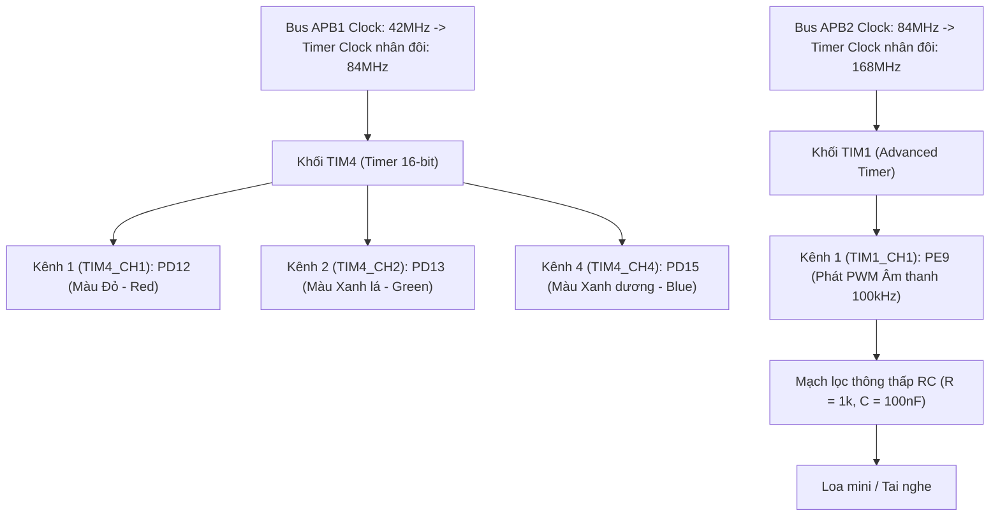

# CHƯƠNG 8: QUẢN LÝ THỜI GIAN NÂNG CAO, PWM, ĐIỀU KHIỂN HỒI TIẾP ÂM & PHÁT ÂM THANH THOẠI TRÊN STM32F407
*(Biên soạn dựa trên Chapter 8: Advanced Time Management, PWM, Feedback Control & Audio - Arm Education Textbook, hiệu chỉnh chuyên sâu cho STM32F407)*

---

## 8.1. MỤC TIÊU CỦA CHƯƠNG
- **Bối cảnh kiến thức:** Sinh viên đã biết cơ chế định thời cơ bản; chương này đi sâu vào **khối Timer phần cứng nâng cao của STM32F407** để tạo xung điều chế độ rộng PWM chính xác, ứng dụng điều khiển công suất tải, thiết kế hệ thống điều khiển hồi tiếp âm tự động và phát âm thanh số trực tiếp từ bộ nhớ Flash.
- **Mục tiêu chi tiết:**
  1. Làm chủ cấu trúc Timer phần cứng trên STM32F407: Tần số clock $f_{TIM}$, thanh ghi bộ chia trước `PSC`, thanh ghi tự nạp `ARR` và thanh ghi so sánh `CCR`.
  2. Băm xung PWM phần cứng điều khiển đổi màu và độ sáng đèn LED RGB trang trí (`PD12`, `PD13`, `PD15` qua `TIM4`) (Examples 8.1 $\div$ 8.4).
  3. Áp dụng lý thuyết điều khiển tự động: Thiết kế vòng điều khiển hồi tiếp âm (Negative Feedback Closed-Loop Control) tự động bù sáng đèn theo cường độ ánh sáng đo từ quang trở LDR (Example 8.5).
  4. Hiện thực hóa kỹ thuật phát âm thanh thoại chất lượng cao (Audio Speech Playback) từ mảng mẫu PCM lưu trong bộ nhớ Flash thông qua điều chế PWM tốc độ cao ($100\text{ kHz}$) kết hợp mạch lọc thông thấp RC (Example 8.6).

---

## 8.2. PHÂN BỔ PHẦN CỨNG TIMER VÀ PWM TRÊN STM32F407



### Công thức tính toán chu kỳ PWM trên STM32F407:
- Với `TIM4` trên bus APB1 có $f_{TIM4} = 84\text{ MHz}$, cần tạo xung PWM có tần số $f_{PWM} = 1\text{ kHz}$ và độ phân giải $1000$ bước ($ARR = 999$):
  $$PSC = \frac{f_{TIM4}}{f_{PWM} \times (ARR + 1)} - 1 = \frac{84 \times 10^6}{1000 \times 1000} - 1 = 84 - 1 = 83$$
- Cài đặt `TIM4->PSC = 83` và `TIM4->ARR = 999` $\rightarrow$ Độ rộng xung thay đổi mượt mà từ $0 \div 1000$ qua thanh ghi `CCR`.

---

## 8.3. HIỆN THỰC HÓA CHI TIẾT CÁC VÍ DỤ TỪ EXAMPLE 8.1 ĐẾN 8.6 TRÊN STM32F407

### VÍ DỤ 8.4: PHA TRỘN MÀU SẮC ĐÈN LED RGB BẰNG HARDWARE PWM (Listing 8.4)
- Điều khiển 3 kênh của `TIM4` (`PD12, PD13, PD15`) với tỷ lệ Duty Cycle độc lập để tạo ra các gam màu mong muốn:
```c
#include "main.h"

TIM_HandleTypeDef htim4;

void Set_RGB_Color(uint16_t red, uint16_t green, uint16_t blue)
{
    __HAL_TIM_SET_COMPARE(&htim4, TIM_CHANNEL_1, red);   // PD12
    __HAL_TIM_SET_COMPARE(&htim4, TIM_CHANNEL_2, green); // PD13
    __HAL_TIM_SET_COMPARE(&htim4, TIM_CHANNEL_4, blue);  // PD15
}

// Chuyển màu mượt mà trong vòng lặp chính
void RGB_Task(void)
{
    // Màu Cam: Đỏ 1000, Xanh lá 300, Xanh dương 0
    Set_RGB_Color(1000, 300, 0);
    HAL_Delay(1000);
    // Màu Tím: Đỏ 800, Xanh lá 0, Xanh dương 800
    Set_RGB_Color(800, 0, 800);
    HAL_Delay(1000);
}
```

---

### VÍ DỤ 8.5: HỆ THỐNG ĐIỀU KHIỂN HỒI TIẾP ÂM ĐỘ SÁNG ĐÈN (Listing 8.5)
- Đo tín hiệu quang trở LDR tại chân `PA4` (`ADC1_IN4`).
- Khi ánh sáng môi trường tối dần ($V_{LDR}$ giảm) $\rightarrow$ Vòng điều khiển hồi tiếp tự động tăng độ rộng xung PWM để đèn sáng hơn và ngược lại:
```c
void Automatic_Lighting_Feedback(void)
{
    uint16_t ldrRaw = Read_ADC(ADC_CHANNEL_4); // 0 đến 4095

    // Nghịch đảo: Phòng càng tối thì đèn LED càng sáng
    uint16_t invertedLight = 4095 - ldrRaw;

    // Quy đổi về dải 0 - 1000 của PWM
    uint32_t duty = (invertedLight * 1000) / 4095;

    Set_RGB_Color(duty, duty, duty); // Đèn trắng tự động điều chỉnh độ sáng
}
```

---

### VÍ DỤ 8.6: PHÁT ĐOẠN ÂM THANH THOẠI CẢNH BÁO TỪ BỘ NHỚ FLASH (Listing 8.6)
- Đoạn âm thanh cảnh báo `"Khí gas rò rỉ! Hãy rời khỏi nhà!"` được lấy mẫu ở tần số $8\text{ kHz}$ (chu kỳ $125\mu\text{s}$), lưu trong mảng `const uint8_t audioSamples[]` trên bộ nhớ Flash của STM32F407.
- Sử dụng `TIM6` tạo ngắt chu kỳ $125\mu\text{s}$, nạp từng mẫu vào thanh ghi `TIM1->CCR1` (chân `PE9` băm xung PWM $100\text{ kHz}$) $\rightarrow$ Tín hiệu đi qua mạch lọc RC tạo ra giọng nói rõ ràng ra loa mini!

---

## 8.4. "UNDER THE HOOD" & CASE STUDY (THEO SÁCH ARM)
- **Under the Hood (8.3.1):** 
  - Cơ sở lý thuyết điều khiển tự động (Control Theory): Mô hình vòng lặp hở (Open-loop) vs Vòng lặp kín có phản hồi (Closed-loop feedback).
  - Phân tích độ ổn định của hệ thống, sai số xác lập (Steady-state error) và khái niệm bộ điều khiển tỷ lệ P (Proportional Control).
- **Case Study (8.4.1):** Hệ thống Đèn Xe Đạp Thông Minh trong Thành phố (Smart City Bike Lights): Tự động điều chỉnh độ sáng và chế độ chớp nhấp nháy theo ánh sáng môi trường và gia tốc kế để báo hiệu phanh an toàn.
