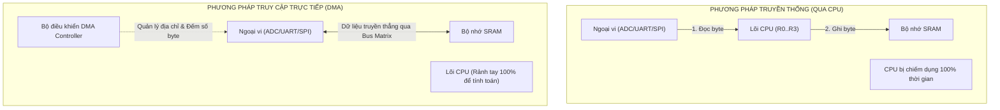

# CHƯƠNG 9: BỘ ĐIỀU KHIỂN TRUY CẬP BỘ NHỚ TRỰC TIẾP (DMA) & TỐI ƯU HÓA BĂNG THÔNG HỆ THỐNG
*(Biên soạn chuẩn hóa chuyên sâu cho Kỹ sư Điện tử & Hệ thống Nhúng STM32F4)*

---

## 9.1. MỤC TIÊU CỦA CHƯƠNG
Sau khi hoàn thành chương này, sinh viên ngành Kỹ thuật Điện tử có khả năng:
1. **Làm chủ nguyên lý hoạt động của khối DMA:** Hiểu rõ bản chất cơ chế truyền dữ liệu trực tiếp phần cứng giữa Ngoại vi và Bộ nhớ mà không cần sự can thiệp của CPU, giải phóng hoàn toàn tài nguyên CPU để xử lý các thuật toán điều khiển phức tạp.
2. **Nắm vững kiến trúc DMA trên STM32F4:**
   - Phân biệt cấu trúc 2 bộ điều khiển DMA1 và DMA2, ma trận kết nối 8 luồng (Streams) và 8 kênh (Channels) trên mỗi stream.
   - Hiểu rõ cơ chế trọng tài ưu tiên (Arbiter Priority) và các bộ đệm FIFO 4 từ (4 words FIFO) chống nghẽn bus.
3. **Lập trình thành thạo 3 chế độ DMA kinh điển:**
   - **ADC Multi-Channel Scan với DMA Circular Buffer:** Thu thập liên tục dữ liệu từ 4-8 cảm biến analog tự động cập nhật vào mảng RAM.
   - **UART-DMA với Ngắt IDLE Line Detection:** Truyền nhận các gói tin dữ liệu có độ dài thay đổi với tốc độ cao mà không làm chậm hệ thống.
   - **SPI-DMA Frame Buffer:** Đẩy hàng chục Kilobytes dữ liệu hình ảnh ra màn hình TFT LCD với tốc độ tối đa của phần cứng.

---

## 9.2. NGUYÊN LÝ HOẠT ĐỘNG VÀ MA TRẬN KẾT NỐI DMA (STM32F4)

Trong phương pháp truyền thống (Polling hoặc Interrupt), mỗi byte dữ liệu muốn chuyển từ thanh ghi ngoại vi (ví dụ `USART_DR` hoặc `ADC_DR`) vào mảng RAM trong bộ nhớ đều phải đi qua các thanh ghi của CPU (Load từ ngoại vi vào thanh ghi $R_0$, rồi Store từ $R_0$ vào RAM). Khi tốc độ lấy mẫu cao, CPU bị "nghẹt thở" vì liên tục phải xử lý ngắt:



### 1. Phân bổ phần cứng 2 bộ DMA trên STM32F4:
- **DMA1 (Ngoại vi Bus APB1):** Kết nối với `TIM2..TIM7`, `USART2..5`, `I2C1..3`, `SPI2..3`, `DAC`. Chú ý: DMA1 **không thể** thực hiện truyền từ Bộ nhớ sang Bộ nhớ (Memory-to-Memory).
- **DMA2 (Ngoại vi Bus APB2 & AHB1):** Kết nối với `ADC1..3`, `TIM1/8`, `USART1/6`, `SPI1/4..6`. DMA2 có thể kết nối Memory-to-Memory vì nó có quyền truy cập trực tiếp vào bus bộ nhớ Flash và SRAM.

### 2. Các chế độ hoạt động cốt lõi của DMA:
- **Normal Mode (Chế độ đơn):** Sau khi truyền đủ số lượng phần tử cấu hình trong thanh ghi `NDTR` (Number of Data to Transfer), khối DMA dừng lại và kích hoạt cờ ngắt hoàn thành (`Transfer Complete Interrupt - TCIF`).
- **Circular Mode (Chế độ vòng tròn):** Khi bộ đếm `NDTR` đếm lùi về 0, khối DMA tự động nạp lại giá trị ban đầu và bắt đầu ghi đè từ đầu mảng bộ nhớ. Rất lý tưởng cho việc lấy mẫu tín hiệu tương tự ADC liên tục.

---

## 9.3. HIỆN THỰC HÓA ỨNG DỤNG THỰC TẾ

### 1. Ứng dụng ADC Đa kênh Quét liên tục với DMA Circular Buffer
Đọc đồng thời 3 cảm biến: Cảm biến Gas (PA0), Cảm biến Nhiệt độ LM35 (PA1) và Biến trở (PA2) tự động lưu vào mảng `adcRawData[3]`:

```c
#include "main.h"

ADC_HandleTypeDef hadc1;
DMA_HandleTypeDef hdma_adc1;

// Mảng bộ đệm DMA - Dữ liệu luôn tự động cập nhật ngầm trong SRAM
uint32_t adcRawData[3];

int main(void)
{
    HAL_Init();
    SystemClock_Config();
    MX_DMA_Init();
    MX_ADC1_Init();

    // Khởi động ADC ở chế độ DMA Circular
    HAL_ADC_Start_DMA(&hadc1, adcRawData, 3);

    while (1)
    {
        // CPU chỉ việc đọc trực tiếp giá trị mới nhất từ mảng mà không tốn 1 chu kỳ chờ đợi nào!
        uint32_t gasVal  = adcRawData[0];
        uint32_t tempVal = adcRawData[1];
        uint32_t potVal  = adcRawData[2];

        float currentTemp = (tempVal * 330.0f) / 4095.0f; // Độ C

        HAL_Delay(100);
    }
}
```

### 2. Ứng dụng UART-DMA với ngắt nhàn rỗi đường truyền (IDLE Line Detection)
Khi máy tính gửi một gói tin có độ dài bất kỳ qua UART, làm sao để STM32 nhận đủ cả gói mà không cần định trước độ dài?
- Cấu hình UART nhận bằng DMA (`HAL_UART_Receive_DMA`).
- Kích hoạt ngắt đường truyền nhàn rỗi `IDLE` (`__HAL_UART_ENABLE_IT(&huart3, UART_IT_IDLE)`).
- Khi kết thúc gói tin, đường truyền nghỉ trong 1 byte time $\rightarrow$ Kích hoạt ngắt IDLE $\rightarrow$ Đọc thanh ghi `NDTR` của DMA để tính ngay chính xác số byte vừa nhận được!

```c
#define RX_BUFFER_SIZE 256
uint8_t rxDMABuffer[RX_BUFFER_SIZE];

void USART3_IRQHandler(void)
{
    // Kiểm tra cờ ngắt IDLE Line Detection
    if (__HAL_UART_GET_FLAG(&huart3, UART_FLAG_IDLE))
    {
        __HAL_UART_CLEAR_IDLEFLAG(&huart3); // Xóa cờ IDLE
        HAL_UART_DMAStop(&huart3);

        // Tính số byte thực tế đã nhận được
        uint16_t bytesReceived = RX_BUFFER_SIZE - __HAL_DMA_GET_COUNTER(&hdma_usart3_rx);

        // Xử lý gói tin nhận được
        Process_Packet(rxDMABuffer, bytesReceived);

        // Khởi động lại DMA cho gói tiếp theo
        HAL_UART_Receive_DMA(&huart3, rxDMABuffer, RX_BUFFER_SIZE);
    }
}
```

---

## 9.4. BÀI TẬP VÀ CÂU HỎI THIẾT KẾ
1. **Câu hỏi:** Giải thích hiện tượng tranh chấp Bus (Bus Contention) giữa CPU và DMA khi cùng truy cập vào bộ nhớ SRAM. Khối Bus Matrix giải quyết vấn đề này như thế nào?
2. **Lập trình tối ưu:** Viết chương trình phát một chuỗi 1000 ký tự ra cổng `USART1` sử dụng DMA: Đo thời gian CPU bị chiếm dụng khi dùng hàm chặn `HAL_UART_Transmit` so với hàm `HAL_UART_Transmit_DMA`.
