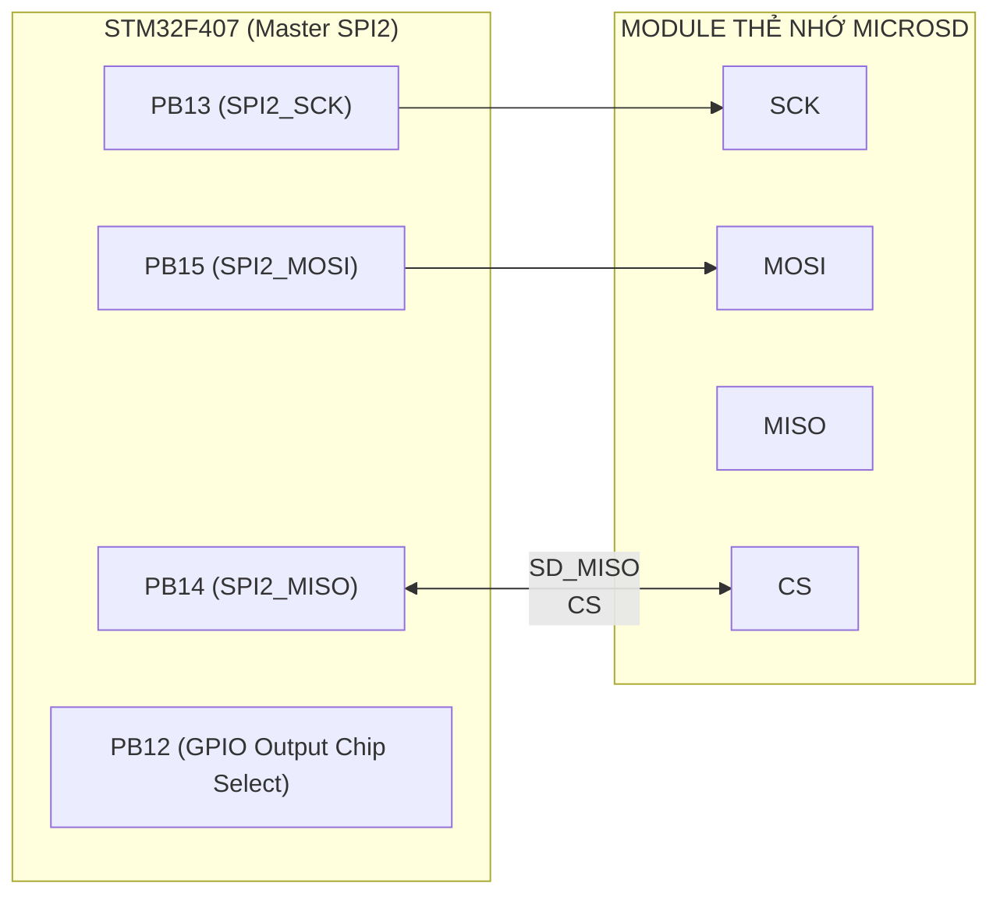

# CHƯƠNG 9: LƯU TRỮ TỆP TIN TRÊN THẺ NHỚ SD & QUẢN LÝ KHO PHẦN MỀM (GIT) TRÊN STM32F407
*(Biên soạn dựa trên Chapter 9: File Storage on SD Cards and Usage of Software Repositories - Arm Education Textbook, hiệu chỉnh chuyên sâu cho STM32F407)*

---

## 9.1. MỤC TIÊU CỦA CHƯƠNG
- **Bối cảnh kiến thức:** Sinh viên đã biết giao tiếp thanh ghi SPI ở Chương 6; chương này nâng lên việc tích hợp một tầng phần mềm trung gian (Middleware) hoàn chỉnh: **Hệ thống tập tin FatFS** để đọc/ghi tệp tin trên Thẻ nhớ SD dung lượng lớn, đồng thời trang bị kỹ năng quản trị phiên bản mã nguồn bằng **Git** cho dự án nhúng.
- **Mục tiêu chi tiết:**
  1. Ghép nối module thẻ nhớ MicroSD với STM32F407 qua giao diện `SPI2` (`PB12..PB15`).
  2. Nắm vững cấu trúc bảng cấp phát tệp tin (File Allocation Table - FAT16/FAT32) và ứng dụng thư viện mã nguồn mở FatFS trong hệ điều hành nhúng.
  3. Hiện thực hóa các ví dụ từ Example 9.1 đến 9.4 trên STM32F407: Tạo tệp nhật ký `event_log.csv`, ghi nhận các sự kiện báo động mới kèm mốc thời gian RTC, duyệt danh sách tệp tin trong thư mục và truyền nội dung tệp tin lên máy tính qua UART.
  4. Hiểu rõ nguyên lý quản lý kho phần mềm (Software Repositories): Cách tổ chức nhánh (Branches), commit, gắn thẻ phiên bản (Tags) và làm việc cộng tác trong các dự án nhúng thực tế.

---

## 9.2. PHÂN BỔ PHẦN CỨNG THẺ NHỚ SD TRÊN STM32F407



---

## 9.3. HIỆN THỰC HÓA CHI TIẾT CÁC VÍ DỤ TỪ EXAMPLE 9.1 ĐẾN 9.4 TRÊN STM32F407

### VÍ DỤ 9.1 & 9.2: TẠO VÀ GHI TIẾP SỰ KIỆN VÀO TỆP TIN NHẬT KÝ (Listings 9.1 & 9.2)
- Mỗi khi có sự cố xảy ra (Khí gas vượt ngưỡng, quá nhiệt, mở khóa thành công, nhập sai mã 5 lần), hệ thống tự động mở file `alarm_log.csv` và ghi tiếp 1 dòng mới:

```c
#include "fatfs.h"
#include <stdio.h>
#include <string.h>

FATFS FatFs;
FIL logFile;

void SDCard_LogEvent(char *timestamp, char *eventStr, float tempVal)
{
    // 1. Mount ổ đĩa thẻ nhớ SD
    if (f_mount(&FatFs, "", 1) == FR_OK)
    {
        // 2. Mở file ở chế độ FA_OPEN_APPEND (Ghi nối đuôi vào cuối file)
        if (f_open(&logFile, "alarm_log.csv", FA_OPEN_APPEND | FA_WRITE) == FR_OK)
        {
            char lineBuffer[128];
            snprintf(lineBuffer, sizeof(lineBuffer), "%s,%s,%.2f C\r\n", timestamp, eventStr, tempVal);

            UINT bytesWritten;
            // 3. Ghi dữ liệu vào file
            f_write(&logFile, lineBuffer, strlen(lineBuffer), &bytesWritten);

            // 4. Đóng file an toàn để hoàn tất lưu trữ
            f_close(&logFile);
        }
        f_mount(NULL, "", 0); // Unmount
    }
}
```

---

### VÍ DỤ 9.3 & 9.4: DUYỆT TỆP TIN VÀ TRUYỀN DỮ LIỆU LÊN MÁY TÍNH (Listings 9.3 & 9.4)
- Khi người dùng gửi lệnh `'4'` từ máy tính PC qua UART, STM32F407 mở file `alarm_log.csv`, đọc từng khối dữ liệu $512\text{ bytes}$ và truyền trực tiếp lên màn hình Terminal:

```c
void SDCard_DumpLogToPC(void)
{
    if (f_mount(&FatFs, "", 1) == FR_OK)
    {
        if (f_open(&logFile, "alarm_log.csv", FA_READ) == FR_OK)
        {
            char readBuffer[128];
            UINT bytesRead;

            UART_SendString("--- BEGIN EVENT LOG FILE ---\r\n");
            // Đọc liên tục cho đến khi hết tệp tin
            while (f_read(&logFile, readBuffer, sizeof(readBuffer) - 1, &bytesRead) == FR_OK && bytesRead > 0)
            {
                readBuffer[bytesRead] = '\0';
                UART_SendString(readBuffer);
            }
            UART_SendString("\r\n--- END OF FILE ---\r\n");
            f_close(&logFile);
        }
        f_mount(NULL, "", 0);
    }
}
```

---

## 9.4. "UNDER THE HOOD" & CASE STUDY (THEO SÁCH ARM)
- **Under the Hood (9.3.1):** 
  - Khái niệm về Kho phần mềm (Software Repositories) và hệ thống quản lý phiên bản phân tán Git.
  - Phân tích tầm quan trọng của việc commit thường xuyên (Commit early, commit often), cách tạo nhánh `feature-branch` độc lập khi phát triển module mới trên STM32 và kỹ thuật merge code an toàn.
- **Case Study (9.4.1):** Quản lý phiên bản mã nguồn trong các dự án nhúng quốc tế sử dụng GitHub / GitLab: Thiết lập quy trình kiểm thử tự động CI/CD (Continuous Integration) kiểm tra lỗi cú pháp và biên dịch tự động trước khi nạp mã nguồn vào thiết bị công nghiệp.
