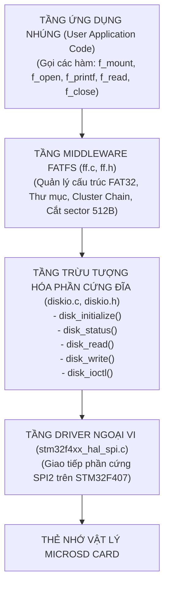

# CHƯƠNG 9: LƯU TRỮ TỆP TIN TRÊN THẺ NHỚ SD & QUẢN LÝ KHO PHẦN MỀM (GIT) TRÊN STM32F407
*(Biên soạn dựa trên Chapter 9: File Storage on SD Cards and Usage of Software Repositories - Arm Education Textbook, hiệu chỉnh chuyên sâu cho STM32F407)*

---

## 9.1. MỤC TIÊU CỦA CHƯƠNG
- **Bối cảnh kiến thức:** Sinh viên đã thành thạo giao thức nối tiếp SPI ở Chương 6; chương này nâng lên việc tích hợp một tầng phần mềm trung gian (Middleware) hoàn chỉnh: **Hệ thống tập tin FatFS** để đọc/ghi tệp tin trên Thẻ nhớ SD dung lượng lớn, xây dựng tính năng **Nhật ký Sự kiện Nhúng (Embedded Data Logging)**, đồng thời trang bị phương pháp luận quản trị phiên bản mã nguồn chuyên nghiệp bằng **Git CLI** trong các dự án kỹ thuật nhúng.
- **Mục tiêu chi tiết:**
  1. **Lý thuyết Thẻ nhớ & Chuẩn Giao tiếp SPI Mode:** Nắm vững cấu trúc vật lý của thẻ MicroSD (NAND Flash, Controller, Sector $512\text{ bytes}$), trình tự gửi lệnh khởi tạo chuẩn SD Card (`CMD0`, `CMD8`, `ACMD41`, `CMD58`), chuyển đổi linh hoạt tần số xung nhịp SPI từ thấp ($< 400\text{ kHz}$) sang cao ($10.5\text{ Mbps}$).
  2. **Kiến trúc Hệ thống Tập tin FAT & Middleware FatFS:**
     - Phân tích cấu trúc phân vùng FAT32: Master Boot Record (MBR), Boot Sector, Bảng chỉ mục FAT1/FAT2, Thư mục gốc (Root Directory) và Cụm dữ liệu (Clusters).
     - Nắm vững kiến trúc phân tầng của thư viện FatFS (Tác giả ChaN): Tầng ứng dụng, tầng API tập tin (`ff.c`), và tầng điều khiển đĩa cấp thấp (`diskio.c`).
  3. **Thiết kế Mạch & Phân Bổ Chân Phần Cứng:** Ghép nối khe cắm thẻ MicroSD với vi điều khiển STM32F407 qua khối `SPI2` (`PB12` CS, `PB13` SCK, `PB14` MISO, `PB15` MOSI).
  4. **Lập trình Ứng dụng Thực tế (Examples 9.1 $\div$ 9.4):**
     - Tạo tệp nhật ký `alarm_log.csv` và ghi nối dữ liệu định dạng bảng tính khi phát hiện báo động.
     - Duyệt danh sách tệp tin trong thư mục và truyền tệp nhật ký lên máy tính PC qua UART.
  5. **Quản lý Phiên bản Phần mềm Nhúng Bằng Git:** Nắm vững quy trình làm việc cục bộ và từ xa với Git CLI, thiết lập `.gitignore` chuẩn cho STM32CubeIDE và chiến lược phân nhánh tính năng (Feature Branching).

---

## 9.2. CƠ SỞ LÝ THUYẾT CHUYÊN SÂU

### 9.2.1. Cấu Trúc Vật Lý Thẻ Nhớ SD và Giao Diện SPI Mode
Thẻ nhớ Secure Digital (SD / MicroSD) tích hợp chip nhớ bán dẫn NAND Flash cùng một bộ vi điều khiển (On-card Flash Controller) đảm nhận việc phân phối đều hao mòn ô nhớ (Wear Leveling), quản lý khối lỗi (Bad Block Management) và thực thi giao thức truyền thông.

Thẻ nhớ hỗ trợ hai chế độ giao tiếp:
1. **Chế độ SD Bus (1-bit hoặc 4-bit):** Giao thức độc quyền của SD Association, tốc độ cực cao, sử dụng khối ngoại vi `SDIO` phần cứng.
2. **Chế độ SPI Bus Mode (1-bit):** Chuẩn giao thức mở, tốc độ vừa phải, cho phép mọi vi điều khiển có khối SPI kết nối trực tiếp chỉ bằng 4 dây dẫn.

```
+---------------------------------------------------------------------------------+
|                       TRÌNH TỰ KHỞI TẠO THẺ NHỚ QUA SPI                         |
+---------------------------------------------------------------------------------+
|                                                                                 |
|  1. Cấp nguồn 3.3V, giữ CS = 1, phát tối thiểu 74 xung Clock giả lập trên SCK    |
|                                                                                 |
|  2. Kéo CS = 0, gửi lệnh CMD0 (0x40 0x00 0x00 0x00 0x00 0x95) -> GO_IDLE_STATE   |
|     Thẻ phản hồi Byte R1 = 0x01 (Báo hiệu đã chuyển sang SPI Mode thành công)   |
|                                                                                 |
|  3. Gửi lệnh CMD8 (SEND_IF_COND) kiểm tra điện áp 3.3V và thẻ loại V2.0 trở lên  |
|     Thẻ phản hồi mã R7 chứa mẫu kiểm tra 0xAA (Xác nhận dải áp 2.7V - 3.6V)    |
|                                                                                 |
|  4. Gửi lặp lại cặp lệnh: CMD55 + ACMD41 (SD_SEND_OP_COND)                      |
|     Chờ cho đến khi cờ bận In-Idle-State trở về 0x00 (Thẻ sẵn sàng hoạt động)  |
|                                                                                 |
|  5. Gửi lệnh CMD58 (READ_OCR) kiểm tra bit CCS (Card Capacity Status):         |
|     - Nếu CCS = 1: Thẻ dung lượng cao SDHC/SDXC (Đánh địa chỉ theo Block 512B) |
|     - Nếu CCS = 0: Thẻ tiêu chuẩn SDSC (Đánh địa chỉ theo Byte)                 |
|                                                                                 |
|  6. Khởi tạo hoàn tất -> TĂNG TỐC ĐỘ XUNG NHỊP SPI2 LÊN TỐI ĐA (10.5 MHz)       |
+---------------------------------------------------------------------------------+
```

> [!IMPORTANT]
> **Quy tắc chuyển đổi tần số xung nhịp SPI:**  
> Trong quá trình khởi tạo (Bước 1 $\div$ 5), chuẩn kỹ thuật thẻ SD quy định xung nhịp Clock bắt buộc phải **$< 400\text{ kHz}$**. Sau khi thẻ phản hồi sẵn sàng, vi điều khiển mới được phép chuyển bộ chia Baudrate Prescaler của SPI lên tần số cao ($10.5\text{ MHz} \div 20\text{ MHz}$) để đạt thông lượng đọc ghi cao.

---

### 9.2.2. Cấu Trúc Hệ Thống Tập Tin FAT32 (File Allocation Table)
Khi thẻ nhớ có dung lượng từ $4\text{GB} \div 32\text{GB}$, định dạng tiêu chuẩn quốc tế là **FAT32**:

```
+----------------+-----------------+-------------------+-------------------+-------------------+
|  Master Boot   |   Boot Sector   |   Bảng FAT 1      |   Bảng FAT 2      |   Vùng Dữ Liệu    |
|  Record (MBR)  |   (VBR / BPB)   | (Chỉ mục Cluster) |   (Bản sao dự     |   (Các Cluster    |
|   (Sector 0)   |                 |                   |     phòng)        |   chứa File & Dir)|
+----------------+-----------------+-------------------+-------------------+-------------------+
```

1. **Sector vật lý (Physical Sector):** Đơn vị phần cứng nhỏ nhất có thể đọc/ghi trên thẻ nhớ, luôn cố định là **$512\text{ bytes}$**.
2. **Cụm dữ liệu (Cluster / Allocation Unit):** Đơn vị cấp phát tệp tin nhỏ nhất của hệ điều hành, gồm một lũy thừa của 2 các Sector liên tiếp (ví dụ: $1\text{ Cluster} = 8\text{ Sectors} = 4096\text{ bytes} = 4\text{ KB}$).
3. **Bảng FAT (File Allocation Table):** Là một mảng các phần tử 32-bit (trong đó 28-bit dùng đánh địa chỉ). Mỗi phần tử đại diện cho một Cluster tương ứng trên đĩa:
   - Giá trị `0x00000000`: Cluster đang rỗng.
   - Giá trị `0x00000002` $\div$ `0x0FFFFFEF`: Số hiệu của Cluster kế tiếp trong tệp tin (Chuỗi liên kết Cluster Chain).
   - Giá trị `0x0FFFFFF8` $\div$ `0x0FFFFFFF`: Đánh dấu kết thúc tệp tin (End of File - EOF).
4. **Thư mục (Directory Entry):** Mỗi tệp tin hoặc thư mục con chiếm một khối $32\text{ bytes}$ mô tả: Tên tệp (8 ký tự), Phần mở rộng (3 ký tự), Thuộc tính (Read-only, Hidden, Directory), Thời gian tạo/sửa đổi (Mốc giờ RTC), Kích thước tệp (bytes), và Số hiệu Cluster bắt đầu.

---

### 9.2.3. Kiến Trúc Middleware FatFS Trên Hệ Thống Nhúng
FatFS là một thư viện phần mềm trung gian mã nguồn mở cực kỳ nổi tiếng của tác giả **ChaN**, được thiết kế chuyên biệt cho các bộ vi điều khiển tài nguyên hạn chế:



#### Cơ chế bộ đệm Sector RAM và Nguy cơ Hỏng Tệp Tin:
- Để tối ưu hóa tốc độ và giảm hao mòn Flash, thư viện FatFS sử dụng một vùng đệm tạm **Sector Buffer ($512\text{ bytes}$)** trong bộ nhớ SRAM của STM32F407.
- Khi người dùng gọi hàm `f_printf()` hoặc `f_write()`, dữ liệu **chỉ mới được ghi vào bộ đệm RAM** của vi điều khiển chứ chưa được nạp vào thẻ nhớ vật lý.
- Chỉ khi bộ đệm đầy $512\text{ bytes}$, hoặc khi chương trình gọi hàm `f_sync()` / `f_close()`, dữ liệu và bảng chỉ mục FAT mới được ghi thực sự xuống thẻ nhớ.
- $\implies$ **Nếu người dùng rút thẻ nhớ đột ngột hoặc ngắt nguồn vi điều khiển khi chưa gọi `f_close()`, bảng FAT sẽ không được cập nhật, dẫn đến hiện tượng tệp tin có dung lượng 0-byte hoặc hỏng toàn bộ hệ thống tệp tin!**

---

### 9.2.4. Cơ Sở Lý Thuyết Quản Lý Phiên Bản Mã Nguồn Bằng Git CLI
Trong kỹ thuật phần mềm nhúng chuyên nghiệp, mã nguồn phải được lưu trữ lịch sử thay đổi để đảm bảo truy vết lỗi, hỗ trợ làm việc nhóm và bảo vệ tài sản trí tuệ.

```
[ Working Directory ] --(git add)--> [ Staging Area ] --(git commit)--> [ Local Repository ] --(git push)--> [ Remote GitHub ]
```

#### Vai trò của tệp `.gitignore` trong dự án STM32CubeIDE:
Mỗi lần biên dịch (Build Project), trình biên dịch GCC sinh ra hàng trăm tệp tin nhị phân trung gian: Tệp đối tượng (`.o`), tệp phụ thuộc (`.d`), tệp liên kết bản đồ (`.map`), tệp nhị phân thực thi (`.elf`, `.hex`, `.bin`).
- Các tệp này chiếm dung lượng hàng chục Megabytes nhưng có thể tái tạo bất kỳ lúc nào chỉ bằng 1 nút nhấn Build.
- Nếu đẩy các tệp nhị phân này lên Git, kho lưu trữ sẽ phình to nhanh chóng và thường xuyên gây xung đột mã nguồn (Merge Conflict) không thể giải quyết được.
- $\implies$ Tệp `.gitignore` đóng vai trò người gác cổng, hướng dẫn Git chỉ theo dõi các tệp mã nguồn gốc (`.c`, `.h`, `.ioc`, `Makefile`, `.ld`) và bỏ qua toàn bộ các thư mục tạm `Debug/`, `Release/`.

---

## 9.3. SƠ ĐỒ NGUYÊN LÝ & SƠ ĐỒ ĐẤU NỐI CHÂN CHI TIẾT

### 9.3.1. Sơ đồ mạch nguyên lý điện tử (Schematics)

```
=============================================================================================
SƠ ĐỒ GHÉP NỐI MODULE MICROSD QUA CHUẨN SPI2 TRÊN STM32F407
=============================================================================================
STM32F407                                                    Module Thẻ Nhớ MicroSD
+------------------+                                        +---------------------+
|             3.3V |----------------------------------------| VCC (Nguồn cấp 3.3V)|
|                  |                                        |                     |
|              GND |----------------------------------------| GND (Mass chung)    |
|                  |                                        |                     |
|  PB12 (GPIO_Out) |----------------------------------------| CS  (Chip Select)   |
|                  |                                        |                     |
|  PB13 (SPI2_SCK) |----------------------------------------| SCK (Serial Clock)  |
|                  |                       +3.3V            |                     |
|                  |                         |              |                     |
|  PB14 (SPI2_MISO)|<------------------------+--[ 10k ]-----| MISO / DO (Data Out)|
|                  |  (Điện trở kéo Pull-up nội/ngoại)      |                     |
|  PB15 (SPI2_MOSI)|----------------------------------------| MOSI / DI (Data In) |
+------------------+                                        +---------------------+
```

---

### 9.3.2. Bảng Phân Bổ Chân Toàn Diện Trên STM32F407 (Master Pinout Table)

| Tên Chân STM32 | Tên Tín Hiệu | Chức Năng Phần Cứng / Alternate Function | Cấu Hình Trên STM32CubeMX | Kết Nối Chân Module Thẻ SD | Mức Điện Áp & Lưu Ý Kỹ Thuật |
| :---: | :---: | :---: | :---: | :--- | :--- |
| `PB12` | `SD_CS` | GPIO_Output | Output Push-Pull, Initial High, Very High Speed | Chân `CS` của khe cắm thẻ | $3.3\text{V}$, tích cực mức thấp (Active-LOW) |
| `PB13` | `SPI2_SCK` | `SPI2_SCK` (AF5) | Alternate Function Push-Pull, Very High Speed | Chân `SCK` / `CLK` của thẻ | $3.3\text{V}$, xung nhịp đồng bộ truyền dữ liệu |
| `PB14` | `SPI2_MISO` | `SPI2_MISO` (AF5) | Alternate Function, Bật **Pull-up** nội | Chân `MISO` / `DO` của thẻ | $3.3\text{V}$, cần trở kéo lên tránh thả nổi khi nhả thẻ |
| `PB15` | `SPI2_MOSI` | `SPI2_MOSI` (AF5) | Alternate Function Push-Pull, Very High Speed | Chân `MOSI` / `DI` của thẻ | $3.3\text{V}$, đường dữ liệu phát từ STM32 |
| `PA2` | `USART2_TX` | `USART2_TX` (AF7) | Alternate Function Push-Pull | Cổng nạp/gỡ lỗi nối tiếp lên PC | $115200\text{ bps}$, phục vụ truyền tệp nhật ký |
| `3V3` | `VCC` | Nguồn $3.3\text{V}$ | Nguồn nuôi hệ thống | Chân `VCC` của module thẻ | Dòng tiêu thụ đỉnh của thẻ khi ghi có thể tới $100\text{mA}$ |
| `GND` | `GND` | Mass hệ thống | Mass chung | Chân `GND` của module thẻ | Bắt buộc chung mass |

---

## 9.4. HIỆN THỰC HÓA CHI TIẾT CÁC VÍ DỤ TỪ EXAMPLE 9.1 ĐẾN 9.4 TRÊN STM32F407

### 9.4.1. Cấu hình STM32CubeMX
1. **Khối SPI2:**
   - Vào *Connectivity* $\rightarrow$ *SPI2*.
   - Mode: **Full-Duplex Master**.
   - Data Size: **8 Bits**, First Bit: **MSB First**.
   - Clock Polarity (CPOL): **Low**, Clock Phase (CPHA): **1 Edge** (Mode 0).
   - Prescaler: Khởi tạo ở **/64** ($656\text{ kHz}$) hoặc cấu hình tự động trong file driver.
2. **Kích hoạt Middleware FATFS:**
   - Vào *Middleware* $\rightarrow$ *FATFS* $\rightarrow$ Tích chọn **User-defined**.
   - Set `_USE_MKFS = 1` (Hỗ trợ định dạng), `_MAX_SS = 512` (Sector Size).

---

### 9.4.2. Mã Nguồn Hoàn Chỉnh Của Chương

#### 1. Tạo và Ghi Nối Tệp Nhật Ký Báo Động (Examples 9.1 & 9.2)
```c
#include "main.h"
#include "fatfs.h"
#include <stdio.h>
#include <string.h>
#include <stdbool.h>

FATFS fs;         /* Khối thông tin hệ thống tập tin */
FIL logFile;      /* Con trỏ tệp tin */
FRESULT fresult;  /* Biến kiểm tra mã lỗi của FatFS */

/* Ghi một bản ghi nhật ký định dạng CSV vào thẻ nhớ */
bool SDCard_LogAlarmEvent(const char *timestamp, const char *sensorName, float measuredValue, const char *status)
{
    /* 1. Gắn kết phân vùng ổ đĩa thẻ nhớ (Mount Volume) */
    fresult = f_mount(&fs, "", 1);
    if (fresult != FR_OK)
    {
        printf("[FATFS ERROR] Khong the mount the nho SD! Ma loi: %d\r\n", fresult);
        return false;
    }

    /* 2. Mở tệp ở chế độ ghi nối đuôi (FA_OPEN_APPEND | FA_WRITE) */
    fresult = f_open(&logFile, "alarm_log.csv", FA_OPEN_APPEND | FA_WRITE);
    if (fresult != FR_OK)
    {
        printf("[FATFS ERROR] Khong the mo tep tin alarm_log.csv! Ma loi: %d\r\n", fresult);
        f_mount(NULL, "", 0); /* Hủy gắn kết */
        return false;
    }

    /* 3. Nếu tệp mới tạo (dung lượng = 0), ghi dòng tiêu đề CSV Header */
    if (f_size(&logFile) == 0)
    {
        f_printf(&logFile, "Timestamp,Sensor,Measured_Value,Alarm_Status\r\n");
    }

    /* 4. Ghi bản ghi sự kiện mới */
    f_printf(&logFile, "%s,%s,%.2f,%s\r\n", timestamp, sensorName, measuredValue, status);

    /* 5. Đồng bộ và đóng tệp an toàn */
    f_close(&logFile);

    /* 6. Hủy mount để bảo toàn hệ thống tệp */
    f_mount(NULL, "", 0);

    printf("[SD SUCCESS] Da ghi nhan su kien vao alarm_log.csv!\r\n");
    return true;
}
```

---

#### 2. Đọc Tệp Nhật Ký và Truyền Lên Máy Tính PC Qua UART (Examples 9.3 & 9.4)
```c
extern UART_HandleTypeDef huart2;

/* Đọc toàn bộ nội dung tệp CSV truyền ra cổng Serial Terminal */
void SDCard_DumpLogToTerminal(void)
{
    char textLine[128];

    if (f_mount(&fs, "", 1) == FR_OK)
    {
        if (f_open(&logFile, "alarm_log.csv", FA_READ) == FR_OK)
        {
            printf("\r\n======================================================\r\n");
            printf("     NOI DUNG TEP NHAT KY SU KIEN (SD CARD LOG)       \r\n");
            printf("======================================================\r\n");

            /* Đọc từng dòng cho đến hết tệp tin */
            while (f_gets(textLine, sizeof(textLine), &logFile) != NULL)
            {
                /* Truyền trực tiếp dòng văn bản ra UART */
                HAL_UART_Transmit(&huart2, (uint8_t *)textLine, strlen(textLine), 200);
            }

            printf("======================================================\r\n");
            printf("                 KET THUC TEP TIN                     \r\n\r\n");
            f_close(&logFile);
        }
        else
        {
            printf("[SD ERROR] Tep alarm_log.csv khong ton tai tren the nho!\r\n");
        }
        f_mount(NULL, "", 0);
    }
}
```

---

## 9.5. THỰC HÀNH QUẢN LÝ MÃ NGUỒN NHÚNG BẰNG GIT CLI

### 9.5.1. Thiết Lập Tệp `.gitignore` Chuẩn Nhúng STM32CubeIDE
Tạo một tệp mang tên `.gitignore` ngay tại thư mục gốc dự án:
```gitignore
# 1. Thư mục và tệp sinh mã biên dịch trung gian
Debug/
Release/
*.o
*.d
*.su
*.elf
*.hex
*.bin
*.map

# 2. Cấu hình môi trường của IDE
.settings/
.project
.cproject

# 3. Tệp rác hệ điều hành
Thumbs.db
.DS_Store
```

### 9.5.2. Các Lệnh Git CLI Thiết Yếu Cho Kỹ Sư Nhúng
```bash
# 1. Khởi tạo kho Git mới
git init

# 2. Thêm toàn bộ mã nguồn sạch vào vùng theo dõi
git add .

# 3. Commit phiên bản hoàn thành khối Thẻ nhớ
git commit -m "feat(sdcard): implement FatFS data logging on SPI2"

# 4. Tạo nhánh phát triển tính năng mới (Ví dụ: BLE)
git branch feature-ble-driver
git checkout feature-ble-driver

# 5. Hợp nhất tính năng đã kiểm thử vào nhánh chính
git checkout main
git merge feature-ble-driver

# 6. Đồng bộ lên GitHub từ xa
git push origin main
```

---

## 9.6. CÂU HỎI ÔN TẬP VÀ BÀI TẬP THIẾT KẾ CHƯƠNG 9

1. **Câu hỏi 1 (Chuẩn giao tiếp thẻ SD):** *Tại sao ở giai đoạn gửi các lệnh khởi tạo (`CMD0`, `CMD8`, `ACMD41`), tần số xung nhịp SPI bắt buộc phải duy trì dưới $400\text{ kHz}$? Điều gì sẽ xảy ra nếu ta phát xung $10\text{ MHz}$ ngay từ đầu?*
2. **Câu hỏi 2 (Cơ chế FatFS):** *Phân tích sự khác biệt giữa hai cờ mở tệp: `FA_CREATE_ALWAYS` và `FA_OPEN_APPEND`. Nếu một hệ thống Data Logger sử dụng nhầm cờ `FA_CREATE_ALWAYS` thì hiện tượng mất mát dữ liệu sẽ diễn ra như thế nào?*
3. **Câu hỏi 3 (Quản trị Git):** *Tại sao các tệp nhị phân `.elf`, `.hex` tuyệt đối không nên đưa vào kho Git của dự án nhúng? Nêu 2 lý do kỹ thuật.*
4. **Bài tập thiết kế hệ thống:** *Thiết kế một hộp đen ghi dữ liệu hành trình (Black Box Flight Recorder) cho xe ô tô: Sử dụng STM32F407, thẻ nhớ MicroSD qua SPI2, cảm biến gia tốc MPU6050 qua I2C1, ghi nhận gia tốc 3 trục với tần số lấy mẫu $50\text{ Hz}$ vào tệp `flight_data.bin` nhị phân để tiết kiệm bộ nhớ tối đa.*
