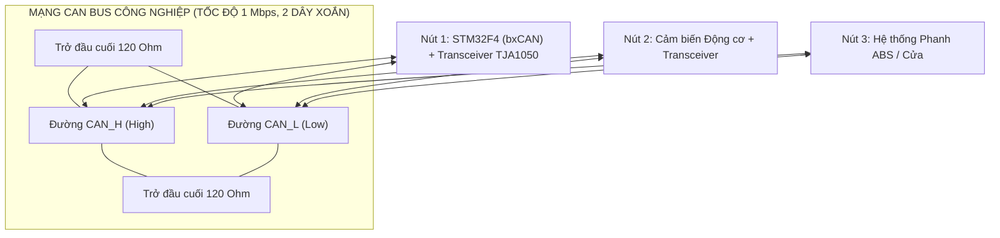

# CHƯƠNG 10: MẠNG TRUYỀN THÔNG CÔNG NGHIỆP CAN BUS & TRUYỀN THÔNG KHÔNG DÂY (BLE / WI-FI)
*(Biên soạn tích hợp dựa trên Chapter 10: BLE & Chapter 11: Wi-Fi Web Server - Arm Education Textbook kết hợp Chuẩn CAN Bus Công nghiệp)*

---

## 10.1. MỤC TIÊU CỦA CHƯƠNG
Sau khi hoàn thành chương này, sinh viên ngành Kỹ thuật Điện tử có khả năng:
1. **Làm chủ mạng truyền thông công nghiệp CAN Bus (Controller Area Network):**
   - Hiểu rõ nguyên lý truyền vi sai 2 dây ($CAN\_H, CAN\_L$), mức logic Recessive (Mức 1 ẩn) và Dominant (Mức 0 trội).
   - Cơ chế phân xử quyền ưu tiên không phá hủy theo mã định danh (Non-destructive Bitwise Arbitration).
   - Thiết kế mạch ghép nối với vi mạch thu phát CAN Transceiver TJA1050/MCP2551 và điện trở kết thúc đường truyền $120\text{ }\Omega$.
2. **Làm chủ truyền thông không dây năng lượng thấp Bluetooth Low Energy (BLE):**
   - Hiểu kiến trúc phân tầng BLE: Generic Access Profile (GAP) và Generic Attribute Profile (GATT), các khái niệm Service, Characteristic, UUID.
   - Kết nối vi điều khiển với Smartphone qua ứng dụng BLE để điều khiển đóng mở cổng và giám sát trạng thái từ xa (Examples 10.1 $\div$ 10.4 của ARM).
3. **Hiện thực hóa Máy chủ Web nhúng (Embedded Web Server qua Wi-Fi):**
   - Ghép nối vi mạch Wi-Fi ESP8266 qua giao tiếp UART và tập lệnh chuẩn AT Commands.
   - Thiết lập kết nối TCP/IP và lập trình STM32 phục vụ một trang Web HTML trực tiếp hiển thị nhiệt độ, trạng thái rò rỉ khí gas và nút bấm điều khiển bật/tắt thiết bị thời gian thực (Examples 11.1 $\div$ 11.4 của ARM).

---

## 10.2. NGUYÊN LÝ MẠNG TRUYỀN THÔNG CÔNG NGHIỆP CAN BUS

### 1. Đặc tính vật lý của Bus CAN
Được hãng Bosch phát minh cho ngành công nghiệp ô tô (Automotive) và tự động hóa, mạng CAN có độ tin cậy cực cao, chống nhiễu vượt trội trong môi trường khắc nghiệt:



- **Điện áp vi sai:**
  - *Mức Recessive (Logic '1'):* Cả hai dây $CAN\_H$ và $CAN\_L$ đều ở mức điện áp $2.5\text{V} \implies V_{diff} = 0\text{V}$.
  - *Mức Dominant (Logic '0'):* $CAN\_H$ kéo lên $3.5\text{V}$, $CAN\_L$ kéo xuống $1.5\text{V} \implies V_{diff} = 2.0\text{V}$.
- **Nguyên tắc phân xử trọng tài (Bitwise Arbitration):** Nếu hai nút cùng phát tin tại một thời điểm, nút nào phát bit 0 (Dominant) sẽ đè bẹp nút phát bit 1 (Recessive). Nút phát bit 1 khi đọc lại thấy đường bus là 0 sẽ nhận ra mình thua quyền ưu tiên và ngay lập tức rút lui chuyển sang chế độ nhận mà **không làm hỏng gói tin của nút kia**! Gói tin có ID nhỏ hơn luôn có quyền ưu tiên cao nhất.

---

## 10.3. TRUYỀN THÔNG KHÔNG DÂY BLUETOOTH LOW ENERGY (BLE) VỚI SMARTPHONE (EXAMPLES 10.1 $\div$ 10.4)

Trong hệ thống Smart Home của giáo trình ARM, module BLE (như HC-08 hoặc HM-10) giao tiếp với STM32 qua cổng UART.

```mermaid
flowchart LR
    Phone["Smartphone App (BLE Client)"] <-->|Sóng vô tuyến BLE 2.4GHz| BLE_Mod["Module BLE (Server / Peripheral)"]
    BLE_Mod <-->|UART (TX/RX) 9600 bps| STM32["Kit STM32F4 Smart Home"]
    STM32 --> Motor["Động cơ mở cổng"]
```

### Triển khai nhận lệnh điều khiển mở cổng từ Smartphone:
```c
// Khi ứng dụng điện thoại gửi chuỗi: "GATE_OPEN\r\n"
void BLE_Task(void)
{
    char bleCmd[32];
    if (UART_Receive_Line(bleCmd, sizeof(bleCmd)))
    {
        if (strcmp(bleCmd, "GATE_OPEN") == 0)
        {
            Open_Gate();
            UART_SendString("Response: Gate is now OPEN\r\n");
        }
        else if (strcmp(bleCmd, "GATE_CLOSE") == 0)
        {
            Close_Gate();
            UART_SendString("Response: Gate is now CLOSED\r\n");
        }
    }
}
```

---

## 10.4. MÁY CHỦ WEB NHÚNG (EMBEDDED WEB SERVER QUA WI-FI) (EXAMPLES 11.1 $\div$ 11.4)

Khối Wi-Fi ESP8266 được kết nối với cổng USART của STM32F4, nhận các lệnh AT để khởi tạo máy chủ TCP tại cổng 80 (HTTP Port). Khi người dùng truy cập địa chỉ IP của kit trên trình duyệt máy tính hoặc điện thoại, STM32 sẽ trả về trang HTML tương tác:

```c
// Mã HTML trang Web hiển thị thông số cảm biến và nút điều khiển
const char WebPage_HTML[] = 
"<!DOCTYPE html><html><head><meta charset='UTF-8'><title>Smart Home Monitor</title>"
"<style>body{font-family:Arial;text-align:center;background:#f0f2f5;}"
".card{background:white;padding:20px;border-radius:10px;width:300px;margin:auto;box-shadow:0 4px 8px rgba(0,0,0,0.1);}"
".btn{background:#007bff;color:white;padding:10px 20px;text-decoration:none;border-radius:5px;font-weight:bold;}"
"</style></head><body>"
"<div class='card'>"
"<h2>SMART HOME DASHBOARD</h2>"
"<p>Temperature: <b>%s &deg;C</b></p>"
"<p>Gas Sensor: <b>%s</b></p>"
"<p>System Alarm: <b style='color:%s;'>%s</b></p>"
"<a href='/?action=reset_alarm' class='btn'>CLEAR ALARM</a>"
"</div></body></html>";
```

### Quy trình trao đổi tập lệnh AT giữa STM32 và ESP8266:
1. `AT+RST`: Khởi động lại vi mạch Wi-Fi.
2. `AT+CWMODE=1`: Đặt chế độ Station (kết nối vào Router gia đình).
3. `AT+CWJAP="SSID_WIFI","MAT_KHAU"`: Kết nối vào mạng Wi-Fi.
4. `AT+CIPMUX=1`: Cho phép đa kết nối (Multiple Connections).
5. `AT+CIPSERVER=1,80`: Khởi tạo Web Server lắng nghe tại cổng 80.
6. Khi có Client kết nối và gửi bản tin HTTP GET $\rightarrow$ STM32 gửi dữ liệu trang HTML bằng lệnh `AT+CIPSEND=<id>,<length>`.

---

## 10.5. BÀI TẬP VÀ CÂU HỎI THIẾT KẾ
1. **Câu hỏi:** So sánh sự khác nhau về cơ chế phát hiện lỗi và cấu trúc khung truyền giữa mạng **CAN Bus** và **RS-485 Modbus**. Tại sao CAN Bus lại được ưu tiên số 1 trong các hệ thống an toàn xe hơi?
2. **Thiết kế mạch:** Vẽ sơ đồ kết nối chân giữa STM32F4 (PA11 - CAN_RX, PA12 - CAN_TX) với vi mạch thu phát TJA1050 và mạng cáp xoắn đôi. Tính toán điện trở kết thúc bus.
3. **Lập trình tích hợp:** Xây dựng kịch bản: Khi nhiệt độ đọc được từ cảm biến vượt quá ngưỡng an toàn, STM32 vừa gửi tin nhắn khẩn cấp qua BLE tới điện thoại gia chủ, vừa tự động cập nhật cảnh báo lên trang Web Server qua Wi-Fi.
