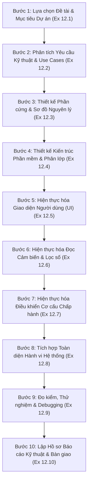
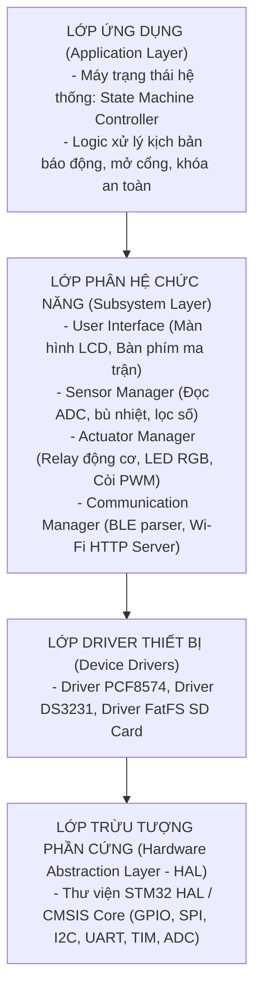

# CHƯƠNG 11: THIẾT KẾ HỆ THỐNG NHÚNG ĐIỀU KHIỂN NGOẠI VI TỔNG HỢP (CAPSTONE PROJECT)
*(Biên soạn dựa trên Chapter 12: Guide to Designing and Implementing an Embedded System Project - Arm Education Textbook)*

---

## 11.1. MỤC TIÊU CỦA CHƯƠNG
Sau khi hoàn thành chương này, sinh viên ngành Kỹ thuật Điện tử có khả năng:
1. **Làm chủ quy trình thiết kế sản phẩm nhúng công nghiệp:** Vận dụng toàn bộ kiến thức về các khối ngoại vi (GPIO, Ngắt EXTI, Timer/PWM, ADC/DAC, UART, SPI, I2C, BLE, Wi-Fi) để thiết kế một hệ thống nhúng hoàn chỉnh từ ý tưởng đến sản phẩm chạy thực tế.
2. **Kỹ năng thiết kế phần cứng chuẩn kỹ thuật:**
   - Khảo sát yêu cầu bài toán và lập bảng đặc tả yêu cầu kỹ thuật (Engineering Requirements).
   - Phân bổ tài nguyên chân I/O trên vi điều khiển, giải quyết triệt để các xung đột phần cứng (Pin Mapping & Conflict Resolution).
   - Thiết kế sơ đồ nguyên lý mạch điện tử (Schematic Design) và tính toán công suất nguồn cấp cho toàn bộ hệ thống.
3. **Kỹ năng kiến trúc phần mềm nhúng chuyên nghiệp:**
   - Phân lớp mã nguồn theo mô hình hướng đối tượng hoặc mô-đun hóa (Separation of Concerns).
   - Ứng dụng mô hình máy trạng thái hữu hạn (FSM) và lập trình không chặn (Non-blocking Cooperative Scheduling).
4. **Kỹ năng kiểm thử, đo kiểm & Lập hồ sơ kỹ thuật:**
   - Xây dựng ma trận kịch bản kiểm thử (Test Cases Matrix) để phát hiện các lỗi biên (Edge cases).
   - Đo kiểm các điểm đo quan trọng bằng Oscilloscope / Logic Analyzer.
   - Soạn thảo tài liệu thiết kế kỹ thuật (Technical Specification) và hướng dẫn sử dụng sản phẩm.

---

## 11.2. QUY TRÌNH 10 BƯỚC THIẾT KẾ SẢN PHẨM NHÚNG (THEO CHUẨN ARM EDUCATION)

---

## 11.3. BẢNG PHÂN BỔ TÀI NGUYÊN PHẦN CỨNG HỆ THỐNG SMART HOME TỔNG HỢP (KIT ST NUCLEO-F429ZI)

| Khối chức năng | Tên thiết bị / Cảm biến | Chân Pin MCU | Chuẩn giao tiếp / Chức năng | Chế độ cấu hình |
| :--- | :--- | :---: | :--- | :--- |
| **Báo động & Chỉ báo** | LED Báo động (Xanh lá) LED Báo sai mã (Đỏ) LED Khóa hệ thống (Xanh dương) | `PB0` `PB14` `PB7` | GPIO Output GPIO Output GPIO Output | Output Push-Pull Output Push-Pull Output Push-Pull |
| **Cảm biến Analog** | Cảm biến Khí gas MQ-2 Cảm biến Nhiệt độ LM35 Biến trở đặt ngưỡng nhiệt độ | `PA3` (A0) `PC0` (A1) `PC3` (A2) | ADC1_IN3 ADC1_IN10 ADC1_IN13 | Chế độ ADC Scan với DMA Circular |
| **Cảm biến Ngắt** | Cảm biến chuyển động PIR | `PG14` (D2) | EXTI14 (Ngắt ngoài) | Bắt sườn lên (Rising Trigger) |
| **Giao diện Người dùng** | Bàn phím ma trận $4\times 4$ Màn hình LCD 16x2 | `PD3..PD6` (Hàng) `PG9..PG12` (Cột) `PB8` (SCL), `PB9` (SDA) | GPIO Input Pull-up GPIO Output Open-Drain $I^2C1$ qua IC PCF8574 | Quét hàng đọc cột I2C Master 100 kbps |
| **Thời gian thực** | IC Đồng hồ RTC DS3231 | `PB8` (SCL), `PB9` (SDA) | $I^2C1$ (Địa chỉ `0x68`) | I2C Master chia sẻ chung bus với LCD |
| **Lưu trữ Nhật ký** | Module Thẻ nhớ MicroSD | `PA5` (SCK), `PA7` (MOSI) `PA6` (MISO), `PD14` (CS) | SPI1 Master GPIO Output CS | SPI Mode 0, Tần số 10.5 MHz |
| **Cơ cấu Chấp hành** | Động cơ DC mở cổng tự động Đèn chiếu sáng nội thất RGB Còi phát âm thanh cảnh báo | `PF13` (Relay 1), `PF14` (Relay 2) `PB6, PB7, PB8` (Kênh RGB) `PE9` (Kênh PWM Loa) | GPIO Output qua Opto/Transistor TIM4_CH1..3 (PWM 1kHz) TIM1_CH1 (PWM Audio 100kHz) | Đảo chiều động cơ Băm xung điều chỉnh màu sắc Phát đoạn thoại thoại từ Flash |
| **Truyền thông Không dây** | Module BLE (HC-08 / HM-10) Module Wi-Fi (ESP8266) | `PD8` (TX), `PD9` (RX) `PG14` (TX), `PG9` (RX) | USART3 (9600 bps) USART6 (115200 bps) | Kết nối Smartphone Embedded Web Server |

---

## 11.4. KIẾN TRÚC PHẦN MỀM NHÚNG PHÂN LỚP (LAYERED ARCHITECTURE)

Để hệ thống hoạt động tin cậy và dễ mở rộng, mã nguồn được phân tách triệt để thành 4 lớp:

---

## 11.5. MA TRẬN KỊCH BẢN KIỂM THỬ TÍCH HỢP (TEST MATRIX)

| Mã kiểm thử | Tình huống kích hoạt | Hành vi mong đợi của hệ thống ngoại vi | Tiêu chuẩn nghiệm thu |
| :---: | :--- | :--- | :---: |
| **TC-01** | Bật nguồn hệ thống | Màn hình LCD hiển thị logo chào mừng; RTC cập nhật giờ; Kiểm tra kết nối thẻ SD thành công; Các Relay ở trạng thái ngắt an toàn. | Đạt: LCD sáng, không có còi hú. |
| **TC-02** | Xịt nhẹ khí gas vào cảm biến MQ-2 | ADC phát hiện điện áp vượt ngưỡng; Còi hú liên tục; LED báo động chốt sáng; Màn hình hiển thị "GAS DETECTED"; Gửi cảnh báo lên PC qua UART; Ghi dòng log vào thẻ SD. | Đạt: Độ trễ phản hồi $< 100\text{ ms}$. |
| **TC-03** | Nhập đúng mật mã trên bàn phím ma trận | Hệ thống tắt còi báo động; Màn hình hiển thị "ALARM CLEARED"; Cập nhật trạng thái về bình thường. | Đạt: Phím bấm nhạy, không dội phím. |
| **TC-04** | Người lạ bước qua cổng khi đang bật bảo vệ | Cảm biến PIR kích hoạt ngắt EXTI; Động cơ DC quay mở cổng trong 5 giây rồi dừng; Đèn LED RGB đổi sang màu trắng chiếu sáng. | Đạt: Động cơ quay êm, ngắt phản hồi tức thì. |
| **TC-05** | Truy cập địa chỉ IP từ điện thoại qua Wi-Fi | Trang Web Dashboard tải thành công trong 1 giây; Hiển thị đúng giá trị nhiệt độ thời gian thực; Bấm nút "Clear Alarm" trên Web tắt được còi báo. | Đạt: Điều khiển từ xa mượt mà. |

---

## 11.6. RUBRIC ĐÁNH GIÁ ĐỒ ÁN CAPSTONE TỔNG HỢP (TRỌNG SỐ 20% HỌC PHẦN)

1. **Chất lượng phần cứng & Mạch điện tử (30%):**
   - Mạch lắp ráp gọn gàng, dây cáp đi khoa học, chống rung lắc, có bảo vệ ngắn mạch và diode dập xung.
   - Sơ đồ nguyên lý mạch (Schematic) vẽ đúng chuẩn kỹ thuật trên phần mềm Altium / KiCad.
2. **Chất lượng phần mềm & Mã nguồn (30%):**
   - Mã nguồn tuân thủ nguyên tắc mô-đun hóa, không dùng blocking delay trong vòng lặp chính.
   - Sử dụng thành thạo ngắt và kỹ thuật máy trạng thái FSM.
3. **Mức độ tích hợp ngoại vi (20%):**
   - Tích hợp thành công ít nhất 4 giao thức ngoại vi khác nhau (ví dụ GPIO + ADC + I2C LCD + SPI SD Card hoặc UART BLE).
4. **Báo cáo kỹ thuật & Thuyết trình phản biện (20%):**
   - Báo cáo định dạng chuẩn khoa học, đầy đủ giản đồ dạng sóng đo kiểm từ máy hiện sóng/Logic Analyzer.
   - Trả lời xuất sắc các câu hỏi phản biện của hội đồng giảng viên.
