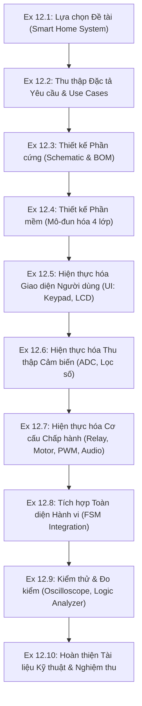

# CHƯƠNG 12: HƯỚNG DẪN THIẾT KẾ VÀ HIỆN THỰC HÓA DỰ ÁN HỆ THỐNG NHÚNG TRÊN STM32F407
*(Biên soạn dựa trên Chapter 12: Guide to Designing and Implementing an Embedded System Project - Arm Education Textbook, hiệu chỉnh chuyên sâu cho STM32F407)*

---

## 12.1. MỤC TIÊU CỦA CHƯƠNG
- **Bối cảnh kiến thức:** Sinh viên đã hoàn thành toàn bộ 11 chương lý thuyết và thực hành từng khối ngoại vi riêng lẻ; chương này là **Đồ án Đỉnh cao (Capstone Project)** giúp sinh viên tổng hợp toàn bộ kiến thức để thiết kế, chế tạo và kiểm thử một sản phẩm nhúng hoàn chỉnh theo quy chuẩn kỹ thuật công nghiệp.
- **Mục tiêu chi tiết:**
  1. Nắm vững phương pháp luận thiết kế sản phẩm nhúng chuyên nghiệp qua 10 bước chuẩn mực (từ khảo sát yêu cầu, thiết kế phần cứng, kiến trúc phần mềm, tích hợp đến lập tài liệu kỹ thuật).
  2. Lập bảng phân bổ tài nguyên chân vi điều khiển STM32F407 không xung đột (Conflict-Free Pin Allocation Table) tích hợp toàn bộ các ngoại vi đã học (GPIO, ADC, Timer/PWM, EXTI, I2C, SPI, UART, BLE, Wi-Fi, SD Card).
  3. Tính toán công suất nguồn cấp (Power Budget) và thiết kế mạch lọc nguồn, chống nhiễu công nghiệp (Decoupling capacitors, Ground plane, Opto cách ly).
  4. Xây dựng ma trận kiểm thử (Test Matrix), thực hiện đo kiểm dạng sóng tín hiệu thực tế trên máy hiện sóng / Logic Analyzer và biên soạn tài liệu báo cáo kỹ thuật chuẩn mực (Examples 12.1 $\div$ 12.10).

---

## 12.2. BẢNG PHÂN BỔ CHÂN PHẦN CỨNG HỆ THỐNG TỔNG HỢP TRÊN STM32F407 (KHÔNG XUNG ĐỘT)

Bảng phân bổ này đã được tính toán tối ưu, bảo đảm toàn bộ các khối ngoại vi trong suốt 12 chương đều hoạt động đồng thời trên kit STM32F407:

| Phân hệ chức năng | Thiết bị ngoại vi | Chân Pin STM32F407 | Khối ngoại vi phần cứng |
| :--- | :--- | :---: | :--- |
| **Báo động & Chỉ báo** | LED Báo động (Green) LED Sai mã (Red) LED Khóa hệ thống (Blue) | `PD12` `PD14` `PD15` | GPIO Output Push-Pull (Tận dụng LED có sẵn trên kit Discovery) |
| **Cảm biến Analog** | Biến trở đặt ngưỡng Cảm biến nhiệt độ LM35 Cảm biến khí gas MQ-2 Quang trở LDR | `PA1` `PA2` `PA3` `PA4` | `ADC1_IN1` `ADC1_IN2` `ADC1_IN3` `ADC1_IN4` |
| **Cảm biến Ngắt & Cơ cấu** | Cảm biến chuyển động PIR Relay 1 (Mở cổng) Relay 2 (Đóng cổng) Bảo vệ quá dòng động cơ | `PC4` `PC8` `PC9` `PC5` | `EXTI4` (Ngắt ngoài bắt sườn lên) GPIO Output qua Transistor/Opto GPIO Output qua Transistor/Opto `EXTI9_5` (Ngắt khẩn cấp) |
| **Giao diện Người dùng** | Bàn phím ma trận $4\times 4$ Màn hình LCD 16x2 | `PE7..PE10` (Hàng) `PE11..PE14` (Cột) `PB6` (SCL), `PB7` (SDA) | GPIO Output Open-Drain GPIO Input Pull-up `I2C1` Master (qua IC PCF8574) |
| **Thời gian thực** | Thạch anh LSE nội hoặc RTC DS3231 | `PC14, PC15` `PB6, PB7` | Khối RTC nội 32.768kHz Chia sẻ chung bus `I2C1` với LCD |
| **Hiển thị Đồ họa** | Màn hình OLED SSD1306 SPI | `PA5` (SCK), `PA7` (MOSI) `PB0` (CS), `PB1` (DC) | `SPI1` Master tốc độ cao |
| **Lưu trữ Nhật ký** | Module Thẻ nhớ MicroSD | `PB13` (SCK), `PB15` (MOSI) `PB14` (MISO), `PB12` (CS) | `SPI2` Master + Thư viện FatFS |
| **Chiếu sáng & Âm thanh** | Đèn chiếu sáng RGB Phát âm thanh thoại cảnh báo | `PD12, PD13, PD15` `PE9` | `TIM4_CH1, CH2, CH4` (PWM 1kHz) `TIM1_CH1` (PWM Audio 100kHz + Lọc RC) |
| **Giao tiếp Máy tính** | Cáp nạp ST-Link / USB-TTL | `PA9` (TX), `PA10` (RX) | `USART1` (115200 bps) |
| **Không dây BLE** | Module BLE HC-08 / HM-10 | `PB10` (TX), `PB11` (RX) | `USART3` (9600 bps) |
| **Mạng Wi-Fi IoT** | Module Wi-Fi ESP8266 | `PC6` (TX), `PC7` (RX) | `USART6` (115200 bps) |

---

## 12.3. TÍNH TOÁN CÔNG SUẤT VÀ THIẾT KẾ MẠCH NGUỒN CẤP (POWER BUDGET)
Tổng dòng điện tiêu thụ cực đại của toàn hệ thống khi tất cả ngoại vi cùng hoạt động:
- Vi điều khiển STM32F407 tại 168MHz: $I_{MCU} \approx 60\text{ mA}$.
- 4 LED chỉ báo ($5\text{ mA} \times 4$): $I_{LED} \approx 20\text{ mA}$.
- 2 Cuộn hút Relay 5V đóng cùng lúc: $I_{Relay} \approx 140\text{ mA}$.
- Động cơ DC khi khởi động tải: $I_{Motor} \approx 500\text{ mA} \div 1.5\text{ A}$ (dùng nguồn riêng 12V).
- Module Wi-Fi ESP8266 khi phát sóng RF đỉnh: $I_{ESP} \approx 200\text{ mA}$.
- Màn hình LCD + OLED + Module thẻ nhớ: $I_{Display} \approx 80\text{ mA}$.

> [!WARNING]
> **Nguyên tắc an toàn thiết kế mạch:**
> 1. Cổng USB máy tính hoặc chip ổn áp trên bo mạch STM32 chỉ cấp tối đa khoảng $300\text{ mA} \div 500\text{ mA}$, **không đủ dòng** để nuôi đồng thời ESP8266 và Relay. Bắt buộc phải sử dụng nguồn ngoài $5\text{V} - 2\text{A}$ qua IC hạ áp switching (LM2596) và ổn áp tuyến tính AMS1117-3.3V cấp riêng cho phần vô tuyến và cảm biến.
> 2. Động cơ DC phải dùng nguồn 12V riêng biệt, cách ly hoàn toàn với mass của vi điều khiển thông qua Optocoupler PC817 để chống xung ngược phá hủy chip STM32F407.

---

## 12.4. QUY TRÌNH 10 BƯỚC HIỆN THỰC HÓA DỰ ÁN (EXAMPLES 12.1 $\div$ 12.10)

---

## 12.5. MA TRẬN KIỂM THỬ TỔNG HỢP (TEST MATRIX) & BÁO CÁO KỸ THUẬT
Mỗi nhóm sinh viên bắt buộc phải thực hiện kiểm thử theo bảng ma trận 8 kịch bản (Test Cases) và chụp ảnh dạng sóng đo kiểm từ Máy hiện sóng/Logic Analyzer làm phụ lục báo cáo:
1. **Kiểm thử khởi động:** Đo điện áp nguồn $3.3\text{V}$ và $5\text{V}$ bằng DMM, kiểm tra mức độ gợn sóng (Ripple $< 50\text{mV}$).
2. **Kiểm thử bắt xung ngắt:** Bắt xung chuyển động PIR trên kênh Ch1 Oscilloscope, đo thời gian trễ từ sườn lên của chân `PC4` đến khi chân điều khiển Relay `PC8` xuất mức cao ($\Delta t < 100\mu\text{s}$).
3. **Kiểm thử khung truyền UART:** Bắt tín hiệu TX của `USART1` trên Logic Analyzer, giải mã chuỗi báo cáo nhiệt độ tại baudrate 115200 bps.
4. **Kiểm thử bus I2C:** Bắt tín hiệu SDA/SCL trên Logic Analyzer khi truyền lệnh ra LCD, kiểm tra xung ACK từ PCF8574.
5. **Kiểm thử đọc ghi thẻ SD:** Rút thẻ MicroSD ra cắm vào máy tính, mở file `alarm_log.csv` kiểm tra các dòng dữ liệu thời gian và sự kiện ghi nhận.
6. **Kiểm thử đóng mở cổng qua BLE:** Dùng app Smartphone gửi lệnh `"OPEN"`, kiểm tra động cơ quay mở và tự dừng sau đúng 5 giây.
7. **Kiểm thử Web Server Wi-Fi:** Mở trình duyệt Web truy cập địa chỉ IP của kit, kiểm tra giá trị nhiệt độ hiển thị khớp với cảm biến LM35.
8. **Kiểm thử tình huống khẩn cấp (Stress test):** Thử nghiệm nhập sai mã 5 lần liên tiếp $\rightarrow$ Hệ thống lập tức khóa cứng, còi hú báo động và gửi thông báo khẩn cấp lên màn hình Web.
