# CHƯƠNG 12: HƯỚNG DẪN THIẾT KẾ VÀ HIỆN THỰC HÓA DỰ ÁN HỆ THỐNG NHÚNG TRÊN STM32F407 (CAPSTONE PROJECT)
*(Biên soạn dựa trên Chapter 12: Guide to Designing and Implementing an Embedded System Project - Arm Education Textbook, hiệu chỉnh chuyên sâu cho STM32F407)*

---

## 12.1. MỤC TIÊU CỦA CHƯƠNG
- **Bối cảnh kiến thức:** Sinh viên đã hoàn thành toàn bộ 11 chương lý thuyết và thực hành từng khối ngoại vi riêng lẻ; chương này là **Đồ án Đỉnh cao (Capstone Project)** giúp sinh viên tổng hợp toàn bộ kiến thức để tự tay thiết kế, chế tạo phần cứng, lập trình kiến trúc mô-đun phân tầng và đo kiểm nghiệm thu một sản phẩm nhúng hoàn chỉnh đạt chuẩn kỹ thuật công nghiệp.
- **Mục tiêu chi tiết:**
  1. **Quy Trình Thiết Kế Kỹ Thuật Chuẩn V-Model:** Nắm vững quy trình 10 bước hiện thực hóa sản phẩm nhúng chuyên nghiệp (từ khảo sát yêu cầu, đặc tả chức năng, phân tích sơ đồ khối, thiết kế nguyên lý Schematic, tính toán BOM, kiến trúc phần mềm, tích hợp hệ thống, kiểm thử dạng sóng, đến hoàn thiện tài liệu kỹ thuật).
  2. **Thiết Kế Mạch Nguồn & Cân Đối Công Suất (Power Budget):** Phân tích và tính toán dòng điện tiêu thụ cho 3 đường nguồn độc lập: Đường logic số $3.3\text{V}$, đường phụ trợ $5\text{V}$, và đường động lực công suất $12\text{V}$. Thiết kế mạch bảo vệ chống cắm ngược cực, cầu chì tự phục hồi PTC, mạch lọc gợn sóng nhiễu nguồn (Decoupling Capacitors) và kỹ thuật phân tách điểm tiếp địa (Star Grounding / Ground Plane).
  3. **Lập Bảng Phân Bổ Chân Phần Cứng Không Xung Đột (Master Pinout):** Tích hợp đồng thời **10 khối ngoại vi** trên một vi điều khiển STM32F407 duy nhất (GPIO, ADC, 1-Wire, I2C, SPI OLED, SPI SD Card, NVIC EXTI Motor, TIM PWM RGB, TIM PWM Audio 100kHz, BLE USART3, Wi-Fi USART6, PC Console USART2).
  4. **Kiến Trúc Phần Mềm Phân Tầng Siêu Vòng Lặp Không Chặn (Non-blocking Layered Architecture):** Xây dựng siêu vòng lặp điều phối (Super Loop Dispatcher) kết hợp máy trạng thái FSM lõi, phân tách trách nhiệm hoàn toàn giữa tầng Trình điều khiển phần cứng (Hardware Drivers), tầng Dịch vụ (Services) và tầng Ứng dụng (Application).
  5. **Kiểm Thử Đo Kiểm & Nghiệm Thu (Acceptance Test Matrix):** Xây dựng ma trận kiểm thử 10 kịch bản thực tế (TC-01 $\div$ TC-10), thao tác đo kiểm trên máy hiện sóng / Logic Analyzer và đánh giá sản phẩm theo bộ tiêu chuẩn Rubric CDIO / ABET.

---

## 12.2. CƠ SỞ LÝ THUYẾT THIẾT KẾ HỆ THỐNG NHÚNG CHUYÊN NGHIỆP

### 12.2.1. Quy Trình V-Model Trong Phát Triển Sản Phẩm Nhúng
Hệ thống nhúng công nghiệp đòi hỏi độ tin cậy và an toàn cực cao, do đó quy trình phát triển sản phẩm phải tuân thủ nghiêm ngặt mô hình chữ V (V-Model):

```
Yêu cầu Khách hàng / Đề tài                        Nghiệm thu Sản phẩm (Acceptance Test)
          \                                              /
     Đặc tả Kỹ thuật Hệ thống                      Kiểm thử Hệ thống Toàn diện (System Test)
            \                                            /
       Thiết kế Mạch Phần cứng                 Kiểm thử Tích hợp Mạch & Ngoại vi (Integration)
              \                                      /
         Kiến trúc Phần mềm Mô-đun             Kiểm thử Đơn vị Module (Unit Testing)
                \                                  /
                 ---> HIỆN THỰC HÓA MÃ NGUỒN C <---
```

#### Quy trình 10 bước chuẩn mực (Examples 12.1 $\div$ 12.10):
1. **Bước 1 (Ex 12.1 - Problem Selection):** Lựa chọn bài toán thực tế (Hệ Thống Nhà Thông Minh Đa Năng Smart Home System).
2. **Bước 2 (Ex 12.2 - Requirement Specification):** Xác định các ca sử dụng (Use Cases), chuẩn đầu ra, điều kiện môi trường hoạt động và ngân sách chi phí linh kiện (BOM Cost).
3. **Bước 3 (Ex 12.3 - Hardware Architecture):** Phân tích sơ đồ khối, lựa chọn chip vi điều khiển (STM32F407VGT6 Cortex-M4 168MHz), lập bảng phân bổ chân không xung đột, vẽ sơ đồ nguyên lý Schematic và tính toán linh kiện.
4. **Bước 4 (Ex 12.4 - Software Architecture):** Phân rã phần mềm thành 4 tầng kiến trúc (Application, Services, Device Drivers, BSP).
5. **Bước 5 (Ex 12.5 - User Interface):** Hiện thực hóa giao tiếp bàn phím ma trận $4\times 4$ và màn hình LCD 16x2 $I^2C$.
6. **Bước 6 (Ex 12.6 - Sensor Acquisition):** Hiện thực hóa đo đạc cảm biến Gas, cảm biến quá nhiệt, cảm biến ánh sáng LDR và cảm biến số 1-Wire DS18B20 kèm thuật toán lọc số.
7. **Bước 7 (Ex 12.7 - Actuation & Communication):** Hiện thực hóa mạch cầu Relay đảo chiều động cơ, ngắt NVIC, băm xung PWM đổi màu LED, phát âm thanh cảnh báo PCM, lưu trữ tệp thẻ nhớ SD FatFS, kết nối BLE Smartphone và Web Server Wi-Fi.
8. **Bước 8 (Ex 12.8 - System Integration):** Tích hợp toàn diện các mô-đun vào máy trạng thái hữu hạn FSM lõi trong siêu vòng lặp không chặn.
9. **Bước 9 (Ex 12.9 - Verification & Testing):** Thực thi ma trận kiểm thử chấp nhận, bắt dạng sóng bus I2C, SPI, 1-Wire, PWM trên Logic Analyzer và Oscilloscope.
10. **Bước 10 (Ex 12.10 - Documentation & Deployment):** Đóng gói sản phẩm, xuất bản hồ sơ thiết kế kỹ thuật, đồng bộ mã nguồn lên Git và nghiệm thu trước Hội đồng.

---

### 12.2.2. Tính Toán Cân Đối Năng Lượng & Thiết Kế Mạch Nguồn (Power Budget)

#### 1. Bảng tính toán dòng điện tiêu thụ cực đại (Worst-case Current Consumption):
Để hệ thống không bao giờ bị sập nguồn khi tất cả các ngoại vi đồng loạt kích hoạt, kỹ sư nhúng phải lập bảng cân đối công suất:

| Khối Chức Năng / Ngoại Vi | Điện Áp Hoạt Động | Dòng Tiêu Thụ Trung Bình | Dòng Tiêu Thụ Đỉnh (Peak) | Ghi Chú Kỹ Thuật |
| :--- | :---: | :---: | :---: | :--- |
| **Lõi STM32F407 (168MHz)** | $3.3\text{V}$ | $60\text{mA}$ | $90\text{mA}$ | Bật ART Accelerator, PLL xung nhịp tối đa |
| **Hệ thống LED chỉ báo & RGB** | $3.3\text{V}$ | $15\text{mA}$ | $25\text{mA}$ | Đèn báo trạng thái + 3 kênh PWM LED |
| **Cảm biến Analog (LM35, LDR, Biến trở)** | $3.3\text{V}$ | $2\text{mA}$ | $5\text{mA}$ | Tiêu thụ rất nhỏ |
| **Cảm biến số 1-Wire DS18B20** | $3.3\text{V}$ | $1\text{mA}$ | $1.5\text{mA}$ | Khi đang chuyển đổi nhiệt độ |
| **Module Màn hình LCD 16x2 (I2C)** | $5.0\text{V}$ | $25\text{mA}$ | $40\text{mA}$ | Kèm dòng đèn nền Backlight LED |
| **Màn hình đồ họa OLED SSD1306 (SPI)** | $3.3\text{V}$ | $15\text{mA}$ | $25\text{mA}$ | Khi sáng toàn bộ điểm ảnh |
| **Thẻ nhớ MicroSD Card (SPI2)** | $3.3\text{V}$ | $20\text{mA}$ | $80\text{mA}$ | **Dòng đỉnh khi ghi khối Flash NAND** |
| **Module Không dây BLE HC-08** | $3.3\text{V}$ | $0.5\text{mA}$ | $15\text{mA}$ | Dòng đỉnh khi phát gói quảng bá RF |
| **Module Wi-Fi ESP8266** | $3.3\text{V}$ | $70\text{mA}$ | **$250 \div 300\text{mA}$** | **Dòng đỉnh phát sóng Wi-Fi công suất cao** |
| **2 Cuộn hút Relay 5VDC** | $5.0\text{V}$ | $0\text{mA}$ | **$140\text{mA}$** | Khi cả 2 rơ-le cùng đóng tiếp điểm |
| **Động cơ DC Cổng Trượt** | $12.0\text{V}$ | $300\text{mA}$ | **$1.2 \div 1.8\text{A}$** | **Dòng khởi động tải nặng hoặc khi kẹt cửa** |

#### 2. Phân tích thiết kế hệ thống nguồn đa tầng:
1. **Nguồn Động Lực ($12\text{VDC} / 2\text{A}$):** Cấp riêng cho động cơ DC qua tiếp điểm Relay. Tuyệt đối không đi chung đường mạch nguồn với vi điều khiển.
2. **Nguồn Phụ Trợ ($5\text{VDC} / 2\text{A}$):** Lấy từ bộ đổi nguồn Adapter xung hoặc hạ áp switching LM2596 từ 12V xuống 5V (hiệu suất $> 85\%$). Dùng nuôi cuộn hút Relay và đèn nền màn hình LCD 1602.
3. **Nguồn Logic Số Ổn Định ($3.3\text{VDC} / 1\text{A}$):** Sử dụng IC ổn áp tuyến tính chất lượng cao **AMS1117-3.3V** hạ áp từ 5V xuống 3.3V. Cung cấp cho vi điều khiển STM32F407, thẻ nhớ SD, OLED, BLE và ESP8266.

```
       Nguồn Adapter Ngoài 12V/2A
                  |
                  +-----------------------------------------> Nguồn Động Cơ DC (12V)
                  |
              +-------+  (Hiệu suất > 85%)
              |LM2596 | (Hạ áp Switching)
              +-------+
                  |
                  +--- +5VDC -------------------------------> Nguồn Cuộn Hút Relay & LCD 1602
                  |
              +-------+
              |AMS1117| (Ổn áp Tuyến tính 3.3V/1A)
              +-------+
                  |
                  +--- +3.3VDC (Ổn định, gợn < 20mV) ------> Nguồn STM32F407, ESP8266, SD Card
```

---

## 12.3. SƠ ĐỒ KHỐI TỔNG THỂ & BẢNG PHÂN BỔ CHÂN HỆ THỐNG MASTER (CONFLICT-FREE)

### 12.3.1. Sơ đồ khối tích hợp toàn hệ thống Smart Home Capstone

```mermaid
graph TD
    subgraph POWER["HỆ THỐNG NGUỒN CẤP ĐA TẦNG"]
        PWR_12V["Nguồn Ngoài 12V/2A"] --> LM2596["Hạ áp Buck LM2596 (5V/2A)"]
        LM2596 --> AMS1117["Ổn áp LDO AMS1117 (3.3V/1A)"]
        PWR_12V --> MOTOR["Động Cơ DC Cổng Trượt"]
        LM2596 --> RELAYS["2 Relay SPDT 5V & LCD 1602"]
        AMS1117 --> MCU_SYS["STM32F407 & Các Ngoại Vi 3.3V"]
    end

    subgraph SENSING["PHÂN HỆ CẢM BIẾN & THU THẬP"]
        S_GAS["PE2: Cảm biến Gas (MQ-2)"] --> MCU["STM32F407VGT6<br>(Lõi ARM Cortex-M4 168MHz)"]
        S_TMP["PE3: Cảm biến Quá Nhiệt"] --> MCU
        S_POT["PA1: Biến trở đặt ngưỡng (ADC1_IN1)"] --> MCU
        S_LM35["PA2: Cảm biến nhiệt LM35 (ADC1_IN2)"] --> MCU
        S_LDR["PA4: Quang trở ánh sáng LDR (ADC1_IN4)"] --> MCU
        S_DS18["PB12: Cảm biến số 1-Wire DS18B20"] --> MCU
        S_PIR["PC4: Cảm biến chuyển động PIR (EXTI4)"] --> MCU
        S_EMG["PC5: Nút ngắt khẩn cấp / Kẹt cửa (EXTI5)"] --> MCU
    end

    subgraph HMI["PHÂN HỆ GIAO DIỆN NGƯỜI DÙNG"]
        MCU --> KEYPAD["PE7..PE10 & PE11..PE14: Phím ma trận 4x4"]
        MCU --> LCD["PB6 (SCL) & PB7 (SDA): LCD 16x2 I2C (PCF8574)"]
        MCU --> OLED["PA5 (SCK), PA7 (MOSI), PB0(CS), PB1(DC): OLED SPI"]
    end

    subgraph ACTUATION["PHÂN HỆ CHẤP HÀNH & CẢNH BÁO"]
        MCU --> RELAY_ACT["PC8 & PC9: Điều khiển 2 Relay Mở/Đóng Cổng"]
        MCU --> RGB_LED["PD12, PD13, PD15: PWM LED RGB Bù Sáng (TIM4)"]
        MCU --> AUDIO["PE9: PWM Sóng mang 100kHz (TIM1) + Lọc RC Loa Thoại"]
    end

    subgraph CONNECTIVITY["PHÂN HỆ KẾT NỐI & LƯU TRỮ"]
        MCU --> SD["PB13..PB15: Thẻ nhớ MicroSD FatFS (SPI2)"]
        MCU --> BLE["PB10 (TX) & PB11 (RX): Bluetooth BLE Smartphone (USART3)"]
        MCU --> WIFI["PC6 (TX) & PC7 (RX): Wi-Fi ESP8266 Web Server (USART6)"]
        MCU --> CONSOLE["PA2 (TX) & PA3 (RX): Cổng Serial Debug PC (USART2)"]
    end
```



---

### 12.3.2. Bảng Phân Bổ Chân Phần Cứng Toàn Diện STM32F407 (Master Conflict-Free Pinout)

Bảng phân bổ này đã được tính toán tối ưu, bảo đảm **100% không trùng chân (No Pin Conflicts)** giữa tất cả các chức năng:

| STT | Chân STM32F407 | Tên Tín Hiệu | Chức Năng Phần Cứng / Alternate Function | Cấu Hình CubeMX | Thiết Bị Ngoại Vi Kết Nối | Mức Điện Áp An Toàn |
| :---: | :---: | :---: | :---: | :--- | :--- | :--- |
| 1 | `PA1` | `ADC_POT` | `ADC1_IN1` | Analog Mode | Chân giữa biến trở chỉnh ngưỡng an toàn | $0 \div 3.3\text{V}$ |
| 2 | `PA2` | `ADC_LM35` | `ADC1_IN2` | Analog Mode | Chân Vout cảm biến nhiệt độ tương tự LM35 | $0 \div 1.5\text{V}$ |
| 3 | `PA4` | `ADC_LDR` | `ADC1_IN4` | Analog Mode | Điểm giữa cầu phân áp quang trở LDR ($10\text{k}\Omega$) | $0 \div 3.0\text{V}$ |
| 4 | `PA5` | `OLED_SCK` | `SPI1_SCK` (AF5) | Alternate Function Push-Pull | Chân CLK màn hình đồ họa OLED SSD1306 | $3.3\text{V}$, tốc độ $10.5\text{ Mbps}$ |
| 5 | `PA7` | `OLED_MOSI`| `SPI1_MOSI` (AF5)| Alternate Function Push-Pull | Chân DIN / MOSI màn hình OLED SSD1306 | $3.3\text{V}$, tốc độ $10.5\text{ Mbps}$ |
| 6 | `PB0` | `OLED_CS` | GPIO_Output | Output Push-Pull, High Speed | Chân chọn chip $\overline{CS}$ màn hình OLED | $3.3\text{V}$, tích cực mức thấp (0) |
| 7 | `PB1` | `OLED_DC` | GPIO_Output | Output Push-Pull, High Speed | Chân chọn Lệnh/Dữ liệu ($D/\overline{C}$) của OLED | $3.3\text{V}$ (0 = Lệnh, 1 = Data) |
| 8 | `PB6` | `I2C1_SCL` | `I2C1_SCL` (AF4) | Alternate Function Open-Drain | Xung nhịp SCL bus I2C (LCD 16x2 PCF8574) | Kéo trở $4.7\text{k}\Omega$ lên 5V (Chân FT) |
| 9 | `PB7` | `I2C1_SDA` | `I2C1_SDA` (AF4) | Alternate Function Open-Drain | Dữ liệu SDA bus I2C (LCD 16x2 PCF8574) | Kéo trở $4.7\text{k}\Omega$ lên 5V (Chân FT) |
| 10 | `PB10`| `BLE_TX` | `USART3_TX` (AF7)| Alternate Function Push-Pull | Chân RXD của module Bluetooth BLE HC-08 | Mức logic $3.3\text{V}$ ($9600\text{ bps}$) |
| 11 | `PB11`| `BLE_RX` | `USART3_RX` (AF7)| Alternate Function Push-Pull | Chân TXD của module Bluetooth BLE HC-08 | Mức logic $3.3\text{V}$, ngắt nhận NVIC |
| 12 | `PB12`| `ONEWIRE_DQ`| GPIO_Output | Output Open-Drain, Very High | Dây tín hiệu 1-Wire cảm biến số DS18B20 | Mức logic $3.3\text{V}$ kèm trở kéo $4.7\text{k}\Omega$ |
| 13 | `PB13`| `SD_SCK` | `SPI2_SCK` (AF5) | Alternate Function Push-Pull | Xung nhịp SCK khe cắm thẻ MicroSD | Mức logic $3.3\text{V}$ ($10.5\text{ Mbps}$) |
| 14 | `PB14`| `SD_MISO` | `SPI2_MISO` (AF5)| Alternate Function, Pull-up nội | Đường dữ liệu DO từ thẻ MicroSD gửi về | Mức logic $3.3\text{V}$ |
| 15 | `PB15`| `SD_MOSI` | `SPI2_MOSI` (AF5)| Alternate Function Push-Pull | Đường dữ liệu DI vi điều khiển gửi xuống thẻ | Mức logic $3.3\text{V}$ |
| 16 | `PC4` | `PIR_EXTI` | `GPIO_EXTI4` | External Interrupt Rising Edge | Tín hiệu ngõ ra cảm biến chuyển động PIR | Mức logic $3.3\text{V}$, ưu tiên ngắt mức 2 |
| 17 | `PC5` | `EMG_EXTI` | `GPIO_EXTI5` | External Interrupt Falling Edge| Nút dừng khẩn cấp / Cảm biến kẹt cửa | Mức logic $3.3\text{V}$, **ưu tiên ngắt mức 0** |
| 18 | `PC6` | `WIFI_TX` | `USART6_TX` (AF8)| Alternate Function Push-Pull | Chân RXD của module Wi-Fi ESP8266 | Mức logic $3.3\text{V}$ ($115200\text{ bps}$) |
| 19 | `PC7` | `WIFI_RX` | `USART6_RX` (AF8)| Alternate Function Push-Pull | Chân TXD của module Wi-Fi ESP8266 | Mức logic $3.3\text{V}$, ngắt nhận NVIC |
| 20 | `PC8` | `RELAY_OPEN`| GPIO_Output | Output Push-Pull, High Speed | Lệnh mở cổng qua Relay 1 (Cực COM1 nối motor) | Mức logic $3.3\text{V}$ qua Opto PC817 |
| 21 | `PC9` | `RELAY_CLOSE`| GPIO_Output| Output Push-Pull, High Speed | Lệnh đóng cổng qua Relay 2 (Cực COM2 nối motor) | Mức logic $3.3\text{V}$ qua Opto PC817 |
| 22 | `PD12`| `PWM_RED` | `TIM4_CH1` (AF2) | Alternate Function Push-Pull | Kênh Đỏ đèn LED RGB (qua trở hạn dòng $330\Omega$)| Tần số $1\text{ kHz}$, Duty $0 \div 100\%$ |
| 23 | `PD13`| `PWM_GREEN`| `TIM4_CH2` (AF2) | Alternate Function Push-Pull | Kênh Lục đèn LED RGB (qua trở hạn dòng $120\Omega$)| Tần số $1\text{ kHz}$, Duty $0 \div 100\%$ |
| 24 | `PD14`| `LED_ALARM`| GPIO_Output | Output Push-Pull | Đèn LED đỏ báo động trung tâm trên kit | Mức logic $3.3\text{V}$ |
| 25 | `PD15`| `PWM_BLUE` | `TIM4_CH4` (AF2) | Alternate Function Push-Pull | Kênh Lam đèn LED RGB (qua trở hạn dòng $120\Omega$)| Tần số $1\text{ kHz}$, Duty $0 \div 100\%$ |
| 26 | `PE2` | `GAS_DIGITAL`| GPIO_Input | Input Mode, Pull-down | Tín hiệu số cảm biến khí gas MQ-2 | Mức logic $3.3\text{V}$ (1 = Có rò rỉ Gas) |
| 27 | `PE3` | `TEMP_SWITCH`| GPIO_Input | Input Mode, Pull-down | Tín hiệu công tắc nhiệt độ lưỡng kim bảo vệ | Mức logic $3.3\text{V}$ (1 = Quá nhiệt) |
| 28 | `PE7..10`| `KEY_ROW0..3`| GPIO_Output | Output Push-Pull, High Speed | 4 chân Hàng quét bàn phím ma trận $4\times 4$ | Mức logic $3.3\text{V}$ |
| 29 | `PE11..14`|`KEY_COL0..3`| GPIO_Input | Input Mode, Bật **Pull-up** nội | 4 chân Cột đọc bàn phím ma trận $4\times 4$ | Mức logic $3.3\text{V}$ |
| 30 | `PE9` | `AUDIO_PWM`| `TIM1_CH1` (AF1) | Alternate Function Push-Pull | Ngõ ra xung PWM mang âm thanh thoại $100\text{ kHz}$ | Nối mạch lọc RC ($1\text{k}\Omega+100\text{nF}$) ra Loa |

---

## 12.4. KIẾN TRÚC PHẦN MỀM SIÊU VÒNG LẶP KHÔNG CHẶN (CLEAN ARCHITECTURE)

Toàn bộ hệ thống được lập trình theo mô hình phân tầng chuẩn công nghiệp (Layered Architecture):

```c
/* ==============================================================================
   FILE: Core/Src/main.c - SIÊU VÒNG LẶP ĐIỀU PHỐI HỆ THỐNG CAPSTONE SMART HOME
   ============================================================================== */
#include "main.h"
#include "inputs.h"
#include "outputs.h"
#include "matrix_keypad.h"
#include "alarm_system.h"
#include "i2c_lcd.h"
#include "ssd1306_spi.h"
#include "ds18b20.h"
#include "ble_service.h"
#include "wifi_webserver.h"
#include "sd_logging.h"

int main(void)
{
    /* 1. Khởi tạo tầng HAL, Clock 168MHz và Bộ tăng tốc Flash ART */
    HAL_Init();
    SystemClock_Config();

    /* 2. Khởi tạo các khối phần cứng ngoại vi (CubeMX generated) */
    MX_GPIO_Init();
    MX_ADC1_Init();
    MX_I2C1_Init();
    MX_SPI1_Init();
    MX_SPI2_Init();
    MX_TIM1_Init();
    MX_TIM4_Init();
    MX_TIM6_Init();
    MX_USART2_UART_Init();
    MX_USART3_UART_Init();
    MX_USART6_UART_Init();
    MX_FATFS_Init();

    /* 3. Khởi tạo tầng trình điều khiển thiết bị (Drivers) */
    LCD_Init(&hi2c1);
    SSD1306_Init();
    DS18B20_Init();
    BLE_Init();
    ESP_StartWebServer("SmartHome_Lab", "12345678");

    /* 4. Khởi tạo tầng ứng dụng và máy trạng thái FSM */
    Inputs_Init();
    Outputs_Init();
    AlarmSystem_Init();

    /* Hiển thị màn hình khởi động */
    LCD_SetCursor(0, 0); LCD_SendString("SMART HOME F407");
    LCD_SetCursor(1, 0); LCD_SendString("ALL SYSTEMS OK! ");

    /* 5. Siêu vòng lặp điều phối chính (Non-blocking Super Loop) */
    while (1)
    {
        /* Nhiệm vụ 1: Quét bàn phím ma trận và máy trạng thái FSM bảo vệ */
        MatrixKeypad_Process();
        AlarmSystem_Process();

        /* Nhiệm vụ 2: Vòng lặp kín tự động điều chỉnh độ sáng đèn LED RGB (Chu kỳ 50ms) */
        LightingControl_FeedbackTask();

        /* Nhiệm vụ 3: Cập nhật thông số nhiệt độ DS18B20 và hiển thị LCD/OLED (Chu kỳ 500ms) */
        DisplayManager_Task();

        /* Nhiệm vụ 4: Xử lý các gói lệnh điều khiển không dây BLE từ Smartphone */
        BLE_Service_Process();

        /* Nhiệm vụ 5: Lắng nghe và phục vụ các yêu cầu HTTP từ Web Server Wi-Fi */
        WebServer_ProcessRequests();

        /* Nhiệm vụ 6: Ghi nhật ký thẻ nhớ SD FatFS khi có sự kiện báo động phát sinh */
        SD_Logging_Task();
    }
}
```

---

## 12.5. MA TRẬN KIỂM THỬ CHẤP NHẬN TOÀN DIỆN (ACCEPTANCE TEST MATRIX)

Sinh viên in sẵn bảng ma trận kiểm thử này để Hội đồng đánh giá nghiệm thu sản phẩm:

| Mã Test | Hạng Mục Kiểm Thử | Thao Tác Kích Hoạt | Hiện Tượng & Kết Quả Mong Đợi | Đánh Giá Hội Đồng |
| :---: | :--- | :--- | :--- | :---: |
| **TC-01** | Kiểm tra Nguồn điện & Khởi động | Bật công tắc nguồn $12\text{V}$ | Đo VOM: Nguồn 5V và 3.3V ổn định. Màn hình LCD và OLED sáng, hiển thị thông điệp khởi động. | [ ] ĐẠT |
| **TC-02** | Đo nhiệt độ số 1-Wire DS18B20 | Chạm ngón tay vào đầu dò DS18B20 | Nhiệt độ tăng đều trên LCD 1602 với độ phân giải $0.0625^\circ\text{C}$, biểu đồ OLED cuộn mượt mà. | [ ] ĐẠT |
| **TC-03** | Vòng hồi tiếp âm PWM LDR | Dùng tay che tối quang trở LDR | Đèn LED RGB tự động tăng độ sáng mượt mà để bù sáng; khi rọi đèn flash, LED RGB tự động tắt. | [ ] ĐẠT |
| **TC-04** | Bàn phím ma trận 4x4 & FSM | Nhấn chuỗi PIN `1234#` | Phím nhận diện nhạy, không rung phím. Hệ thống giải trừ `DISARMED`, phát tiếng bíp xác nhận. | [ ] ĐẠT |
| **TC-05** | Chu trình Động cơ Cổng & Relay | Kích hoạt cảm biến PIR `PC4` | Relay 1 đóng $\rightarrow$ động cơ mở cổng 4s $\rightarrow$ dừng chờ 5s $\rightarrow$ Relay 2 đóng cổng 4s. | [ ] ĐẠT |
| **TC-06** | Ngắt dừng khẩn cấp NVIC | Nhấn nút ngắt `PC5` khi motor chạy | Khối NVIC lập tức ngắt điện động cơ trong $< 1\mu s$. Đèn LED đỏ báo nguy nhấp nháy. | [ ] ĐẠT |
| **TC-07** | Báo động Âm thanh Thoại PWM | Giả lập rò rỉ khí Gas `PE2` | Loa phát ra câu thoại rõ ràng: *"Warning! Fire detected!"* bằng kỹ thuật PWM $100\text{ kHz}$ qua lọc RC. | [ ] ĐẠT |
| **TC-08** | Ghi nhật ký Thẻ nhớ SD FatFS | Tạo sự kiện báo động hỏa hoạn | Tháo thẻ nhớ cắm máy tính: Tệp `alarm_log.csv` ghi nhận bản ghi mới có đầy đủ mốc giờ và cảm biến. | [ ] ĐẠT |
| **TC-09** | Điều khiển Không dây BLE | Mở app điện thoại, gửi `OPEN` | Module nhận lệnh qua `USART3`, kích hoạt Relay mở cổng và phản hồi trạng thái về màn hình điện thoại. | [ ] ĐẠT |
| **TC-10** | Máy chủ Web Nhúng Wi-Fi | Gõ IP của STM32 trên trình duyệt | Dashboard HTML hiện ra đẹp mắt, nhấn nút "BẬT ĐÈN" trên trình duyệt, đèn LED phòng khách bật sáng tức thì. | [ ] ĐẠT |

---

## 12.6. BỘ TIÊU CHÍ RUBRIC ĐÁNH GIÁ NGHIỆM THU ĐỒ ÁN (THANG ĐIỂM 10)

| Tiêu Chí Đánh Giá (Chuẩn CDIO / ABET) | Trọng Số | Mức Xuất Sắc (9.0 - 10.0) | Mức Khá (7.0 - 8.9) | Mức Trung Bình (5.0 - 6.9) | Mức Không Đạt (< 5.0) |
| :--- | :---: | :--- | :--- | :--- | :--- |
| **1. Thiết kế Mạch Phần Cứng (BOM, Layout, An toàn)** | **20%** | Sơ đồ nguyên lý chuẩn mực, mạch nguồn 3 tầng cách ly quang hoàn hảo, có bảo vệ chống xung ngược, đấu nối cực kỳ gọn gàng. | Mạch lắp ráp chạy tốt, có bảo vệ cơ bản, dây nối hơi lộn xộn. | Mạch chạy được nhưng nguồn cấp bị sụt áp nhẹ khi ESP8266 phát sóng, thiếu tụ lọc. | Mạch đấu nối sai, gây chập cháy linh kiện hoặc không hoạt động. |
| **2. Kiến Trúc Phần Mềm & Chất Lượng Code** | **25%** | Mô-đun hóa 100% đạt chuẩn MISRA-C, không dùng hàm trễ delay chặn, đóng gói `static/extern` an toàn, tài liệu chú thích rõ ràng. | Phân chia mô-đun tốt, nhưng còn 1-2 biến toàn cục dùng chung chưa kiểm soát. | Mã nguồn dồn nhiều trong `main.c`, còn dùng hàm `HAL_Delay` gây trễ hệ thống. | Sao chép mã nguồn không hiểu bản chất, phát sinh lỗi biên dịch. |
| **3. Khả Năng Tích Hợp Hệ Thống & Vận Hành** | **25%** | Đạt **10/10 tiêu chí** trong Ma trận kiểm thử chấp nhận, các khối ngoại vi hoạt động đồng thời mượt mà không xung đột. | Đạt **8 - 9 tiêu chí**, đôi lúc phản hồi Wi-Fi bị chậm khi tải nặng. | Đạt **5 - 7 tiêu chí**, một số ngoại vi không dây chập chờn. | Hệ thống treo cứng, xung đột chân hoặc không vận hành được kịch bản. |
| **4. Kỹ Năng Đo Kiểm Sóng Trên Thiết Bị Đo** | **15%** | Sử dụng thành thạo Oscilloscope và Logic Analyzer, bắt và giải thích chính xác dạng sóng I2C, SPI, 1-Wire, PWM trước Hội đồng. | Bắt được dạng sóng nhưng thao tác chỉnh trigger còn lúng túng. | Cần giảng viên gợi ý mới thiết lập được thang đo trên thiết bị. | Không biết sử dụng thiết bị đo trong phòng thí nghiệm. |
| **5. Hồ Sơ Kỹ Thuật, Quản Trị Git & Phản Biện** | **15%** | Báo cáo kỹ thuật chuyên nghiệp, kho Git lịch sử commit đều đặn theo nhóm, trả lời xuất sắc mọi câu hỏi phản biện của Hội đồng. | Báo cáo đầy đủ, commit Git tốt, trả lời được đa số câu hỏi. | Báo cáo sơ sài, chỉ có 1 commit dồn cục vào ngày cuối. | Không có báo cáo hoặc không trả lời được câu hỏi chuyên môn. |
