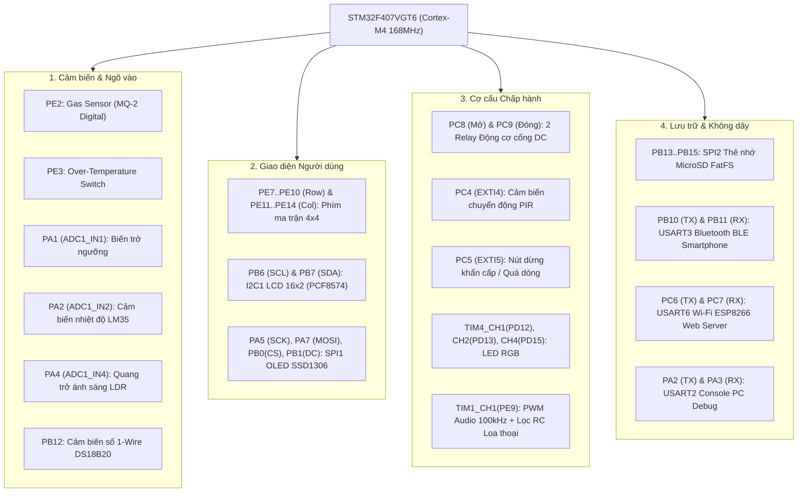

# BÀI THỰC HÀNH SỐ 15: TÍCH HỢP HỆ THỐNG NHÚNG CAPSTONE PROJECT - HỆ THỐNG NHÀ THÔNG MINH ĐA NGOẠI VI TRÊN STM32F407
**Học phần:** Điều khiển Thiết bị Ngoại vi & Ghép nối Hệ thống Nhúng (STM32F407)  
**Thời lượng:** 3 tiết (135 phút) | **Mô hình:** Studio (Nghiệm thu Đồ án Capstone & Báo cáo Phản biện)  
**Chuẩn đầu ra học phần (CLO):** CLO 1 $\div$ CLO 6 (Đánh giá toàn diện kiến thức, thiết kế phần cứng, lập trình hệ thống, đo kiểm, làm việc nhóm và đạo đức nghề nghiệp)  
**Căn cứ giáo trình:** *ARM Education - Chương 12: Design and Implementation of an Embedded System (Ex 12.1 $\div$ 12.10)*

---

## 1. MỤC TIÊU BÀI THÍ NGHIỆM TỔNG KẾT (CAPSTONE)
1. **Mục tiêu Tích hợp Hệ thống (System Integration):**
   - Kết nối và vận hành đồng bộ **10 khối ngoại vi** trên một kit vi điều khiển duy nhất STM32F407 không bị xung đột tài nguyên chân (Pin Conflicts) hay xung đột thời gian thực (Resource Contention).
   - Đảm bảo hệ thống hoạt động liên tục, ổn định theo thời gian thực (Real-Time Responsiveness) dưới mô hình kiến trúc phần mềm phân tầng không chặn (Non-blocking Layered Architecture).
2. **Kỹ năng Thiết kế & Đánh giá Kỹ thuật:**
   - Hoàn thiện tài liệu kỹ thuật sản phẩm: Sơ đồ khối hệ thống, Bản vẽ nguyên lý (Schematic), Danh mục vật tư linh kiện (BOM - Bill of Materials) và Bảng phân bổ chân STM32F407 toàn diện.
   - Xây dựng **Ma trận kiểm thử chấp nhận (Acceptance Test Matrix)** bao quát mọi tình huống vận hành bình thường và tình huống sự cố nguy cấp.
3. **Đánh giá Năng lực Sinh viên (Rubric Nghiệm thu):**
   - Đánh giá khả năng làm việc nhóm, trình bày giải pháp kỹ thuật, phản biện câu hỏi hóc búa của Hội đồng chấm thi và thao tác đo kiểm thực tế trên thiết bị đo (Logic Analyzer / Oscilloscope).

---

## 2. BẢNG PHÂN BỔ TÀI NGUYÊN TOÀN HỆ THỐNG TRÊN STM32F407 (MASTER PINOUT)

Hệ sinh thái ngoại vi tích hợp hoàn chỉnh không có bất kỳ chân nào bị trùng lặp:

---

## 3. KỊCH BẢN VẬN HÀNH TỔNG HỢP (COMPREHENSIVE USE CASES)

Sinh viên phải trình diễn trước Hội đồng 5 kịch bản tích hợp:

### Kịch bản 1: Giám sát Môi trường & Bù sáng Tự động (Environmental Adaptive)
- Cảm biến DS18B20 (`PB12`) và LM35 (`PA2`) đo nhiệt độ định kỳ. Giá trị nhiệt độ hiển thị đồng thời lên:
  - Dòng 1 màn hình LCD 16x2 $I^2C$.
  - Biểu đồ sóng nhiệt độ thời gian thực trên màn hình đồ họa OLED SSD1306 $SPI$.
  - Trang Web Dashboard giám sát qua Wi-Fi ESP8266.
- Quang trở LDR (`PA4`) liên tục giám sát ánh sáng phòng: Khi giảng viên che tối quang trở, đèn LED RGB tự động tăng độ sáng thông qua vòng hồi tiếp âm PWM `TIM4` để duy trì độ rọi ổn định.

### Kịch bản 2: Bảo vệ Nhà & Xác thực Mã PIN (Security & Access Control)
- Hệ thống ở trạng thái `ARMED` (Bật phòng vệ). Khi có người bước vào vùng quét của cảm biến PIR (`PC4`), ngắt `EXTI4` kích hoạt đếm ngược 10 giây.
- Người dùng tiếp cận bàn phím ma trận $4\times 4$, nhấn mã PIN `1234` kèm mốc thời gian RTC. Màn hình LCD hiển thị `PIN ACCEPTED`, hệ thống giải trừ về trạng thái an toàn `DISARMED`.
- Nếu nhập sai mã PIN quá 3 lần: Kích hoạt còi hú báo động dồn dập và ghi ngay dòng sự cố vào tệp `alarm_log.csv` trên thẻ nhớ MicroSD.

### Kịch bản 3: Tự động hóa Cổng trượt & Ngắt bảo vệ An toàn (Safety Interlock)
- Cổng trượt tự động mở qua Relay 1 (`PC8`).
- Trong quá trình cổng đang đóng qua Relay 2 (`PC9`), giảng viên tác động vật cản làm kích hoạt nút ngắt khẩn cấp `PC5`:
  - Khối NVIC lập tức kích hoạt ngắt ưu tiên cao nhất `EXTI9_5_IRQHandler` dừng tức thì động cơ trong vòng micro-giây.
  - Sau 1 giây, động cơ tự động đảo chiều quay ngược lại để giải phóng vật cản, bảo vệ an toàn tính mạng con người tuyệt đối.

### Kịch bản 4: Cảnh báo Hỏa hoạn & Phát Âm thanh Thoại PCM (Multi-modal Alarm)
- Khi phát hiện rò rỉ khí gas (`PE2`) kết hợp nhiệt độ vượt ngưỡng cài đặt trên biến trở (`PA1`):
  - Khối Timer `TIM1` (`PE9`) kết hợp ngắt `TIM6` lập tức phát câu cảnh báo thoại đã lưu trong bộ nhớ Flash: *"Warning! Fire detected!"* qua mạch lọc RC ra loa.
  - Đèn LED đỏ chớp tắt liên tục.
  - Hệ thống gửi bản tin cảnh báo khẩn cấp không dây về ứng dụng điện thoại BLE và đẩy trạng thái đỏ lên Web Dashboard Wi-Fi.

### Kịch bản 5: Điều khiển Từ xa Đa kênh (BLE Smartphone & Web Dashboard)
- Giảng viên sử dụng điện thoại thông minh:
  - Gửi lệnh qua Bluetooth BLE (App Serial Terminal) để đóng/mở cổng và xem trạng thái.
  - Mở trình duyệt Web truy cập địa chỉ IP của kit STM32F407 để bật/tắt thiết bị đèn chiếu sáng phòng khách.
  - Rút thẻ nhớ SD cắm vào máy tính, mở tệp `alarm_log.csv` kiểm tra toàn bộ lịch sử các sự kiện đã diễn ra với đầy đủ ngày giờ RTC.

---

## 4. MA TRẬN KIỂM THỬ CHẤP NHẬN (ACCEPTANCE TEST MATRIX)

Sinh viên in sẵn bảng này để Hội đồng kiểm tra và ký xác nhận từng tiêu chí:

| Mã Test | Tên bài kiểm tra | Thao tác kích hoạt | Kết quả mong đợi | Đạt / Không đạt |
| :---: | :--- | :--- | :--- | :---: |
| **TC-01** | Khởi động hệ thống | Cấp nguồn cho bo mạch | Tất cả các khối ngoại vi khởi tạo thành công, LCD hiển thị IP và trạng thái | [ ] ĐẠT |
| **TC-02** | Đo nhiệt độ DS18B20 | Chạm tay vào đầu dò DS18B20 | Nhiệt độ trên LCD & OLED tăng mượt mà với độ phân giải $0.0625^\circ\text{C}$ | [ ] ĐẠT |
| **TC-03** | Hồi tiếp âm PWM LDR | Che tối hoặc rọi đèn vào LDR | LED RGB thay đổi độ sáng tỷ lệ nghịch với ánh sáng môi trường | [ ] ĐẠT |
| **TC-04** | Bàn phím ma trận 4x4 | Nhập mã PIN 4 chữ số | Nhận diện phím chính xác không rung, đổi trạng thái FSM an toàn | [ ] ĐẠT |
| **TC-05** | Đảo chiều Động cơ | Kích hoạt PIR mở cổng | Relay 1 đóng $\rightarrow$ dừng $\rightarrow$ Relay 2 đóng, có cơ chế đảo chiều khi kẹt | [ ] ĐẠT |
| **TC-06** | Ngắt khẩn cấp NVIC | Nhấn nút ngắt `PC5` khi motor chạy | Động cơ ngắt điện tức thì trong $< 1\mu s$ | [ ] ĐẠT |
| **TC-07** | Phát âm thanh PWM Audio | Kích hoạt báo động Gas | Loa phát ra câu thoại/tiếng còi hú rõ ràng, không bị rè méo sóng mang | [ ] ĐẠT |
| **TC-08** | Ghi thẻ nhớ SD FatFS | Tạo sự kiện báo động | Tệp `alarm_log.csv` ghi nhận dòng mới với đầy đủ mốc thời gian RTC | [ ] ĐẠT |
| **TC-09** | Không dây BLE | Gửi lệnh từ Smartphone | Nhận lệnh và phản hồi telemetry qua Bluetooth trong bán kính 5m | [ ] ĐẠT |
| **TC-10** | Wi-Fi Web Server | Truy cập IP trên trình duyệt Web | Dashboard hiển thị giao diện đẹp mắt, bấm nút điều khiển thiết bị phản hồi tức thì | [ ] ĐẠT |

---

## 5. THỰC HÀNH ĐO KIỂM BẢO VỆ ĐỒ ÁN TRƯỚC HỘI ĐỒNG
Trong buổi nghiệm thu, mỗi nhóm sinh viên bốc thăm 1 trong 3 câu hỏi đo kiểm thực tế trên máy đo:
1. **Thao tác đo kiểm 1:** Kết nối Logic Analyzer vào bus I2C (`PB6, PB7`) hoặc SPI (`PA5, PA7`), bắt và giải mã trực tiếp gói tin truyền trước màn hình của Hội đồng.
2. **Thao tác đo kiểm 2:** Kết nối Oscilloscope vào chân PWM Audio `PE9` và chân sau lọc RC, chứng minh khả năng triệt tiêu sóng mang $100\text{ kHz}$ của mạch lọc.
3. **Thao tác đo kiểm 3:** Bắt giản đồ xung 1-Wire trên máy hiện sóng, giải thích các khoảng định thời Reset $480\mu s$ và Presence $120\mu s$ của cảm biến DS18B20.

---

## 6. RUBRIC ĐÁNH GIÁ NGHIỆM THU ĐỒ ÁN MÔN HỌC (THANG ĐIỂM 10)

| Tiêu chí đánh giá | Trọng số | Mức Xuất sắc (9.0 - 10.0) | Mức Khá (7.0 - 8.9) | Mức Trung bình (5.0 - 6.9) | Mức Không đạt (< 5.0) |
| :--- | :---: | :--- | :--- | :--- | :--- |
| **1. Thiết kế Mạch & Phần cứng** | **20%** | Mạch lắp ráp breadboard/PCB cực kỳ gọn gàng, tính toán trị số linh kiện chuẩn xác, có bảo vệ quá áp, cách ly quang hoàn hảo. | Mạch chạy tốt, gọn gàng, có tính toán trở nhưng chưa tối ưu dây cắm. | Mạch chạy được nhưng dây nhợ lộn xộn, thiếu mạch lọc chống nhiễu. | Mạch đấu nối sai, gây sụt áp hoặc chập cháy linh kiện. |
| **2. Chất lượng Mã nguồn & Kiến trúc** | **25%** | Mô-đun hóa 100% đạt chuẩn MISRA-C, không dùng delay chặn CPU, hàm `main.c` trong sáng, có đóng gói `static/extern`. | Mã nguồn mô-đun hóa nhưng còn vài biến toàn cục dùng chung chưa kiểm soát. | Mã nguồn gom nhiều trong 1-2 file, còn dùng hàm trễ blocking. | Mã nguồn sao chép không hiểu bản chất, phát sinh lỗi biên dịch. |
| **3. Khả năng Tích hợp & Vận hành** | **25%** | Vượt qua 10/10 bài kiểm tra trong Acceptance Test Matrix, hệ thống phản hồi mượt mà thời gian thực. | Vượt qua 8-9 bài kiểm tra, đôi lúc phản hồi chậm khi tải cao. | Vượt qua 5-7 bài kiểm tra, một số ngoại vi không dây chập chờn. | Hệ thống treo, xung đột ngoại vi, không vận hành được kịch bản. |
| **4. Đo kiểm & Giải thích Dạng sóng** | **15%** | Thao tác Oscilloscope / Logic Analyzer điêu luyện, giải thích cặn kẽ từng bit và hiện tượng vật lý. | Bắt được dạng sóng nhưng giải thích chưa thật sự sâu sắc. | Cần giảng viên hướng dẫn mới chỉnh được trigger trên máy đo. | Không biết sử dụng thiết bị đo kiểm trong phòng lab. |
| **5. Báo cáo, Git & Phản biện** | **15%** | Hồ sơ kỹ thuật chuyên nghiệp, kho Git lịch sử commit rõ ràng theo nhóm, trả lời xuất sắc câu hỏi phản biện. | Hồ sơ đầy đủ, commit Git tốt, trả lời được đa số câu hỏi. | Hồ sơ sơ sài, chỉ có 1-2 commit dồn cục trước hạn nộp. | Không có báo cáo hoặc không trả lời được câu hỏi chuyên môn. |