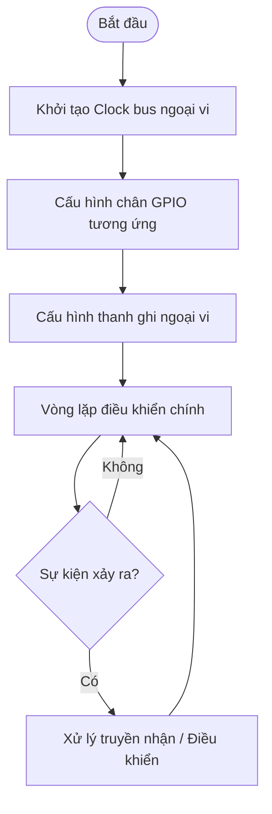

# [CHƯƠNG X]: [TÊN NGOẠI VI / CHỦ ĐỀ]

---

## 1. MỤC TIÊU CỦA CHƯƠNG (LEARNING OBJECTIVES)
- **Về kiến trúc & phần cứng:** 
  - Nắm vững cấu trúc khối phần cứng của ngoại vi trên dòng ARM Cortex-M4 (STM32F4).
  - Hiểu rõ nguyên lý hoạt động của các thanh ghi điều khiển chính.
- **Về thiết kế mạch ghép nối:** 
  - Đọc hiểu sơ đồ chân và tính toán các thông số linh kiện ghép nối ngoại vi (điện trở hạn dòng, mạch đệm công suất, cách ly quang, phối hợp mức logic).
- **Về lập trình & debug:** 
  - Cấu hình và lập trình thành thạo cả hai phương thức: Bare-metal (thao tác trực tiếp thanh ghi) và STM32 HAL Library.
  - Sử dụng các công cụ đo kiểm (Oscilloscope / Logic Analyzer) để phân tích tín hiệu.

---

## 2. CƠ SỞ LÝ THUYẾT VÀ NGUYÊN LÝ HOẠT ĐỘNG
### 2.1. Bản chất hoạt động của khối ngoại vi
*(Trình bày sơ đồ khối phần cứng, nguyên lý làm việc của mạch logic bên trong chip MCU)*

### 2.2. Phân tích các thanh ghi cấu hình (Register Breakdown)
| Tên thanh ghi | Địa chỉ Offset | Ý nghĩa các bit quan trọng | Giá trị Reset |
| :--- | :---: | :--- | :---: |
| `REG_CTRL` | `0x00` | Bit [0]: Enable; Bit [1..2]: Mode... | `0x00000000` |
| `REG_DATA` | `0x04` | Dữ liệu xuất/nhập 8-bit hoặc 16-bit | `0x00000000` |

### 2.3. Sơ đồ cây xung nhịp (Clock Tree) & Cấp nguồn cho ngoại vi
*(Phân tích ngoại vi nằm trên bus AHB hay APB1, APB2; thanh ghi `RCC_APBxENR` tương ứng)*

---

## 3. THIẾT KẾ MẠCH NGUYÊN LÝ GHÉP NỐI PHẦN CỨNG
### 3.1. Sơ đồ mạch nguyên lý (Hardware Schematic)
*(Chèn hình vẽ mạch nguyên lý hoặc sơ đồ khối kết nối chân giữa MCU và thiết bị ngoại vi)*

### 3.2. Tính toán và chọn lựa linh kiện
- Công thức tính toán điện áp / dòng điện:
  $$I_{out} = \frac{V_{CC} - V_{drop}}{R_{load}}$$
- Phân tích an toàn phần cứng: Chống nhiễu, cách ly mass (Ground loop isolation), diode dập xung ngược cuộn cảm ($V = -L \frac{di}{dt}$).

---

## 4. LƯU ĐỒ THUẬT TOÁN VÀ GIẢI THUẬT ĐIỀU KHIỂN


---

## 5. THIẾT KẾ PHẦN MỀM VÀ MÃ NGUỒN MẪU (CODE EXAMPLES)
### 5.1. Triển khai phương pháp Bare-Metal (Truy xuất thanh ghi trực tiếp)
```c
/**
 * @brief Khởi tạo và điều khiển ngoại vi cấp thanh ghi
 */
#include "stm32f4xx.h"

void Peripheral_Init_BareMetal(void) {
    // 1. Cấp xung clock cho ngoại vi
    RCC->AHB1ENR |= RCC_AHB1ENR_GPIODEN;
    
    // 2. Cấu hình chế độ chân
    GPIOD->MODER &= ~(3U << (12 * 2));
    GPIOD->MODER |=  (1U << (12 * 2)); // Chế độ Output
}
```

### 5.2. Triển khai phương pháp STM32 HAL / LL Drivers
```c
/**
 * @brief Khởi tạo và điều khiển ngoại vi sử dụng thư viện HAL
 */
#include "main.h"

void Peripheral_Process_HAL(void) {
    // Gọi các hàm API chuẩn của thư viện HAL
    HAL_GPIO_WritePin(GPIOD, GPIO_PIN_12, GPIO_PIN_SET);
    HAL_Delay(500);
    HAL_GPIO_WritePin(GPIOD, GPIO_PIN_12, GPIO_PIN_RESET);
    HAL_Delay(500);
}
```

---

## 6. CÁC LỖI KỸ THUẬT THƯỜNG GẶP VÀ CÁCH GỠ LỖI (TROUBLESHOOTING)
| Hiện tượng lỗi | Nguyên nhân gốc rễ | Giải pháp khắc phục |
| :--- | :--- | :--- |
| Ngoại vi không hoạt động, thanh ghi không ghi được giá trị | Chưa cấp xung clock qua thanh ghi `RCC` | Bật bit clock tương ứng trong `RCC_AHBxENR` hoặc `RCC_APBxENR` trước khi ghi thanh ghi |
| Dữ liệu truyền nhận bị sai lệch ngẫu nhiên | Sai tần số thạch anh cấu hình trong System Clock / Baudrate lệch > 2% | Kiểm tra lại cấu hình bộ nhân tần PLL và tần số thạch anh thực tế trên kit |
| Vi điều khiển bị treo / HardFault Handler | Truy xuất vào vùng nhớ ngoại vi chưa kích hoạt hoặc tràn bộ đệm mảng | Dùng ST-Link Debugger kiểm tra Call Stack và thanh ghi CFSR/HFSR |

---

## 7. CÂU HỎI ÔN TẬP VÀ BÀI TẬP THIẾT KẾ
### A. Câu hỏi lý thuyết củng cố
1. Câu 1: ...
2. Câu 2: ...

### B. Bài tập tính toán & thiết kế mạch
1. Bài 1: Tính toán giá trị điện trở hạn dòng và dòng tiêu thụ khi điều khiển...
2. Bài 2: Thiết kế sơ đồ nguyên lý ghép nối vi điều khiển STM32F4 với...

### C. Bài tập lập trình mở rộng
1. Viết chương trình điều khiển... kết hợp ngắt...
